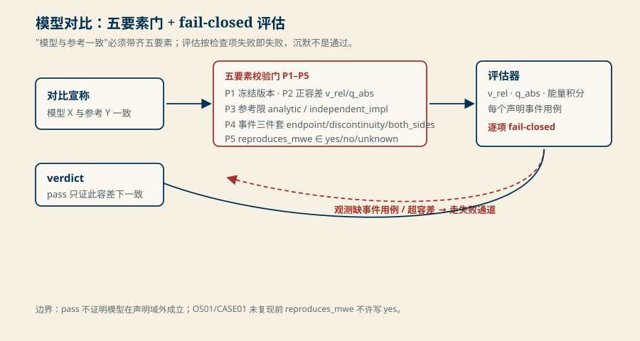

# R01 电化学模型

> 研究支线 R01：模型对比宣称的强度上限由对比协议决定。本单元交付**模型对比协议**（教学值）——它钉住"模型与参考一致"这句话必须带的五要素，不证明任何真实模型成立：OS01/CASE01 闭合前，所有对比保持教学身份。

## R01.1 定位

研究支线 R01 站在电化学模型的门口，先修 D01（端子证据）、D02（电芯模型）、D11（HPPC 与参数辨识）、D27（保真阶梯）。采用表给两个权威输入：

- **OS01 PyBaMM**：冻结可运行版本，交网格/容差研究与独立参考，能量积分对照；
- **CASE01 PyBaMM#5072/5205**：先建解析 ODE 基准（端点/左右侧/重复事件），并明确是否真的重现原 MWE。

"模型 X 与参考 Y 一致"是研究里最常被过度宣称的句子。R01 把它拆成五要素并做成机器可审的门。

**首步：安时漂积分（包内平均电压缓慢下降）——不懂得看你从这条口径起，对照代码册概念 P1/P2（若引用 bms-book/engineering 中的概念编号，先查代码册概念），逐步用状态量复算。**

## R01.2 证据分级与研究边界

- 离线方法工件：对比协议、五要素校验、按检查项 fail-closed 的评估器；
- 真实研究输入：OS01（PyBaMM，2026-11-18 E12 轻量基准本机核验，部分闭合）、CASE01（#5072/5205，2026-11-18 双版本×双求解器对照完成，紧容差归因探针判定**未复现**——差异落于容差路径）——快照材料见 `docs/superpowers/plans/2026-11-08-bms-open-source-snapshot.json`；
- 教学值：SPMe-teaching 种子协议与观测值。

## R01.3 机制：五要素协议与 fail-closed 评估

`code/engineering/research/r01_model_comparison.py`：



**五要素校验**（validate_spec，P1–P5）：

| 规则 | 检查 | 严重级 |
|---|---|---|
| P1 | `frozen_version` 必须是发布标签（v23.4.1 形）或 40 位 commit；其它字符串只有显式 `synthetic: true` 才放行——占位符不许装成冻结版本（`placeholder_version`） | error |
| P2 | 容差 `v_rel`/`q_abs` 必须存在且为正 | error |
| P3 | 参考只能是 `analytic` 或 `independent_impl`——"同组另一台机器跑的"不是参考 | error |
| P4 | 事件基准必须覆盖 CASE01 三件套：endpoint / discontinuity / both_sides | error |
| P5 | `reproduces_mwe` 三值 yes/no/unknown；"maybe" 不是回答，unknown 是诚实回答 | error |

**评估**（evaluate）先过协议门：`validate_spec` 有 error 级 findings、或事件用例表为空，直接 fail（`protocol_valid`/`has_event_cases` 检查项）——无效协议不许产出 passing verdict。门后按检查项 fail-closed：电压误差、容量误差、能量积分（若协议声明）、以及**每一个声明的事件用例**都必须通过；观测里缺事件用例即 fail——沉默不是通过。

## R01.4 反例教学：三种灌水对比

- 容差写 0 或干脆不写——"无限精度"与"没有标准"同义；
- 参考写成"作者的另一组运行"——同一错误实现跑两遍不会暴露错误；
- 事件基准只做端点——不连续事件处的左右侧行为（CASE01 的坑）永远不被检验。

## R01.5 动手验证（学生任务）

```bash
python -m pytest code/engineering/research -q
python code/engineering/research/r01_model_comparison.py
```

入门：跑通；把种子协议的 `reproduces_mwe` 从 unknown 改成 maybe 看 P5 说什么，再改回 unknown 看为什么诚实答案放行。
进阶：给种子协议加 `q_abs=0.0`、删掉 `both_sides`、把参考改成 `same_lab`，三次运行分别对到 P2/P4/P3。
精通：把 OS01 采用行的"网格/容差研究"要求译成协议的扩展字段（如 `grid_study: {n_pts: [...], observed: [...]}`），写校验与负例——你扩展的是协议，不是宣称。

## R01.6 冻结数字（E22）

- 种子协议：SPMe-teaching / `pybamm-teach-0.x-frozen-2026-11`（**显式 `synthetic: true` 的合成夹具**，非真实 pin），v_rel=0.01、q_abs=0.002，解析参考，能量积分开启，事件三件套齐，`reproduces_mwe=unknown`，`pybamm_integration=unverified`；
- 校验 findings 0；评估 verdict `pass`（v_rel 0.0042、q_abs 0.0009、能量积分通过、三事件全过）；
- 边界：pass 只证明**在此容差下与指定参考一致**，不证明模型在声明域外成立。

## R01.7 与相邻单元的关系

- D27 保真阶梯管"哪一级的模型不许说什么"，R01 管"说一致时必须带什么"——前者限域，后者举证；
- R03（老化与跨域验证）复用本协议做跨条件对比；OS08 的条件域限制是它的输入。

## R01.8 验收边界

- 协议 verdict pass 不构成任何模型对任何真实电芯的适用性证明；
- OS01/CASE01 未复现前，`reproduces_mwe` 不许写 yes；
- 种子是 synthetic 合成夹具：真实对比必须替换为真 pin（发布标签/commit）与独立参考实现，并保留本协议全部五要素；
- PyBaMM 集成与 MWE 复现保持 `unverified`：本单元评估只覆盖本地解析基准，不覆盖任何真实 PyBaMM 运行。

## 参考

- `code/engineering/research/r01_model_comparison.py` / `test_r01_model_comparison.py`
- `docs/superpowers/plans/bms-depth/source-adoption.md`（OS01/CASE01 采用行）
- 计划：P6 研究支线（`docs/superpowers/plans/2026-11-08-bms-depth-rebuild.md`）
