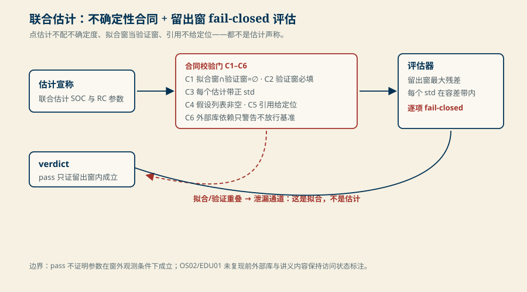

# R02 联合估计与不确定性

> 研究支线 R02：联合估计宣称的强度上限由它带的合同决定。本单元交付**联合估计不确定性合同**（教学值）——它钉住"联合估计 SOC 与参数"这句话必须带的分窗合同与不确定度凭证，不证明任何真实估计成立：OS02/EDU01 闭合前，所有估计保持教学身份。

## R02.1 定位

研究支线 R02 站在联合估计的门口，先修 D13（SOC 估计）、D14（参数辨识）。采用表给两个权威输入：

- **OS02 PyBOP**：拟合与验证分开进入合同；multipulse notebook 的 OCV 初值/时间去重/2RC 边界；追代价与优化结果；P4 G02——标准库基准先行，不依赖安装该库；
- **EDU01 UCCS/Plett**：引用公式连同假设，给得出页/节/公式号定位；原站访问待复核前标访问状态。

联合估计论文里最常见的三个窟窿：拿拟合窗的成绩当验证成绩、只报点估计不报 std、引一篇文献名当公式出处。R02 把三者做成机器可审的门。

## R02.2 证据分级与研究边界

- 离线方法工件：合同校验 C1–C6、按检查项 fail-closed 的评估器；
- 真实研究输入：OS02（PyBOP notebook）、EDU01（UCCS/Plett 讲义）——均为 read/待复核状态，未复现；
- 教学值：joint-EKF-teaching 合成种子（synthetic，无外部库依赖）。

## R02.3 机制：合同门与留出窗评估

`code/engineering/research/r02_joint_estimation.py`：



**合同校验**（validate_report，C1–C6）：

| 规则 | 检查 | 严重级 |
|---|---|---|
| C1 | 拟合窗与验证窗交集为空——重叠是泄漏，不是验证 | error |
| C2 | 验证窗必填——没有留出窗的"估计"只是拟合 | error |
| C3 | 每个估计必须带正 std——点估计单独不构成不确定度声称 | error |
| C4 | 假设列表非空（EDU01：公式必须连同假设登记） | error |
| C5 | 每条引用给得出页/节/公式号定位，只写文献名不算引用 | error |
| C6 | 声明外部库依赖即 error——教学合同硬约束：标准库基准先行（OS02 P4 G02），带依赖声明的合同评估不许 pass | error |

**评估**（evaluate）先过合同门：`validate_report` 有 error 级 findings、或 estimates 表为空，直接 fail（`contract_valid`/`has_estimates` 检查项）——无效合同不许产出 passing verdict。门后按检查项 fail-closed：留出验证窗最大残差在容差内，且**每一个**估计的 std 都落在容差带内（观测缺哪个估计的不确定度判定，哪个就 fail）。

## R02.4 反例教学：三种灌水估计

- 拟合窗验证窗重叠（C1）——同一批数据又当答案又当考卷；
- 三个参数只报值不报 std（C3）——"联合估计收敛了"与"联合估计有多确定"是两句话；
- 引用只写"Plett 讲义"（C5）——没有定位的引用无法复核，等于没有引用。

## R02.5 动手验证（学生任务）

```bash
python -m pytest code/engineering/research -q
python code/engineering/research/r02_joint_estimation.py
```

入门：跑通；把 `validation_window_ids` 清空看 C2，再放一个和拟合窗相同的 id 看 C1 的泄漏通道说什么。
进阶：删掉 `R1` 的 std 看 C3；把 `source_citations[0]` 的 locator 清空看 C5。
精通：把 OS02 的"追代价和优化结果"译成合同扩展字段（如 `cost_trace: {final, per_iter}`），加校验与负例——你扩展的是合同，不是宣称。

## R02.6 冻结数字（E23）

- 种子合同：joint-EKF-teaching / synthetic=True / external_lib=None；拟合窗 pulse-1、验证窗 pulse-2；R0=0.0012±0.0001、R1=0.0021±0.0004、C1=18000±900；容差 0.005；
- 校验 findings 0（warnings 0）；评估 verdict `pass`（留出窗最大残差 0.0018，三参数 std 全在带内）；
- 边界：pass 只证明**在留出窗内**残差与不确定度达标，不证明参数在窗外观测条件下成立。

## R02.7 与相邻单元的关系

- B05（先切分后看）管数据身份与泄漏，R02 管估计合同——C1/C2 是 B05 纪律在估计语境的复述；
- R01 的对比协议管"与参考一致"带什么，R02 管"联合估计"带什么——两者共同构成研究宣称的举证格式；
- D14 的参数辨识先修提供窗切分的工程语境。

## R02.8 验收边界

- 合同 verdict pass 不构成任何估计对任何真实电芯的适用性证明；
- OS02 未复现前，教学合同保持标准库硬约束：声明外部库依赖的合同直接 fail，不得替代标准库基准；
- EDU01 原站恢复访问前，讲义内容保持访问状态标注，引用只作为待核定位存在；
- 真实估计必须替换真数据、真留出窗与可核引用，并保留本合同全部要素。

## 参考

- `code/engineering/research/r02_joint_estimation.py` / `test_r02_joint_estimation.py`
- `docs/superpowers/plans/bms-depth/source-adoption.md`（OS02/EDU01 采用行）
- 计划：P6 研究支线（`docs/superpowers/plans/2026-11-08-bms-depth-rebuild.md`）
