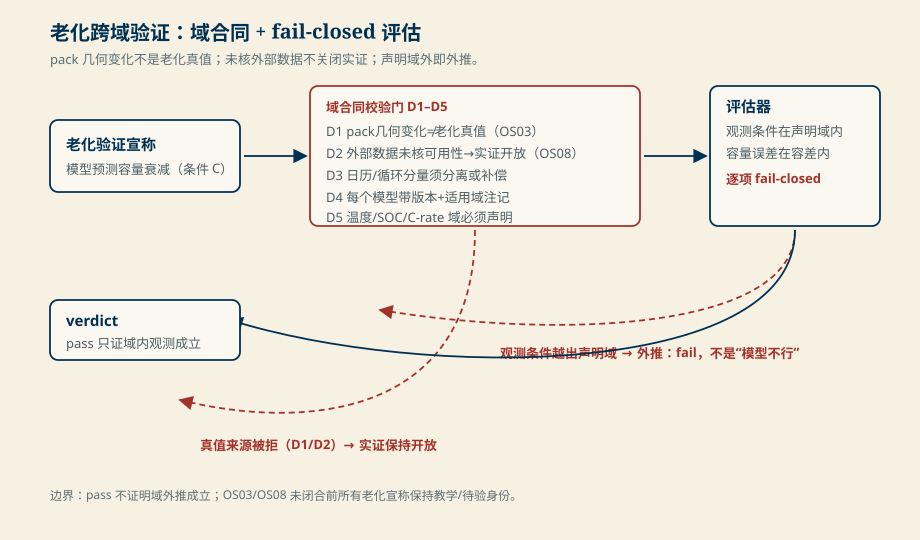

# R03 老化与跨域验证

> 研究支线 R03：老化验证宣称的强度上限由它带的域合同决定。本单元交付**老化跨域验证域合同**（教学值）——它钉住"模型预测容量衰减"这句话必须带的真值分级、分量归属与条件域声明，不证明任何真实老化模型成立：OS03/OS08 闭合前，所有老化宣称保持教学/待验身份。

## R03.1 定位

研究支线 R03 站在老化验证的门口，先修 D15（老化与寿命边界）、D16（快充与析锂边界）、D21（记录与可复现数据链）。采用表给两个权威输入：

- **OS03 liionpack**：几何变化不能充老化真值；setup_circuit 节点网络、两类拓扑、输入数组映射；冻结兼容依赖；逐节 KCL/KVL 与最弱项证据；
- **OS08 BLAST**：条件域/外推限制进入合同；250Ah LFP 原论文数据及条件组合；日历/循环分量补偿；Kokam 快算另建模型身份；**无外部数据不得关闭 R03 实证**。

老化研究里最常见的三个窟窿：拿 pack 改几何前后的差异当老化证据、把日历+循环混在一起的容量掉当循环老化、声明域外悄悄外推。R03 把三者做成机器可审的门。

## R03.2 证据分级与研究边界

- 离线方法工件：域合同校验 D1–D5、按检查项 fail-closed 的评估器；
- 真实研究输入：OS03（liionpack）、OS08（BLAST 250Ah LFP）——均为 read 状态，未复现，外部数据可用性未核；
- 教学值：synthetic 电芯级真值种子（calendar/cycle 分离）。

## R03.3 机制：域合同门与域内评估

`code/engineering/research/r03_aging_domain.py`：



**域合同校验**（validate_claim，D1–D5）：

| 规则 | 检查 | 严重级 |
|---|---|---|
| D1 | 真值来源为 pack 几何/拓扑变化 → 拒绝——几何变化不是老化真值（OS03） | error |
| D2 | 真值来源为未核可用性的外部数据 → 拒绝——实证保持开放（OS08）；`field_data` 必须 `verified_availability=True`（严格布尔）+ 可溯源 source_id，否则同样不许关闭实证 | error |
| D3 | 日历/循环分量必须各自 separated 或 compensated——混合数据不是循环老化证据 | error |
| D4 | 每个模型必须带 version + domain_note——Kokam 快算另建模型身份 | error |
| D5 | 温度/SOC/C-rate 条件域必须声明，且每轴为 `[lo, hi]` 数值对、`lo<hi`——畸形或反向界在进评估前即被拦下（`malformed_condition_domain`），不许靠崩掉当失败 | error |

**评估**（evaluate）先过合同门（error 级 findings 或无模型即 fail），再按检查项 fail-closed：观测的每个条件轴落在声明域内、容量相对误差在容差内。**出域观测 fail——那是外推，不是"模型不行"。**

## R03.4 反例教学：三种灌水老化验证

- pack 改了几何、重跑了仿真，说"对上了老化"（D1）——你验证的是几何变化，不是老化；
- 三个月存储 + 五十次循环混着测，说"循环老化率"（D3）——日历分量没分离，数字不属于循环；
- 论文数据拿过来直接对标，可用性没核（D2）——实证没关闭，只是看起来关了。

## R03.5 动手验证（学生任务）

```bash
python -m pytest code/engineering/research -q
python code/engineering/research/r03_aging_domain.py
```

入门：跑通；把 `ground_truth.kind` 改成 `pack_geometry_change` 看 D1，改成 `external_unverified` 看 D2。
进阶：把 `components.calendar` 改成 `unresolved` 看 D3；删掉 `models[0].version` 看 D4。
精通：把 OS03 的"逐节 KCL/KVL 与最弱项证据"译成合同扩展字段（如 `kcl_kvl_per_node: {node: {kcl_ok, kvl_ok}, weakest: id}`），加校验与负例——你扩展的是合同，不是宣称。

## R03.6 冻结数字（E24）

- 种子合同：aging-fade-teaching / synthetic=True；域 15–45°C、SOC 0.2–0.9、C-rate 0.2–1.5；真值 cell_level_test（日历/循环分离）；模型 semi-empirical-fade@teach-1.0 带域注记；容差 0.02；
- 校验 findings 0；评估 verdict `pass`（观测 25°C / SOC 0.5 / 0.5C 在域内，容量相对误差 0.008）；
- 边界：pass 只证明**域内观测**成立，不证明域外推成立；外部数据可用性核验前实证保持开放。

## R03.7 与相邻单元的关系

- R01 对比协议、R02 估计合同管"宣称带什么"，R03 管"老化宣称带什么"——三份合同共同构成研究宣称的举证格式；
- OS08 的条件域限制同时是 D15 寿命边界的输入——寿命结论不许越过已验证条件域（D27 全局保真地板）；
- D21 记录链提供真值来源的可复现身份。

## R03.8 验收边界

- 合同 verdict pass 不构成任何老化模型对真实寿命的预测证明；
- OS03/OS08 未闭合前，pack 级几何证据与未核外部数据不得作为老化真值；
- 真实老化验证必须替换为核过可用性的电芯级试验数据，并保留本合同全部要素。

## 参考

- `code/engineering/research/r03_aging_domain.py` / `test_r03_aging_domain.py`
- `docs/superpowers/plans/bms-depth/source-adoption.md`（OS03/OS08 采用行）
- 计划：P6 研究支线（`docs/superpowers/plans/2026-11-08-bms-depth-rebuild.md`）
