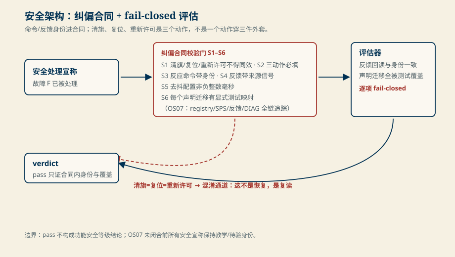

# R04 安全架构专题

> 研究支线 R04：安全处理宣称的强度上限由它带的纠偏合同决定。本单元交付**安全纠偏合同**（教学值）——它钉住"故障 F 已被处理"这句话必须带的命令/反馈身份、三态恢复区分、去抖与测试映射，不构成功能安全等级结论：OS07 闭合前，所有安全宣称保持教学/待验身份。

## R04.1 定位

研究支线 R04 与安全链 D22（诊断刷写）–D26（标定生产与在役）强耦合，先修 D24（架构审读）、D25（安全论证）、D26（在役）。采用表给权威输入：

- **OS07 foxBMS**：命令/反馈身份进入纠偏合同；从 registry / SPS / 反馈 / DIAG 回调追完整状态机和去抖配置/测试；**区分清旗、复位、重新许可**；P1/S3 G02 核心语义，P5/P6 完整链。

安全文档里最常见的三个窟窿：反应命令不写谁发的、故障"恢复"只有一步（清旗即复位即重新上电）、声明了状态迁移却拿不出对应测试。R04 把三者做成机器可审的门。

## R04.2 证据分级与研究边界

- 离线方法工件：纠偏合同校验 S1–S6、按检查项 fail-closed 的评估器；
- 真实研究输入：OS07（foxBMS 状态机与去抖配置）——read 状态，未复现；
- 教学值：HVIL-open 合成故障合同（synthetic，无真实状态机连接）。

## R04.3 机制：纠偏合同门与反馈一致性评估

`code/engineering/research/r04_safety_correction.py`：



**纠偏合同校验**（validate_contract，S1–S6）：

| 规则 | 检查 | 严重级 |
|---|---|---|
| S1 | 清旗/复位/重新许可按 `(actor, effect)` 元组比较——全同即混淆，多余元数据键不洗白 | error |
| S2 | 三个恢复动作必填，且每个动作 actor/effect 非空——`{}` 满足存在却不构成动作 | error |
| S3 | 反应命令必须带身份——谁有权发这条命令 | error |
| S4 | 预期反馈必须带来源信号——凭什么确认动作生效 | error |
| S5 | 去抖配置为非负整数毫秒 | error |
| S6 | 每个故障至少声明一条状态迁移，且每条迁移映射到已声明测试 ID——空迁移表与 bogus 映射都算无覆盖 | error |

**评估**（evaluate）先过合同门（error 级 findings 或无故障条目即 fail），再按检查项 fail-closed：观测反馈与声明的反馈身份一致、声明的每个迁移都被测试覆盖。**反馈对不上、迁移缺测——沉默不是通过。**

## R04.4 反例教学：三种灌水安全处理

- 反应命令只写"断开继电器"不写发令者（S3）——任何组件都能发令等于没人负责；
- 故障恢复只有"清故障码"一步（S1/S2）——清旗之后状态机在哪？复位谁做？重新许可谁批？一步冒充三步；
- 状态机图画了六条迁移，测试只有两个（S6）——图是愿望，测试才是证据。

## R04.5 动手验证（学生任务）

```bash
python -m pytest code/engineering/research -q
python code/engineering/research/r04_safety_correction.py
```

入门：跑通；把 `recovery.reset` 改成和 `clear_flag` 完全一样看 S1，删掉 `re_permission` 看 S2。
进阶：清空 `reaction.actor` 看 S3、清空 `feedback.source` 看 S4、把 `debounce_ms` 改成 -1 看 S5。
精通：把 OS07 的"registry/SPS/反馈/DIAG 回调全链"译成合同扩展字段（如 `trace_chain: [{hop: "registry->sps", test: "T-..."}]`），加校验与负例——你扩展的是合同，不是宣称。

## R04.6 冻结数字（E25）

- 种子合同：hvil-teaching / synthetic=True；故障 HVIL-open：检测=HVIL 回路电流采样，反应=断开主正/主负（actor=BMS 安全状态机），反馈=继电器状态回读（source=辅助触点回采），去抖 100ms；恢复三态互异（清旗=诊断服务清零故障码 / 复位=下电重启 / 重新许可=上电自检）；迁移两条各带测试映射；
- 校验 findings 0；评估 verdict `pass`（反馈一致、两迁移均被覆盖）；
- 边界：pass 只证明**合同内身份区分与测试覆盖**成立，不构成功能安全等级结论。

## R04.7 与相邻单元的关系

- D22–D26 安全链给出真实状态机、刷写与在役语境；R04 给出"宣称安全处理"的举证格式——D25 安全论证引用本合同的 verdict 时只能作为门内证据；
- R01–R03 的三份合同（对比/估计/老化）与 R04 共同构成研究宣称举证格式族；D27 全局保真地板禁止把本 verdict 升级为功能安全结论；
- D28 独立复核规则 I1–I3 可直接复用于本合同的复跑评审。

## R04.8 验收边界

- 合同 verdict pass 不构成任何功能安全等级（ASIL/SIL）结论；
- OS07 未闭合前，registry/SPS/反馈/DIAG 全链追踪保持 read 状态，种子合同不接真实状态机；
- 真实安全宣称必须接真实状态机与 HIL 测试证据，并保留本合同全部要素。

## 参考

- `code/engineering/research/r04_safety_correction.py` / `test_r04_safety_correction.py`
- `docs/superpowers/plans/bms-depth/source-adoption.md`（OS07 采用行）
- 计划：P6 研究支线（`docs/superpowers/plans/2026-11-08-bms-depth-rebuild.md`）
