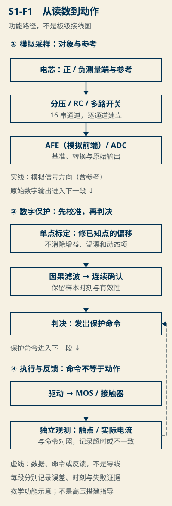
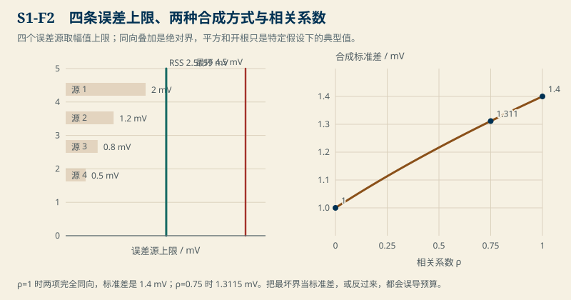
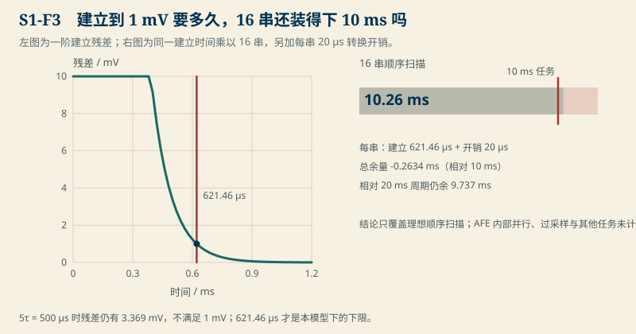
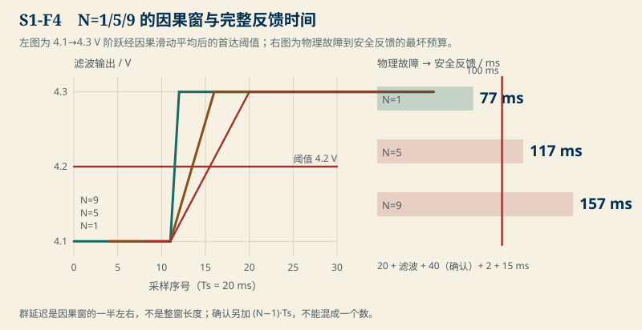

# S1　精度够了，保护为什么反而慢了

:::: story 现场
实验室里，一个采样链路的调试结论支持了“加一层滑动平均更稳”，但另两个样本让结论落地：看似更平滑的曲线延迟了过压检出。A 组验证保持现有设置，B 组让通道数翻倍，任务窗口不动。两组结果不一致，谁先出结果并不只看平均曲线漂不漂亮。
::::

<figure>

<figcaption>图 S1-F1　传感—校准—采样—保护的信号路径（代码真源机制图，非实测接线图）。校准只修固定偏差，滤波与确认负责噪声与误动作；四站缺任一站的证据，后续数字都不合格。</figcaption>
</figure>

<aside class="reading-bet" aria-label="开读押注">
<p class="reading-bet__eyebrow">开读押注 · 平均更平滑，但保护反而更慢</p>
<p>同一组过压数据，N=1/5/9 三个滑动窗都能把曲线变平。哪个窗最适合装进 100 ms 的故障反应窗口？</p>
<ol><li>N=1，最快</li><li>N=5，平滑且够快</li><li>N=9，最平滑</li></ol>
</aside>

:::: chapter-route 阅读路径

- **第一次主线**：S1.1–S1.6。先分清测量与动作两件事，再把误差、校准、建立和滤波的延迟一层层算出来。
- **第二遍深挖**：S1.7–S1.8。四张历史结果如何合成预算，哪些结论只在本教学场景成立。
- **动手验证**：S1.9。用冻结配置跑参考实现，再改一个参数重做；判据写在任务卡里，答案默认折叠。
::::

## S1.1 一条读数要过的四站

保护动作表面上是一句“电压到了就跳”，实际是一条信号链：被测对象 → 传感与调理 → 转换与标定 → 数据质量与时刻 → 保护反馈。每一站在链条里只承担一件事：传感分压与 RC 决定高电压如何降到采样窗，转换与标定决定一位数变成可信的电压值，滤波与确认决定这个值在噪声里走多远才算数，反馈决定“命令执行”是不是真的落下。先把四站分开，才能算出每一站的误差与延迟，而不是用“平均更平滑”一句话把整条链打包。

“平均后的曲线更稳”是测量这一站的结论；“检出更慢”是动作这一站的代价。传感分压与 RC、采样多路（每串一次）、转换与标定、滤波与连续确认，四者共同决定读数的可信度与时刻；独立反馈决定动作是否真实落下。本章不讲任何具体 AFE 的拓扑或数据手册，只讲这四站在教学参数下留下的证据与边界。

- **它不能证明**：本单元全是教学参数和合成边界；不证明任何具体 AFE 的数据手册指标、热设计或高压安全。高电压、化成与拆解只出现在名词或风险纪律，不作可照做的搭建指导。

## S1.2 先修入口

S1 先用两组数字和交直流对时直觉，不预设读者已学过协方差。

| 先修 | 用在哪里 | 补课位置 | 30 秒核对 |
|---|---|---|---|
| 极性与功率能量 | 判断电芯电压是谁的正负参考 | [B01 极性与功率能量](../bridges/B01-电路与能量.md) | 充电为正和放电为正如何换算 |
| 指数、积分与采样 | 一阶建立与离散确认 | [B02 指数、积分与采样](../bridges/B02-变化与采样.md) | dvp/dt = −vp/τ 的解与样本间隔 |
| 上界、协方差与两列最小二乘 | 误差到底怎样合成 | [B03 上界、协方差与两列最小二乘](../bridges/B03-误差矩阵与拟合.md) | ρ=0 与独立是同一件事吗 |
| 时钟、状态与反馈 | 确认、调度与反馈怎么拼 | [B04 时钟、状态与反馈](../bridges/B04-时间与状态.md) | 连续 N 拍需要几个间隔 |
| 数据身份与留出 | 什么时候允许下结论 | [B05 数据身份与留出](../bridges/B05-数据身份与留出.md) | 合成数据不能证明什么 |
| 端电压与内部状态 | 先有一个状态的身份 | P1 最小先修包 D01 | 端电压和 OCV 各自是什么 |

**核对题**（先写答案，再展开）：

1. 四个误差源上限 2/1.2/0.8/0.5 mV 同向叠加，最坏是多少？平方和开根又是多少？
2. 采样间隔 20 ms、连续 3 拍确认，需要几个间隔？温度为 20 ms 时是多久。
3. 单点校准修掉的是哪一类误差，没修的是哪几类？

<details>
<summary>核对答案</summary>

1. 同向最坏 4.5 mV；RSS = √(4+1.44+0.64+0.25) ≈ 2.51595 mV。RSS 只是不相关随机项的典型合成，不是绝对界。
2. 连续 3 拍要 2 个间隔，即 40 ms。第一遍计数不能算一次延迟。
3. 单点校准只修校准点的固定偏移；增益误差、MEMS 温漂、随机噪声和动态建立残差没修，未参加校准的点还留残差（见 S1.4）。

</details>

## S1.3 四个误差源怎样合成：最坏、RSS 与相关性

先把测量模型写正：

```text
y_i = (1 + g_c) V_i + b_c + b_i + α_i (T − T_0) + n_i + e_dynamic,i
```

读数 `y_i` 与真值 `V_i` 差在增益（`g_c`）、固定偏置（`b_c`）、通道偏置（`b_i`）、温漂（`α_i (T − T_0)`）、随机噪声（`n_i`）和动态建立残差（`e_dynamic,i`）六项上。每一项的量级、是否可估计、是否相关，决定能不能拿来算保险。

线性误差的最坏界是对系数取绝对值后的上限和；方差合成是平方加协方差：

```text
Σ a_i² σ_i² + 2 Σ_{i<j} a_i a_j Cov(ε_i, ε_j)
```

均方误差还含偏差平方，求均值不能自动去掉偏差。最大值不是 σ，不相关也不等于独立。

<figure>

<figcaption>图 S1-F2　共同误差与独立误差的合成。左：最坏界与 RSS 是两种不同假设；右：ρ=1 时标准差 1.4 mV，ρ=0.75 时 1.3115 mV。把最坏界当标准差、或把 RSS 当绝对界，预算都会错。</figcaption>
</figure>

左图给出本章冻结的四个上限：2、1.2、0.8、0.5 mV。同向叠加的最坏界是 4.5 mV；直接平方和开根得 2.51595 mV——这只是不相关随机项的典型合成，不能命名为“可用绝对界”。右图是两个 σ=0.6 与 0.8 mV 的噪声随相关系数 ρ 合成：ρ=0 时 1.0 mV，ρ=0.75 时 1.3115 mV，ρ=1 时 1.4 mV。参考文献只说能量密度等约束会把保真定到一段时间窗口，本章的合成同样受“假设先写清”约束。

## S1.4 一次校准真正修掉了什么

取测量链 `reading = 1.002 V + 0.012 V`。在校准点 3.7 V 附近读数比真值高 19.4 mV；减去这点固定偏移后，3.0 V 残差为 −1.4 mV，4.2 V 残差为 +1.0 mV（`code/engineering/measurement/s1_measurement.py` 给出 `correction_mv = −19.4`，残差见 `residual_mv`）。

这说明两件事：一，校准只修校准点的固定偏移；二，增益误差 0.2% 在离校准点 0.7 V 时仍留 1.4 mV 残差。单点校准够不够，看未参加校准点的残差，不看校准点的拟合程度。

因此单点校准不能代替双点校准与温度验收：增益分量需要双点分离，温漂需要扫温。把校准后的残差留进 S1.3 的合成：修掉固定偏置后，剩下的是增益残差、温漂、噪声与动态项，它们不再以 19.4 mV 的形式出现，也不能假定自动消失。

## S1.5 建立时间：从指数衰减到最坏等待

多路开关切到新通道时，模拟前端的电容从旧电压追向新电压。领先的取样看不见真实数值，只看见还没建立完的尾巴。用一阶有效模型描述这一段：

```text
|e(t)| = |ΔV| exp(−t/τ)
```

“等一会儿稳了”不是结论。要求残差 ≤ 1 mV 时，等待时间由上限反解：`t ≥ τ ln(|ΔV| / 1 mV)`。

冻结参数：τ = 100 µs，ΔV = 500 mV。`ln(500) ≈ 6.2146`，等待 ≥ 621.46 µs。对应的 5τ = 500 µs 残差仍有 `500 e^(−5) ≈ 3.369` mV——**5τ 不够**。5τ 只是工程里记住衰减到 0.67% 的粗口径；本场景的 0.2% 容差要求更长的 6.21τ。

这是一阶有效模型，不是所有 AFE 拓扑的承诺；不能把内部切换电容的全部细节想成同一颗开关。

<figure>

<figcaption>图 S1-F3　建立精度与 16 串扫描的时序对照。左：621.46 µs 才到 1 mV，5τ 不合格；右：16 串共 10.26337 ms，已超 10 ms 任务，放进 20 ms 周期仍余 9.7366 ms——两个结论不可互换。</figcaption>
</figure>

## S1.6 16 串顺序扫描装不装得下一个任务

若每串通道都要等这段建立时间，且每串另有 20 µs 转换开销，16 串顺序扫描为：

```text
16 × (621.46 + 20) µs = 10.26337 ms
```

它已超过 10 ms 的任务预算（余量 −0.26337 ms），但小于 20 ms 的采样周期（余量 9.7366 ms）。**两个结论各自成立，不能混用**：超任务不等于超周期，塞进周期不等于任务做得完。

这只是理想顺序扫描的下限；AFE 内部并行、过采样、丢弃等开销都没计入。若把 10.26337 ms 又盲加到 S1.7 的 77/117/157 ms 反馈预算上，或假装它能与滤波时间重叠而不给出起止时刻，预算就失真了。完整的 `S1-physical-chain` 要逐项冻结模拟建立、扫描相位、数字输出、确认、调度、驱动、反馈的起止时刻与是否重叠，本章只给两个独立场景（`S1-scan-settling` 与 `S1-filter-post-afe`）。

## S1.7 因果滑动平均：峰值稳定，群延迟还在

对 AFE 输出后的数字量做因果滑动平均：`m[n]` 只用当前及过去 N 个样本，每 Ts 更新一次。等方差、时间不相关的随机噪声下，平均的方差按 1/N 收缩（`σ²/N` 只限这一种对照）；若窗内任意两样本具有同一个相关系数 ρ（同均值平稳噪声、lag 复利的等相关假设，别无其它），方差因子为 `(1+(N−1)ρ)/N`。方差变小是真事，但它不是检出延迟。

冻结算例（`S1-filter-post-afe`，与前面的 RC 扫描实例分开登记）：Ts = 20 ms，物理阶跃 4100→4300 mV，触发条件为滤波输出 ≥ 4200 mV。完整预热历史下，N=1/5/9 窗的首达阈值相对首个高样本为 **0/40/80 ms**（首次越限序号 12/14/16，见 `filter_step_case`）。**群延迟不是通用检出延迟**：滑动窗每 Ts 出一个新均值，N·Ts 是窗覆盖时长而非数据更新时间；首达阈值取决于阈值在阶跃中的相对位置，本算例里分别是 0/2/4 个间隔（群延迟 `(N−1)Ts/2` 在这里分别是 0/40/80 ms 的近似参照，不是首达时间本身）。

确认另算：触发整定后还要连续 3 拍都≥阈值，对本算例另需 40 ms。把它写进 S1.8 的总预算，而不要折进滤波延迟里。

同一算例下，居中滑动平均在首个高样本就越限（序号 12）——因为它用了未来样本。这正是“用未来样本滤波”的直观形态：真实时链路里不存在，本章以后一律用因果窗。

<figure>

<figcaption>图 S1-F4　N=1/5/9 同轴曲线与完整反馈时间。确认另加 40 ms；100 ms 教学窗口只容许 N=1（77 ms），N=5/9 分别 117/157 ms 超出。</figcaption>
</figure>

## S1.8 把时间拼成一个预算

完整的物理故障到安全反馈最坏总时，由五段拼出：

```text
首拍 ≤ Ts + 滤波延迟 + 连续确认 + 判决 + 执行到反馈
```

代入本算例：首个高样本 ≤ 20 ms、判决 2 ms、执行到反馈 15 ms。于是 N=1 为 77 ms，N=5 为 117 ms，N=9 为 157 ms。100 ms 教学窗口只有 N=1（77 ms）能容下；N=5/9 超出，不能靠“曲线更平滑”消除。

这条预算只覆盖本教学场景。真实的 AFE 扫描相位、数字输出、调度优先级和驱动速度都要另行登记；`S1-physical-chain` 的完整物理链不在本章，见 S1.6 的纪律。调度加回字段也只对应本章的 Ts 与确认数，不代表商用 BMS 的协议或任务集。

## S1.9 动手验证

下面每题都能用冻结配置跑出数。先自己算，再跑 `python code/engineering/measurement/s1_measurement.py --out <dir>` 对答案；学生题在 `--students` 里（不泄答案）。

**题 1（改误差预算）**：把 `rss_limit_mv` 的四项轮换成 3/2/1/0.5 mV。新的最坏界是什么？新的 RSS 是什么？哪一个能写进安全裕量，哪个不能？

**题 2（改通道数与任务预算）**：把 `cell_count` 改为 24，并把 `task_budget_s` 设为 15 ms。顺序扫描共多少？相对 10 ms / 20 ms 分别剩多少？

**题 3（改滤波与确认）**：把 `confirm_samples` 改为 5，N 保持 5。完整反馈总时变成多少？100 ms 窗口还能装吗？

**诊断任务（独立）**：

1. **开线**：某通道开线后读数冻在上一次的值。日志给的是“电压看起来正常”。怎样用时间戳间隔与滤波窗的关系证明这段是“无新样本”，而不是“电压真的没变”？写一条能落到字段的判据。
2. **卡值**：采样值卡在 4.199 V，恰好在阈值下 1 mV。随后的真实过压被平均掉。用确认数和窗长解释卡值为什么没被发现，并给出让卡值现形的独立检查点。
3. **时间戳**：两组日志，一组用物理事件时刻，一组用采样序号当时间。为什么第二组在 3 拍确认里会少算 40 ms？写出哪一个字段（Ts、序号、N）是唯一能对齐两组日志的。

<details>
<summary>参考答案</summary>

- 题 1：最坏界 6.5 mV；RSS = √(9+4+1+0.25) ≈ 3.775 mV。安全裕量只能用 6.5 mV；3.775 mV 只是不相关典型值，不能当绝对界。
- 题 2：`24 × 641.46 µs ≈ 15.40 ms`。相对 10 ms 超 5.40 ms；相对 20 ms 仍余 4.60 ms。
- 题 3：确认从 40 ms 变成 80 ms，总时 157 ms；100 ms 窗口装不下。

诊断参考：开线看“连续多拍无变化且时间戳连续推进”——真信号不会一字不动加一个窗长，冻住的旧值会；卡值用“原始样本与滤波输出双门限”现形，滤波输出卡住时原始样本越限即告警；时间戳对齐靠 Ts 与序号推事件时刻，确认的 40 ms 正是 `(N−1)·Ts`，少算即把序号差当时间差。

</details>

## S1.10 三个错误实现必须能被测试拒绝

- **“均值去掉全部偏差”**：均值只能把随机方差按 1/N 收缩；固定偏置和增益残差不会被平均消掉（`test_confirmation_cost_is_n_minus_one_intervals` 之外的预算检查会让这类实现先在 S1.4 的残差上露馅）。
- **“RSS 全部最大值”**：RSS 限制在不相关随机项且无偏差平方时成立；`ρ=1` 时正确合成是 1.4 mV，不是 1.0 mV（`test_correlation_changes_the_sum_sigma` 覆盖 `ρ=1`）。
- **“用未来样本滤波”**：因果窗要求 `m[n]` 不用 `n+1` 往后的样本；居中窗在本算例用未来样本把首达并到第 12 拍，`test_centered_window_crosses_earlier_because_it_uses_future_samples` 专门锁住两者之差。

## S1.11 与 S2/S3 的关系

S1 管“读数可信与时刻”；S2 用这些可信读数去辨识内阻与极化。S1 的滤波延迟进入保护动作的预算后，会与 S3 的预充、上下电时序叠加。任一单元说“更平滑”或“更精确”时，先问：截止时间变了没有。

## S1.12 本单元已冻结的数字

- 最坏界 4.5 mV；RSS 2.51595 mV；合成σ 1 / 1.31149 / 1.4 mV。
- 单点校准 3.7 V，偏移 19.4 mV；3.0 V −1.4 mV、4.2 V +1.0 mV。
- 建立 621.46 µs；5τ 残差 3.369 mV；16 串扫描 10.26337 ms。
- 滤波延迟 0/40/80 ms；确认 40 ms；完整反馈 77/117/157 ms。

以上数字是教学参数，来自 `code/engineering/measurement/s1_measurement.py`。它们不可直接映射成任何具体硬件的规格。

## S1.13 装配边界

- **进入主站索引与批量扩写**：需要 P2 的门槛（窄屏 390/820 px、A4、离线阅读与真人试读证据），本样章尚未通过。
- **P2 装配**：本单元的正文、四张 SVG 目前放在 `bms-book/engineering/`，尚未进入 32 章清单；装配时必须补窄屏、A4 与离线版验收，并让真人读者走一遍 S1.9 的任务。这些证据目前**没有**，不能由本地测试替代。
