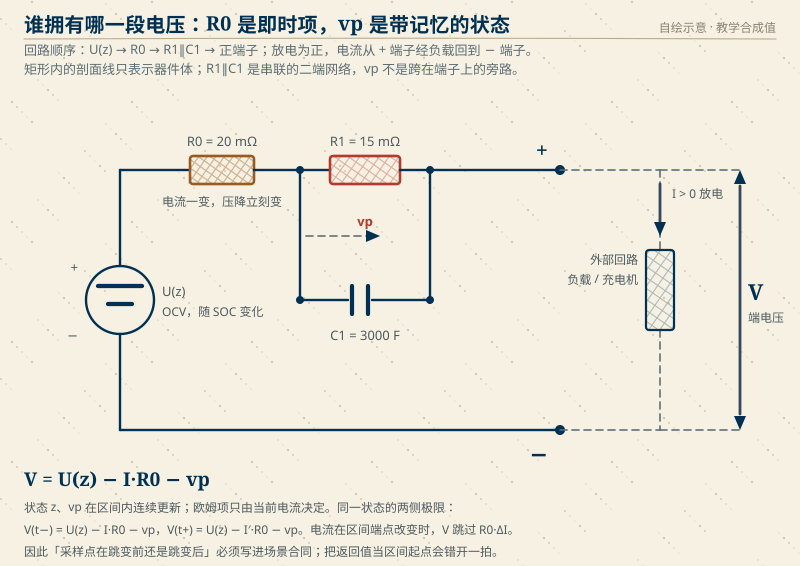
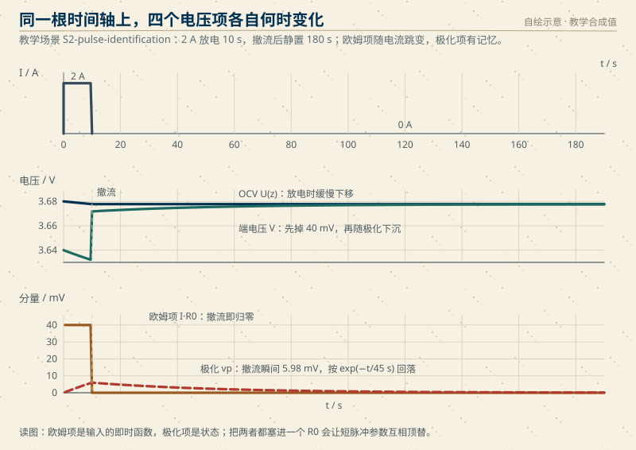
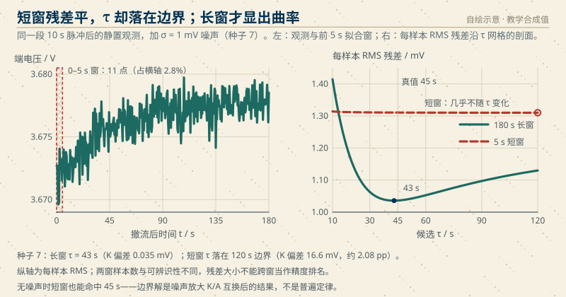
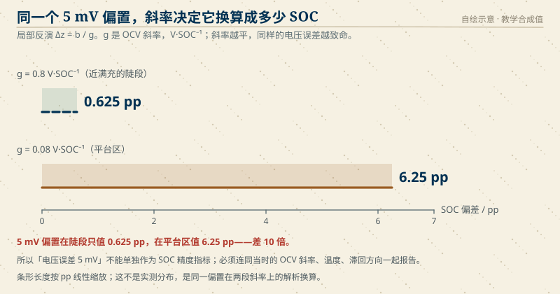
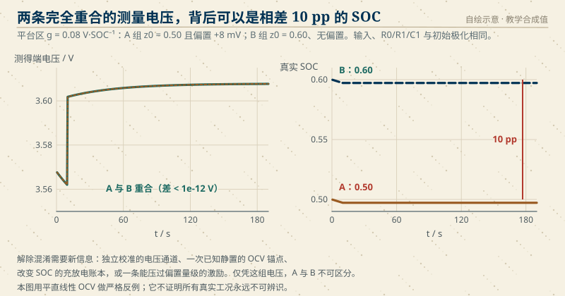

# S2　一条电压曲线能识别出多少东西

::: story 现场
同一份数据、同一台电脑，两个人给出两套参数。

甲只取撤流后的前 5 秒：内阻 142.5 mΩ，时间常数 120 s，电容 842 F。乙取完整 180 秒：内阻 15.1 mΩ，时间常数 43 s，电容 2842 F。数据里还叠着 1 mV 的白噪声。

两条曲线都贴着各自窗口内的数据，残差都小，却给出了不同的衰减速度。时间常数不是“退完所需时间”：本例真值 τ = 45 s，撤流 45 秒后极化项仍约为撤流瞬间的 36.8%，并未归零。

这一单元的任务不是选出一个"更顺眼"的答案，而是说明：这条曲线**在什么条件下**能定出 R0、R1、τ、C1 和 SOC，**在什么条件下不能**，不能时缺的是哪一条信息。
:::

<figure>

<figcaption>图 S2-0　概念图（AI 生成、非实测）：外部电压曲线不直接给出内部状态，状态卡是这一问题的比喻，不是电解液液位或电化学剖面。图中不提供测量数值，定量结论以 S2.5 的冻结配置与报告为准。</figcaption>
</figure>

<aside class="reading-bet" aria-label="开读押注">
<p class="reading-bet__eyebrow">开读押注 · 两份拟合都好看，信哪一份</p>
<p>同一段 10 s 脉冲后的静置数据，11 个点的短窗和 361 个点的长窗都能收敛。哪一组参数值得写进 BMS 参数表？</p>
<ol><li>短窗，离脉冲更近、更少受温度漂移影响</li><li>长窗，看见了曲线的弯曲</li><li>都不能直接信，要先看窗口长度和噪声量级</li></ol>
</aside>

::: chapter-route 阅读路径

- **第一次主线**：S2.1–S2.5。先看一条曲线如何被拆成欧姆项、极化项和 OCV，再走完"连续方程 → 离散 → 拟合 → 手算核对"。
- **第二遍深挖**：S2.6–S2.8。比较短窗与长窗、看四个反例、检查留出验证与局部可观性。
- **动手验证**：S2.9。用冻结配置跑参考实现，再换一个工况重做；判据写在任务卡里，答案默认折叠。
:::

## S2.1 两个答案，一条曲线

先把两套数字摆齐。它们来自同一份合成数据：2 Ah 电芯，2 A 恒流放电 10 s，撤流后静置 180 s，采样间隔 0.5 s，观测叠加 σ = 1 mV 的高斯噪声（随机种子 7）。生成这份数据的真实参数是 R0 = 20 mΩ、R1 = 15 mΩ、C1 = 3000 F，所以 τ = 45 s。

| 读法 | 拟合窗 | τ | R1 | C1 | 静置段 SOC 偏差 |
|---|---:|---:|---:|---:|---:|
| 甲 | 0–5 s（11 点） | 120 s（网格边界） | 142.5 mΩ | 842 F | +2.08 pp |
| 乙 | 0–180 s（361 点） | 43 s | 15.1 mΩ | 2842 F | +0.004 pp |
| 真值 | — | 45 s | 15 mΩ | 3000 F | 0 |

甲得到的是本窗内的网格最优候选，小残差不等于参数已被确定。5 秒只覆盖真值 τ 的 1/9，曲率在 1 mV 噪声下不明显；按 S2.4 的模型，这一小段近似为 $(K+A)-(A/\tau)t$。不同的 K、A、τ 可以互相补偿，保持起点 $K+A$ 与初斜率 $-A/\tau$ 接近，却给出很不一样的渐近电压和衰减速度。因此，11 个点拟合得贴，并不能证明 120 s 或由它换算出的 R1、C1 可靠。

乙的窗口覆盖 4 个真值 τ，在本场景的单 RC、恒温假设下看见了更多曲率，目标函数才对 τ 有更清晰的区分。种子 7 下，τ 误差为 2 s，R1 误差约 0.9%；这些误差仍需结合噪声与重复结果判断，不由残差单独给出。长窗也不是“更长就更准”：S2.6 会逐条列出十个种子的结果，无噪声时短窗同样能命中 45 s。

**本单元的交付物**：一份可复算的辨识报告。它必须能回答四个问题：

1. 这条曲线**唯一确定**了哪些量？（在冻结的模型与已知输入下）
2. 哪些量只能靠外部信息补？（SOC 初值、电压偏置、Q、采样链）
3. 参数落在搜索边界时，报告怎么写才不误导？
4. 换一个脉冲，同一组参数还能复现轨迹吗？

**它不能证明**：电芯的实际内阻、寿命状态、安全边界；也不证明参数在别的温度、别的 SOC、别的倍率下成立。本单元全部数字都是合成真值，来自提交进仓库的方程，不是台架实测。

## S2.2 先修入口

这一单元把四块已有知识拼在一起。任何一块松动，后面的结论都会跟着松。

| 先修 | 用在哪里 | 补课位置 | 30 秒核对 |
|---|---|---|---|
| 一阶线性微分方程与指数解 | 极化状态 vp 的演化 | [第 10 章 模型与 OCV](../book/10-模型OCV四项.md) | 若 dv/dt = −v/τ 且 v(0)=v₀，写出 v(t) |
| 最小二乘的正规方程 | 固定 τ 后解 K、A | [第 13 章 HPPC 参数辨识](../book/13-HPPC参数辨识.md) | 两个基函数几乎共线时，解会怎样 |
| 无真值下的诊断口径 | 没有独立 SOC 时怎么说话 | [第 17 章 无真值诊断](../book/17-无真值诊断.md) | "模型自洽"能证明什么、不能证明什么 |
| 曲线形状与参数混淆 | 短窗为什么看起来也顺 | [第 28 章 HPPC 曲线解剖](../book/28-HPPC曲线解剖.md) | 起点和初斜率相同的两条指数线，何时分开 |

**核对题**（先写答案，再展开）：

1. 采样间隔 Δt = 0.5 s、τ = 45 s 时，e^(−Δt/τ) 等于多少？它接近 1 意味着什么？
2. 若 OCV 对 SOC 的斜率 g = 0.8 V/SOC，5 mV 的电压偏置会让 SOC 偏多少？
3. 在 0–5 s 内，e^(−t/τ) 从 1 降到 0.895。两个基函数"1"和"e^(−t/τ)"的差别只有 10%，这对 K 与 A 的分离意味着什么？

<details>
<summary>核对答案</summary>

1. e^(−0.5/45) = 0.98895。相邻两拍只差 1.1%，所以单看两拍几乎分不出"状态在衰减"还是"截距不同"。
2. Δz = 5 mV / 0.8 V·SOC⁻¹ = 0.00625 SOC = 0.625 pp。若 g = 0.08，同样的 5 mV 变成 6.25 pp——差 10 倍。
3. 两个基函数在窗口内近似平行，正规方程的行列式很小；K 抬一点、A 压一点，残差几乎不变。这就是短窗的参数互换。

</details>

## S2.3 物理对象：谁拥有哪一段电压

模型只有三个元件，但每一个都要说清归属，否则符号一错，后面的拟合全部作废。

<figure>

<figcaption>图 S2-1　一阶 RC 等效电路与极性合同。回路顺序是 U(z) → R0 → R1∥C1 → 正端子：并联支路串联在回路里，若误画成跨接端子的旁路，端电压就不再是 OCV 减去两项压降。放电为正，电流从 + 端子经外部负载回到 − 端子；R0 是即时项，vp 是带记忆的状态。矩形内的剖面线只表示器件体，不是导体或电流路径。图为机制示意，参数取 S2-pulse-identification 的冻结值。</figcaption>
</figure>

**读图任务**：沿电流箭头走一圈，先确认 R1∥C1 是串联在回路里的二端网络、不是并接在端子上的负载；指出哪一段电压"电流一变就变"，哪一段"撤流后还在"。再看端子两侧：如果把采样点取在电流跳变之前，读到的端电压会差多少？

本模块的符号合同（与 [工程约定](../engineering-conventions.md) 一致）：

- 放电电流为正，`I > 0` 表示电芯对外输出；
- SOC 记为 $z\in[0,1]$，是比例不是百分数；
- 极化压降 $v_p\ge 0$ 从 OCV 中减去，充电时参与状态方程但**不取绝对值**；
- 旧接口 `code/soc` 保留充电为正：$I_{\text{legacy}}=-I$，$u_{rc}=-v_p$。跨模块引用时必须先换算，不能把两套符号接在同一条数据上。

**时钟合同**：$I[k]$ 作用在区间 $[t_k,t_{k+1})$；$z[k],v_p[k]$ 是 $t_k$ 时刻的状态；$t_k$ 时刻的端电压用该时刻生效的电流计算。于是首个样本是阶跃前极限，释放时刻的样本是撤流后极限。两个电压跳变都由同一状态的左右极限给出，与"采样得到的电压"分开报告。

| 类别 | 本场景中的量 | 说明 |
|---|---|---|
| 已测 | 端电压 $V_k$、电流时序 $I_k$ | 含 1 mV 噪声；电流为给定激励 |
| 已知 | $Q=2$ Ah、$\Delta t=0.5$ s、脉冲时长 $T_p=10$ s、静置 180 s | 由场景配置冻结 |
| 待估 | $R_0$、$R_1$、$C_1$、$\tau$、$K$（渐近电压） | 由一段撤流尾段拟合 |
| 由待估量导出 | 释放时刻的 $z$、$v_p$ | $z$ 由 $K$ 反演，$v_p$ 由 $A$ 反演 |
| 不可观测 | 电压偏置、真实 SOC 的绝对基准 | 本场景没有独立参考；只能声明"在给定假设下" |

## S2.4 从微分方程到可计算的拟合

### 连续方程

放电时，SOC 按库仑账下降，极化按一阶弛豫演化：

$$
\frac{dz}{dt}=-\frac{I}{3600\,Q},\qquad
\frac{dv_p}{dt}=-\frac{v_p}{\tau}+\frac{I}{C_1},\qquad
\tau=R_1C_1
$$

端电压把三项相减：

$$
V=U(z)-I\,R_0-v_p
$$

$U(z)$ 在本场景冻结为直线 $U(z)=3.6+0.8\,(z-0.5)$ V。这样选不是因为它像真实 OCV，而是因为它让每一个数都能手算复现；真实 OCV 的曲率是另一个场景，不能拿这里的结论去替代。

### 离散：为什么用指数系数而不是欧拉法

在一个采样区间内电流不变（零阶保持），上面两个方程都有解析解。SOC 是线性积分：

$$
z_{k+1}=z_k-\frac{I_k\,\Delta t}{3600\,Q}
$$

极化是一阶惯性环节，离散形式为

$$
v_{p,k+1}=a\,v_{p,k}+R_1(1-a)\,I_k,\qquad a=e^{-\Delta t/\tau}
$$

这个式子不是近似：在区间内 $I$ 恒定时，它就是连续解的精确值。用它做基准，采样间隔再大也不会混入离散化误差；后面比较"参数误差"时，误差只能来自辨识，不来自积分器。

### 撤流后的尾段

释放时刻 $t=0$ 之后 $I=0$，SOC 冻结在 $z_{\text{rest}}$，极化按 $e^{-t/\tau}$ 衰减。端电压变成

$$
V(t)=K+A\,e^{-t/\tau},\qquad
K=U(z_{\text{rest}}),\qquad
A=-v_p(0^+)
$$

主脉冲是放电，$v_p(0^+)>0$，所以 $A<0$：电压从低处向 $K$ 回升。注意 $K$ 是**渐近值**，不是最后一个样本；把末样本当 OCV 是一个独立的反例，见 S2.7。

$A$ 与元件参数的关系还差一步。脉冲持续 $T_p$，初值为零，释放瞬间的极化为

$$
v_p(0^+)=I\,R_1\left(1-e^{-T_p/\tau}\right)
$$

所以

$$
R_1=\frac{|A|}{I\left(1-e^{-T_p/\tau}\right)},\qquad
C_1=\frac{\tau}{R_1}
$$

括号里那一项就是**有限脉冲修正**。$T_p\gg\tau$ 时它趋近 1，可以忽略；本场景 $T_p=10$ s、$\tau=45$ s，它只有 0.1993。忽略它会把 R1 算成 2.99 mΩ，偏低 80%（S2.7 反例二）。

<figure>

<figcaption>图 S2-2　一条脉冲的电压账本，全部数值来自 S2-pulse-identification 的解析轨迹（无噪声）。欧姆项是输入的即时函数，极化项是状态；把两者都塞进一个 R0，会让短脉冲的参数互相顶替。</figcaption>
</figure>

**读图任务**：在 10 s 竖线处，找出"瞬间变化的那一截"和"之后才慢慢变化的那一截"。如果只用 0–5 s 的数据，你还能看见极化项的弯曲吗？

### 拟合合同

参考实现只做一件事：在撤流尾段上拟合 $K+A e^{-t/\tau}$，并且把每一步写成可复核的规则。

1. **数据**：只用 $t\ge 0$ 的静置样本，释放时刻那一点包含在内；脉冲段不参与。
2. **网格**：$\tau$ 在 10–120 s 上按 0.5 s 步长取 221 个候选点。$\tau$ 不进连续优化，避免初值依赖。
3. **线性子问题**：固定 $\tau$ 后，$K$ 与 $A$ 是线性的，用 2×2 正规方程闭式求解：

$$
\begin{bmatrix} n & \sum b_k \\ \sum b_k & \sum b_k^2 \end{bmatrix}
\begin{bmatrix} K \\ A \end{bmatrix}
=
\begin{bmatrix} \sum V_k \\ \sum V_k b_k \end{bmatrix},
\qquad b_k=e^{-t_k/\tau}
$$

4. **选择**：比较各候选的残差平方和，取最小者；同时报告归一化行列式 $\det/(n\sum b_k^2)$，它衡量两个基函数有多"平行"。
5. **边界**：若最优 $\tau$ 落在 10 s 或 120 s，必须标记 `tau_at_grid_boundary`。它仍是本次有限网格上的最优候选，但端点外侧未经比较；仅凭这个标记，既不能证明真值在网格外，也不能宣布最小二乘“无解”。应结合剖面平坦度、噪声与模型条件判断是否需要补数据或扩大网格复核，不能把边界候选直接写成已确认的物理参数。
6. **换算**：用 $R_1=|A|/[I(1-e^{-T_p/\tau})]$ 与 $C_1=\tau/R_1$ 回元件参数；$\tau=R_1C_1$ 是恒等式，不独立估计。
7. **验证**：另跑一个 30 s 脉冲，参数不回调。验证脉冲不参与网格选择，也不参与任何调参。

这套合同有一条容易忽略的纪律：**不用验证数据选模型**。如果看见验证误差大就回去改窗长、改网格，验证集立刻退化成训练集，后面的 RMSE 不再说明任何问题。

## S2.5 冻结参数与手算锚点

所有数字共用同一份配置，ID 为 `S2-pulse-identification`。改动其中任何一个字段，都必须登记新的场景 ID。

| 字段 | 值 | 单位 |
|---|---:|---|
| $Q$ | 2.0 | Ah |
| $R_0$ | 0.020 | Ω |
| $R_1$ | 0.015 | Ω |
| $C_1$ | 3000 | F |
| $\tau=R_1C_1$ | 45 | s |
| $U(z)$ | $3.6+0.8(z-0.5)$ | V |
| $z_0$ | 0.60 | — |
| $I$ | 2.0（放电） | A |
| $\Delta t$ | 0.5 | s |
| 脉冲 / 静置 | 10 / 180 | s |
| 噪声 | σ = 1 mV，种子 7 | V |

**手算四步**（先自己算，再对照）：

1. **欧姆跳变**：$I R_0=2\times0.020=40$ mV。它在电流加上和撤掉的两个瞬间都出现，方向相反。
2. **10 s 末的极化**：$2\times0.015\times(1-e^{-10/45})=5.977878$ mV；同一时段 SOC 降 $2\times10/(3600\times2)=0.277778$ pp。
3. **30 s 末（验证脉冲）**：$2\times0.015\times(1-e^{-30/45})=14.597486$ mV；SOC 降 0.833333 pp。
4. **从尾段反推**：若拟合得到 $|A|=5.977878$ mV、$\tau=45$ s，则 $1-e^{-10/45}=0.199263$，$R_1=5.977878/(2\times0.199263)=15.000$ mΩ，$C_1=45/0.015=3000$ F。

释放时刻的渐近电压 $K=U(0.597222)=3.677778$ V；把它代入 $U(z)$ 反解，得到 $z=0.597222$，与库仑账一致到 $10^{-15}$ 量级。

**跑一遍**（新目录，不覆盖旧证据）：

```text
python code/engineering/identification/s2_identification.py --out .tmp-s2
```

输出目录包含三个文件：

| 文件 | 内容 | 谁可以用它 |
|---|---|---|
| `config.json` | 冻结配置与场景 ID | 复现者、审阅者 |
| `observations.csv` | 逐拍时间、电流、SOC、vp、端电压 | 重新拟合、画图 |
| `report.json` | 锚点、拟合、验证、反例、限制 | 正文与图的唯一数值来源 |

报告里的 `input_digest` 把配置、τ 网格和种子一起哈希。本场景的摘要是 `sha256:69ee9bc2…0851`；配置改一个字段，摘要就变。摘要不是正确性证明，它只保证"你算的是这一份输入"。

无噪声基准的结果：361 个样本，τ = 45.0 s，R1 相对误差 $6.8\times10^{-14}$，C1 相对误差 $-6.8\times10^{-14}$，$z$ 误差 $1.2\times10^{-15}$，归一化行列式 0.519。这些数字的意义是**浮点一致性**——代码和解析式对得上，不是"参数很准"。

## S2.6 短窗与长窗：两种策略的取舍

<figure>

<figcaption>图 S2-3　同一段观测的两种读法。上：种子 7 的带噪恢复曲线，首点约 3.673 V（含 1 mV 噪声；无噪声释放值 3.6718 V），向渐近值 3.678 V 回升；虚线框是 5 s 窗（真实宽度，11 个样本），框内斜线只标窗口，不是误差带。下：每样本 RMS 残差（固定窗口下与残差平方和同解）沿 τ 的剖面；长窗在 43 s 有本窗 argmin，曲线形状不给置信区间。短窗整条曲线变化不到 0.4%，本窗 argmin 在 120 s 边界，但已知合成真值 45 s 就在网格内。两窗样本数与可辨识性不同，纵向残差不能直接当精度排名；无噪声短窗也能命中 45 s，不能据此宣称长窗普遍更好。</figcaption>
</figure>

**读图任务**：在上图里找 5 s 窗的位置，它占横轴多少？再看下图：短窗的最小值在 120 s 边界，但合成真值 45 s 在网格内。这一边界结果只说明当前网格选中了端点，不能据此断言真值在网格外；结合近乎平坦的剖面与噪声条件，本例应报告“τ 的证据不足”，不是“算法无解”。

下图的纵轴是每样本 RMS，只用于同一窗口内比较 τ 候选；极小点位置是 argmin，不是置信区间，也不是“参数一定准”的证明。两窗样本数与可辨识性不同，短窗的 RMS 数值不能直接拿去和长窗排名；真正支持下面比较的是十种子重复，而不是这张图看起来谁更低。

两种可行策略的对比：

| | 短窗（0–5 s） | 长窗（0–180 s） |
|---|---|---|
| 样本数 | 11 | 361 |
| 覆盖的 τ | 0.11 τ | 4 τ |
| 基函数归一化行列式（τ=45） | $1.2\times10^{-3}$ | 0.519 |
| 对温度漂移、SOC 变化的暴露 | 少 | 多 |
| 主要失效模式 | K/A 互换、τ 撞边界、R1 符号翻转 | 慢漂移污染、单指数假设破裂 |
| 代价 | 时间短、易安排 | 需要稳定静置、温控与更长的测试窗口 |

短窗的正规方程条件差两个数量级以上，这是"看起来也顺"的数学原因：两个基函数在窗口内几乎成比例，残差对 K 与 A 的具体分配不敏感。

十个种子（σ = 1 mV）的逐条结果：

| 种子 | 长窗 τ | 短窗 τ | 长窗 R1 | 短窗 R1 | 长窗 \|K 误差\| | 短窗 \|K 误差\| |
|---:|---:|---:|---:|---:|---:|---:|
| 0 | 40.0 | 120.0 | 14.02 mΩ | 193.9 mΩ | 0.131 mV | 24.54 mV |
| 1 | 46.5 | 120.0 | 16.15 mΩ | −56.3 mΩ | 0.115 mV | 14.32 mV |
| 2 | 52.0 | 120.0 | 16.24 mΩ | 145.9 mΩ | 0.082 mV | 17.53 mV |
| 3 | 52.0 | 10.0 | 16.41 mΩ | 3.8 mΩ | 0.142 mV | 1.79 mV |
| 4 | 38.5 | 10.0 | 13.38 mΩ | 0.6 mΩ | 0.066 mV | 4.79 mV |
| 5 | 54.0 | 120.0 | 16.98 mΩ | 212.8 mΩ | 0.245 mV | 27.70 mV |
| 6 | 44.5 | 120.0 | 15.60 mΩ | 45.7 mΩ | 0.114 mV | 1.11 mV |
| 7 | 43.0 | 120.0 | 15.13 mΩ | 142.5 mΩ | 0.035 mV | 16.61 mV |
| 8 | 47.5 | 120.0 | 15.31 mΩ | 161.0 mΩ | 0.014 mV | 19.73 mV |
| 9 | 41.5 | 120.0 | 13.84 mΩ | 338.4 mΩ | 0.076 mV | 47.09 mV |

十次里长窗在两项指标上都更好（10/10）；长窗 τ 误差 0.5–9 s，中位 4.25 s，短窗 10 次全部命中网格边界；短窗 K 误差的中位数是长窗的约 170 倍。种子 1 的短窗甚至给出**负的 R1**——非物理结果，任何下游参数表都必须拒绝。

但这不是普遍定律。无噪声时短窗同样能准确命中 45 s（S2.5 的无噪声基准用的是 0–180 s，若把窗截到 5 s，残差最小点仍在 45 s）。在本噪声水平与这十个种子中，缺少可见曲率的短窗把 K/A/τ 互偿放大成了不稳定的参数结果。报告因此显式写出：

```text
"universal_ordering_claim": false
"claim": "Scenario-specific observation; no universal ordering of short and long windows is asserted."
```

要证明"短窗总是更差"，需要覆盖电芯类型、温度、噪声谱、采样率的统计证据；本单元只有一组冻结场景，不能替这个结论背书。

## S2.7 正常与失败：四个反例

**最小正确例**：无噪声、同一脉冲，拟合参数与真值一致到 $10^{-13}$；这是代码正确性的基线，不是工程精度。

**边界例**：把场景改成 τ = 200 s（超出 10–120 s 网格），最优候选落在 120 s，报告 `tau_at_grid_boundary = true`。这里真值在网格外是由已知的合成配置确认的，不是边界标记本身证明的。120 s 仍是本次网格搜索的解，但 τ、R1、C1 尚不能作为已确认参数写进参数表；应记录“当前搜索与观测条件下证据不足”，再按模型与噪声条件决定扩大网格或调整静置窗口后重新验证。

**反例一：把最后一个样本当 OCV。** 末样本包含尚未衰减完的极化，直接当 $K$ 会低估 OCV：

| 静置时长 | 末样本偏差 | 折算 SOC 偏差 |
|---:|---:|---:|
| 5 s | −5.349 mV | −0.669 pp |
| 180 s | −0.109 mV | −0.0137 pp |

静置越短，偏差越大；这不是"传感器不准"，是模型把未衰减的状态误当成了稳态。

**反例二：忽略有限脉冲修正。** 直接令 $R_1=|A|/I$，得到 2.989 mΩ，相对误差 −80.07%；修正因子 $1-e^{-10/45}=0.1993$ 恰好是这个偏差的来源。脉冲越短、τ 越大，错得越多。

**反例三：短窗给出非物理参数。** 种子 1 的 5 s 窗拟出 R1 = −56.3 mΩ，而本单元的被动 RC 模型要求 R1 > 0。这说明“残差小”不等于“解有效”；参数表必须带符号与区间检查。

**反例四：平坦 OCV 上的偏置反演。**

<figure>

<figcaption>图 S2-4　同一个 5 mV 偏置，在不同 OCV 斜率上换算出的 SOC 误差相差十倍。条形按 pp 线性缩放，是解析换算，不是实测分布。</figcaption>
</figure>

局部反演公式只有一行：$\Delta z=b/g$。$g$ 越小，同样的电压误差越致命：

| 偏置 $b$ | $g=0.8$ V·SOC⁻¹ | $g=0.08$ V·SOC⁻¹ |
|---:|---:|---:|
| 5 mV | 0.625 pp | 6.25 pp |

这不是"平台区测量更难"的修辞，而是可计算的放大系数。报告里同一句话必须连同 $g$、温度和滞回方向一起给出，否则"电压误差 5 mV"无法换算成任何 SOC 指标。

<figure>

<figcaption>图 S2-5　严格反例：$U(z)=3.6+0.08(z-0.5)$，A 组 $z_0=0.50$、偏置 +8 mV，B 组 $z_0=0.60$、无偏置。输入、R0/R1/C1 与极化初值相同，382 个样本的电压最大差异为 0.0 V，而 SOC 相差 10 pp。</figcaption>
</figure>

这个反例是**严格**的：8 mV 正好等于 $g\times0.1$，两组电压逐点相等（最大差异 0.0 V），不是"近似重合"。它说明：在未知常数偏置存在时，电压轨迹只能确定 $gz+b$ 这一组合，$z$ 与 $b$ 无法分离。

解除混淆需要新信息：独立校准的电压通道、一次已知静置的 OCV 锚点、改变 SOC 的充放电账本，或者一条能压过偏置量级的激励。仅凭这组电压，A 与 B 不可区分。

同时要划清边界：本反例用平直线性 OCV 构造，它不证明所有真实工况永远不可辨识；真实 OCV 的曲率、滞回与温度依赖会提供额外约束。反例的作用是证明"仅凭这条曲线"不够，而不是否定一切辨识。

## S2.8 独立验证与局部可观性

### 留出验证

拟合用 10 s 脉冲，验证用 30 s 脉冲，静置同为 180 s。验证时只允许 R0/R1/C1/τ 来自拟合；Q、输入、脉冲时长、初值都按场景给定。轨迹共 422 个样本（1 个阶跃前样本 + 60 个脉冲样本 + 361 个静置样本）。

无噪声结果：

| 指标 | 值 |
|---|---:|
| RMSE | $4.39\times10^{-16}$ V |
| 最大绝对误差 | $1.33\times10^{-15}$ V |
| 样本数 | 422 |

这个量级说明的是"参数与解析式一致"，不是"模型能预测真实电芯"。30 s 脉冲与 10 s 脉冲共用同一组方程、同一颗电芯、同一个初值，它检验的是参数是否足以复现另一条激励轨迹，而不是模型阶数是否正确、参数能否跨电芯迁移。

**裁定规则**（写进任务卡）：若留出 RMSE 明显高于测量噪声底，或参数在不同窗口间跳动超过噪声传播的量级，或 τ 命中边界，则不宣布"辨识成功"。三者任一成立，报告只能给区间或"证据不足"。

数据角色也要分开写：

| 角色 | 本场景中的内容 |
|---|---|
| 观测 | 静置尾段电压（可含已声明的合成噪声） |
| 合成真值 | 由方程生成的 z、vp 与无噪声电压 |
| 预测 | 拟合参数与正向仿真轨迹 |
| 参考 | 无：本场景没有独立 SOC 测量 |

### 局部可观性

把静置段写成两拍的状态空间。状态 $x=[z,v_p]^T$，转移矩阵与观测行：

$$
F=\begin{bmatrix}1&0\\0&a\end{bmatrix},\qquad
H=\begin{bmatrix}g&-1\end{bmatrix}
$$

两拍观测矩阵

$$
\mathcal{O}=\begin{bmatrix}H\\HF\end{bmatrix}
=\begin{bmatrix}g&-1\\g&-a\end{bmatrix}
$$

其行列式为

$$
\det\mathcal{O}=g\,(1-a)
$$

这个式子把两件事绑在一起：

- $g=0$（OCV 对 SOC 完全平坦）时行列式为零，SOC 与极化的任意组合给出同一电压；局部不可观。
- $a\to1$（采样远快于 τ）时行列式趋小，单对样本的信息量少；但样本数增多可以累积信息，所以**小的行列式不等于全局不可辨识**。

数值对照（冻结参数）：

| 条件 | $a$ | $\det\mathcal{O}$ | 按百分点尺度（$\div100$） |
|---|---:|---:|---:|
| Δt = 0.5 s，g = 0.8 | 0.98895 | 0.008840 | $8.840\times10^{-5}$ |
| Δt = 5 s，g = 0.8 | 0.89484 | 0.084129 | $8.413\times10^{-4}$ |
| Δt = 0.5 s，g = 0.08 | 0.98895 | 0.000884 | $8.840\times10^{-6}$ |

**单位警告**：$\mathcal{O}$ 的第二列是 $-1$，无量纲；第一列是 $g$，单位 V/SOC。所以行列式的量纲只有 V·SOC⁻¹，不是 $V^2\cdot\text{SOC}^{-1}$。上表最后一列不是"放大"，而是换单位：若把 SOC 写成百分点 $p=100z$，则 $\partial z/\partial p=1/100$，$H$ 的 SOC 列从 $g$ 变成 $g/100$，行列式随之**缩小** 100 倍，量纲变成 V/pp。两列数字描述的是同一份信息，只是刻度不同；两者都不是误差界。要谈误差，必须回到具体的噪声模型与估计器。

还要避免一个逻辑跳跃：某一点 $g=0$ 只说明该点局部退化；真实的非线性 OCV 在别处仍有斜率，轨迹上其他样本会提供约束。把"局部导数为零"直接说成"整条曲线不可观测"，是把线性反例当成了普遍定理。

## S2.9 撤掉帮助：三个独立任务

以下任务只给输入、输出格式和判据。参考实现和答案默认折叠，先自己做。

### 任务 A（迁移）：换一个工况重做

输入：同一模块，把电流改为 1 A、脉冲改为 20 s、τ 改为 60 s（R1 = 12 mΩ、C1 = 5000 F），静置仍 180 s；噪声 σ = 1 mV，种子换成 3。

要求：

1. 先用解析式算出 20 s 末的极化电压与 SOC 下降，写成两行手算；
2. 跑参考实现，给出无噪声的 τ、R1、C1 与相对误差；
3. 用 30 s 脉冲做留出验证，报告 RMSE；
4. 说明为什么这次不能直接沿用 S2.5 的 5.977878 mV。

判据：τ 命中 60 s 网格点、R1/C1 相对误差 ≤ $10^{-6}$、留出 RMSE ≤ $10^{-8}$ V；若任一项不满足，先查场景 ID 与配置，而不是改容差。

### 任务 B（设计）：没有独立参考时怎么说话

输入：`S2-flat-ocv` 场景（$g=0.08$），只给电压、电流与 Q，不给偏置。

要求：

1. 用 8 mV 偏置构造一组与无偏置数据重合的轨迹，报告最大电压差；
2. 给出 A 组与 B 组的 SOC 差；
3. 写出你的结论句，并注明它依赖哪条假设。

判据：结论必须包含"在该模型与未知常数偏置下不可区分"，并且不得声称"所有真实工况都不可辨识"。若你写的是"电压一样所以 SOC 一样"，判为未通过。

### 任务 C（审读）：找出一处会骗人的写法

输入：下面这段"结论"，改写它，使其在证据上站得住。

> 短窗 R1 = 142 mΩ，长窗 R1 = 15.1 mΩ，说明短窗拟合错误，应当一律使用 180 s 窗口。

要求：指出至少两处问题（边界解、噪声条件、普适性、R1 符号），并给出改写后的两句话。

<details>
<summary>参考要点</summary>

- 142 mΩ 是 τ 命中 120 s 边界后换算出的候选值，不是已确认的物理参数；按本单元裁定规则，应报告“证据不足”，而不是把网格最优误说成算法无解。
- “短窗错误”过强：无噪声时短窗能命中真值；应写成“在本噪声水平与本窗口下，当前数据不足以确认这组参数”。
- 不能推出"一律使用 180 s"：长窗暴露于温漂与 SOC 变化，且真实电芯可能不满足单指数假设。
- 还应检查 R1 符号；种子 1 的短窗给出负值，说明需要有效性检查。

</details>

**提交模板**（两个任务通用）：

```text
场景 ID：
输入摘要：
手算锚点：
无噪声结果（τ、R1、C1、相对误差）：
留出验证（脉冲、RMSE、最大误差）：
边界与符号检查：
不成立的结论：
```

判据只有一条是硬的：**结论不能超出证据**。数字对、结论越界，同样退回。

## S2.10 来源、限制与下一步

### 本单元的文件

| 文件 | 作用 |
|---|---|
| [`code/engineering/identification/s2_identification.py`](../../code/engineering/identification/s2_identification.py) | 参考实现：仿真、拟合、反例、报告、命令行 |
| [`code/engineering/identification/test_s2_identification.py`](../../code/engineering/identification/test_s2_identification.py) | 窄测试：锚点、拟合、边界、反例、可复现性 |
| [`code/engineering/identification/test_s2_figures.py`](../../code/engineering/identification/test_s2_figures.py) | 图结构与字号回归：XML 良构、串联拓扑、无旁路、极性标注、纵向轴方向及窄屏显示字号；实际排版仍需审图 |
| [`code/engineering/identification/make_s2_figures.py`](../../code/engineering/identification/make_s2_figures.py) | 五张 SVG 的生成器，数值直接读自同一模块；概念插图另行生成 |
| [`bms-book/engineering/assets/s2-model/`](assets/s2-model/) | 图源（五张 SVG）与概念插图（webp），P2 装配时直接引用 |
| [`bms-book/engineering-conventions.md`](../engineering-conventions.md) | 符号、时钟与数据口径 |

复算命令：

```text
python code/engineering/identification/s2_identification.py --out <新目录>
python code/engineering/identification/s2_identification.py --out <新目录> --mode student
python code/engineering/identification/make_s2_figures.py
python -m pytest code/engineering/identification -q --basetemp=".tmp-s2"
```

`--mode student` 不生成 `report.json`（拟合值、残差、边界标记都不写），只发配置、观测与问题。配置保留合成真值供自查，交付物是拟合过程、边界判断与结论，不是从配置抄数。

### 场景 ID 与身份

| ID | 用途 |
|---|---|
| `S2-pulse-identification` | 主场景：10 s 辨识 + 30 s 验证 |
| `S2-flat-ocv` | 平坦 OCV 的偏置反例 |
| `S2-short-window-ambiguity` | 起点与初斜率相同的两条正衰减曲线，单独登记，不并入主脉冲尾段 |

最后一条尤其要守住：主脉冲的 $A<0$（电压回升），那两条曲线是正振幅衰减（电压下降）；把两类数据混进同一次拟合，是在用不同的物理过程互相"证明"。

### 限制（对应报告的 `limitations`）

- 合成教学参数；没有电芯数据表、测量链或硬件证据；
- OCV 按设计取线性，真实曲率是另一个场景；
- 尾段拟合假设单 RC 支路且 Q 已知，模型阶数未检验；
- 验证脉冲与辨识脉冲共用同一颗电芯与初值，跨电芯迁移未检验；
- 局部可观性行列式的量纲是 V·SOC⁻¹（第二列为无量纲 −1），仍不是误差界，不能读作精度数字。

### 与旧章节的接口

- 符号：新模块放电为正，旧 `code/soc` 充电为正；跨用时先做 $I_{\text{legacy}}=-I$、$u_{rc}=-v_p$ 的换算。
- 方法：第 13 章给的是 HPPC 的三步记账与 40/120 s 窗的直觉；本单元把它写成带边界标记与留出验证的完整合同，两者不重复。
- 诊断：第 17 章的无真值口径在这里落成 `data_roles` 四行；报告只声称"预测"和"合成真值"，不声称"实测"。

### 下一步

- **S1**：把测量链、采样与误差传播接到同一套符号上，说明本单元的"已测电压"从哪来。
- **S3**：预充时序与接触器状态机，复用本单元的"同一状态两侧极限"写法。
- **P2 装配**：本单元的正文、五张 SVG 与一张概念插图目前放在 `bms-book/engineering/`，尚未进入 32 章清单；装配时必须补窄屏（390/820 px）、A4 与离线版验收，并让真人读者走一遍 S2.9 的任务。这些证据目前**没有**，不能由本地测试替代。
