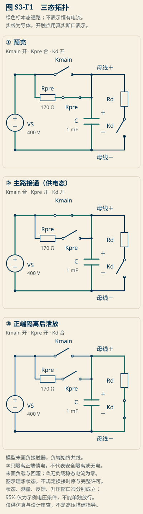
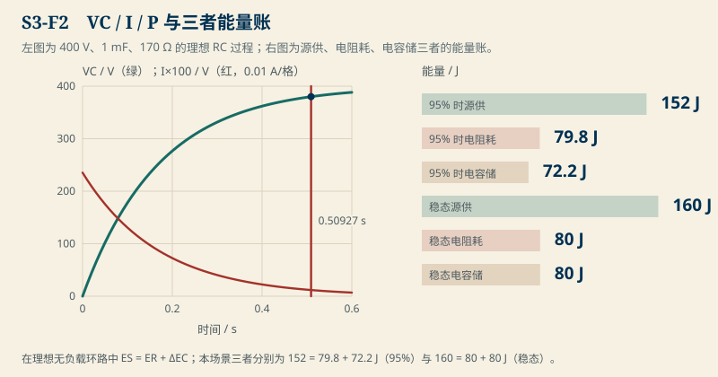
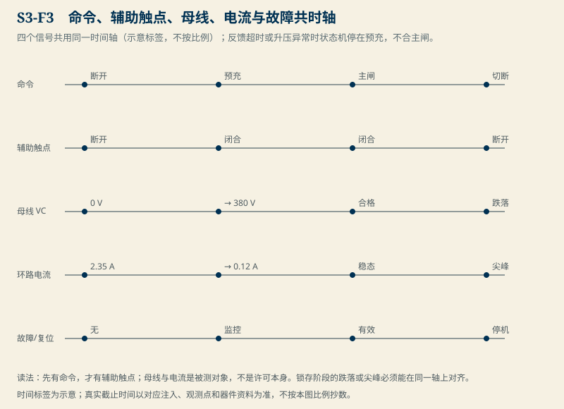
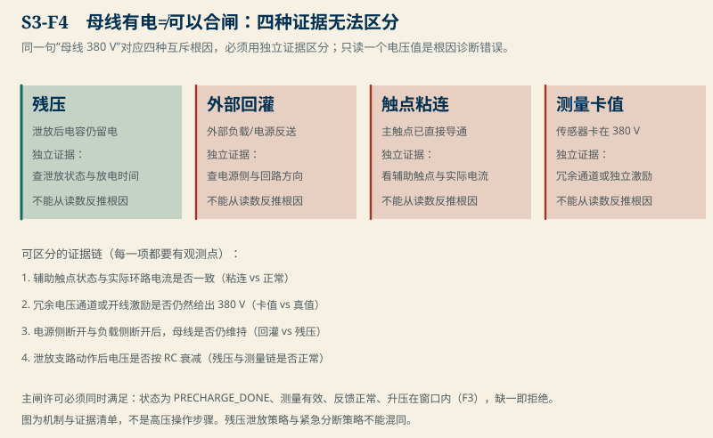
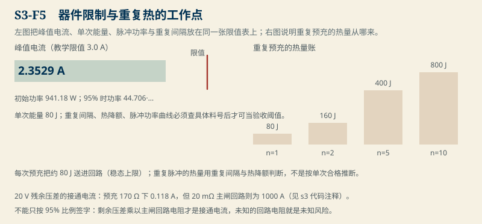

# S3 预充时序：母线起来了，许可还差四样证据

> 本章是 BMS v3 深研计划的单点样章，对应计划 S3（`docs/superpowers/plans/2026-11-08-bms-depth-rebuild.md`）与 B04 桥页的 D07/D08 可靠交互要点。
> 参考实现为 `code/engineering/precharge/s3_precharge.py`（仅用标准库）；图由 `make_s3_figures.py` 从冻结实现生成。
> 预充不能只等固定时间，而应读取母线是否按预期上升；上不去可能是后端短路，异常快也可能意味着测量、接线或触点状态异常。图内的比例合闸提示只代表示例电压条件；文中主闸许可（状态、有效性、反馈、窗口）各自成立、缺一不可。高压与绝缘只作仿真和设计审查对象，不构成操作指导。

场景登记：`S3-inrush-precharge` 是理想 RC 主线；`S3-precharge-with-load` 是加入并联负载的第二数值场景。两个场景各自守住自己的时间常数与能量账，互不串账。母线 95% 只是示例电压条件，不能代替完整的预充与接通许可。

其他教材章节仍只回答各自问题，不做高压操作指导。

## S3.0 先看哪里

### 看五张图

<figure>


<figcaption>图 S3-F1　三个状态、三条路。实线是导电路径，虚线是控制信号。合主闸的许可另看后文，不能只看 95%。</figcaption>
</figure>

<figure>


<figcaption>图 S3-F2　VC/I/P 曲线与三者能量账。理想无负载环路中 ES = ER + ΔEC，本场景两处账面都已算出：152 = 79.8 + 72.2 J、160 = 80 + 80 J。</figcaption>
</figure>

<figure>


<figcaption>图 S3-F3　命令与反馈的共时轴。先有命令，才有辅助触点；母线与电流是被测对象，不是许可本身。锁存阶段的跌落或尖峰必须能在同一轴上对齐。</figcaption>
</figure>

<figure>


<figcaption>图 S3-F4　母线有电≠可以合闸。同一句“母线 380 V”对应四个互斥根因，只读一个电压值是根因诊断错误。</figcaption>
</figure>

<figure>


<figcaption>图 S3-F5　器件限制与重复热的工作点。重复脉冲的热量用重复间隔与热降额判断，不是按单次合格推断。</figcaption>
</figure>

### 开读押注

押注一：**母线到了 95%，许可成立的概率**。押注二：**残压 20 V 在主闸回路上的接通电流**。请在继续读推导前先写自己的数字与结论，本章末尾会用两组对照复核。

### 阅读路径

1. **09 章 9.4–9.6 续读**：`S3-precharge-with-load` 的稳态母线、5τ 耗散账与“到不了 95%”应放在“理想瞬间零阻”之后读；残压对照应放在老预充手册“停在约 40 V”之后读，别并列记数字。
2. **预充故事（S3.1）**：从 `P1-先修最小包` 的 D07 老正文链路进入；S3 是新计算样章，不能覆盖旧教材已交付的叙述、普通预充与高度预充的其他细节。
3. **状态机与许可（S3.4–S3.6）**：状态×测量×反馈×保护交叉表、辅助触点与主触点电流的组合、超时拒绝与非超时拒绝不可互换。
4. **工作与异常（S3.3、S3.7）**：`D08` 的零初始电流、一次合闸、短停或持续浪涌、母线负载、正常请求与保护跳闸、馈电与复电、首次失败后隔明确间隔才给重试机会。
5. **真实系统边界（S3.8）**：合主闸顺序与无间隔、单通道相位相对裕度、双通道相对裕度、稳定主回路互斥叠加、预充与泄放的有限策略和真实设备验收，都要标明是仿真、设计选择还是证据。

## S3.1 理想线：RC 预充从零起步

教学场景 `S3-inrush-precharge` 冻结值：电源 VS = 400 V，母线电容 C = 1 mF，预充电阻 R = 170 Ω，初始母线 V0 = 0 V。四个数全是教学假设，不是选型。

无并联负载时理想 RC 环路：

```text
VC(t) = VS − (VS − V0)·exp(−t/RC)
I(t)  = (VS − V0)/R·exp(−t/RC)
τ     = RC = 0.17 s
```

数值闭式（微分 t=0 起）：

- 初始电流 I(0) = 400/170 = **2.35294 A**，初始电阻功率 P(0) = **941.176 W**；
- 90%（360 V）在 t = τ·ln(10) ≈ **0.39144 s**；
- 95%（380 V）在 t = τ·ln(20) ≈ **0.50927 s**；
- 到达 5τ（0.85 s）时电压 ≈ 397.30 V，仍未到 400 V。

### S1-Q：95% 的意义

停下自答：**母线升到 380 V（95%）后，主闸是不是就能合了？**

答案：不能。380 V 只是一个示例电压条件。主闸许可另有四条独立翔实证据（状态、测量有效性、反馈、升压窗口，见 S3.4），且 95% 之后仍有 20 V 压差。比例本身不是许可；20 V 用什么回路电阻看电流，才决定合闸的冲击（S3.5）。

## S3.2 为什么要预充：接通浪涌长什么样

母线电容未充电时阻抗近似为零。直接闭合主接触器，电源经主闸回路（线阻、开关管、电容 ESR 之和）看到的几乎是短路。接通浪涌电流近似

```
I_rush ≈ V_bus / R_loop
```

教学对照：残余压差只有 20 V。若主闸回路电阻为 20 mΩ，I_rush ≈ 20/0.02 = **1000 A**；若仍经 170 Ω 预充电阻，I_rush ≈ 0.118 A（S3-F5 右图）。同一 20 V，两种回路差四个数量级以上的冲击。

结论：预充的目的不是“让电压看起来对”，而是**把接通瞬间的大电流关进一个能量已知、功率已知、时间已知的通道里**。能量账与器件限值见 S3.3、S3.7。

## S3.3 能量账：源供 = 电阻耗 + 电容储（无负载时）

理想无负载环路逐项自洽，`ES = ER + ΔEC`，式子来自三元积分：

- 电容增量：`ΔEC = ½C[VC(t)² − V0²]`；
- 电阻耗：`ER(t) = ½C(VS−V0)²[1 − exp(−2t/RC)]`（从电流平方积分）；
- 源供：`ES(t) = VS·C[VC(t)−V0]`。

冻结数（S3-F2 右图）：

```text
95% 时点（380 V）：ES = 152 J = ER 79.8 J + ΔEC 72.2 J
稳态上限（400 V）：ES = 160 J = ER 80 J + ΔEC 80 J
```

两份 80 J 不是同一份能量：电阻耗的是发热，电容储的是将来能倒灌回去的电场能。合主闸把这个账“封口”了——主回路一旦接通，电阻耗散时代结束，剩下的能量交换在负载。

### 能量账的边界

上面的代数只在“无并联负载”时成立。加入负载后（S3.4），源供不再只是电容做功，必须用有限窗口积分数值核对（见代码 `energy_with_load` 的边界项）。把无负载结论带进带负载场景，是新错误。

## S3.4 带并联负载：到不了 95%，等待也没用

场景 `S3-precharge-with-load`：同一电源与预充电阻，母线加 2 kΩ 并联负载。

```text
稳态母线 = VS·R_load/(R + R_load) = 400·2000/2170 ≈ 368.66 V
τ_par    = (R·R_load)/(R + R_load) · C ≈ 0.15668 s
```

**稳态 368.66 V 低于 95% 门槛 380 V**。预充永远到不了许可电压——再等也是原地踏步。状态机必须在“升压过慢”里判失败，而不是等到超时后才疑惑。`time_to_fraction(cfg, 0.95)` 直接抛错正是这个约束的编码形式。

### 有限窗口的能量账（5τ 窗）

稳态耗散随时间发散（负载一直吃电），所以只能在同一有限窗口内对规划账。用 R_load = 2 kΩ 的 5τ 窗（0.78341 s，数值积分与解析式差 < 0.01%）：

```text
源供 192.76 J = 电阻耗 88.31 J + 负载耗 37.41 J + 电容储 67.04 J
```

这与无负载的 160 = 80 + 80 J 是**两套不同的账**：负载在 5τ 窗里吃掉 37.41 J。把两套账混用，就会把“预充无效”的负载悄悄算进合格。

## S3.5 接通电流与器件限值：限值表也是判定的一部分

| 量 | 教学冻结值 | 限值（示例） | 判读 |
|---|---:|---:|---|
| 初始电流 | 2.35294 A | ≤ 3.0 A（教学限值） | 通过；限值收紧到 2.0 A 即失败 |
| 初始功率 | 941.176 W | 查脉冲曲线 | 按单峰功率与持续时间平账 |
| 单次能量 | 80 J | ≤ 85 J（教学限值） | 通过；重复间隔须另查热降额 |
| 20 V 残压下主闸电流 | 1000 A（20 mΩ 回路） | 未知回路电阻 | 不能按 95% 字数放行 |

重复预充的热量逐次叠加：n 次预充约为 n×80 J（稳态上限）。判定限值不是“单次没冒烟”，而是峰值、脉冲能量、重复间隔与热降额的联合表。表中限值是教学值；换成真实器件必须查具体料号。

### S1-Q：残压冲击

停下自答：**为什么 20 V 的残压最危险？**

答案：20 V 看起来只有 5% 的压差，但主闸回路电阻是毫欧量级，20 V / 20 mΩ = 1000 A。比例（95%）不能代替接通电流；主闸回路电阻未知时，签“95% 足够”就是签未知冲击。

## S3.6 状态机：为什么只是 95% 不够

主闸许可必须同时满足四样，见 `main_contact_permitted`：

```text
state == "PRECHARGE_DONE"            # 预充已正常走完
valid == True                        # 母线测量有效（独立证据）
feedback_ok == True                  # 触点/电流反馈一致
rise_ok == True                      # 升压在窗口内（不快不慢）
measured_v >= 0.95 * VS              # 示例电压条件
```

任何一条缺失就**拒绝**。这四条分别对应本章的四个故障位：

- 接入/取消与馈电：接入前置条件（负载已卸、保护未动作）与馈电后复电恢复（S3.7）；
- 保护跳闸：预充中途保护动作或通过测量基线前就拒绝；
- 故障注入：升压异常（太快或太慢）、反馈超时、负载未卸、残压、回灌、粘连、卡值；
- 反馈超时（fill→合闸许可≠反馈拒绝）：命令、辅助触点、实际电流、器状态分开记；超时停在预充，不合主闸。

### 边界对照：与 09 章预充段的关系

`09-软件逻辑与状态机` 是数据流、时间轴与可复现证据页，本章只给 D07/D08 的单点数值样章。真实顺序、高压与绝缘只作仿真和设计审查对象。109 态与粘连处理、合闸许可撤销时序留到第 10 章。

## S3.7 故障与证据：母线有电不等于可以合闸

同一句“母线 380 V”对应四种互斥根因（S3-F4）：

```text
残压       —— 泄放后电容仍留电         独立证据：泄放状态与放电时间
外部回灌   —— 外部负载/电源反送        独立证据：电源侧与回路方向
触点粘连   —— 主触点已直接导通        独立证据：辅助触点与实际电流
测量卡值   —— 传感器卡在 380 V         独立证据：冗余通道或开线激励
```

拒绝不合闸（而非误读根因）是本章的最低门槛：

- 预充拒绝（refuse）/超时（timeout）/保护动作（protective trip）：先记录，再查原因；已禁止重试要等明确间隔；
- 馈电与复电：先按正常请求恢复；若已在保护跳闸则须等人工确认/清除条件，不能自动复电；
- 残压与粘连：不要用单路电压读数下结论；保留中档或独立互锁证据（如式双通道独立）。

两类拒绝不可互换：接受许可≠反馈拒绝；已在保护跳闸≠已合闸。允许“预充完成但反馈未至”去等反馈，而非把它当成拒绝根因。

## S3.8 工作与异常矩阵：两类拒绝、两种时限

汇合 B04 桥页 D07/D08 与旧正文（引用旧教材第 4/7/8/32 章但不复制其细节）：

| 矩阵条 | 预期 | 拒绝/处理 |
|---|---|---|
| 零初始电流 | 三种异常矩阵（D08）无法预览：用 S3.3 三次故障注入（S3.6） | 超时进入失败 |
| 一次合闸 | 一次性合闸无间隔重复（预充一次到位） | 超时/反馈超时拒绝 |
| 短停或持续浪涌 | 短停冲击或持续浪涌的恢复路径（S3.5） | 按限值表判定 |
| 母线负载 | 带载到不了 95%（S3.4） | 拒绝而非长等 |
| 正常请求/保护跳闸 | 正常请求可恢复，保护跳闸须人工确认 | 两种机制不可互换 |
| 馈电与复电 | 馈电恢复按正常请求；跳闸后先等人工确认 | 禁自动复电 |
| 首次失败后明确间隔 | ≥ 3600 s 教学间隔后才可再试 | 间隔内拒重试 |

`39-完整矩阵` 是 D07 的系统级验收表；本章只给单点数值样章坐标（理想 RC 主线与带载第二场景），不能替代完整矩阵的合闸顺序、无间隔、单通道/双通道相对裕度与稳定主回路互叠加等全部时限验收。

## S3.9 诊断任务

**任务一（升级去向）**：板子从 400 V 电源预充到 380 V，为何还差 20 分钟进不去主闸？用双扰动对照：残压 50 V 与带载 2 kΩ，分别算达到 95% 的时间和稳态电压，并画出两条 VC 曲线。**禁止**只用 170 Ω 电阻算接通电流。

**任务二（判断练习）**：给 F3 两条序列，一条命令/辅助触点滞后但母线正常，另一条母线停在 40 V 不动，用状态机与反馈交叉表指出哪一次该拒绝、哪一次是根因待查，并写出同轴确认方法。

**任务三（审查练习）**：厂商把预充数据 sheet 靠“双极放电残压”这个模糊需求让测试负责；预充时间待测量确认后填——指出“测了也签不出边界”（能量与重复热）与“只测单次不测重复”的风险，并补计算与器件引用。

## S3.10 如何给厂商写预充数据包

预充数据包不能只靠“双极放电残压”这个模糊需求让测试负责；预充时间待测量确认后填。数据包至少含：

- 脉冲曲线引用（具体料号、持续时间、重复间隔）；
- 波形来源与观测点（辅助触点、实际电流、母线三同轴，见 S3-F3）；
- 拒绝/超时/保护/馈电/复电的失败记录；
- 限值表（峰值、能量、功率、重复）与热降额引用。

第 9 章只给数据包的写法规格（装置试验、终端结果与 `09` 章状态机、信号、持久化、快照和可复现日志一起审查），不把真实器件的脉冲曲线编成通用默认。

## 三个现在的坏实现

### 坏实现 1：单电压许可预充电

只读母线电压，一旦 ≥95% 就合主闸，没有状态面、有效性面、反馈面与升压窗口面。它碰到的真实风险：卡值传感器读到 380 V、粘连触点已直接导通、外部回灌把母线顶住——三种根因它都判成“合格”，合闸许可成了误判制造机。

### 坏实现 2：只等固定时间

不读母线是否按预期上升，只等一个与温度、负载、阻容无关的固定等待。带载时（S3.4）它会一直等到一个永远到不了的电压才超时；残压高时它又可能在电压还没到保险线就误判完成。同一等待时间在三个场景里是三个相反的行为。

### 坏实现 3：没有合闸顺序与限值

合主闸与断预充无顺序、无间隔，母线在换接瞬间只靠电容是会塌的；器件限值（峰值、脉冲能量、重复）不查资料先把教育值当限值签。第二次预充的热量与第一次摩擦，重复间隔不写进恢复逻辑就是自掘坟墓。

## 冻结数字：本章复算入口

| 量 | 数值 | 出处 |
|---|---:|---|
| τ（理想） | 0.17 s | `tau_s` |
| 初始电流/功率 | 2.35294 A / 941.176 W | `initial_inrush` |
| 到 90% / 95% | 0.39144 s / 0.50927 s | `time_to_fraction` |
| 95% 能量账 | 152 = 79.8 + 72.2 J | `energy_account(0.95)` |
| 稳态能量账 | 160 = 80 + 80 J | `energy_account(1.0)` |
| 残压 50 V 时 t95 | 0.48657 s（缩短但未消失） | `time_to_fraction` |
| 2 kΩ 稳态母线/τ | 368.66 V / 0.15668 s | `S3-precharge-with-load` |
| 2 kΩ 5τ 能量 | 192.76 = 88.31 + 37.41 + 67.04 J | `energy_with_load` |
| 20 V 残压主闸电流 | 1000 A（20 mΩ 回路）/ 0.118 A（170 Ω） | `close_current_at_residual` |

复算入口：

```bash
python -X utf8 code/engineering/precharge/s3_precharge.py --out .tmp-s3-evidence
python -X utf8 code/engineering/precharge/s3_precharge.py --students
pytest code/engineering/precharge -q -p no:cacheprovider --basetemp=.tmp-pytest-s3
```

把 `--out` 指向的 `report.json` 打出来的即是上表数字；数值积分与解析能量账的一致性（差 < 1e-8 J）在窄测试里已锁死。

## 装配边界

本章新增章节仅由 S3 计划项交付（S3.1–S3.4 与计划勾选项）。本章未完成的部分：真实系统级验收表、完整 39 项合闸矩阵、合闸顺序与无间隔验证、单通道/双通道相对裕度、稳定主回路互斥叠加、预充与泄放有限策略与真实设备验收——以上不属于 S3 单点数值样章的范围。教师据此判分时用本章三任务；学生复核时先跑复算入口，再重算本章新增的全部公式。

## 参考

- D07/D08 可靠交互要点与 39 项矩阵（计划 Phase 3）；
- 09 章软件逻辑与状态机、08 章过流/时间整定细节的物理根归属（别在此章编）；
- S1–S2 样章的结构模板（本章为 S3 编号）。
