# 电路详解 ②：采样链与 AFE 芯片

> **本篇你会学到**　一颗 ADC 怎么轮流看十几串，误差从哪来，开线、NTC、隔离和 isoSPI 各管哪一截。
> **预计用时**　随阶段 3 精读。
> **前置**　阶段 2 的保护板。本篇以芯片手册语言为主。
> **一句话**　一颗 ADC 怎么看住十几串电芯？答案是：它不看，它巡逻。

> 配套教程：阶段 3（AFE + MCU）。
> 本篇回答一个问题：**BMS 怎么用一颗 ADC 逐串扫描，把 16 串电池电压都测准到 ±5mV（0.12%）？**

---

## 本页目录

按层走先看 [能力地图](../stages/bloom-map.md)。标题末尾的 `[记忆]` … `[创造]` 是布鲁姆层级。

- [1. 采样链全景与误差预算 [分析]](02-采样链与AFE芯片.md#1-采样链全景与误差预算-分析)
- [2. MUX 巡逻式测量：一颗 ADC 测 16 串 [理解]](02-采样链与AFE芯片.md#2-mux-巡逻式测量一颗-adc-测-16-串-理解)
- [3. 输入 RC：小电阻里的大学问 [分析]](02-采样链与AFE芯片.md#3-输入-rc小电阻里的大学问-分析)
- [4. 开线检测：采样线断了会发生什么 [分析]](02-采样链与AFE芯片.md#4-开线检测采样线断了会发生什么-分析)
- [4b. 卡值与漂移：开线之外的传感器故障 [分析]](02-采样链与AFE芯片.md#4b-卡值与漂移开线之外的传感器故障-分析)
- [5. BQ769x0/x2 内部巡游（以手册功能框图为地图） [分析]](02-采样链与AFE芯片.md#5-bq769x0x2-内部巡游以手册功能框图为地图-分析)
- [6. 温度采样：NTC——越热阻值越小 [理解]](02-采样链与AFE芯片.md#6-温度采样ntc越热阻值越小-理解)
- [7. 高压菊花链与 isoSPI：变压器"隔电不隔信号" [理解]](02-采样链与AFE芯片.md#7-高压菊花链与-isospi变压器隔电不隔信号-理解)
- [8. 电流采样：安时积分精度的天花板 [分析]](02-采样链与AFE芯片.md#8-电流采样安时积分精度的天花板-分析)
- [9. 自测 [分析]](02-采样链与AFE芯片.md#9-自测-分析)

## 1. 采样链全景与误差预算 [分析]

```
电芯 → RC 滤波 → 多路选择器 MUX → ADC（+基准源） → 数字接口（I2C/SPI） → MCU
```

每个环节都往结果里"掺沙子"：

| 环节 | 误差来源 | 量级/对策 |
|---|---|---|
| RC 滤波 | AFE 输入漏电流流过 R 产生压降 | R 必按手册推荐值，漏电流×R 直接进误差 |
| MUX | 导通电阻、电荷注入 | 高阻 ADC 输入下可忽略；切换后要等稳定再转换 |
| ADC | 失调、增益误差、INL | AFE 内部出厂校准 + 产品出厂标定 |
| 基准源 | 初始误差 + **温漂** | 误差预算的第一项；温度每变 10°C 都要重新核算 |
| 布局 | 采样线拾取干扰、地弹 | 开尔文走线、远离功率回路 |

±5mV 在 4.2V 上是 0.12%——任何一环"凑合"都会超标。这就是为什么 AFE 是一颗专门的芯片，而不是 MCU 自带 ADC 凑合。

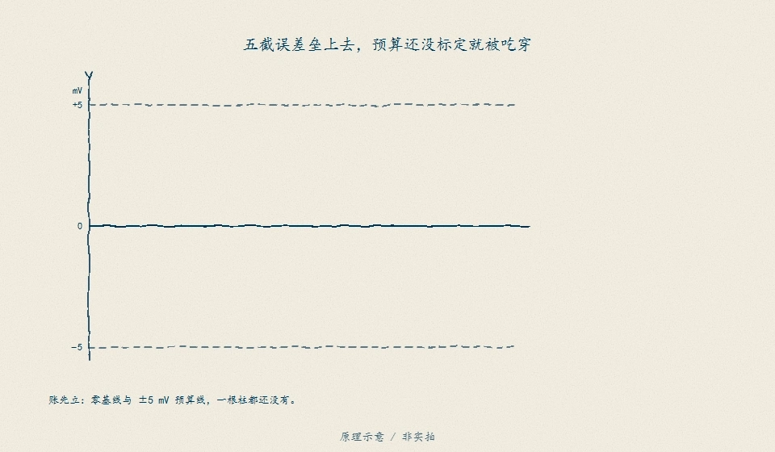

> **看图**　五截误差一截一截垒上去，为什么还没标定，整个 ±5 mV 预算就先被吃穿了？

> **图说**　把上表量化成瀑布——基准温漂 +2.0mV、ADC 失调/增益 +1.5、RC 漏电 +0.8、MUX 电荷注入 +0.3、布局拾取 +0.9，未标定累计 5.5mV 已超 ±5mV 预算线。

> **口诀**　误差从基准开始加。不是从 ADC 位数开始减。

**看动画时盯住哪里**

出厂标定把系统性项（基准初始、失调、增益）用系数修掉，剩余随机与温漂项约 1.8mV 回到预算内——标定不是锦上添花，是预算闭环的最后一环。

> **原理**　基准、分压、滤波、ADC 和温漂各自贡献误差。出厂标定只能修掉系统性增益和失调，随机项和温漂还在预算里。
> **证据**　误差预算里标定只能修掉系统性增益和失调。AFE 侧对照 [TI 储能 BMS 方案](https://www.ti.com.cn/solution/zh-cn/ess-battery-management-system-bms)（中文）。
> **延伸阅读**　[详解②](../circuits/02-采样链与AFE芯片.md)

**练完你会怎样**：你能用上面那句口诀，把这张图讲给别人听。

## 2. MUX 巡逻式测量：一颗 ADC 测 16 串 [理解]


> **图说**　盯住哨兵走到的那一串：这一拍只有这一路接在 ADC 上，旁边那串还是上一拍的数。

> **口诀**　一颗 ADC 轮流看每一串。这一拍的电压不是同一瞬间。
> **动态**　初始态：多路开关停在某一串，ADC 读的是这一路。扰动：通道号加一，开关切到下一串。中间态：新通道等电压稳定，再开始转换。稳态：这一拍的数字写入寄存器，然后切下一串。扫完一圈，各串各有自己的采样时刻。

索引见 [电路动态分析](README.md#电路动态分析)。

AFE 内部没有 16 颗 ADC（太贵），而是**一颗 ADC + 一个多路选择器**：像哨兵巡逻，轮流把每一串接到同一个 ADC 上。

这个架构带来两个重要性质：

- **串间一致性极好**：所有串用同一颗 ADC、同一个基准测量——即使绝对值有点偏差，**串与串之间的相对差**（均衡和保护真正关心的）依然很准；
- **各串不是严格同一时刻测的**：扫完一圈要固定时间（手册给出）。电流剧烈波动时，先扫的串和后扫的串对应不同瞬间——高速工况下要在算法里留意。

**练完你会怎样**：你能用上面那句口诀，把这张图讲给别人听。

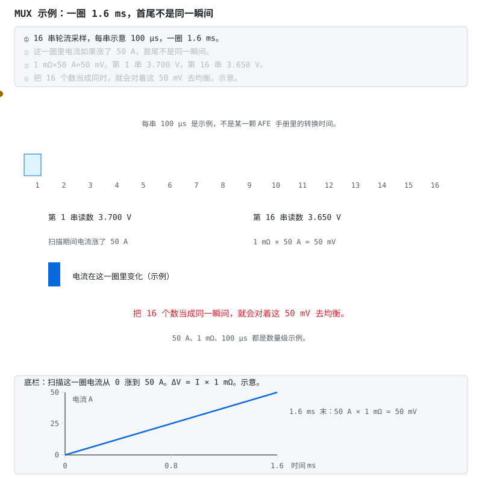

> **图说**　每串 100 μs、一圈 1.6 ms 是示例，不是某一颗 AFE 手册里的转换时间，也不是示波器截图。

> **口诀**　一颗 ADC 轮流看每一串。这一拍的电压不是同一瞬间。
> **算一笔**　16 × 100 μs = 1.6 ms。50 A × 1 mΩ = 50 mV。
> **错了会怎样**　把这一圈当成同一瞬间，均衡和保护会对着这 50 mV 的假压差动作。

**看动画时盯住哪里**

扫描期间电流涨 50 A、单体 1 mΩ 时，首尾可以差 50 mV。手册上的真实扫描时间替换这两个 100 μs 即可，算法不变：ΔV ≈ ΔI × R。

> **原理**　AFE 内部没有 16 颗 ADC（太贵），而是**一颗 ADC + 一个多路选择器**：像哨兵巡逻，轮流把每一串接到同一个 ADC 上。
> **证据**　可核验演示：本节 SVG（浏览器打开即播），正文有不看动画也能读的说明。一颗 ADC 经多路开关轮流测各串，通道之间不是同时刻。入口 [TI 储能 BMS 方案](https://www.ti.com.cn/solution/zh-cn/ess-battery-management-system-bms)（中文）。
> **延伸阅读**　[立创开源 BQ76920 工程](https://oshwhub.com/kaijun/mps-energy-station)


同一圈扫描，把等待也加进直线。

**练完你会怎样**：你能用上面那句口诀，把这张图讲给别人听。

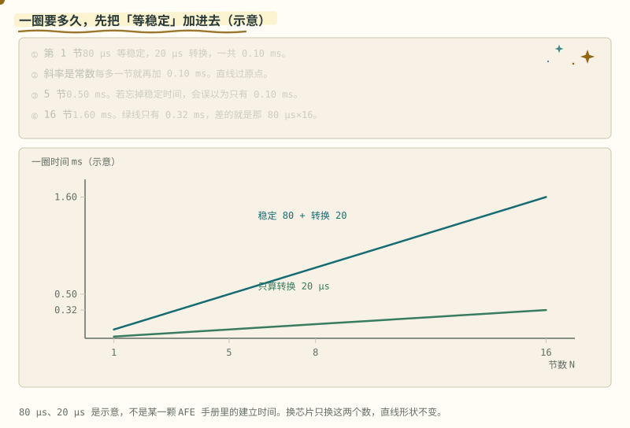

> **图说**　盯住每节那截 80 µs 的等待：16 节示意一共 1.60 ms，只算 20 µs 转换会少算成 0.32 ms。

> **口诀**　每节 80 µs 等稳定，再加 20 µs 转换。

16 节是 1.60 ms。只算转换会变成 0.32 ms。自测在[阶段 3](../stages/stage-3-AFE-MCU智能BMS.md)。数字是示意。

**练完你会怎样**：你能用上面那句口诀，把这张图讲给别人听。

## 3. 输入 RC：小电阻里的大学问 [分析]

每串采样输入前的 RC 是手册"钦定"的，自己改会出事：

- **R 改大**：AFE 采样时从引脚抽取的漏电流在 R 上产生压降 → 该串读数系统性偏低，且漏电流随温度变，误差也跟着变；
- **C 改大**：均衡开关动作后，电压要等 RC 时间常数才能稳定 → 采样值滞后，均衡期间测不准；
- **C 改小**：抗混叠与抗 ESD 能力下降。

**结论：第一版照抄手册典型应用电路，一个元件都不要改。**

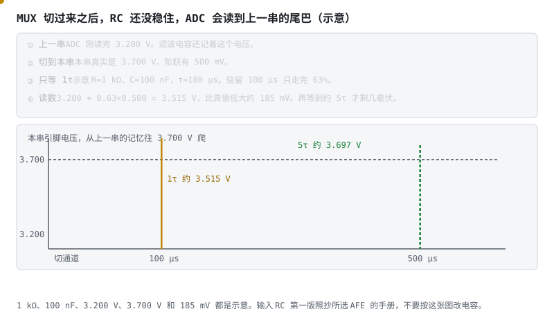

> **图说**　上一串留在电容上的是 3.200 V，本串真实是 3.700 V，阶跃 500 mV。

> **口诀**　通道刚切过来，先问电容稳住没有。没稳住的数，带着上一串。

**看动画时盯住哪里**

示意 R=1 kΩ、C=100 nF，τ=100 µs。MUX 只停 100 µs，也就是 1τ，电压只走完 63%，读数是 3.200 + 0.315 = 3.515 V，比真值低大约 185 mV。停到大约 5τ，误差才落到几毫伏。电容改大，τ 变长，这个误差会更久。

- 曲线从上一串的高度往 3.700 V 爬，不是跳变。
- 黄线在 100 µs：这一拍的读数 3.515 V。
- 大约 500 µs 才贴近真值。驻留比这个短，误差就还在。

**短自测**

1. τ=100 µs、只等 1τ，500 mV 的阶跃走完多少？读数大约是多少？
2. 为什么把滤波电容随意加大会让均衡期间更不准？
3. 1 kΩ 和 100 nF 可以拿去改 AFE 输入吗？

<details>
<summary><b>参考答案（先自己想完再展开）</b></summary>

1. 大约 63%，也就是 315 mV。从 3.200 V 起到大约 3.515 V。
2. τ 变长，同样的驻留时间更不够，读数更靠近上一串。
3. 不要。第一版照抄所选芯片的手册。这两个数只说明「没等够会差 100 mV 这一级」。

</details>

**练完你会怎样**：你看到一串电压忽然跳，会先问：是电芯变了，还是 MUX 没等够。


> **原理**　采样输入的电阻和电容按手册取值。改电阻会改变热插拔电流和均衡电流，改电容会改变滤波和抗静电能力。
> **证据**　输入阻容照抄所选 AFE 的手册，不要按手感加大电容。入口 [TI 储能 BMS 方案](https://www.ti.com.cn/solution/zh-cn/ess-battery-management-system-bms)（中文）。
> **延伸阅读**　[立创开源 BQ76920 工程](https://oshwhub.com/kaijun/mps-energy-station)

## 4. 开线检测：采样线断了会发生什么 [分析]

采样线可能因振动、连接松动或腐蚀而断开。断线后的读数取决于输入电容、漏电、偏置、相邻通道耦合和诊断配置：可能接近旧值，也可能偏高、偏低或越量程。**开线不一定读 0，也不一定越量程**；中间抽头断开还可能影响相邻两个差分通道。

开线诊断需要所选 AFE 的具体机制。有些芯片注入拉/灌电流，比较不同诊断条件下的响应；注入方向、等待时间、均衡状态、比较对象和阈值必须核对该型号的手册。固件要按诊断时间预算调度、检查完成状态并记录结果，不能把一次普通电压读取当作开线检测通过。

**量程内开线的反例**：用两串的代数关系检查一个可能状态。实际电芯分别为 4.300 V、3.100 V，总压 7.400 V；中间抽头断开后，假设输入网络使悬空端相对底端保持 3.700 V，AFE 就可能报告 3.700 V、3.700 V。两路都在 0–5 V 的示意量程内，读数之和也等于总压；若本算例上限为 4.200 V，实际第一串已经越限。这些数字只构造反例，不是某款 AFE 的实测波形或通用电芯限值。它说明：**量程正常、总压吻合或邻串正常，都不能证明缺失单节安全**。

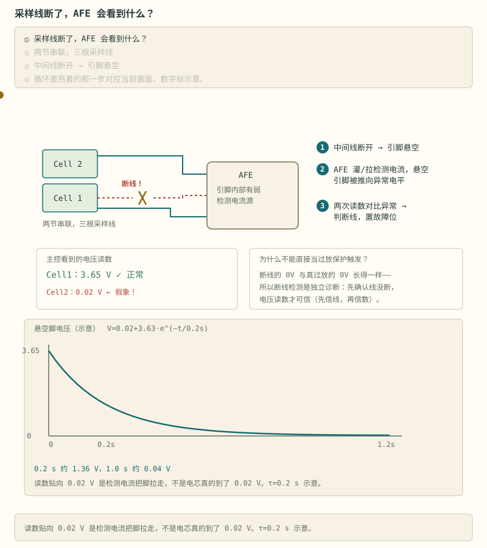

> **图说**　这张机制示意选择了检测电流使悬空端读数下降的情形；实际诊断按芯片规定比较注入前后或不同注入条件的结果。图中的两次读数与衰减轨迹不代表所有 AFE 的检出方法或覆盖率。

> **口诀**　先信线还在，再信这串电压。0 mV 可以是断线。

**看动画时盯住哪里**

仅凭 0 V 这个码，不能区分严重欠压、开线、采样短路或数据错误。**先信线，再信数**是要求保留诊断证据，不是先屏蔽欠压保护、等查清根因后才反应。异常电压与测量无效可以同时触发各自的保守处理，见 [详解④ §3.4](04-系统安全与量产.md#34-采样链的可信度断线检测-分析)。

下栏曲线 `V = 0.02 + 3.63·exp(−t/0.2 s)` 只是一条示意响应：0.2 s 约 1.36 V，1 s 约 0.044 V，最后趋向 0.02 V。它描绘的是输入端读数，不是电芯真的降到了这个电压，也不是从恒定检测电流推导出的通用响应式。

> **原理**　读数在量程内不证明连接完好；开线诊断通过也只证明本次诊断条件下覆盖的连接状态，不能替代后续数据的新鲜度和质量检查。
> **证据**　上面的两串反例可由差分电压和总压关系手算。动画为机制示意；具体开线诊断仍须核对所选 AFE 手册，芯片入口见 [TI 储能 BMS 方案](https://www.ti.com.cn/solution/zh-cn/ess-battery-management-system-bms)（中文）。本页不宣称已经完成芯片诊断覆盖验证。
> **延伸阅读**　[文末自测第 4 题](02-采样链与AFE芯片.md#9-自测-分析)，以及 [详解④ §3.4](04-系统安全与量产.md#34-采样链的可信度断线检测-分析)。

**练完你会怎样**：你能用上面那句口诀，把这张图讲给别人听。

## 4b. 卡值与漂移：开线之外的传感器故障 [分析]

开线、卡值（stuck-at）和漂移都可能留下量程内的数。量程检查筛查编码或工况是否异常；卡值诊断检查有足够激励时信号是否按预期更新；漂移对账检查长期偏差。它们提供的证据不同，**任何一项都不能单独确定故障根因**。

> **口诀**　先看时间和质量，再看量程与响应；有变化不等于正确，不变也不等于坏。

**先辨别健康常值、卡值和旧数据**。下面都是教学条件，不是某颗芯片的诊断阈值：

| 场景 | 可复核的观察 | 能得到什么结论 |
|---|---|---|
| 健康静置常值 | 假设按 1 mV 四舍五入，连续 60 拍输入都在 3.6998–3.7002 V 内，则每拍都输出 3.700 V；采样序号和实际转换时间正常推进 | 噪声和变化小于一个量化格，数字完全不变仍可能健康；稳定温度下的 NTC 也可能如此 |
| 有激励却无响应 | 受控模拟输入从 3.700 V 改为 3.720 V，独立参考确认已建立，转换时间/序号推进而输出仍是 3.700 V | 是卡值或测量链异常线索；还须查转换状态、缓冲区和通道映射。实际电芯的激励还须结合可信电流、时间对齐及可分辨响应范围；别的串/NTC 变化不能替代该通道的响应依据 |
| 数值合理但过期 | 在同一单调时基上，样本采于 1000 ms、收于 1115 ms，当前 1120 ms，示意最大允许年龄为 100 ms | 样本年龄为 120 ms，已过期；“5 ms 前刚收到”不能使它变新。数值即使仍为 3.700 V，也不能按新样本使用 |

每条测量至少携带通道身份、源采样时间或可证明的新转换标识、序号、通信/转换/诊断质量。接收时间另存；重读寄存器成功或重复收到一帧不证明发生了新转换。不同设备的时间戳要先建立带误差界的时钟映射，复位和回绕要能辨别；源时间不可得时，必须说明新鲜度能被证明到哪一步，不能直接用接收时间代替。

**量程、响应与漂移如何配合**：

| 检查 | 需要的依据 | 不能独断的结论 |
|---|---|---|
| 量程/饱和 | AFE 有效输入与编码范围、NTC 电路、温度范围、所选电芯的运行限值分别登记 | 越运行限值可能是真过充/过放；超测量范围、饱和或错误码也可能来自接线/供电/通信。不能用一组通用数字判定“物理不可能、必是开线” |
| 卡值/响应 | 激励是否足够、噪声和量化、测点热惯性、时间窗口、采样是否更新 | 连续若干拍相同只构成条件性线索；没有激励时，应记录诊断条件不足，不能据此判健康或故障 |
| 漂移/对账 | 独立参考或守恒核算、容量与效率、温度、OCV 条件及各项不确定性 | 差值增长不唯一指向电流零漂，也可能涉及电压偏置、容量误差、时钟、自放电或 OCV 模型失配 |

**可疑与无效之后怎样处理**：可疑线索要保留原因、时刻和待确认项；转换失败、样本过期或诊断确认失效的数据要标无效，不得伪装成正常更新。DTC 与快照记录观测和质量，根因尚未确认时就保留“待定位”。

包电压除以串数、相邻串电压和温度模型可用于一致性检查或带标识的估计，**不能填补缺失单节/测点来继续授予依赖它的充电、均衡或高功率许可**。只有覆盖同一对象、精度/时效和共因失效边界经过验证的独立通道，才能按已验证策略接管。缺少这种证据时，要在规定反应时间内执行预先设计的限流、停充或受控停机策略，并核对执行反馈；具体动作取决于系统危害和执行器能力，不能一律突然硬断，也不能等根因查清才反应。已有保护不能因“也许是传感器坏了”而被屏蔽。

**漂移怎样对账**：

- **静置核对**：满足小电流、温度、静置及充放方向条件后，比较 OCV 参考与积分估计，并保留两者的不确定性，见 [阶段 4 §4.3](../stages/stage-4-SOC-SOH算法.md#43-ocv-校正先判断电压能不能信-分析)。这里等的是电芯极化松弛，不能拿 §3 输入 RC 的微秒级等待替代。以 +2 mA 恒定测量偏置为例，30 天积分多计 `0.002 A × 24 h × 30 = 1.44 Ah`，相对 5 Ah 为 28.8 个百分点；这是估计误差，不是电池实际漏掉了这份电量，方向随电流约定而定。
- **合格锚点核对**：只有满充参考的电压、电流、持续时间和温度等条件确实成立，才按策略校正，见 [阶段 4 §4.2](../stages/stage-4-SOC-SOH算法.md#42-安时积分库仑计主力但它会梦游-分析)。锚点之间差值突变是调查线索；要结合独立电流零点/电压参考、容量与温度记录排查，不能直接诊断为分流器受潮或霍尔温漂。

**怎样验证而不混淆证据层级**：[阶段 6 §6.2.5 的 `hil_replay`](../stages/stage-6-精通与毕业项目.md#625-故障注入与快照回放-应用) 只是 PC 上向现有保护逻辑喂脚本值并回读快照；其中 0 mV 进入欠压分支，没有开线标志，也没有验证本节的卡值、漂移或新鲜度诊断。文件名不使它成为 HIL。后续软件注入应分别保留健康静置常值、有已知激励的冻结通道、量程内开线和过期样本，核对误报、检出、质量传播及动作。真实开线覆盖还需受控电芯模拟器、被测控制板、诊断配置与仪器记录；这些验证尚未在本节完成。

**练完你会怎样**：你能区分健康常值、可疑响应和过期数据，指出还缺哪项独立证据，并说明为什么包平均或邻串不能替代缺失单节的保护依据。

> **原理**　诊断同时检查值、时间、质量和响应条件。异常线索可以触发保守处理，但根因定位与恢复许可需要各自的证据。

## 5. BQ769x0/x2 内部巡游（以手册功能框图为地图） [分析]

- **输入 MUX + ADC**：上两节已讲；
- **库仑计（CC）**：独立的高速 ADC 通道测检流电阻，直接输出电流积分值——硬件帮你把安时积分做了；
- **保护子系统**：OV/UV/SCD/OCD/OT/UT 各有独立比较器 + 可配阈值/延时寄存器，触发后**不经过 MCU**直接动作——这是"硬件保护兜底"的实体；
- **均衡开关**：每串一个内部开关，外接均衡电阻；MCU 写位选串放电，注意手册的占空比/热限制；
- **LDO（REGOUT）**：从电池组取电稳压给 MCU——省一颗电源芯片，但带载能力有限；
- **通信**：I2C（x0）或 I2C/SPI/HDQ（x2），**CRC 校验强烈建议开**——电池包是强干扰环境。
> 注：以上是 BQ769x0/x2 家族的通用画像；具体型号的功能集与寄存器细节（保护阈值是固定档位还是数字可配、通信接口种类、均衡开关数量）差异不小，一律以对应型号 datasheet 为准。

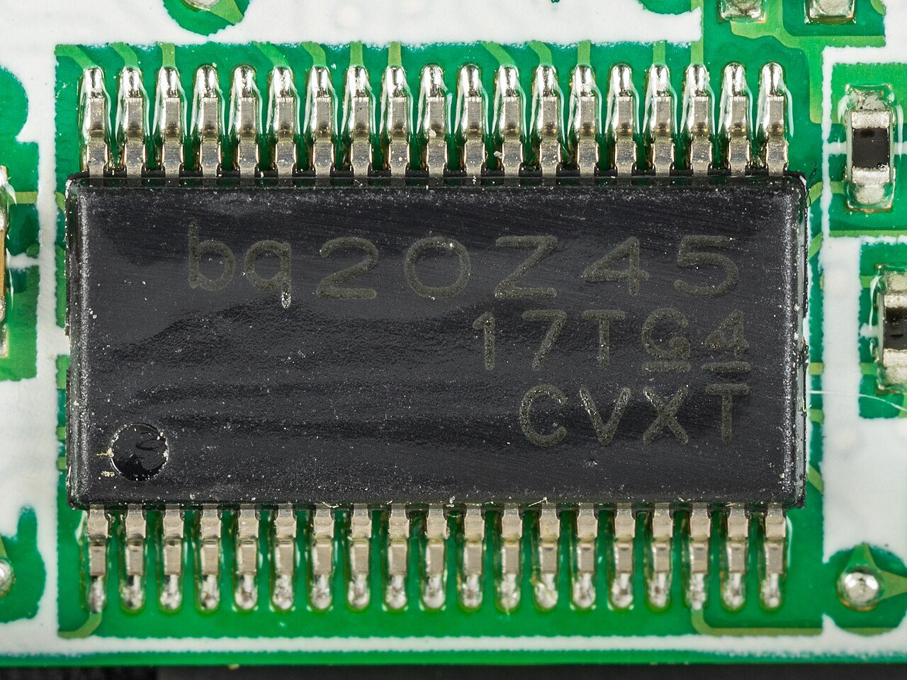

电池管理芯片焊在电芯旁边时长这样。这颗是 TI BQ20Z45，笔记本软包上的气量计，带保护，走 SMBus。它不是 BQ76952，也不是评估板，更没有 isoSPI 线束。来源见 [照片来源](assets/photos/PHOTOS.md)。

TI 官方 BQ76952 评估板和 isoSPI 菊花链线束的实拍仍缺。共享资源里用 BQ76920、BQ76940、BQ76952、BQ76920EVM、LTC6811、LTC6820、isoSPI 检索过，没有对得上的文件。2026-10-05 又看过 Embedded World 上的 TI 实验板，那是 MSP430。

同日 DigiKey 论坛讨论过 BQ76952EVM 的电流改造，页面上没有可转载的评估板照片。isoSPI 的文件名检索落到无关照片。官方评估板用户指南只外链，照片不转载：[BQ76952EVM 用户指南 SLUUC33](https://www.ti.com/lit/ug/sluuc33a/sluuc33a.pdf)。

isoSPI 评估板页同样只外链：[ADI DC2792B](https://www.analog.com/en/resources/evaluation-hardware-and-software/evaluation-boards-kits/dc2792b.html)。认领见 [共建任务板](../共建任务板.md) T11。

能放进仓库的是开源近邻。LibreSolar BMS C1 用 BQ76952，硬件许可 CERN-OHL-W v2，下面三张按该仓库文档的 CC BY-SA 4.0 转载。测试照显示板卡和线束，电源是另一张；负载仪表没有与板卡同框。这不是 TI 官方 EVM，也不是电源、分压链、保护板、万用表的同框。

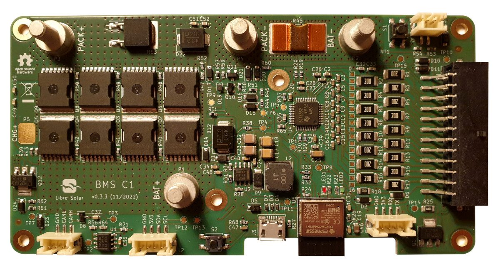

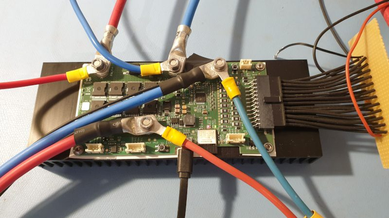

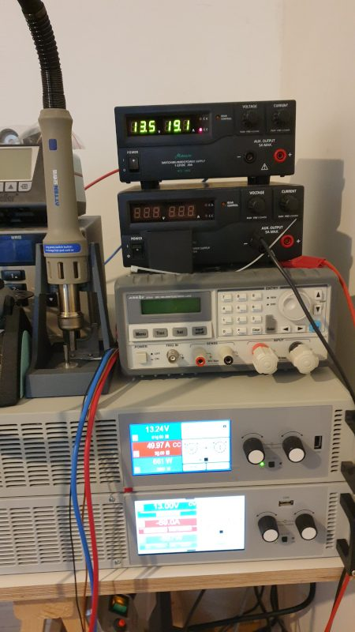

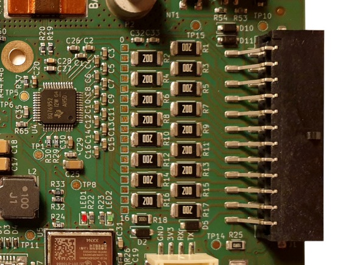

右侧黑色插座的焊脚沿两列电阻通向 BQ76952。近景由同一张全板照片裁出，未放大，LibreSolar，CC BY-SA 4.0。针脚定义与接线次序见[安装手册](https://github.com/LibreSolar/bms-c1/blob/e79f8e99d3393ef2c15a3c979d9fc88d78691cc0/manual/4-installation.md)；[裁剪与授权记录](assets/photos/PHOTOS.md)。此前两张 DIY BQ76940 图片的上游公有领域声明仅明确覆盖代码，照片授权不明，2026-11-07 撤回。


> **图说**　红线是节数乘大约 3.7 V 的共模。蓝线是穿过变压器的示意差分，停在 2 V。评估板照片仍然没有。

> **口诀**　开源 BQ76952 台架不是 TI 官方评估板。isoSPI 线束仍缺实拍。

**看动画时盯住哪里**

金点沿共模那根斜线走。差分不跟着升高。这张代替不了 TI 官方评估板或 isoSPI 线束的实拍。笔记本上的 BQ20Z45 照片不是这块板。下面的 TI 视频里板子出镜，视频文件不进仓库。

**视频**　YouTube · 英文，可选 · [TI《BQ76942 / BQ76952 介绍》](https://www.youtube.com/watch?v=f0sG9cH1m8Q)

官方 4 分钟，讲 3–16 串监测、库仑计、保护和 I2C/SPI。板子本身不是重点。阈值以手册为准，不要背片子里的宣传数字。

[](https://www.youtube.com/watch?v=f0sG9cH1m8Q)

**视频**　YouTube · 英文，可选 · [TI《BQ76942 评估板与 BQStudio》](https://www.youtube.com/watch?v=wsgJGTf2BfI)

这段里评估板出镜，用来看 BQ76942 EVM 长什么样，以及它怎么接 BQStudio。它不是放进本仓库的照片，也不是 isoSPI 线束。BQ76952 的操作片中说与 BQ76942 相同，串数不同。同一支片子的产品页：[ti.com/video/6176075469001](https://www.ti.com/video/6176075469001)。

[](https://www.youtube.com/watch?v=wsgJGTf2BfI)

> **原理**　一颗 ADC 经多路开关轮流测各串，所以串间用的是同一把尺子，但不是同一瞬间。数字侧再做均衡、保护和带 CRC 的通信。强干扰环境下 CRC 不要关。
> **证据**　BQ76952 的测量、保护和通信分工，见 TI 官方介绍 [BQ76942 / BQ76952](https://www.youtube.com/watch?v=f0sG9cH1m8Q)（英文，可选）和 [产品页](https://www.ti.com/product/BQ76952)。芯片族入口还有 [TI 储能 BMS 方案](https://www.ti.com.cn/solution/zh-cn/ess-battery-management-system-bms)（中文）。片子里的毫伏和微安是宣传口径，以对应料号手册为准。
> **延伸阅读**　[立创开源 BQ76920 工程](https://oshwhub.com/kaijun/mps-energy-station)。笔记本气量计的实物见上面的 BQ20Z45 照片，命令往返在 [阶段 5 §5.5](../stages/stage-5-通信与集成.md#55-smbus-与-ble笔记本的与手机的-理解)。评估板外观看上面的官方演示，仓库里没有可转载的静帧。

**练完你会怎样**：你能用上面那句口诀，把这张图讲给别人听。

## 6. 温度采样：NTC——越热阻值越小 [理解]

电压、电流之外，第三条采样链是温度（低温禁充、高温降额都靠它）。主角是 **NTC 热敏电阻**：


> **图说**　盯住分压中点：温度升高时 NTC 变小，中点电压往下掉，方向不要记反。

> **口诀**　温度升高，NTC 变小，分压中点跟着降。

- **接法**：固定电阻上拉 VCC、NTC 在下臂接地（BQ769x0 的 TS 脚正是这个结构）。中点电压 $V_{\text{中点}} = VCC \times \dfrac{R_{NTC}}{R + R_{NTC}}$——温度升 → NTC 阻值降 → **中点电压降**（方向别记反）；
- **换算**：阻值 ↔ 温度用 B 值方程或直接查表（量产按批次给表）；
- **布点**：贴电芯本体测电芯温度（保护用），贴 MOS/均衡电阻旁测板温（热保护用）——两个都要，策略不同；
- 多串系统每块从板布 2–4 路 NTC 是常态，极端温度往往出现在"中间被夹着的那几串"。

阻值不是随温度画直线。Beta 方程是弯的，只拉两个点去换算，中间和两端都会偏：

**练完你会怎样**：你能用上面那句口诀，把这张图讲给别人听。

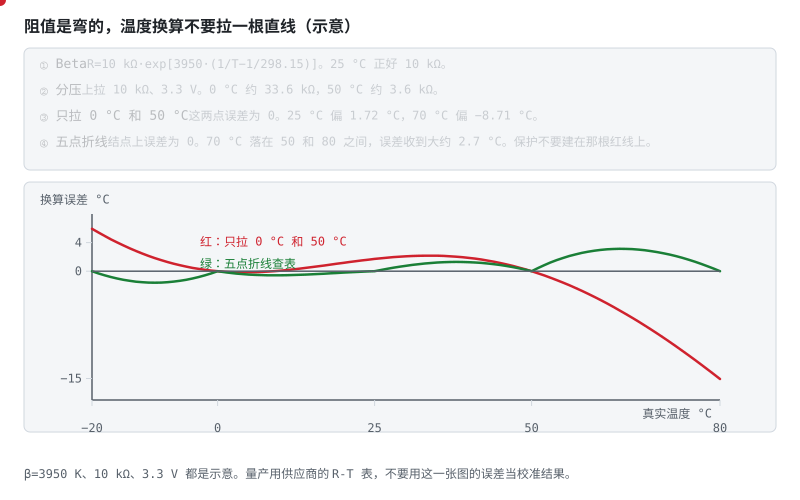

> **图说**　示意 R = 10 kΩ·exp[3950·(1/T−1/298.15)]，上拉 10 kΩ、3.3 V。

> **口诀**　阻值是弯的。两点拉直线，冷热两端先偏。查表把误差留在两结点中间。

**看动画时盯住哪里**

25 °C 正好 10 kΩ，0 °C 约 33.6 kΩ，50 °C 约 3.6 kΩ。只用 0 °C 和 50 °C 拉直线，这两点误差为 0，25 °C 偏大约 1.7 °C，70 °C 偏大约 −8.7 °C。改成 −20/0/25/50/80 五点折线，70 °C 落在 50 和 80 之间，误差收到大约 2.7 °C。红点沿着那根两点误差走。

- 红线在 0 °C 和 50 °C 穿过零，到了 70 °C、80 °C 就冲下去。
- 绿线在每个结点上回到零，中间只剩一小截。
- 黄点贴红线。保护阈值不要建在那根红线上。

**短自测**

1. 为什么 0 °C 和 50 °C 的误差是 0，25 °C 却不是？
2. 70 °C 时，两点直线和五点折线大约各偏多少？
3. β = 3950 K 能当成你这颗 NTC 的参数吗？

<details>
<summary><b>参考答案（先自己想完再展开）</b></summary>

1. 直线就是用这两个点定的，所以它们误差为零。25 °C 的真实分压不在这根弦上，示意偏 1.7 °C。
2. 两点大约 −8.7 °C，五点大约 2.7 °C。70 °C 已经落在 0–50 的外面，仍落在 50–80 这一段里面。
3. 不能。10 kΩ 和 3950 K 是教学数。量产用供应商的 R-T 表。

</details>

**练完你会怎样**：你换算温度时会去要一张表，而不是在两个温度之间拉一根直线。


> **原理**　NTC 越热阻值越小，和固定电阻分压后送给 ADC。温度点要贴到最热和最冷的电芯附近，不能只测板边一颗。Beta 曲线不是直线，两点线性化会在标定段以外把温度读偏。
> **证据**　NTC 越热阻值越小，和分压电阻一起送给 ADC。保护板侧的接法见 [EET《ID 与 NTC》](https://www.eet-china.com/mp/a179929.html)。
> **延伸阅读**　[瑞萨《BMS 教程》中文导读](../renesas-bms-tutorial-中文导读.md)（可选扫盲）

## 7. 高压菊花链与 isoSPI：变压器"隔电不隔信号" [理解]

超过 16 串，单颗 AFE 不够了，而且相邻从板的"地"相差几十到几百伏——普通 SPI 直接连接等于拿 MCU 去摸高压。

先看隔离为什么这么要命——两块板的"地"隔着 300V：


> **图说**　盯住左右两幅的地：左边直连时几百伏灌进接口，右边信号过去、电位差留在墙外。

> **口诀**　从板地和主控地可以差几百伏。直连会把接口打穿。

直连 = 把 300V 电位差直接灌进芯片（左图冒烟现场）；加了隔离器，信号包跳过缝隙、电位差被挡在墙外（右图）。磁耦/容耦/光耦/变压器都是这个思想，isoSPI 把它做成了标准：

**练完你会怎样**：你能用上面那句口诀，把这张图讲给别人听。


> **图说**　盯住变压器两侧：数据穿过去，从板的高电位停在墙这边，不要沿导线跟到主控地。

> **口诀**　数据穿过变压器，高压电位差留在墙那边。

**练完你会怎样**：你能用上面那句口诀，把这张图讲给别人听。

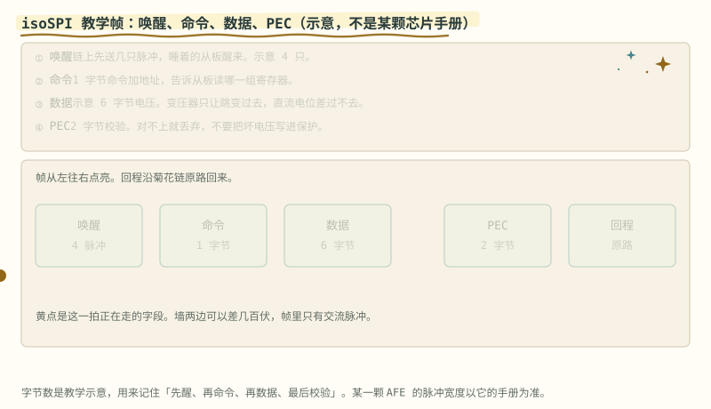

> **图说**　一帧按四拍走。

> **口诀**　先叫醒，再下命令，再收数据，最后对校验。对不上就当没听见。

**看动画时盯住哪里**

示意先发 4 只唤醒脉冲，再发 1 字节命令，再发 6 字节数据，最后 2 字节 PEC。对不上就丢掉，别把坏电压写进保护。变压器只耦合跳变，两边的地可以差几百伏。字节数是教学示意，不是某一颗 AFE 手册里的脉冲宽度。

- 从左到右五个格子：唤醒、命令、数据、PEC、回程。
- 黄点停在哪一格，哪一格就是这一拍。
- PEC 那格暗着的时候，先别相信前面的电压。

**短自测**

1. 数据字节已经到了，为什么还要等 PEC？
2. 变压器挡住的是什么，放过去的是什么？
3. 图上的 6 字节能当作 LTC6811 的帧长吗？

<details>
<summary><b>参考答案（先自己想完再展开）</b></summary>

1. 校验失败的数据不能进保护。坏电压比没有电压更危险。
2. 挡住直流电位差，放过去的是跳变。所以几百伏的共模留在墙那边。
3. 不能。它是为了记住四拍。脉冲宽度和字节数以那颗芯片的手册为准。

</details>

**练完你会怎样**：你能按顺序说出一帧：醒、命令、数据、校验。校验失败你会丢掉整帧。


解法（LTC6811 的方案）：

- 多颗 AFE 串成**菊花链**：每颗芯片接收数据、重新生成、转发给下一颗——信号像接力棒传下去，天然抵抗长链路上的衰减；
- 级间用 **isoSPI**：把 SPI 信号调制后通过**变压器**耦合。变压器只传交变信号不传直流电位——数据穿墙而过，几百伏的共模电压被挡在墙外；
- 主控 BMU 在链的一端，就能轮询整链上百串。

> 对比：BQ 系多颗级联通常各配隔离通信接口；LTC 的 isoSPI 把隔离做进了协议层，两根双绞线 + 两个变压器就是全部。

> **原理**　超过 16 串，单颗 AFE 不够了，而且相邻从板的"地"相差几十到几百伏——普通 SPI 直接连接等于拿 MCU 去摸高压。
> **证据**　变压器隔的是电，不是信号。高压包参考 [ENNOID-BMS](https://github.com/EnnoidMe/ENNOID-BMS)（英文，可选）。
> **延伸阅读**　[详解②](02-采样链与AFE芯片.md)


链断了，时间几乎等于超时。

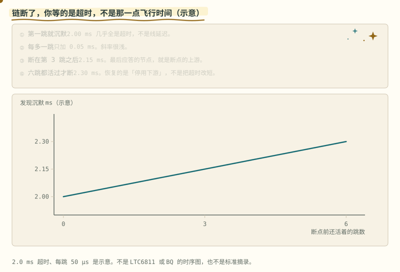

> **图说**　盯住那条很浅的直线：断在第 3 跳之后示意才 2.15 ms，大头是 2 ms 超时，不是跳数。

> **口诀**　每多一跳只加 0.05 ms。2 ms 的超时才是大头。

断在第 3 跳之后，示意 2.15 ms。教学时序，不是某颗 AFE 的手册。展开在[阶段 5](../stages/stage-5-通信与集成.md)。

**练完你会怎样**：你能用上面那句口诀，把这张图讲给别人听。

## 8. 电流采样：安时积分精度的天花板 [分析]

| 方案 | 原理 | 适合 |
|---|---|---|
| 低边分流 | B- 与地之间串毫欧电阻 | 低成本小系统；注意地弹与无法检对地短路 |
| 高边分流 | B+ 侧串电阻 + 高共模放大 | 地干净的系统 |
| 霍尔/磁通门 | 磁场感应，天然隔离 | 大电流储能/车用；零漂需出厂标定 |

分流器接法必须**开尔文（四线）**：电流走一对端子，电压采样单独一对端子——否则引线上的毫欧压降全算进电流里。

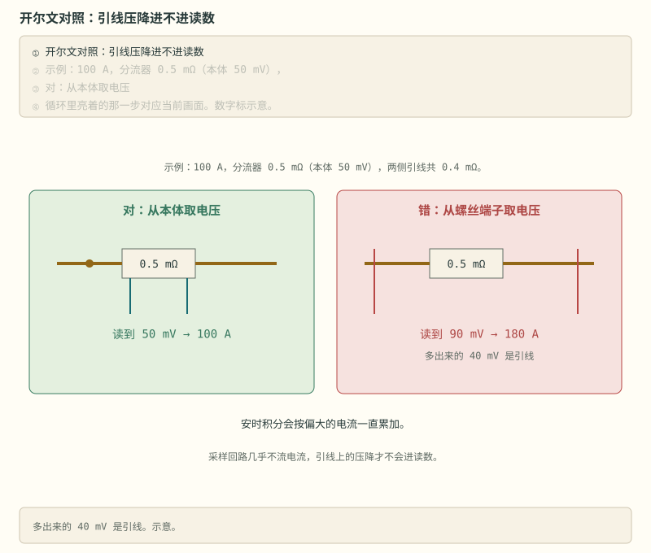

> **图说**　示例 100 A、分流器 0.5 mΩ，本体 50 mV。

> **口诀**　电流走功率端子，电压从本体另取一对。
> **算一笔**　多出来的 80 A = 40 mV / 0.5 mΩ。采样线几乎不流电流，引线压降才不进读数。
> **错了会怎样**　安时积分按偏大的电流幅值累加：放电量会多扣、充电量会多计，SOC 偏差方向取决于工况与电流符号约定。

**看动画时盯住哪里**

两侧引线共 0.4 mΩ，再掉 40 mV。从本体取电压仍是 100 A。从螺丝端子取电压变成 90 mV，折成 180 A。布线对照在 [详解⑤ §2](05-BMS电路板绘制与设计要点.md#2-采样线-应用)。

> **原理**　分流器接法必须**开尔文（四线）**：电流走一对端子，电压采样单独一对端子——否则引线上的毫欧压降全算进电流里。
> **证据**　积分会漂，因为零漂和容量误差没有校正通道。跑 [code/soc](../../code/soc/README.md) 的 `compare.py` 能看见三条曲线分开。
> **延伸阅读**　[ECE5720 Notes03 中文导读](../ece5720-notes03-中文导读.md)（可选，原文英文）

**练完你会怎样**：你能用上面那句口诀，把这张图讲给别人听。

## 9. 自测 [分析]

> **先读/后读**：这些题考采样链上的误差从哪来、断线时读数为什么会撒谎，主层是 [分析]。

1. 为什么说 MUX 架构"串间一致性好"？这对哪个 BMS 功能特别重要？
2. 把 AFE 输入 R 从 100Ω 改成 1kΩ 会发生什么？
3. NTC 在下臂的分压电路里，温度升高时中点电压往哪边走？
4. 开线后读数一定是 0 或越量程吗？两串之和与总压吻合为什么仍不够？应怎样检出和处理？
5. 保护子系统"不经过 MCU"为什么重要？
6. isoSPI 的变压器解决了什么问题？菊花链上相邻板的"地"能差多少？
7. 分流器为什么要四线开尔文接法？
8. 1 mV 量化下连续 60 拍都是 3.700 V，能判卡值吗？样本采于 1000 ms、当前 1120 ms，1115 ms 刚收到；若最大允许年龄为 100 ms，能当新样本吗？

<details>
<summary><b>参考答案（先自己想完再展开）</b></summary>

1. 因为所有串共用**同一颗 ADC、同一个基准源**：基准的初始误差与温漂、ADC 的失调与增益误差对各串是**共同的系统性偏差**，在求"串与串之差"时大部分被抵消。对**均衡**与**保护**特别重要——它们判断的正是相对关系（谁最高、谁最低、压差多大）。代价是各串不在同一瞬间采样，电流剧烈波动时首尾串对应不同时刻。
2. AFE 采样时从该引脚抽取的漏电流流过这个 10 倍大的电阻，产生 **10 倍大的压降**，直接叠加进测量值 → 该串读数**系统性偏低**。更糟的是漏电流随温度变化（通常温度升高漏电流增大），于是这个误差不是固定偏置而是会**随温度漂移**，无法用一次出厂标定消掉。举例：若漏电流在 1μA 量级，100Ω 上只有 0.1mV，1kΩ 上就是 1mV——相对 ±5mV 的总预算已经吃掉五分之一。结论：照抄手册推荐值。
3. **往下走（中点电压降低）**。NTC 是负温度系数：温度升 → $R_{NTC}$ 减小。中点电压 $V_{\text{中点}} = VCC \times \dfrac{R_{NTC}}{R + R_{NTC}}$，这个分式随 $R_{NTC}$ 单调递增，所以 $R_{NTC}$ 减小 → 中点电压降。记法：热了 NTC "变成一根导线"，把中点往地上拽。
4. 不一定。输入电容、漏电、偏置和耦合可使断线后读数仍在量程内。§4 的两串实际为 4.300/3.100 V，却可能报告 3.700/3.700 V，总和仍是 7.400 V，所以总压或邻串不能证明单节安全。按所选 AFE 手册执行开线诊断并核对结果、时间和质量；具体覆盖需验证。无效单节不得用平均值填补后继续授权，按已设计的限流/停充/受控停机策略处理并核对反馈。0 V 也不能独断根因，更不能因此屏蔽欠压保护。
5. 因为它构成一条**不依赖软件存活的独立保护通道**。MCU 可能死机、固件可能跑飞、时钟可能失效，看门狗复位也需要时间；而 AFE 内部的 OV/UV/SCD/OCD/OT/UT 各有独立比较器，触发后直接驱动保护输出关闸。两点价值：①**冗余**——任何单点软件失效下电池仍受保护，这是量产（尤其车规）的门票；②**速度**——短路保护要求 μs 级动作，而软件的"周期采样 → 判定 → 去抖 → 输出"路径是毫秒级，根本赶不上。
6. 变压器解决的是**跨大共模电位差传输信号**：它只耦合交变信号、不传导直流电位，所以 SPI 数据能穿过去，而两侧之间的直流电位差被挡在外面（同时也隔断了地环流）。相邻从板"地"的差值取决于每块板管几串：按每块 12–18 串、单体 3.6V 估算，相邻板相差约 **40–65V**；而链路两端（整包首尾）累积的共模差可达整包电压，几百伏量级（本文以 300V 为例）。
7. 分流器本体只有毫欧级电阻，而它的焊盘、引线、过孔、焊点也在毫欧量级。若电压采样与大电流通路共用同一对端子，这些引线上的压降会被一起测进去 → 电流读数**系统性偏大**，而且随焊接工艺、温度、老化漂移。开尔文（四线）把两件事分开：大电流走一对**功率端子**，电压采样走另一对从电阻本体引出的**信号端子**，采样回路几乎不流电流（无压降），测到的就是电阻本体的真实压降。SOC 安时积分的精度天花板就在这里。
8. 不能仅凭常值判卡值：§4b 的 3.6998–3.7002 V 健康输入会全部量化为 3.700 V，需结合激励、转换更新和独立证据。时间例的样本年龄为 `1120−1000=120 ms`，已超过 100 ms；接收距今 5 ms 不代表采样距今 5 ms。该比较假设采样与当前时间在同一时基，跨设备需先处理时钟映射。

</details>

**练完你会怎样**：你能说明量程正常也可能开线、常值也可能健康、刚收到也可能过期，并给出不能由替代估计授予的动作许可。开源 BQ76952 台架你不会把它说成 TI 官方评估板。

---

**上一篇**　[电路详解 ①：功率回路](01-功率回路-MOS保护与预充.md) ｜ **目录**　[五篇详解](README.md#五篇详解) ｜ **下一篇**　[电路详解 ③：充电、均衡与计量](03-充电均衡与计量.md) ｜ [阶段 3 AFE+MCU](../stages/stage-3-AFE-MCU智能BMS.md)

> **原理**　这些题考的是上面几节的机制。先盖住折叠答案，用自己的话讲完再展开。
> **证据**　这些题考的是本篇前面几节的机制。对照 [瑞萨《BMS 教程》中文导读](../renesas-bms-tutorial-中文导读.md)。
> **延伸阅读**　[华之美 DW01A 数据手册](https://hmsemi.com/downfile/DW01A.PDF)
