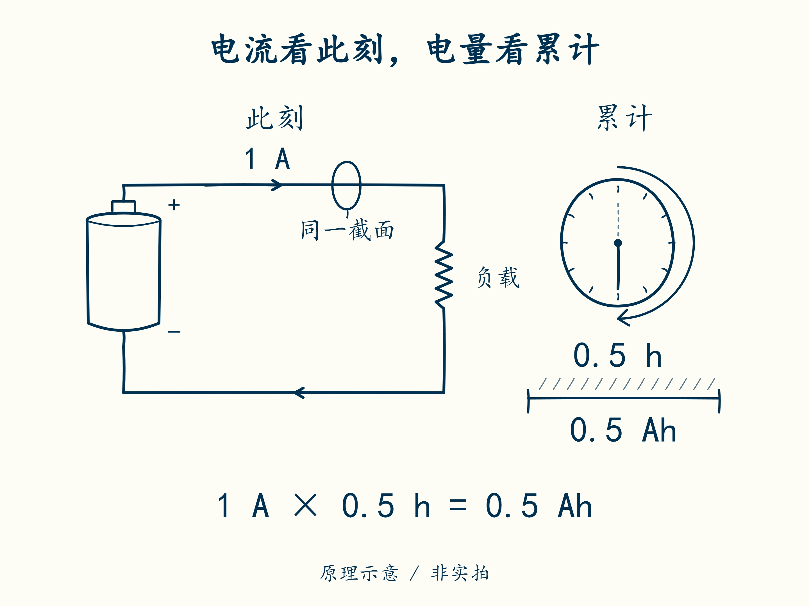

# 01 · 电压、电流与电量分别告诉你什么

先修：会乘除法。完成本课，你能解释为什么“都是 2 Ah”不能推出“能量一样多”。

## 先看一张标签

电芯是一节能独立储存和释放电能的基本单元，多节电芯可以组成电池包。灯、电机这类从电池取电的设备叫**负载**；给它们供电，就是电池在放电。

本课用一节虚拟电芯，标签写着 **标称 3.7 V、额定 2 Ah**。“标称”是用来说明规格、便于比较的代表值，不是每时每刻的实测值；“额定 2 Ah”是厂家按规定试验条件标明的容量。假定它给负载供电时，电流表读到 **1 A**。三个数字说的是三件事：

| 数字 | 回答的问题 | 此时不能推出什么 |
|---|---|---|
| 3.7 V，伏特 | 正、负两端之间的电压有多大；这里写的是标称值 | 当前正好 3.7 V、已经充满 |
| 1 A，安培 | 此刻电量通过得多快 | 电芯还剩多少电 |
| 2 Ah，安时 | 在规定试验条件下共能放出多少电量 | 任何电流、温度下都能放 2 小时 |

Ah 中的 h 是小时，1 小时 = 60 分钟 = 3600 秒。**电流乘时间得到电量**：1 A 持续 1 h，就通过 1 Ah。若只持续 30 分钟，先换算为 30 / 60 = 0.5 h，再算 1 A × 0.5 h = **0.5 Ah**。若只运行 30 秒，时间应换成 30 / 3600 h，电量为 1 × 30 / 3600 ≈ **0.00833 Ah**，不能把秒数直接当小时。

先看图里标着 1 A 的箭头：它说明此刻流得多快；要知道半小时共通过同一段导线多少电量，还要把时间算进去。

图中哪些数带 A，哪些数带 Ah？沿着这两个单位，再看下面的功率与能量。

## 再分清功率和能量

功率表示此刻用能有多快，单位 W，瓦特。公式里 **P 表示功率，V 表示电压，I 表示电流**；把电压的数值（以伏特计）乘以电流的数值（以安培计），就得到功率：

**P = V × I = 3.7 × 1 = 3.7 W。** 这里假定供电时两端实际测得的电压为 3.7 V；标签上的标称值不能保证这个读数。

能量表示一段时间内共用了多少，单位 Wh，瓦时；1 W 持续 1 h 就是 1 Wh。用 **E 表示能量**，用标称电压估算额定能量：**E ≈ 3.7 V × 2 Ah = 7.4 Wh**。“≈”表示近似相等。真实放电时电压会变化，精确能量要分成小段计算：每段用“电压 × 电流 × 小时数”，最后相加。

因此，Ah 相同不一定 Wh 相同，还要看电压。当前电压也不能直接换成剩余电量百分比，后面会单独解释。

## 跟着算一遍

假定教学电芯从满电开始，以恒定 0.5 A 放电 1 小时，忽略损耗和容量变化：

1. 放出电量：0.5 A × 1 h = **0.5 Ah**。
2. 剩余电量：2 Ah − 0.5 Ah = **1.5 Ah**。
3. 若这段平均电压为 3.6 V，放出能量约 3.6 V × 0.5 Ah = **1.8 Wh**。

检查量级：放出的 0.5 Ah 是额定 2 Ah 的四分之一；放出能量也应约为整节能量的四分之一，而不是几十 Wh。

## 合上例子再做

另一节教学电芯为标称 3.2 V、2 Ah。它从满电开始，以 0.8 A 放电 15 分钟。算出额定能量估计、放出电量，以及忽略损耗时的剩余电量。说明为什么它与 3.7 V、2 Ah 电芯的能量不同。

做完后核对

额定能量估计 3.2 × 2 = **6.4 Wh**；15 分钟 = 0.25 h，放出 **0.2 Ah**，若从满电起则剩 **1.8 Ah**。相同 Ah 只代表额定电荷量相同，电压不同使能量不同。不能把额定能量当作任意工况下保证可用的能量。

在纸上写下 V、A、Ah、W、Wh 各自回答的问题。这是模块一计算单的第一部分。

下一课：[四节串起来，哪些数会变](02-pack.md)。
