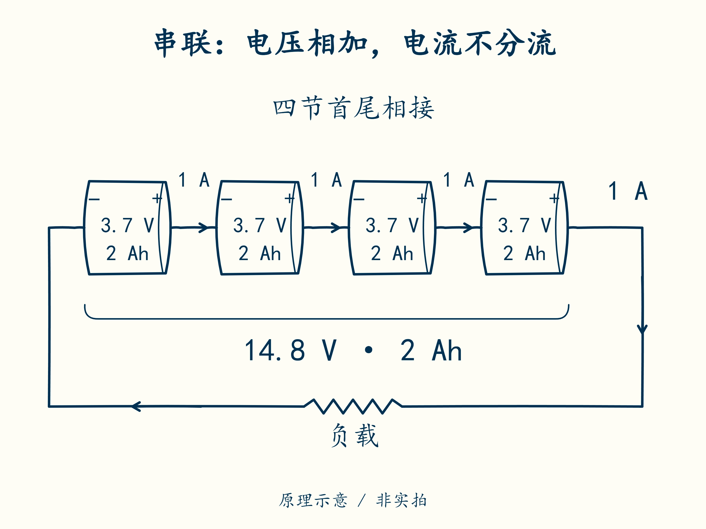

# 02 · 四节串起来，哪些数会变

先修：[第 1 课](01-units.md)的电压、电流、电量和能量。完成本课，你能读懂“4S1P、2 Ah”，并找出整包电压掩盖的单节差异。

## 同一条电流通路

每节电芯都有正端和负端。把第一节的正端接到第二节的负端，再把第二节的正端接到第三节的负端，依次接下去，称为**串联**。四节这样连接后，留下第一节的负端和第四节的正端，作为整包对外的两端。

如果把正端接在一起、负端也接在一起，就形成多条路径，称为**并联**。S 和 P 分别是串联、并联的英文简写。**4S1P** 表示四节串成一条路径，没有第二条并联支路；本课程先只研究这种连接。

假定四节规格相同，每节标称 3.7 V、2 Ah：

| 量 | 单节 | 四节串联 | 原因 |
|---|---:|---:|---|
| 标称电压 | 3.7 V | 14.8 V | 3.7 + 3.7 + 3.7 + 3.7 = 14.8 |
| 额定容量 | 2 Ah | 2 Ah | 每节经过的电流相同，通过的 Ah 不相加 |
| 额定能量估计 | 7.4 Wh | 29.6 Wh | 整包标称电压 × 容量，即 14.8 × 2 = 29.6 |

常见错法是“4 × 2 = 8 Ah”。串联增加电压，不能把容量也相加。若串联包以 1 A 放电半小时，每节均通过 0.5 Ah；整包通过的仍是 0.5 Ah。

沿图中的导线走一圈：四节之间有没有让电流分成四份的岔路？

## 整包读数不能代替四个读数

假设此刻四节分别读到 **3.70、3.72、3.68、3.71 V**。相加得到整包电压：3.70 + 3.72 + 3.68 + 3.71 = **14.81 V**。最高为 3.72 V，最低为 3.68 V，最大压差就是两者相减：3.72 − 3.68 = **0.04 V**。

小压差常用 mV，读作“毫伏”；m 表示千分之一，1000 mV = 1 V。所以 0.04 V × 1000 = **40 mV**，只是换了单位，差值没有改变。

另一个包为 **4.25、3.52、3.52、3.52 V**，总和也是 14.81 V。两包总电压相同，却不能认为四节状态相同。第 7 课才会设定教学保护阈值；现在只需看到，加总会丢掉单节信息。

为什么需要电池管理系统，简称 **BMS**？接在整包两端的用电设备，仅凭总电压看不出哪节异常；BMS 需要分别测量各节、监测温度，再限制充放电。它管理和保护电池，但不会凭空修复已经损坏的电芯。

## 合上例子再做

某 3S1P 包的三节均为标称 3.2 V、3 Ah。计算标称电压、容量和能量估计。实际三节读数为 3.40、3.28、3.31 V，再算总电压与最大压差。为什么只报总电压不够？

做完后核对

标称 **9.6 V、3 Ah、约 28.8 Wh**。实际总电压 **9.99 V**，压差 **0.12 V = 120 mV**。总电压无法指出是哪节偏高，也无法判断单节是否越过其允许范围。3 Ah 依赖规定条件与单节一致性，不能由串联形式保证。

在计算单上补上 4S 包的标称值、四个实际读数、总和、最小值和最大值。保留单位；以后这些数会进入同一个项目。

下一课：[带上负载，为什么掉压和发热](03-load.md)。
