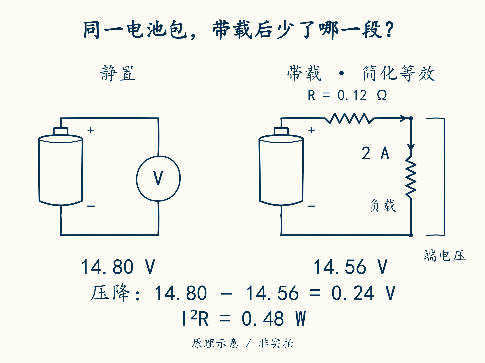

# 03 · 带上负载，为什么掉压和发热

先修：[第 2 课](02-pack.md)的串联关系。完成本课，你能估算一次带载掉压，并判断“掉压就是没电”哪里不成立。

## 从两次读数开始

4S 教学包不充电、不放电，静置时读到 **14.80 V**。接入用电设备，电流变为 **2 A**，立即读到 **14.56 V**。两次相减：14.80 − 14.56 = **0.24 V**。电压瞬间降低，不能据此说它瞬间用掉大量电量。

先比较图中两种状态：带载后，电流经过了哪一段电阻？读数比静置时少了多少？

先把真实电池简化成两部分：一部分提供电压，另一部分用一个总电阻 **R**，代表电流经过电芯、连接线和接头时受到的阻碍。这是用于估算的模型，不是说内部真的只有一颗电阻。电阻单位是 **Ω，欧姆**；1000 mΩ = 1 Ω。

把少掉的这段电压叫**压降，用 ΔV 表示**。I 仍表示电流，R 表示总电阻，关系是 **ΔV = I × R**。代入本例：2 A × 0.12 Ω = **0.24 V**，恰好解释这次瞬间变化。

在整包两端实际读到的电压叫**端电压**。本例有电流时，端电压为 14.80 − 0.24 = **14.56 V**。断开用电设备后，电流减小，压降也减小，端电压会上升。更慢的恢复还包含电化学过程，留到第 12 课。

## 电阻还把电能变成热

同一个 R 还会发热，用 **P热** 表示发热功率，单位仍为 W。公式为 **P热 = I² × R**；I² 就是 I 乘以自己。因此 2 A 时为 2 × 2 × 0.12 = **0.48 W**；4 A 时为 4 × 4 × 0.12 = **1.92 W**，是原来的四倍。不要把“电流翻倍”误当成“热也只翻倍”。

| 放电电流 | 估计压降 | 估计发热功率 |
|---:|---:|---:|
| 1 A | 0.12 V | 0.12 W |
| 2 A | 0.24 V | 0.48 W |
| 4 A | 0.48 V | 1.92 W |

观察上图的直线与下图的弯曲线：电流从 2 A 增到 4 A 时，压降翻倍，发热功率变成四倍。图线由本课公式计算，不是电池台架实测。

这些是功率，不是温升。实际升温多少还取决于持续时间、散热、热容量与局部热点。总 R 模型也不能说明某个接头的温度。

## 现在再认识倍率

同样的 1 A，对大容量和小容量电芯的负担不同。为了比较，人们按额定容量来描述电流大小，这种说法叫**倍率，用 C 表示**。

对本课 2 Ah 电芯，先算 **2 Ah / 1 h = 2 A**，把这个电流称为 **1C**。有了这个基准，0.5C 就是 2 A × 0.5 = **1 A**，2C 就是 2 A × 2 = **4 A**。反过来，若电流为 1 A，按 1 / 2 = 0.5，可知是 0.5C。4S 串联包的容量仍为 2 Ah，也按这个基准换算。

这里的 1 h 用来定义倍率，不是保证任何条件下都能放电一小时；真实允许多大电流，要看电芯要求和温度等条件。

本课只做纸笔或 PC 计算。不要为了看压降直接短路电池，也不要让新手用电流档跨接电池两端。真实测量需要正确串联接法、额定负载和独立保护，见以后硬件任务。

## 模块一交付：一页计算单

将虚拟包的电芯规格改为 **每节 3.7 V、2 Ah，4S1P，总 R = 0.16 Ω**。让它以 0.5C 放电 12 分钟，端电压暂用静置 14.8 V 减去电阻压降估算。交出电流、压降、端电压、发热功率、放出 Ah，标清哪些是模型估计。

交付后核对

0.5C = **1 A**；压降 **0.16 V**；端电压估计 **14.64 V**；热功率 **0.16 W**；12 分钟 = 0.2 h，放出 **0.2 Ah**。不能由这张计算单声称温升合格、容量实测合格或真实包可安全运行。若算成 4 A，回到“倍率相对于单节/串联包容量”这一关系重做。

需要电化学细节时再读 [电池与保护专题](../stages/stage-0-主线-电池.md)，此时不是继续课程的前置任务。

下一课：[把第一行采样读进电脑](04-first-run.md)。
