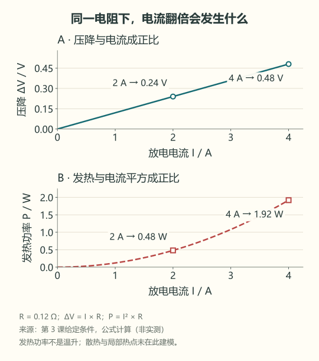

# 03 · 带上负载，为什么掉压和发热

先修：[第 2 课](02-pack.md)的串联关系。完成本课，你能估算一次带载掉压，并判断“掉压就是没电”哪里不成立。

## 从两次读数开始

4S 教学包静置时为 **14.80 V**，接上 2 A 负载后立即读到 **14.56 V**。这一下少了 0.24 V，不能据此说它瞬间用掉大量电量。

先用最简单的等效模型：电池内部有理想电压源，再串一个总电阻 R。这个电阻把电芯、连接与线束的短时压降合在一起，不代表内部真的只有一颗电阻。电阻单位是 Ω，欧姆；1000 mΩ = 1 Ω。

**压降 ΔV = I × R**。若总 R = 0.12 Ω，则 2 A 时 ΔV = 0.24 V，恰好解释这次瞬间变化。卸载后压降减小，端电压会上升。更慢的恢复还包含电化学过程，留到第 12 课。

## 电阻还把电能变成热

同一个 R 的发热功率为 **P热 = I² × R**。2 A 时为 2 × 2 × 0.12 = **0.48 W**；电流增到 4 A，发热变为 **1.92 W**，是原来的四倍。不要把“电流翻倍”误当成“热也只翻倍”。

| 放电电流 | 估计压降 | 估计发热功率 |
|---:|---:|---:|
| 1 A | 0.12 V | 0.12 W |
| 2 A | 0.24 V | 0.48 W |
| 4 A | 0.48 V | 1.92 W |

观察上图的直线与下图的弯曲线：电流从 2 A 增到 4 A 时，压降翻倍，发热功率变成四倍。图线由本课公式计算，不是电池台架实测。

这些是功率，不是温升。实际升温多少还取决于持续时间、散热、热容量与局部热点。总 R 模型也不能说明某个接头的温度。

## 现在再认识倍率

倍率用 C 表示，把电流与额定容量联系起来。对 2 Ah 电芯，**1C 对应 2 A，0.5C 对应 1 A，2C 对应 4 A**。这里 C 表示倍率，别与电荷单位库仑混淆。倍率说明工况，不自动说明电芯允许这个电流。

本课只做纸笔或 PC 计算。不要为了看压降直接短路电池，也不要让新手用电流档跨接电池两端。真实测量需要正确串联接法、额定负载和独立保护，见以后硬件任务。

## 模块一交付：一页计算单

将虚拟包的电芯规格改为 **每节 3.7 V、2 Ah，4S1P，总 R = 0.16 Ω**。让它以 0.5C 放电 12 分钟，端电压暂用静置 14.8 V 减去电阻压降估算。交出电流、压降、端电压、发热功率、放出 Ah，标清哪些是模型估计。

交付后核对

0.5C = **1 A**；压降 **0.16 V**；端电压估计 **14.64 V**；热功率 **0.16 W**；12 分钟 = 0.2 h，放出 **0.2 Ah**。不能由这张计算单声称温升合格、容量实测合格或真实包可安全运行。若算成 4 A，回到“倍率相对于单节/串联包容量”这一关系重做。

需要电化学细节时再读 [电池与保护专题](../stages/stage-0-主线-电池.md)，此时不是继续课程的前置任务。

下一课：[把第一行采样读进电脑](04-first-run.md)。
