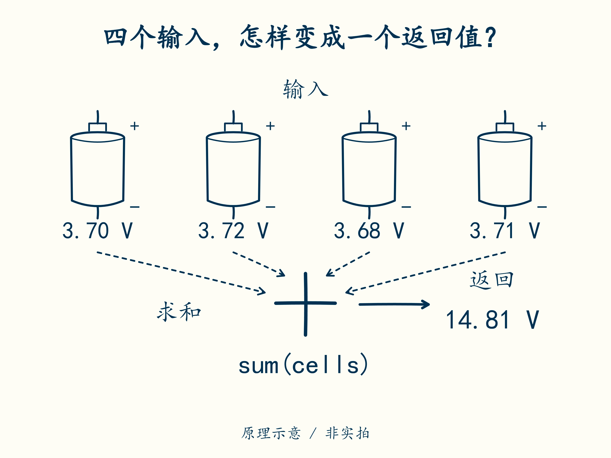

# 04 · 把第一行采样读进电脑

先修：[第 3 课](03-load.md)。本课第一次用电脑，不要求你已经会编程。完成后，你能运行一个小函数，并知道输入、代码和输出分别在哪里。

## 先让已知正确的一步成功

先按 [项目说明的环境步骤](project.md#先验证环境)安装 Python、解压代码，并在能看到 `README.md` 和 `code` 文件夹的目录打开终端。**终端**是输入命令、查看文字结果的窗口。下面每次只复制一行，按回车，等结果出现后再输入下一行。

```sh
python code/course/learn.py doctor
python code/course/learn.py init --work my_bms.py
python code/course/learn.py check --work my_bms.py --through 4
```

第一行检查环境，第二行创建你的作业文件，第三行检查到第 4 课。最后应看到 `LEARNER: 2 passed, 0 failed, through lesson 04`，意思是“学员实现通过 2 项检查，失败 0 项”。以后只需重复第三行；`init` 不会覆盖已有作业。

<span id="读懂六行-python"></span>

## 把四个数交给一个函数

用记事本或代码编辑器打开刚生成的 `my_bms.py`，找到下面两行。**函数**就是一段可以反复使用的小计算；`pack_voltage` 是它的名字，意思是“计算整包电压”。

```python
def pack_voltage(cells):
    return sum(cells)
```

`def` 表示“定义函数”；`cells` 是输入的名字。四节电压装在方括号里，称为列表：`[3.70, 3.72, 3.68, 3.71]`。`sum(cells)` 把这四个数相加；`return` 把结果交回调用它的地方。

第二行开头的四个空格叫缩进，表示这一行属于函数。请用英文括号、冒号和逗号。文件后面那些 `raise NotImplementedError(...)` 是待完成的作业，先留着；当前检查只会运行你学到的部分。



用手指沿虚线找出输入，再找返回值。图中虚线表示数据传给函数，**不表示实际接线**。

现在亲自换一组输入。回到终端运行：

```sh
python -i my_bms.py
```

出现 `>>>` 后，你进入了 Python 的交互窗口。**只输入下面每行 `>>>` 后的内容**；没有 `>>>` 的行是电脑显示的结果，不用输入。

```text
>>> cells = [3.70, 3.72, 3.68, 3.71]
>>> pack_voltage(cells)
14.81
>>> exit()
```

第一行用 `=` 给这组数起名 `cells`，第二行调用函数，最后一行退出 Python，回到可以运行检查命令的终端。某些机器会显示 `14.809999…`，这是小数在电脑里的舍入差；本例仍约为 14.81 V。

再做一次有意的改错：在编辑器中把 `return sum(cells)` 暂改成 `return 14.81`，**保存文件**，重新运行检查到第 4 课。应出现 `1 passed, 1 failed`，因为检查器还会换一组输入。观察后改回并保存，确认重新得到 `2 passed, 0 failed`。保留这次失败记录。

## 一行数据需要哪些字段

采样是某一时刻取得的一组读数。CSV 是用逗号分隔的文本表格，第一行写字段名：

```csv
sampled_s,cell1_v,cell2_v,cell3_v,cell4_v,current_a,temp_c
0.0,3.70,3.72,3.68,3.71,1.0,25.0
```

把两行上下对齐读：`sampled_s` 对应 `0.0`，表示在第 0 秒采到；`cell1_v` 到 `cell4_v` 是四节电压；`current_a` 对应 `1.0`，表示 1 A 放电；`temp_c` 对应 `25.0`，表示 25 °C。本课程约定放电为正、充电为负。列名里的单位能减少把 3700 mV 当作 3700 V 的错误。

现阶段只读懂这行，不必写读取表格的程序。完整输入和日志到第 19 课再接起来。

## 合上例子再做

给 `pack_voltage` 输入 `[3.10, 3.20, 3.30, 3.40]`，先手算，再重新进入交互窗口运行 `pack_voltage([3.10, 3.20, 3.30, 3.40])`。解释为什么把答案直接写死，第一组通过仍不表示函数正确。再说明 `current_a=-0.5` 在本课程中表示什么。

<details class="course-check">
<summary>做完后核对</summary>

总电压 **13.0 V**。函数应随输入改变；固定返回 14.81 会被第二组拒绝。−0.5 A 表示 **0.5 A 充电**。浮点计算可能出现 14.809999…，检查器允许很小的舍入差，不能因此放宽到毫伏级测量误差。

</details>

下一课：[读数离真值有多远](05-calibration.md)。
