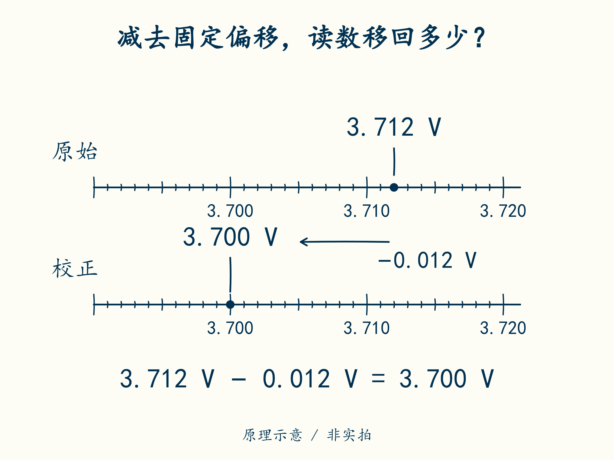

# 05 · 读数离真值有多远

先修：[第 4 课](04-first-run.md)的函数和数据字段。完成后，你能校正固定偏差，并说明校正后为什么仍有误差。

## 参考源给 3.700 V，读数却是 3.712 V

这里的**参考源**是一份电压已独立确认、用来对照的输入；**测量链**是把这个电压变成屏幕读数的整条过程。假定多次对照后，发现它稳定地偏高 **0.012 V，也就是 12 mV**。把这种大致固定的偏差称为偏移。本课先处理这个固定差值。

校正值 = 原始读数 − 偏移，因此 **3.712 − 0.012 = 3.700 V**。偏移若为 −0.020 V，说明仪器读低了，减去负数就相当于补回来。不要不看符号一律“再减 20 mV”。



观察两条尺上标记的位置：读数原先偏高时，校正应朝哪个方向移动？

用编辑器打开 `my_bms.py`，找到 `calibrate`，把它下面的 `raise NotImplementedError(...)` 替换为下面的 `return` 行并保存。`raw_v` 是校正前的原始读数，`offset_v` 是已确认的偏移，两个输入都用 V。

```python
def calibrate(raw_v, offset_v):
    return raw_v - offset_v
```

回到终端运行 `python code/course/learn.py check --work my_bms.py --through 5`。应有 **4 项通过、0 项失败**，其中包含第 4 课的两项。之后每课沿用这个命令，只提高 `--through` 的数字。

## 电子读数如何出现台阶

可以把电子读数想成用一把有刻度的尺子量电压：真实电压可以连续变化，读数却只能落在一个个刻度上。负责把电压转成整数的器件叫**模数转换器，简称 ADC**；它给出的整数叫码值。

假定教学 ADC 为 12 位，表示有 2¹² = 4096 个可用整数，从 0 数到 4095。本例用 5 V 作为换算的参考电压，没有先把输入电压缩小。本课约定 **电压 V = 码值 × 5 / 4095**。所以码值 0 对应 0 V，4095 对应 5 V；码值每增加 1，读数增加约 **0.00122 V = 1.22 mV**。这一个个台阶带来的误差叫量化误差。

先记住“刻度有限”即可继续。选芯片时还要回到手册：真实芯片可能按参考电压 / 4096 描述步长，还存在参考源误差、噪声和不同位置刻度不均匀等问题。多节电池专用采样芯片（AFE）的接法和换算也不能照搬本例。

| 误差来源，教学上界 | 幅度 | 能靠减固定偏移消除吗 |
|---|---:|---|
| 稳定偏移 | 12 mV | 可校正主要部分，受校准条件限制 |
| 量化，取半步 | 约 0.61 mV | 不能 |
| 参考源与前端剩余误差 | 4 mV | 不能靠一次单点校正保证 |
| 重复采样变化 | 2 mV | 不能保证瞬时读数等于平均值 |

校正了稳定偏移后，剩下三项若恰好都朝同一方向偏，合计为 **0.61 + 4 + 2 = 6.61 mV**。这就是保守的误差预算：先给出最不利时可能差多少。只有掌握了各项的统计分布和相互关系，才适合用别的合成方法。

例如把剩余上界向上取整为 ±7 mV，校正读数 4.190 V 的可能区间就是 **4.190 − 0.007 = 4.183 V** 到 **4.190 + 0.007 = 4.197 V**。在这些假设成立时，区间全部低于 4.200 V；判断靠的是整个区间，不能只看显示值。

## 合上例子再做

原始值 3.681 V，已确认偏移 −0.009 V。算出校正值。若剩余误差上界为 ±7 mV，校正读数 4.198 V 能否证明真实电压低于 4.200 V？

<details class="course-check">
<summary>做完后核对</summary>

校正值 **3.690 V**。4.198 V 对应的可能区间为 **4.191–4.205 V**，不能证明真实电压低于 4.200 V。阈值设计需要测量裕量，不能用显示小数位数代替准确度。

</details>

下一课：[没有新数据时，不能沿用绿灯](06-quality.md)。
