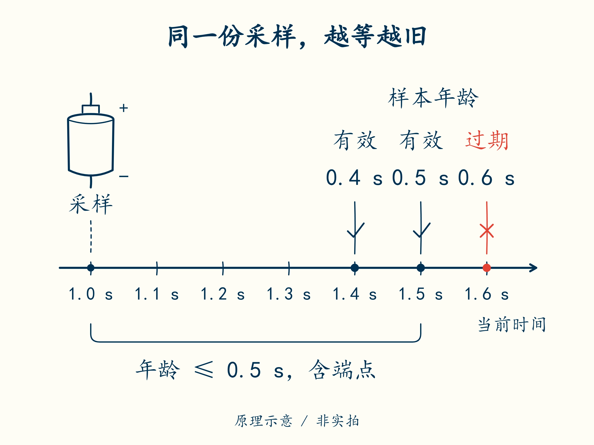

# 06 · 没有新数据时，不能沿用绿灯

先修：[第 5 课](05-calibration.md)。完成后，你能拒绝缺失、无效与过期样本，并区分“值看着正常”和“有可信的新数据”。

## 同样是 3.70 V，意义可能不同

在第 1 秒采到四节 3.70 V，第 2 秒程序还显示它们。可能电池确实稳定，也可能采样已经停止，页面只留下旧值。**采样时间**回答“什么时候测的”，**当前时间**回答“现在什么时候”；两者相减才是样本年龄。

本课分两步判断。先看四节读数是否齐全、是否都是可用的数，再看它们够不够新。**样本年龄 = 当前时间 − 采样时间**；年龄为 0 表示刚采到，0.4 s 表示已经过去 0.4 秒。

教学规则：四节均有值、数值有限、每节位于 0–5 V 的表示范围内，且年龄位于 **0–0.5 s（含端点）**，才算这项质量检查通过。“数值有限”是指不能是无穷大或无效数值。这个宽范围只抓明显坏数据，不代表 0 V 是安全电芯电压。安全阈值下一课单独判断。

| 采样时间 | 当前时间 | 年龄 | 本项结果 |
|---:|---:|---:|---|
| 1.0 s | 1.4 s | 0.4 s | 通过 |
| 1.0 s | 1.5 s | 0.5 s | 通过，刚好到上限 |
| 1.0 s | 1.6 s | 0.6 s | 过期 |
| 2.0 s | 1.5 s | −0.5 s | 时间关系无效 |

“时间戳”就是随读数一起记下的时间。这里的两个时间都从同一个起点计秒；一台电脑说“已经运行 10 秒”，另一台说“现在 14 点”，不能直接相减。



图中只采了一次。找出从“还能用”变成“过期”的位置，并说清变化的是电压，还是样本年龄。

## 把判断写成函数

先读懂一个判断：`len(cells) == 4` 表示“四节读数是否齐全”。`len` 数列表里有几项；`==` 比较两边是否相等，结果为 `True`（是）或 `False`（否）。第 4 课的单个 `=` 用来起名或赋值，作用不同。

下面的代码是本课完整示范。替换 `my_bms.py` 中 `sample_ok` 的待完成内容，保留文件开头已有的 `import math`；它让程序能使用数学工具。

```python
def sample_ok(cells, sampled_s, now_s, max_age_s):
    values_ok = len(cells) == 4 and all(
        math.isfinite(v) and 0 <= v <= 5 for v in cells)
    time_ok = all(math.isfinite(t) for t in
                  (sampled_s, now_s, max_age_s))
    return (values_ok and time_ok and max_age_s >= 0
            and 0 <= now_s - sampled_s <= max_age_s + 1e-9)
```

按三个名字读这段代码即可：`values_ok` 检查电压，`time_ok` 检查时间，最后的 `return` 要求两者都通过，并且样本年龄没有越界。`sampled_s`、`now_s`、`max_age_s` 依次是采样时间、当前时间、允许的最大年龄，单位都是秒。

`and` 表示条件都要满足。`for v in cells` 表示依次拿出每节电压，用 `v` 临时称呼它；`all(...)` 要求每一节都通过括号内的检查。`0 <= v <= 5` 表示包含两端的 0–5 V。`math.isfinite(v)` 会拒绝无穷大和 NaN（表示没有有效数值）；对时间列表的检查也是同一读法。

保存后运行 `python code/course/learn.py check --work my_bms.py --through 6`，应有 **12 项通过、0 项失败**。再进入第 4 课的交互窗口，分别运行 `sample_ok([3.7, 3.7, 3.7, 3.7], 1.0, 1.4, 0.5)` 和把 `1.4` 换成 `1.6` 的调用，观察结果从 `True` 变成 `False`，然后用 `exit()` 退出。

上界的 `1e-9` 是 0.000000001 秒，专门容纳电脑小数的舍入差：例如 1.1 − 0.6 可能略大于 0.5。它不代表可以放宽真实超时要求。不要把缺失值换成 0 后当作新测量，也不要为了让曲线连续而插值后隐藏“缺失”标签。

## 模块二交付：带质量的数据

样本 A 为四节 `[3.7,3.7,3.7,3.7]`，采样 5.0 s，当前 5.5 s；B 只有三节，时间同 A；C 有四节，时间为采样 5.0 s、当前 5.51 s。按 0.5 s 上限逐一给出结论，并说明同一个 5.0 s 样本被重复收到时，还应增加什么检查。

<details class="course-check">
<summary>交付后核对</summary>

A 通过年龄端点；B 缺节，失败；C 过期，失败。重复收到同一时间戳不能算新观察，整合控制器还要求采样时间递增，并检查采样间隔。`sample_ok` 本身不保存上一次时间，因此只通过此函数还不足以证明流式数据连续。

</details>

保留检查输出，并写下后续需求：“数据无效时，不允许继续接通输出。”代码里把“允许输出”称为使能，下一课再接上限值判断。

下一课：[整包正常，为什么单节已经越线](07-limits.md)。
