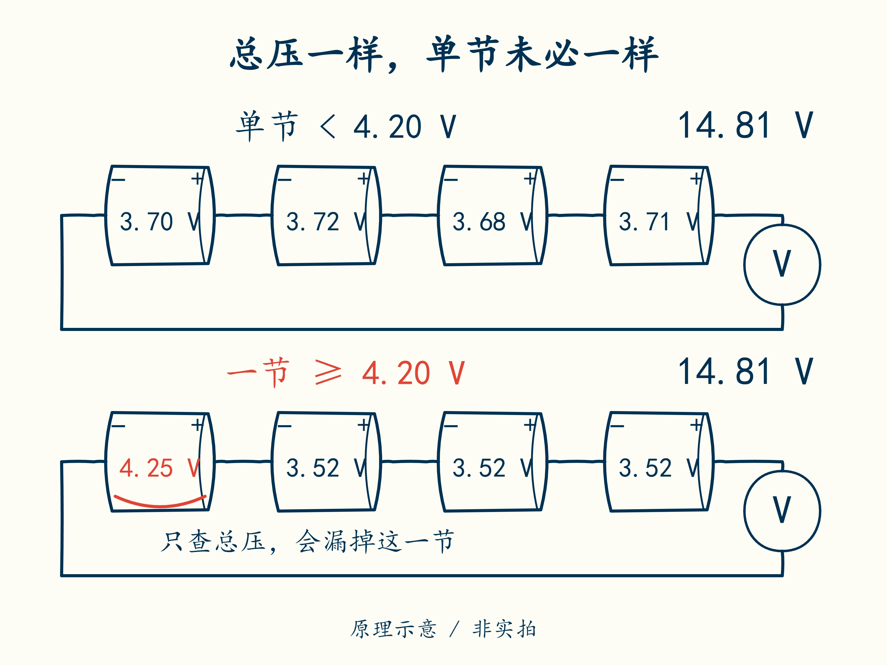

# 07 · 整包正常，为什么单节已经越线

先修：[第 6 课](06-quality.md)的样本质量。完成本课，你能把“数据有效”和“电池状态允许”分开判断。

## 加总藏住了什么

第 2 课中，`[4.25,3.52,3.52,3.52]` 的和为 14.81 V。若只看整包，读数与正常例子一样；但一节已经高出本项目的 **4.20 V 教学上限**。

先接上上一课的判断：假定这四个读数刚刚采到，数值都在 0–5 V 内，第 6 课的质量检查可以通过。它只说明“数据可以拿来判断”，并没有说“电池处于允许范围”。本课要补上后一个问题。

本项目约定：单节 **≤3.00 V** 标记欠压，**≥4.20 V** 标记过压。这两个用来作判断的边界叫阈值，含端点：恰好读到 3.00 V 或 4.20 V，也算越线。

这些数字只供虚拟训练。真实产品需要按电芯型号、温度、测量误差和安全目标确定阈值，尤其不能把三元示意值用于磷酸铁锂。

先遮住单节数字，只看两个总压；再沿串联路径检查每节。总压相同时，哪一处信息会被加总藏起来？图只比较上限，完整判断还要检查欠压下限与数据质量。

| 检查层 | 输入 | 回答 |
|---|---|---|
| 质量检查 | 数值、节数、时间 | 这批数据能不能用 |
| 限值检查 | 有效单节电压 | 是否有单节越线 |
| 动作判断 | 越线及持续时间 | 何时禁止充电/放电 |
| 反馈检查 | 开关实际状态 | 命令是否得到执行 |

第一层失败，就不能拿读数继续宣告“没有越线”。第二层发现越线，也不等于已经成功切断电流；后两层在接下来的课里完成。

## 从一句判断写到接口

学员文件中的 `violations(cells, low_v, high_v)` 返回一个布尔值。布尔值只有 `True` 和 `False`。本题只需判断最小值是否低于或等于下限，**或者**最大值是否高于或等于上限；Python 用 `min`、`max` 和 `or` 表达。

三个输入沿用前面已认识的量：`cells` 是四节电压列表，`low_v` 是下限 3.00，`high_v` 是上限 4.20，单位都为 V。`min(cells)` 找最低单节，`max(cells)` 找最高单节。对开头这组数，最低 3.52 V 没有欠压，但最高 4.25 V 已过压，所以整个函数返回 `True`。它表示“至少发现一项越线”，不是“允许输出”。

先写出自己的表达式，再运行检查到第 7 课。此函数假定第 6 课质量检查已经通过，不接受空列表。把每层的输入约定写清，比在一个函数里到处补默认值更容易审查。

后面的项目用一个统一的“允许输出”条件，代码中称为使能。真实 BMS 常分别限制充电和放电，过压可能只禁充、欠压只禁放，还可能有独立硬件保护。需要分方向控制时，必须重新定义状态与测试，不能把本例一个布尔值直接搬上板。

## 合上例子再做

包 A：`[3.00,3.70,3.70,3.70]`；包 B：`[3.01,3.70,3.70,4.19]`；包 C：缺少一个读数。按本课规则分别判断。解释为什么把四节平均后再比阈值会漏报。

做完后核对

A 欠压端点，返回 **True**；B 未越本课电压阈值，返回 **False**，不等于整个系统安全；C 在质量层拒绝，不进入此函数。平均值会稀释某一节的异常。工程阈值还要考虑第 5 课误差预算。

下一课：[越线多久才动作，回来多少才恢复](08-time.md)。
