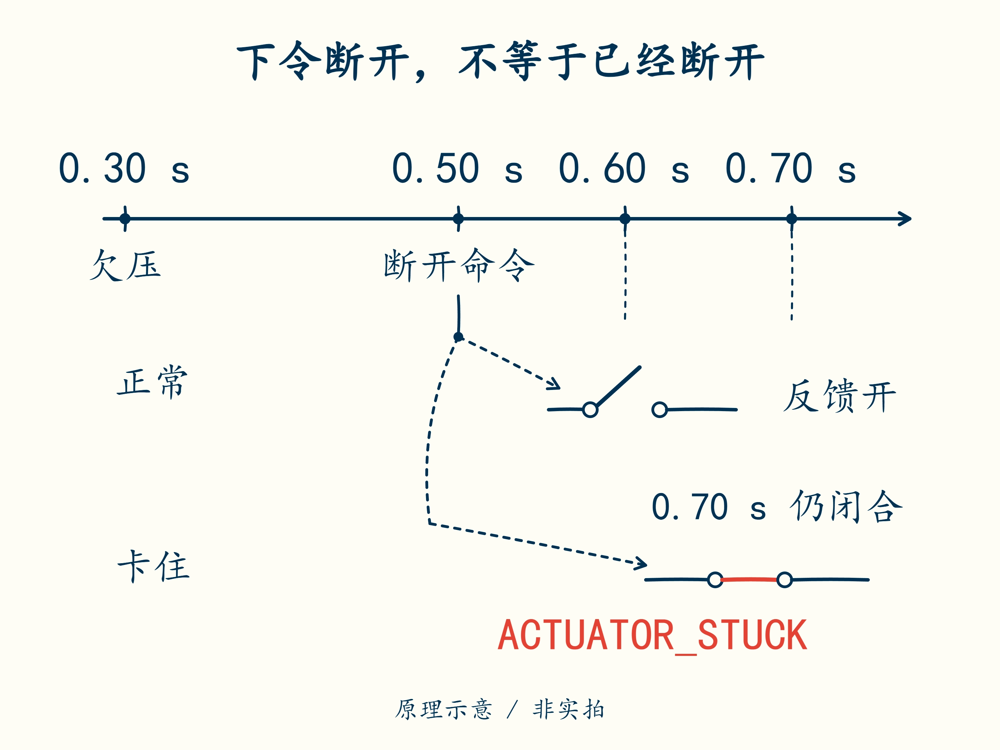

# 09 · 发出断开命令，不等于已经断开

先修：[第 8 课](08-time.md)。完成本课，你能把“我要求开关做什么”与“开关实际做了什么”分别记下来。

## 两条不同的信号

沿用上一课的事件：电压从 0.30 s 起一直偏低，到 0.50 s 软件决定断开。此时软件做的是发出要求，开关还需要时间执行。被命令动作的开关器件叫执行器；报告它实际状态的信号叫反馈。

`command_on=False` 表示软件要求停止输出；`feedback_closed=True` 表示模型中的开关反馈仍闭合，也就是这条通路尚未被反馈证实断开。两者可以暂时不一致，因为执行器有响应时间；长期不一致则必须诊断。

沿两条分支找开关触点：哪个时刻只发出了命令，哪个时刻才有“已经断开”的反馈？

本项目在 **0.50 s** 发出断开命令，允许反馈最多等待 **0.20 s**。到 0.60 s 仍闭合时，只等了 **0.60 − 0.50 = 0.10 s**；到 **0.70 s** 还闭合，才达到本例等待上限，增加 `ACTUATOR_STUCK`（执行器卡住）故障。

此时要保留两条记录：先有欠压，所以要求断开；随后反馈没有按时打开，所以又发现执行问题。输出继续保持禁止。把故障变量清零，不会让已经粘连的开关物理断开。

## 锁存与复位

假如断开后卸去了负载，电压回升，新的电压样本可能重新落在正常范围。它只证明“现在读数回来了”，不能证明刚才的欠压原因已经消除。锁存就是记住已经发生的故障，不让它因一个正常样本自动消失。

复位表示经过检查后解除这条故障记忆。复位至少要求：**人工明确请求、当前条件已安全、反馈证实已断开**。函数 `can_reset(manual, safe, feedback_open)` 分别接收这三个布尔值，只有三项都为 `True` 才返回 `True`。它只表达必要条件，不实际执行复位。

可以先比较两次请求：三项均为真时允许进入复位检查；若当前安全、反馈已断开，但没有人工请求，仍不允许。完成函数并检查到第 9 课。

注意 `feedback_open` 问的是“是否已断开”，日志的 `feedback_closed` 问的是“是否仍闭合”，含义相反。在本题只取真/假的反馈中，`feedback_closed=True` 就对应 `feedback_open=False`，不能把同一个值原样传进去。

本课函数是复位条件练习。整合项目为便于审查始终锁存，不提供实际清故障命令。要扩展复位，需要确认电压均 ≥3.15 V 且低于恢复上限、温度与质量有效，并重新走启动检查。真实硬件还需要独立切断途径和故障处置规程，不能靠这个函数保证安全。

## 模块三交付：一条完整动作链

输入为：0.30 s 开始连续欠压，0.50 s 下令断开，0.60 s 反馈仍闭合，0.70 s 反馈仍闭合，0.80 s 电压回升到 3.20 V。画出越线、确认、命令、反馈超时和锁存五个时刻。回答“0.80 s 能否自动重合”，再列一项当前 PC 记录无法验证的硬件问题。

交付后核对

欠压从 **0.30 s** 起计，**0.50 s** 确认并下令；**0.70 s** 达反馈等待上限，判卡住。0.80 s 电压回升仍不自动重合。反馈电路是否能识别真实粘连、MOS 是否已击穿、独立保护能否切断等，都需要目标硬件验证。

下一课：[用电流和时间做电量账本](10-counting.md)。
