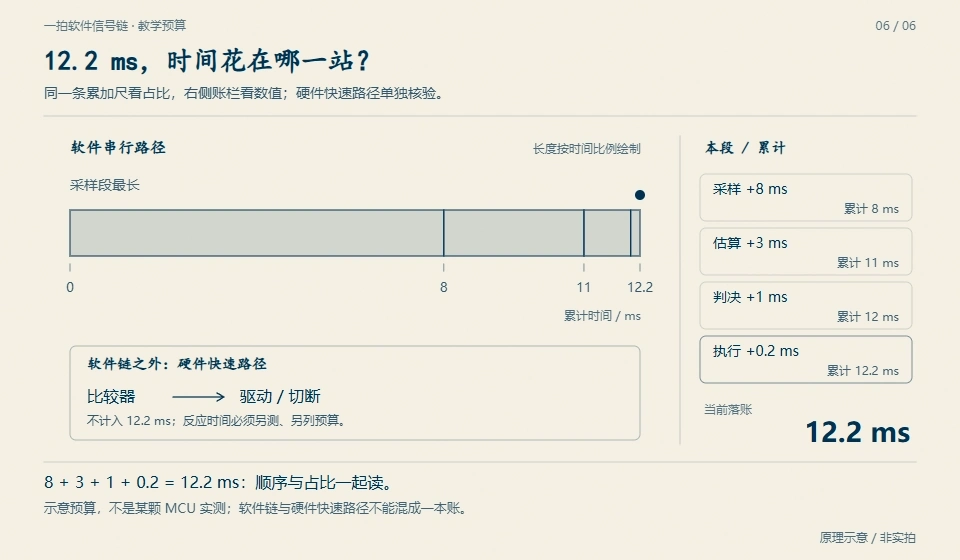

# 09 · 发出断开命令，不等于已经断开

先修：[第 8 课](08-time.md)。完成本课，你能把“我要求开关做什么”与“开关实际做了什么”分别记下来。

## 两条不同的信号

`command_on=False` 表示软件要求停止输出；`feedback_closed=True` 表示模型中的开关反馈仍闭合。两者可以暂时不一致，因为执行器有响应时间；长期不一致则必须诊断。

这是机制示意，图中其他工程数字不作为本项目配置。观察任务：指出命令和反馈分别属于哪一段；不要用命令箭头代替反馈证据。

本项目在 **0.50 s** 发出断开命令，允许反馈最多等待 **0.20 s**。若 **0.70 s** 反馈仍闭合，增加 `ACTUATOR_STUCK`（执行器卡住）故障。输出保持禁止，原欠压故障也继续保留。把故障变量清零，不会让已经粘连的开关物理断开。

## 锁存与复位

锁存意味着故障发生后不会因一个正常样本自动消失。复位至少要求：**人工明确请求、当前条件已安全、反馈证实已断开**。`can_reset(manual, safe, feedback_open)` 只表达这三项都满足的必要条件。

完成函数并检查到第 9 课。注意 `feedback_open` 与日志的 `feedback_closed` 含义相反，调用时必须转换；命名不清是这类错误的常见来源。

本课函数是复位条件练习。整合项目为便于审查始终锁存，不提供实际清故障命令。要扩展复位，需要确认电压均 ≥3.15 V 且低于恢复上限、温度与质量有效，并重新走启动检查。真实硬件还需要独立切断途径和故障处置规程，不能靠这个函数保证安全。

## 模块三交付：一条完整动作链

输入为：0.30 s 开始连续欠压，0.50 s 下令断开，0.60 s 反馈仍闭合，0.70 s 反馈仍闭合，0.80 s 电压回升到 3.20 V。画出越线、确认、命令、反馈超时和锁存五个时刻。回答“0.80 s 能否自动重合”，再列一项当前 PC 记录无法验证的硬件问题。

交付后核对

欠压从 **0.30 s** 起计，**0.50 s** 确认并下令；**0.70 s** 达反馈等待上限，判卡住。0.80 s 电压回升仍不自动重合。反馈电路是否能识别真实粘连、MOS 是否已击穿、独立保护能否切断等，都需要目标硬件验证。

下一课：[用电流和时间做电量账本](10-counting.md)。
