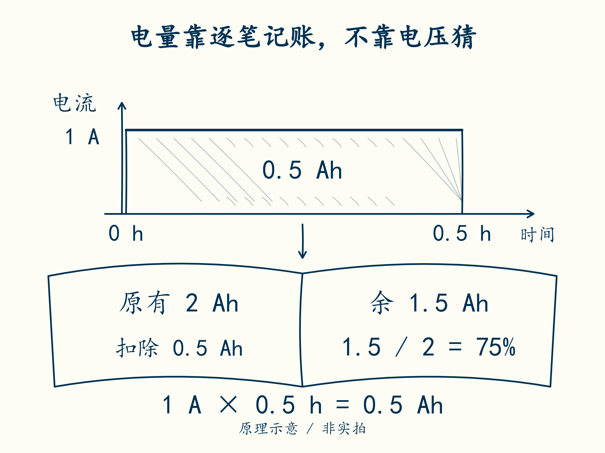

# 10 · 用电流和时间做电量账本

先修：[第 9 课](09-feedback.md)，以及第 1 课的 Ah。完成本课，你能从一小段电流记录更新剩余电量。

## 从“还剩多少 Ah”到 SOC

前面几课判断的是“此刻还能不能允许输出”。现在换一个问题：即使电压没有越线，这个包还剩多少电？回到第 1 课的电量单位 Ah，先按流出的电量一笔笔扣账。

4S 包额定容量 2 Ah，若当前可用电量为 1.5 Ah，比例为 1.5 / 2 = **0.75 = 75%**。这个剩余电量比例称为荷电状态，简称 **SOC**。串联包仍按 2 Ah 记账，不把容量乘以四。本项目在代码中用 0–1，展示时才乘 100%；不要把 75 和 0.75 混用。

先把公式里的四个量认清：旧 SOC 用 `s` 表示；电流用 `I` 表示，放电为正、充电为负；这一小段经过的时间用 `Δt` 表示，单位秒；容量用 `Q` 表示，单位 Ah。Δt 读作“delta t”，这里只表示一段时长。

**新 s = 旧 s − I × Δt / (3600 × Q)**。

别急着把四个量一次代进公式。先算 **I × Δt / 3600**，得到流出的 Ah；再除以 Q，得到流出电量占容量的比例；最后从旧 SOC 扣掉这个比例。若电流为负，减去负数使 SOC 上升，正好对应充电。本例暂不计算充电效率和温度引起的可用容量变化。

先找电流时间图中 1 A 与 0.5 h 围住的面积，再沿箭头找到电量账本。哪一步得到 Ah，哪一步除以容量后才得到 SOC？账本表示累计电量，图中没有用电压或液面高度代替 SOC。

## 按两段记录走一遍

从满电 1.00 开始，先以 1 A 放电 1800 s，再以 −0.5 A 充电 720 s：

第一段先换时间：1800 / 3600 = 0.5 h。流出电量为 1 × 0.5 = 0.5 Ah，占 2 Ah 的 0.25，所以 SOC 从 1.00 减到 0.75。

第二段流出的带符号电量为 −0.5 × 720 / 3600 = −0.1 Ah，负号表示实际流入。除以 2 Ah 得 −0.05，更新时为 **0.75 − (−0.05) = 0.80**。括号中的负号不能丢掉。

| 段 | 电量变化 | SOC 变化 | 段末 SOC |
|---|---:|---:|---:|
| 放电 | −0.5 Ah | −0.25 | 0.75 |
| 充电 | +0.1 Ah | +0.05 | 0.80 |

分段电流为常数时，这样记账称为库仑计数或安时积分。实际采样很密时，也是一小段一小段累加。整合项目采用前一个采样点电流保持到下一个采样点的约定，不能拿后一个电流悄悄改算前面的区间。

在 `soc_step(soc, current_a, dt_s, capacity_ah)` 中实现公式。四个输入依次对应旧 SOC、电流 A、时长 s、容量 Ah；每次调用只更新这一小段，函数返回新的 SOC。

结果要限制在 0–1：算到小于 0 时只显示 0，超过 1 时只显示 1。这个处理称为限幅。容量必须为正，时间不能为负，输入也必须是有限数值；不符合时抛 `ValueError`，表示拒绝这组输入，不是返回 SOC 为零。限幅防止显示越界，但会隐藏账本超支，工程诊断仍应保留超支证据。

## 合上例子再做

初始 SOC 为 0.60，容量 2 Ah，以 0.8 A 放电 900 s。算新 SOC。若随后缺了十分钟电流记录，是否可以继续宣称 SOC 仍有同样可信度？

做完后核对

流出 **0.2 Ah**，比例减少 **0.10**，新 SOC 为 **0.50**。缺失十分钟时不知道电量变化，不能把缺段当作零电流；可以保留最后估计，但应标记不确定。第 19 课会让 SOC 质量随缺样失效。

下一课：[账本为什么越记越偏](11-drift.md)。
