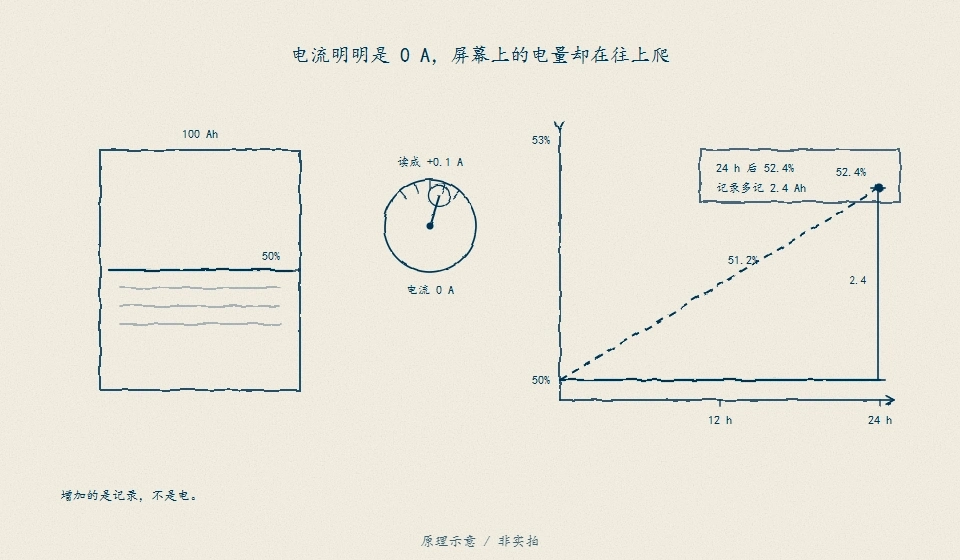

# 10 · 用电流和时间做电量账本

先修：[第 9 课](09-feedback.md)，以及第 1 课的 Ah。完成本课，你能从一小段电流记录更新剩余电量。

## 从“还剩多少 Ah”到 SOC

4S 包额定容量 2 Ah，若当前可用电量为 1.5 Ah，比例为 1.5 / 2 = **0.75 = 75%**。这个剩余电量比例称为荷电状态，简称 **SOC**。本项目在代码中用 0–1，展示时才乘 100%；不要把 75 和 0.75 混用。

设旧 SOC 为 s，放电电流 I 为正，持续时间 Δt 以秒计，容量 Q 以 Ah 计：

**新 s = 旧 s − I × Δt / (3600 × Q)**。

右边 I × Δt / 3600 是流出的 Ah，再除以 Q 得到比例。若电流为负，减去负数使 SOC 上升，正好对应充电。本例暂不计算充电效率和温度引起的可用容量变化。

观察任务：找出累计变化的输入，而不是把图中某个电压值当成 SOC 真值。本课数值以正文给定的 2 Ah 为准。

## 按两段记录走一遍

从满电 1.00 开始，先以 1 A 放电 1800 s，再以 −0.5 A 充电 720 s：

| 段 | 电量变化 | SOC 变化 | 段末 SOC |
|---|---:|---:|---:|
| 放电 | −0.5 Ah | −0.25 | 0.75 |
| 充电 | +0.1 Ah | +0.05 | 0.80 |

分段电流为常数时，这样记账称为库仑计数或安时积分。实际采样很密时，也是一小段一小段累加。整合项目采用前一个采样点电流保持到下一个采样点的约定，不能拿后一个电流悄悄改算前面的区间。

在 `soc_step` 中实现公式，将结果限制在 0–1。容量必须为正，时间不能为负；这两个条件不满足时应抛 `ValueError`，不要默默给出看似正常的结果。边界截断防止显示越界，但会隐藏账本超支，工程诊断仍应保留超支证据。

## 合上例子再做

初始 SOC 为 0.60，容量 2 Ah，以 0.8 A 放电 900 s。算新 SOC。若随后缺了十分钟电流记录，是否可以继续宣称 SOC 仍有同样可信度？

做完后核对

流出 **0.2 Ah**，比例减少 **0.10**，新 SOC 为 **0.50**。缺失十分钟时不知道电量变化，不能把缺段当作零电流；可以保留最后估计，但应标记不确定。第 19 课会让 SOC 质量随缺样失效。

下一课：[账本为什么越记越偏](11-drift.md)。
