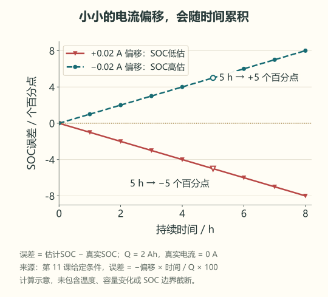

# 11 · 账本为什么越记越偏

先修：[第 10 课](10-counting.md)。完成本课，你能分别估计电流零漂和容量设错造成的 SOC 误差。

## 静置时也在“记放电”

真实电流为 0 A，传感器却一直读 **+0.020 A**。五小时后，多记的放电量为 **0.020 × 5 = 0.10 Ah**。对 2 Ah 包，这使 SOC 少算 **0.10 / 2 = 0.05**，即 **5 个百分点**。

这不是电池真的流出了 0.10 Ah，而是程序每次扣账都多扣一点，积累了五小时。即使电流完全不变，电量误差也会随时间增长，这就是这里所说的漂移。下面的线性误差计算先假定 SOC 没有碰到上一课的 0 或 1 限幅。

这里“少算 5 个百分点”与“相对少算 5%”不同：真实 50% 却报 45%，差 5 个百分点，相对误差为 10%。报告误差时写清分母。

`drift(offset_a, hours, capacity_ah)` 的三个输入是电流偏移 A、累计时间 h 和容量 Ah。注意时间已经是小时，这里不用再除以 3600。它返回“多记的放电量占容量的比例”，保留正负号：

**函数结果 = 电流偏移 × 小时数 / 容量。**

开头这组输入使函数返回 **+0.05**，表示账本多扣了 5 个百分点。若把误差定义为“报告 SOC − 真实 SOC”，结果应是 **−0.05**。一个说多扣了多少，一个说最终报高还是报低，两者符号相反；在图表或报告中先写清采用哪个定义。

图中纵轴用“估计 SOC − 真实 SOC”，单位为百分点，因此正电流偏移对应向下的实线。先找 5 小时位置的两种误差，再解释为什么两条曲线方向相反；线型与标记也区分了它们。此图为公式计算，未进行真实校准。

## 换了容量，公式还会算，但分母错了

老化后真实可用容量为 **1.6 Ah**，程序仍按 2 Ah。满电开始放出 0.8 Ah：

| 使用的容量 | 计算的剩余比例 |
|---|---:|
| 程序 2 Ah | 1 − 0.8 / 2 = 60% |
| 本次条件下实测 1.6 Ah | 1 − 0.8 / 1.6 = 50% |

程序高估 **10 个百分点**。这与电流偏移的来源不同：一个是每段电量记错，一个是归一化容量错。简单把 SOC 加减一个常数，不能同时修复两者。

“归一化”在这里就是除以容量、换成 0–1 的比例。两种计算都承认已经放出 0.8 Ah；分歧在于，0.8 Ah 是 2 Ah 的 40%，却是 1.6 Ah 的 50%。所以同样从满电开始，剩余比例才会差 10 个百分点。

## 给误差找证据

验证零漂需要在确认无电流的条件下取得原始数据；“命令已断开”仍不足以证明电流为零，记得第 9 课的反馈。容量测试则要固定温度、倍率、截止条件和仪器，不能用某一次短时带载掉压代替。

本课只用已给定的示意偏移和容量计算，未执行真实校准或容量试验。完成 `drift` 后检查到第 11 课，再把这两个误差项写进模块四的预算表。

## 合上例子再做

偏移为 −0.010 A，静置 8 h，容量 2 Ah，SOC 会往哪个方向偏、偏多少个百分点？另一个包真实容量 1.5 Ah，程序按 2 Ah，从满电放出 0.6 Ah，两种 SOC 各是多少？

做完后核对

`drift` 返回 **−0.04**，传感器误报充电，SOC 高估 **4 个百分点**。第二问程序报 **70%**，真实容量条件下为 **60%**。不能只凭一次 SOC 不准就断言原因是电流零漂，应分别检查初始值、电流、时间和容量。

下一课：[何时能用电压校正电量](12-voltage-model.md)。
