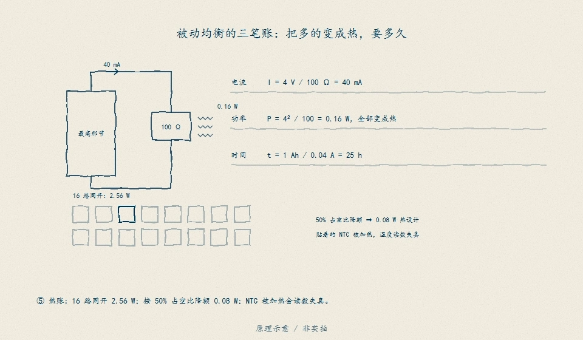
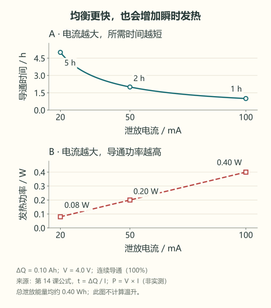

# 14 · 均衡需要多久，热往哪里去

先修：[第 13 课](13-charging.md)的充电限制，以及第 3 课的功率。完成本课，你能估算一次被动均衡的最短时间与发热量。

## 多出来的电量要去哪里

假定经过可追溯的电量分析，4S 教学包有一节比目标状态多 **0.10 Ah**。先只解决“怎样去掉这部分多余电量”。在这节两端接入一条带开关和电阻的旁路，开关闭合时，就让电流经这条路流过电阻，把电能变成热。这叫被动均衡，流出去的电流叫泄放电流。

它不会把这份电量搬到较低的电芯，也不会使已经衰减的电芯恢复容量。这里给定的 0.10 Ah 来自前面的电量分析，不能只看两节电压有差，就断言知道相差多少 Ah。

本题设泄放电流恒为 **0.050 A，即 50 mA**，先忽略电流随电压变化。所需导通时间为：

**时间 = 要泄放的电量 / 泄放电流 = 0.10 Ah / 0.050 A = 2 h。**

量级检查：50 mA 很小，要消除十分之一 Ah 的差异需要小时，不能期待几秒钟均衡完成。函数 `balance_hours(delta_ah, current_a)` 的输入分别是要去掉的 Ah 和泄放电流 A，返回小时。先把 50 mA 换成 0.050 A，再相除，不能把 50 直接放进分母。

输入必须为有限数，电量差不能为负，电流必须大于零，否则抛 `ValueError`。电量差为零则无需泄放，时间也为零。

这是机制示意，图中工程条件不代替本课的 50 mA。观察任务：指出能量变成热的位置，再找出仍需要充电器输入的那条通路。

## 导通两小时，不一定两小时就完成

如果电路为限制温升，每 10 秒只导通 5 秒，另外 5 秒暂停，导通比例就是 **50%**。原来开着时泄放 50 mA，现在一半时间没有这股电流，平均只剩 25 mA。理想日历时间，也就是从开始到结束实际要等多久，变为 **0.10 / 0.025 = 4 h**。

实际还会受充电窗口、测量暂停、最低工作电压与软件策略影响。因此前面的 2 h 是恒流连续导通假设下的估计，不是保证两小时后一定均衡完成。

充电时还要看电流怎样分路：若串联支路充电电流幅度为 1 A，其中 0.05 A 经过某节的旁路电阻，就剩 **1 − 0.05 = 0.95 A** 进入这节电芯。它仍在充电，只是比其他节少充一点；不能在充电器还送入大电流时，声称这节已经净放电。

在单节电压暂按 4.0 V 处理时，导通发热功率为 **P = V × I = 4.0 × 0.05 = 0.20 W**。泄放 0.10 Ah 的能量约 **4.0 × 0.10 = 0.40 Wh**，约为 **1440 J**。J 是焦耳，1 Wh = 3600 J。50% 导通时平均功率减半，但完成同样泄放量的总热量近似不变。

观察 50 mA 对应的 2 h 与 0.20 W。再沿横轴增大电流：时间缩短，但导通功率增加，不能只用“更快”评价方案。图中均为连续导通的理想计算，不能代替热试验。

这还不能算出电阻温度。需要热阻、环境温度、邻近电芯影响和实测热点；多个通道同时均衡时，还要考虑总热量。不能只看单颗电阻额定功率就宣布板子不会过热。

## 合上例子再做

电量差改为 0.06 Ah，泄放电流为 20 mA，导通比例为 50%。算连续导通时间、日历时间；单节暂按 4.0 V 时，再算导通功率和总泄放能量。为什么不能只凭 40 mV 压差断言电量差就是 0.06 Ah？

做完后核对

连续导通 **3 h**，理想日历时间 **6 h**；导通功率 **0.08 W**，总能量约 **0.24 Wh**。压差还受电流、内阻、温度、静置时间和 OCV 曲线影响；没有适用模型与数据，不能把 mV 直接换成 Ah。

下一课：[哪一节决定还能放多久](15-weakest.md)。
