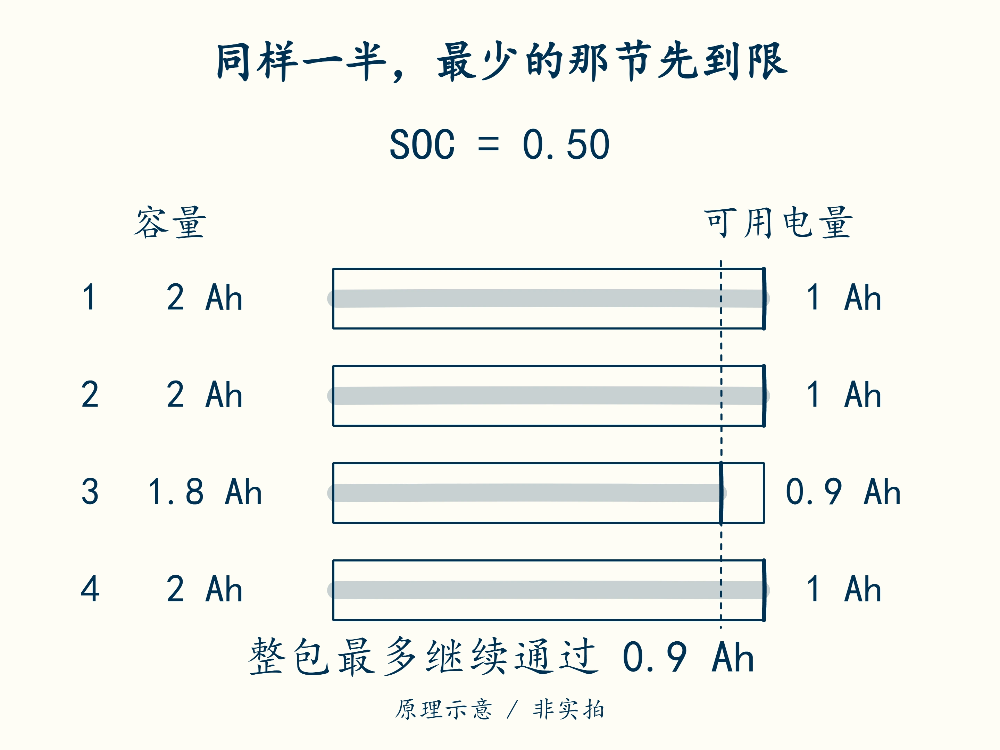

# 15 · 哪一节决定还能放多久

先修：[第 14 课](14-balancing.md)，回忆串联电流相同。完成本课，你能从各节可用电量估计整包余量，避免把平均 SOC 当作可用能力。

## 四节都显示一半，也可能不一样

给每节分别记额定或当前条件下的可用容量 Q，再记相对于这个容量的 SOC，简化的剩余电量为 **Q × SOC**。教学包四节容量为 `[2.0,2.0,1.8,2.0] Ah`，各节 SOC 均为 0.50：

回忆第 10 课用“剩余 Ah / 容量 Ah”得到 SOC，现在只是把这步倒过来。第 1 节的一半是 2.0 × 0.50 = 1.0 Ah，第 3 节的一半则是 1.8 × 0.50 = 0.9 Ah；同样显示 50%，可放出的 Ah 不一定相同。

沿同一 Ah 刻度找最短的一条，再说明为什么不能把其余三节剩下的电量绕过它送出。条形长度表示可用 Ah，不表示单节电压，也不表示 Wh。

| 单节 | 容量 | SOC | 简化剩余电量 |
|---|---:|---:|---:|
| 1 | 2.0 Ah | 50% | 1.0 Ah |
| 2 | 2.0 Ah | 50% | 1.0 Ah |
| 3 | 1.8 Ah | 50% | 0.9 Ah |
| 4 | 2.0 Ah | 50% | 1.0 Ah |

串联放电让同一份 Ah 经过每节。按此简化模型，第 3 节先用完，整包最多继续通过 **0.9 Ah**；不能把四节相加报成 3.9 Ah，也不能用平均 0.975 Ah 掩盖第 3 节。

可以先试着让整包再放出 0.9 Ah：其余三节各从 1.0 Ah 降到 0.1 Ah，第 3 节则为 0.9 − 0.9 = 0 Ah，已到本模型的可用电量下端。若再要求多放一点，仍得让同一份电量经过第 3 节，所以不能靠其他节还有电就继续使用这条串联通路。

若放电恒为 1 A，估计时间为 **0.9 Ah / 1 A = 0.9 h = 54 分钟**。真实系统可能更早被单节低压、温度或功率限制截断，尤其大电流下的压降会提前触及限值。这里不是续航保证。

这些 Ah 也不是可以直接加总的 Wh。若要估计剩余能量，还需知道放电期间各节电压如何变化，再按第 1 课的方法累计。尤其当最弱单节触发截止时，其他节剩下的能量可能暂时无法从整包取出；仪表显示的平均电量不等于负载可继续使用的能量。

## 先找最小值，再解释条件

完成 `remaining_ah(capacities, socs)`：`capacities` 按单节顺序存放容量 Ah，`socs` 按相同顺序存放 0–1 的 SOC。先将同一位置配对，逐节相乘，再从这些 Ah 中取最小值；第 8 课用过的 `zip` 可以帮助配对，`min` 可以找最小值。

接口假定两列非空、长度相同、容量为正且 SOC 位于 0–1。第 3 个容量必须配第 3 个 SOC，不能各自排序后再相乘。自己列出两种打乱配对会造成的错误，再检查到第 15 课。

如果第 3 节容量衰减，均衡只能调整各节电量位置，不能把 1.8 Ah 修复为 2 Ah。如果各节容量相同而初始 SOC 不同，均衡才可能减少某些不一致损失。把两类情况混在一起，会把“暂时改善压差”误认为“修复电池健康”。

深读时可看 [SOH 与 SOP 专题](../stages/stage-4-主线-SOH与SOP.md)：健康状态描述容量、内阻等变化，功率能力还取决于当前工况。它们和 SOC 不能互相代替。

## 模块五交付：余量与均衡预算

另一次教学记录的容量为 `[2.0,1.8,2.0,2.0] Ah`，对应 SOC 为 `[0.60,0.50,0.55,0.50]`。估计整包余量和 0.5 A 恒流放电时间。另有一项独立均衡任务：需泄放 0.10 Ah，电流 50 mA、连续导通、单节暂按 4.0 V。给出时间、功率与能量，并说明这些计算尚未验证什么。

交付后核对

逐节为 **1.2、0.9、1.1、1.0 Ah**，第 2 节决定简化余量 **0.9 Ah**，时间 **1.8 h = 108 分钟**。独立均衡任务为 **2 h、0.20 W、0.40 Wh**。容量来源、温度与倍率影响、实际截止点、泄放电流变化和热点均未被此计算验证。不能把第一问的电量差直接当作第二问的实测来源。

下一课：[把物理量装进八个字节](16-frame.md)。
