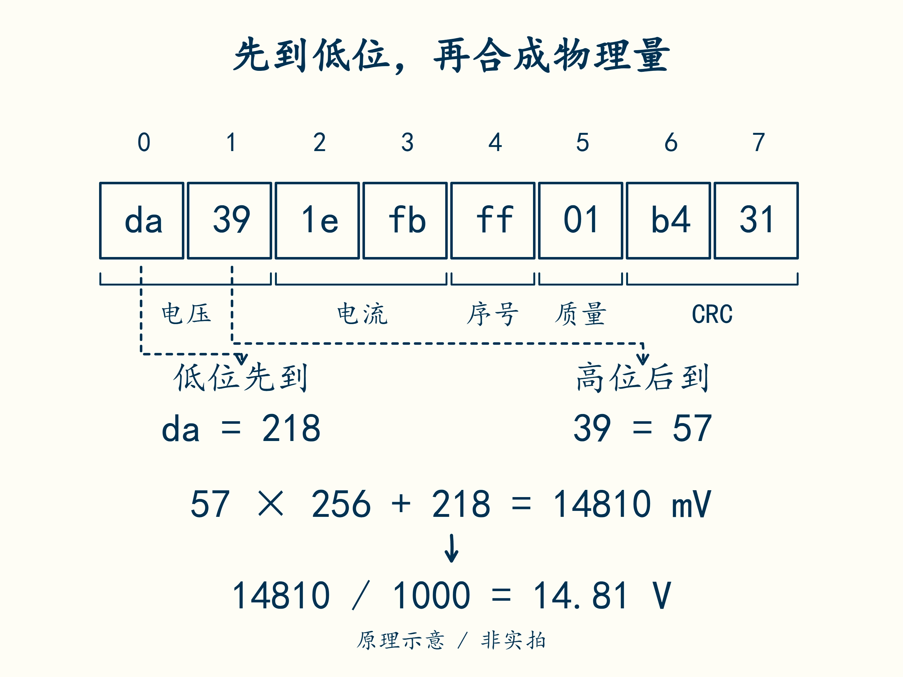

# 16 · 把物理量装进八个字节

先修：[第 15 课](15-weakest.md)。完成本课，你能按一份明确约定把字节还原成带单位的信号，并解释负电流为何需要有符号整数。

## 先定约定，再写解析器

电脑不能从一串数自动猜出“这是 V 还是 mV”。本课程自定义一条 **8 字节教学记录**，这里只处理已取得完整边界的一条记录。它不是 CAN 帧格式，也不是 Modbus 协议；即使将它放进某种总线，仍要遵守那种总线自己的帧与传输规则。

先把记录想成排成一行的 8 个格子，每格放一个字节。每个字节内部还有 8 个只能取 0 或 1 的位置，叫二进制位。8 个位置一共有 256 种组合，因此一个字节可表示 **0–255**；较大的整数要占多个字节。

为了不写很长的 0 和 1，通常用十六进制显示字节。它用 0–9 后再接 a、b、c、d、e、f，分别表示 10、11、12、13、14、15。**两个十六进制数字写一个字节**：右边是个位，左边每增加 1，数值就增加 16。

先只算电压的两个字节 `da 39`：

- `0xda` = 13 × 16 + 10 = **218**。
- `0x39` = 3 × 16 + 9 = **57**。

`0x` 只是提醒读者“后面按十六进制读”，不是额外传输的数据。因此 `0xda` 与显示中的 `da` 指同一个字节，不能再把字符 0 和 x 当作两个字节。

两个字节组成一个整数时，还要约定谁在前。本课程采用**小端序**：先放低位字节，后放高位字节。与十进制的十位每增加 1 就增加 10 类似，这里的高位字节每增加 1 就增加 256。因此：

**`[先到：da，218] [后到：39，57]` → 57 × 256 + 218 = 14810。**



先找到电压的两个格子，再沿虚线追到低位和高位。解释为什么记录先写 `da 39`，计算却是 57 × 256 + 218；其他六个格子仍按字段位置保留。

协议规定这个整数的单位为 mV，所以物理电压为 **14810 / 1000 = 14.81 V**。同一个整数也可写成十六进制 `0x39da`；它在记录里的字节顺序仍为 `da 39`。

| 字节位置，从 0 起 | 字段 | 编码与单位 |
|---|---|---|
| 0–1 | 整包电压 | 无符号 16 位整数，单位 mV |
| 2–3 | 电流 | 有符号 16 位整数，单位 mA，放电为正 |
| 4 | 序号 | 无符号 8 位，下一课处理递增与回绕 |
| 5 | 质量 | 仅 1 表示本协议约定的有效数据 |
| 6–7 | CRC 校验值 | 前 6 字节的 CRC，16 位小端序 |

表中“无符号”表示只编码非负整数；“有符号”则要同时表达正数与负数。电压用前一种，电流要区分放电与充电，所以用后一种。单有这张表还不够，读取时也必须选对这两种解释。

## 用一条完整样本核对

配套编码器 `reference.encode(14.81, -1.25, 255)` 的实际结果为：

```text
da 39 1e fb ff 01 b4 31
```

前两字节对应 **14810 mV**。接下来的 `1e fb` 若按无符号读是 64286；按有符号 16 位的补码解释，值为 64286 − 65536 = **−1250 mA**。序号是 255，质量是 1。末尾是校验值，本课先把它保留，下一课再验证。

电流也可以按位置复算：`1e` 是 30，`fb` 是 251，所以 251 × 256 + 30 = 64286。两个字节共有 65536 种组合。有符号 16 位约定将其中 0–32767 用于非负数，32768–65535 用于负数，后半段要减去 65536。这种约定叫补码。先掌握本题这一条规则，不必先推导完整的二进制运算。

得到 −1250 后，还要除以 1000，才是 **−1.25 A**。负号说明充电，不是再把这个数变成正数才算“正确电流”。

把上面的显示文本交给 Python 时，用 `bytes.fromhex` 转成真正的字节记录。可以按第 4 课进入 `python -i my_bms.py`，在 `>>>` 后逐行输入下面的内容；其中 `print` 会把结果显示出来：

```python
import struct

frame = bytes.fromhex("da 39 1e fb ff 01 b4 31")
print(len(frame))  # 8 个字节，不是字符串的字符数
print(frame[0:2].hex(" "))  # 只看电压字段：da 39
```

引号里按样本写两位一组的十六进制数字，用空格隔开，不加 `0x`。`frame` 是这条记录；位置编号从 0 开始。`frame[0:2]` 叫切片，表示取位置 0、1，到位置 2 前停止。因此它恰好取出两个字节，而不是三个。类似地，`frame[:6]` 取前六个字节，`frame[6:]` 取从位置 6 到结尾的部分。

`struct.unpack` 按指定格式把字节解释为数值。例如 `struct.unpack("<H", frame[0:2])` 得到 `(14810,)`；括号表示一组结果，本次只有一项，后面加 `[0]` 就能取出这一项。`<H` 中，`<` 表示小端，`H` 表示无符号 16 位，也就是两个字节。

本题前六个字节合起来的格式为 **`<HhBB`**：电压用大写 `H`，电流用小写 `h` 表示有符号 16 位，序号与质量各用一个 `B` 表示无符号 8 位。它们占 **2 + 2 + 1 + 1 = 6 字节**。大小写不能交换；读回电压和电流后，还要各除以 1000。

在学员文件 `my_bms.py` 中实现 `decode(frame)` 的第一版，返回 `(电压V, 电流A, 序号)`，检查到第 16 课。先用上面这个好样本对照手算，再自行组织函数。此时通过好样本不表示能拒绝坏记录，提交物必须写“尚未完成校验”。

固定 8 字节也不会自动解决串口粘包、断帧与重新同步。本例假定外层已交付完整记录，流式接收器需要另外设计边界。编码的量程、分辨率、溢出策略与协议版本也应明确，不能靠读者猜测。

例如有符号 16 位的整数范围为 −32768 到 32767，按 mA 缩放后最多表示约 ±32.7 A。电池允许多大电流是另一个物理约束；换成 100 A 系统时，需要重新设计缩放或字段宽度，不能任由溢出后变成负数。

## 合上例子再做

解读 `90 33 0c fe 07 01 5f 1c`，写出电压、电流、方向与序号。若把电流按无符号读，会得到什么错误结果？

<details class="course-check">
<summary>做完后核对</summary>

电压 **13.2 V**，电流 **−0.5 A，表示充电**，序号 **7**。无符号误读会得到 65036 mA，即 **+65.036 A**，方向和量级都错。末尾校验值已经由配套编码器核对，但你的接收函数仍需自己验证。

</details>

下一课：[收到字节后，先证明它能用](17-receive.md)。
