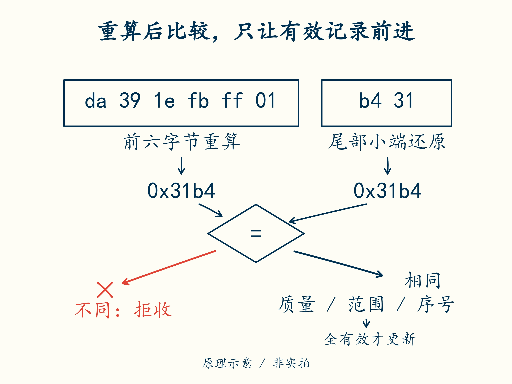

# 17 · 收到字节后，先证明它能用

先修：[第 16 课](16-frame.md)的字段编码。完成本课，你能拒绝长度错误、校验错误、无效质量和重复序号，并说明这些检查各自不能证明什么。

## 一个数字翻转，仍可能像正常电压

第 16 课好样本为 `da 39 1e fb ff 01 b4 31`。若传输中将首字节 `da` 变为 `db`，解出的电压只差 1 mV，看起来仍很合理。只检查物理范围发现不了这次变化；必须检查发送端给出的数据校验值。

CRC 是一种按约定从数据计算出短校验数的方法，本课的 CRC16 结果占 16 位，也就是两个字节。发送端对前六个字节计算一次，把结果附在最后；接收端对收到的前六个字节重算，再与末尾两个字节比较。如果数值不同，就拒绝这条记录，不继续拿它判断电池状态。



沿两条输入找出“重算的值”和“记录带来的值”，再跟踪比较后的两条路径。CRC 相同后仍要检查质量、范围和序号；只有整条接收检查通过，才更新上一条成功记录。

本课程明确使用：**CRC 多项式 0x1021、初值 0xffff、输入和输出不反射、结果不再异或**；覆盖前 6 字节，最后 2 字节按小端保存结果。这些词是在规定计算过程：多项式决定按什么规则处理各位，初值规定从哪个数开始，反射规定是否反转输入或输出的位顺序，最后异或则规定是否再做一次按位调整。

第一次不必手算这些位运算，但两端必须使用完全相同的参数。只写“CRC16”不够，因为不同变种会给出不同结果。本题用 Python 标准库实现已约定的计算，先用一段大家都能输入的字节作对照：

```python
import binascii

print(hex(binascii.crc_hqx(b"123456789", 0xffff)))  # 应为 0x29b1
```

这里 `b"123456789"` 表示九个字符对应的字节，不是把整数 123456789 编码成字节；`hex` 只是把结果显示为十六进制。这个对照能确认函数与参数的搭配，不是在检验电池数据。

回到第 16 课的 `frame`，`payload = frame[:6]` 就是参与校验的前六字节，`payload` 在这里表示数据部分。调用 `binascii.crc_hqx(payload, 0xffff)` 得到 **0x31b4**，应与末尾的 `b4 31` 按小端还原后的数相同。不要把最后两个校验字节也放进本题的重算范围。

## 把接收条件写完整

在 `my_bms.py` 中完善上一课的 `decode`。先确认长度恰为 8，才能按字段位置取值；CRC 必须一致；然后按 `<HhBB` 还原数据，检查质量为 1、电压在 **0–20000 mV，含端点**。任何一项不满足都抛 `ValueError`，通过后才返回三项物理信号。

这里仍是两层判断：质量和表示范围先决定数据能不能用，第 7 课的保护阈值再决定电池状态是否允许。0–20000 mV 不是新的充放电安全窗口。电流范围目前由有符号 16 位编码限定，也不代表这些电流都在电池允许范围内。

| 检查 | 能发现什么 | 仍不能证明什么 |
|---|---|---|
| 长度 | 截短或多出的字节 | 帧边界一定正确 |
| CRC | 许多传输损坏 | 数据来源可信、未被恶意篡改 |
| 质量与范围 | 明确无效或越表示范围 | 电池当前安全 |
| 序号 | 重复、跳号或乱序 | 消息年龄合格、发送端没重启 |

## 序号必须随一次有效接收推进

序号是发送端给记录排的编号，用来判断有没有重复或漏掉。实现 `sequence_ok(previous, current)`：`previous` 是上一条成功接收的序号，`current` 是这次已经通过解码校验的序号。没有前值时用 `None`，允许以第一条有效记录建立起点。

已有前值时，只接受 `(previous + 1) % 256`。`%` 表示取余：255 加 1 得 256，除以 256 的余数是 0，因此 **255 的下一条为 0**。这种从最大编号回到 0 的过程称为回绕。输入来自已解码的字节，范围为 0–255。

序号检查失败时，不把失败帧更新成新的“上一条成功记录”。本练习选择严格拒绝跳号：它能暴露丢帧，但需要实际接收器定义如何暂停使用、诊断和重新建立会话。不要擅自遇到失败就设 `previous=None`，那样每条重复帧都能冒充第一条。

检查到第 17 课，包括损坏一位、短帧、质量无效、重复和回绕。CRC 无法认证来源：修改数据的人也可以重新计算 CRC。需要对抗攻击时，还要有身份认证、会话与重放防护设计。

## 合上例子再做

上一条成功序号为 254，依次收到 255、0、0、2。按本课严格规则，逐条写出接收或拒绝，以及每步保留的上一条成功序号。若收到的 0 帧 CRC 错误呢？

<details class="course-check">
<summary>做完后核对</summary>

接收 **255**，再接收 **0**；第二个 0 重复，拒绝并保留前值 0；2 跳过 1，拒绝仍保留 0。若首次 0 的 CRC 错误，不更新前值，仍等待合法的 0。严格规则没有自行恢复丢失序号的能力，工程实现需另定可审查的重同步策略。

</details>

下一课：[通信消失后，谁继续负责保护](18-timeout.md)。
