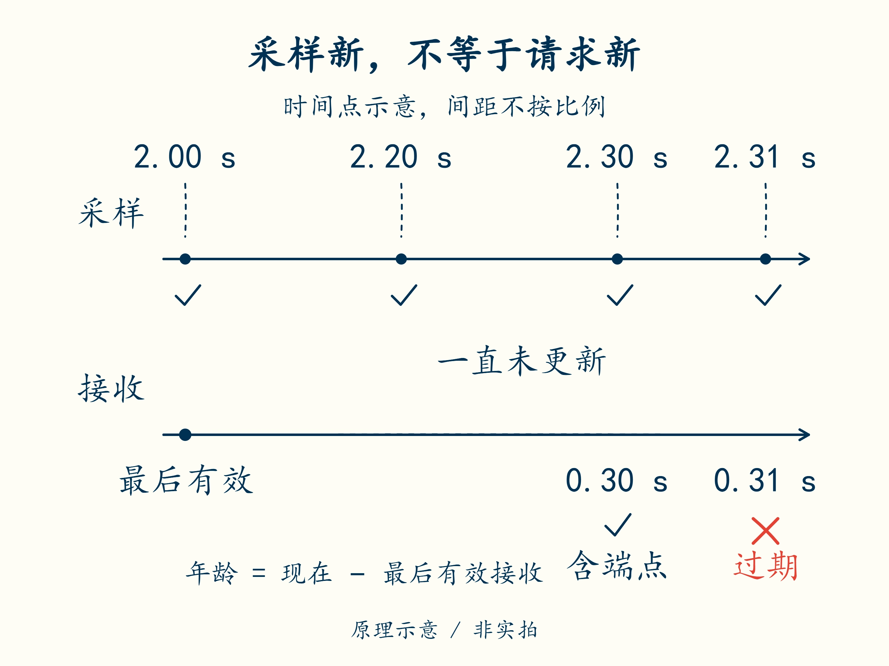

# 18 · 通信消失后，谁继续负责保护

先修：[第 17 课](17-receive.md)的有效接收。完成本课，你能定义消息超时后的动作，并让远程使能请求服从本地保护。

## 最后一次有效接收决定年龄

序号连续的消息仍可能晚到：发送端早就测完、排好编号，却在传输途中耽搁了。序号回答“它排在谁后面”，还不能回答“这次操作请求已经多久没有更新”。

接收端要用自己的时钟记下最后一次**有效接收时间**，再用同一时钟的当前读数减去它，得到接收年龄。例如可以把本地计时器想成一直运行的秒表；调整电脑显示的日期，不应让这个秒表突然倒退。这样的计时源称为单调时钟。

如果消息里还带采样时间，就要另外判断采样年龄。一个刚到手的包裹，里面也可能装着旧测量。接收时间与采样时间各自保留，不能因为“刚收到”就把采样时间改成现在。来自另一台设备的采样时钟必须先对齐，才能和本地时钟直接相减。

本项目的通信教学上限为 **0.30 s，含端点**，最后有效接收在 2.00 s。当前为 2.20 s 时年龄为 0.20 s，尚新鲜；2.30 s 为端点，仍通过；2.31 s 时已经超时。CRC 错误或重复序号的消息不能刷新最后有效接收时间，否则故障流量会让超时永远不发生。

分别追踪采样与接收两条线，说明为什么采样正常仍可能禁止使能。**时间点为示意，横向间距不按比例**，年龄必须用标出的时刻相减；两条记录共用已对齐的本地时间基准，不要求两台物理时钟。

“刷新时间”在这里就是把最后有效接收时刻改成这次接收时刻。判断失败就不改：即使收到了很多字节，也可能一直没有新的有效请求。计时依据是有效记录，不是串口是否还有动静。

## 远程只能提出请求

本地 BMS 即使失去上位机，也应继续采样和执行本地保护。上位机指包外负责显示、记录或发请求的电脑/控制设备；它不应成为本地过压、欠压和温度保护的唯一观察者。

本题采用保守使能规则：`remote_enable(local_safe, fresh, requested)` 的三个输入依次回答：本地条件允许吗？远程请求仍新鲜吗？远程确实请求使能了吗？只有三项均满足才返回 `True`，任何一项为假就禁止输出。

例如，刚收到“开启”请求，但本地已锁存欠压，第一项仍为假；本地读数正常，但最后有效请求已经过期，第二项为假。先用这两个事件核对自己的判断，再检查到第 18 课。这里不再提供完整条件表达式，自己列出八种真假组合检查。

这里的“通信超时就禁使能”是本项目选定的教学策略，不是所有车辆和储能系统的通用失效处置。真实系统可能需要受控停车、降功率或与其他控制器协调；必须按风险分析确定。无论如何，通信恢复不应绕过已经锁存的本地故障，也不能自动证明执行器恢复正常。

## 哪些部分已经接上，哪些还没有

第 19 课的 PC 回放把三种时间放在同一条已对齐的时间线上：`sampled_s` 是本地采样时刻，`remote_received_s` 是远程请求的有效接收时刻，`now_s` 是当前本地时刻。计算采样年龄用 `now_s − sampled_s`，计算接收年龄用 `now_s − remote_received_s`。两条链独立检查，不要求两台物理时钟；某条链可以停止更新，而另一条继续正常。

日志中 `sample_valid` 与 `remote_fresh` 分别表示两条链的质量。通信超时会锁存 `COMM_TIMEOUT`，即使采样仍正常也禁止使能。第 16–17 课的解码、序号检查仍是独立练习；回放直接输入已解码字段，没有真实总线接收器，不能称为“CAN 超时已验证”。

## 模块六交付：接收记录与超时策略

最后一次有效接收为 5.00 s，收到序号 10。5.10 s 又收到序号 10；5.20 s 收到序号 11，但 CRC 错误；5.31 s 本地读数正常，远程请求仍为使能。按 0.30 s 上限判断此刻使能。再考虑 5.40 s 收到有效序号 11，但本地欠压已锁存，结果是否改变？交付记录需列时间、序号、拒收原因、最后有效接收时间和使能决定。

交付后核对

重复和 CRC 错误均不能刷新时间，5.31 s 距最后有效接收 **0.31 s**，已超时，应禁止使能。5.40 s 的有效 11 可以恢复通信新鲜度，但本地锁存故障仍使 `local_safe=False`，继续禁止；PC 项目中的 `COMM_TIMEOUT` 本身也采用锁存策略。还需保留采样质量、命令和实际反馈；本练习没有验证真实总线延迟或硬件切断时间。

下一课：[把测量、判断、动作接成一圈](19-loop.md)。
