## 先选目标，不从资源海里游

<section class="goal-route-grid" aria-label="四条任务导向学习路线">
  <a v-for="route in data.goalRoutes" :key="route.id" class="goal-route" :href="route.link">
    {{ route.duration }} · {{ route.hardware }}
    <strong>{{ route.title }}</strong>
    适合：{{ route.forWho }}
    <b>先做</b>{{ route.start }}
    <b>交付</b>{{ route.output }}
    进入路线 →
  </a>
</section>

还不知道目标，就从[十三个核心问题](核心问题地图.md)里挑一个最想解决的；完全零基础，直接做[第 0 天小实验](stages/getting-started.md#第-0-天30-分钟小胜利零器材也能做一半)。

要做道路车辆，先选[电动自行车／电动摩托车／电动汽车三条应用路线](车辆应用分流.md)，再进入[固定版本的开源原理图与 PCB 剖析](开源硬件剖析.md)；不要按“48 V、72 V、400 V”直接猜车辆类别。

## 全程先看一张图

每一站都有对应的阶段正文，过关标准写在每篇末尾；全库 154 张动画负责把电流、热、数据与状态变化画出来——先看清全程，再决定从哪一站进场。
<section class="learning-cockpit" aria-labelledby="learning-cockpit-title">
  

    
把“看过”变成“会做”

    <h2 id="learning-cockpit-title">先定位能力，再留下证据</h2>
    
不用把七个阶段从头刷一遍。先选自己所在的认知层，完成一个有输出的入口，再沿着证据链向上走：会叫名、会解释、会运行、会诊断、会取舍，最后交付别人能复现的作品。

  

  

    

      <a class="learning-step" :href="layer.link">
        {{ layer.number }}
        
          
            <strong>{{ layer.name }}</strong>
            {{ layer.verb }}
          
          {{ layer.summary }}
          <b>验收</b>{{ layer.proof }}
        
        ↗
      </a>
    

  

  

    <a v-for="route in data.practiceRoutes" :key="route.tag" class="practice-card" :href="route.link">
      {{ route.tag }}
      <strong>{{ route.title }}</strong>
      {{ route.details }}
      {{ route.linkText }} →
    </a>
  

</section>

## 验收电池组

<section class="pack-monitor" aria-labelledby="pack-monitor-title">
  

    
读数存在这台浏览器

    <h2 id="pack-monitor-title">包的容量由最弱那一节决定</h2>
    
七篇末尾的验收清单，勾上就记住。每一格按自己的完成度充电，但包的读数取<b>最弱单体</b>：串联认最小。平均是安慰，不是容量——它恰好能把漏检的那一节藏得干干净净。

  

  

    

      包 SOC
      <strong class="pack-stat__value">{{ soc === null ? '未测量' : percent(soc) }}</strong>
    

    

      最弱单体
      <strong class="pack-stat__value">{{ weakestNames }}</strong>
    

    

      平均（安慰值）
      <strong class="pack-stat__value">{{ average === null ? '—' : percent(average) }}</strong>
    

    

      已勾
      <strong class="pack-stat__value">{{ doneTotal }} / {{ data.pack.total }}</strong>
    

  

  

    
    

      <a
        class="pack-cell"
        :class="{ 'is-unsampled': !cell.sampled, 'is-weakest': soc !== null && cell.ratio === soc }"
        :href="cell.link"
      >
        
          
          未采样
        
        
          {{ cell.index }}
          {{ cell.name }}
          {{ cell.done }} / {{ cell.total }}
        
      </a>
    

  

  

    <template v-if="soc === null">
      一块电芯都还没采到样，所以没有可信读数。从
      <a :href="data.pack.cells[0].link">{{ data.pack.cells[0].name }}</a>
      的清单勾第一条开始。
    </template>
    <template v-else>这块包只量七篇验收的 {{ data.pack.total }} 条。入门与电路板绘制另有自检，各算各的，不进这块包。</template>
  

</section>

## 七个阶段

<ol class="stage-list">
  <li v-for="s in data.stages" :key="s.link">
    <a :href="s.link">{{ s.text }}</a>
  </li>
</ol>

## 三个进阶实验

- [PC 综合实验](PC综合实验专题.md)：把采样、SOC、保护与通信接成可追踪的运行记录。
- [SOC 真实数据实验](SOC真实数据专题.md)：用 NASA 实测数据标定模型，在独立随机负载上解释误差。
- [扩散与常相位实验](扩散与常相位专题.md)：把活性颗粒当球算一遍扩散，看一阶 RC 差多少、奈奎斯特尾巴的斜率是谁的读数。
