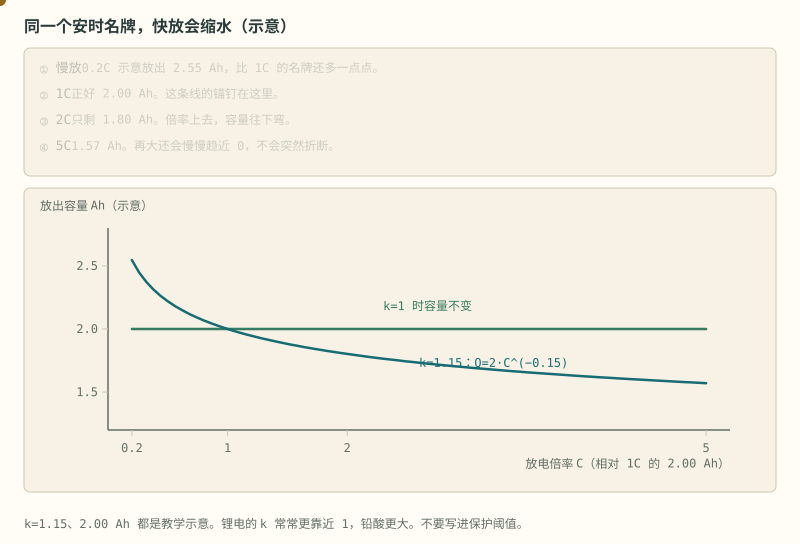
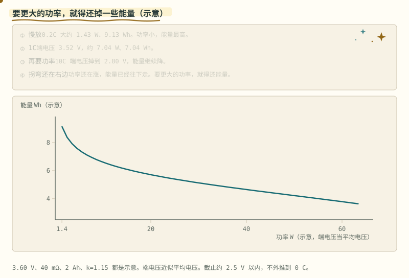
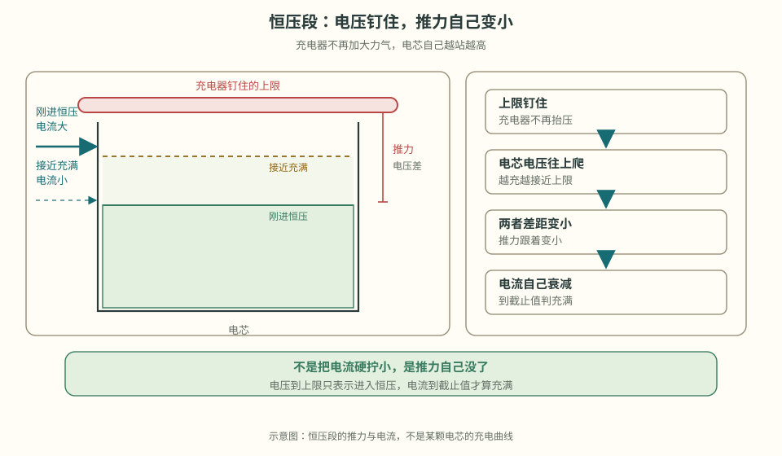
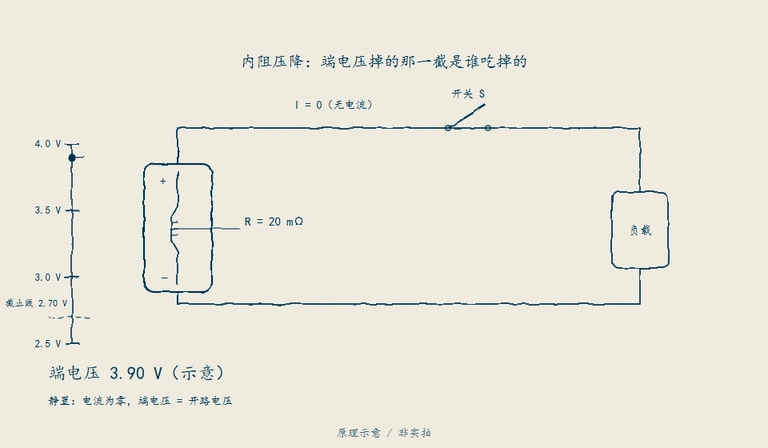
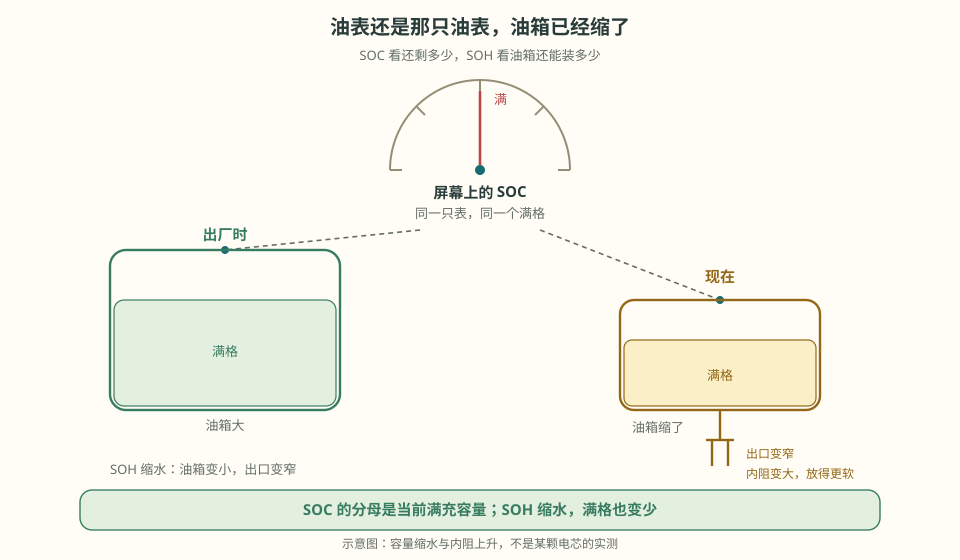

# 阶段 0 主线：充电与剩余电量

接着读电压表示什么、充电为什么会变慢、屏幕上的剩余电量怎样估。表中的电压只是教学示例。

### 0.1.5 必背参数表 [记忆]

> **先读/后读**：这张表是 [记忆]。C 倍率的含义在下一小节 [理解]，不要和电压红线记成一件事。

| 参数 | 三元锂 NCM | 磷酸铁锂 LFP |
|---|---|---|
| 标称电压 | 3.6 / 3.7 V | 3.2 V |
| 满充电压 | 4.2 V | 3.65 V |
| 放电截止电压 | 2.8–3.0 V | 2.5 V |
| OCV 平台 | 有明显斜率 | 极平（阶段 4 的噩梦） |

> 表中为常见化学体系的典型值，**具体数值以你所用电芯的 datasheet 与保护 IC 的阈值版本为准**——同叫"三元"，不同厂家的满充/截止也可能差出 50mV。放电截止是保护该停的地方。铁锂常见大约 2.5 V，不是 §0.1.3 的铜溶解电压。

> **原理**　表里的电压是常见体系的示例。同一化学体系不同厂家也能差出几十毫伏，设计和保护阈值以电芯与芯片 datasheet 为准。
> **证据**　三元约 4.2V、铁锂约 3.65V 是常见满充示例，对照 [BU-409](https://batteryuniversity.com/article/bu-409-charging-lithium-ion)（英文，可选）。具体红线以电芯 datasheet 为准。
> **延伸阅读**　[瑞萨《BMS 教程》中文导读](../renesas-bms-tutorial-中文导读.md)（可选扫盲）

**短自测**

1. 表里的 4.2 V 能写进每一块保护板吗？
2. 铁锂的平台为什么让阶段 4 头疼？

<b>参考答案（先自己想完再展开）</b>

1. 不能。那是三元常见满充示例，铁锂常见是 3.65 V。同一化学体系，厂家之间还能差出几十毫伏。阈值跟这颗电芯和这版保护 IC 走。
2. 电压几乎不动的时候，荷电可以差一大截。电压法在这段不灵。

**练完你会怎样**：你查表之前会先问厂家，不把 4.2 V 当成全世界的门。

### 0.1.5b C 倍率：同一安培，容量不同就不是一回事 [理解]

> **算一笔账**　一块 16 串 50 Ah 的包：1C = 50 A，0.5C = 25 A，2C = 100 A；标称电量约 3 kWh，满电 1C 放电约 3.36 kW。同一个 10 A，对 10 Ah 是 1C，对 50 Ah 只是 0.2C——C 永远跟着容量走。

**C 倍率**：1C = 一小时放完额定容量的电流。算一道：

> 一个 16 串 20Ah 磷酸铁锂储能包，用 0.5C 充电，充电电流多大？整包满充电压多少？
>
> 电流 = 20Ah × 0.5C = **10A**；满充电压 = 3.65V × 16 = **58.4V**（标称 3.2V × 16 = 51.2V，这就是"48V 储能系统"的真实电压范围）。

> **图说**　盯住底栏过原点的直线和贴着走的黄点：示意 20 Ah 时，0.5C 是 10 A，2C 是 40 A，串数不进这个乘法。

> **口诀**　C 只看容量。串数不进电流公式。

盯住底栏那条直线：容量示意 20 Ah 时，$I=20\times C$。0.5C 是 10 A，2C 是 40 A。黄点贴着这条线走。串数仍然不进这个乘法。

同一个 10A，对 10Ah 的包是 1C、对 20Ah 的包只是 0.5C——C 永远跟着容量走。上面那道题里的 0.5C，就是把龙头开在"两小时才放空"的位置上。

> **原理**　1C 是一小时放完额定容量的电流。同一个安培数，容量不同，C 倍率就不同。
> **证据**　1C 的定义和充电电流怎么选，对照 [BU-409](https://batteryuniversity.com/article/bu-409-charging-lithium-ion)（英文，可选）。容量不同，同一个安培数不是同一个倍率。
> **延伸阅读**　[瑞萨《BMS 教程》中文导读](../renesas-bms-tutorial-中文导读.md)（可选扫盲）

**短自测**

1. 16 串 20 Ah 的铁锂包，0.5C 是多少安？串数进这个乘法吗？
2. 同一个 10 A，对 10 Ah 和 20 Ah 是同一个倍率吗？

<b>参考答案（先自己想完再展开）</b>

1. 10 A。C 只看容量。串数用来乘电压：满充示例 3.65 V × 16 = 58.4 V。
2. 不是。10 Ah 上是 1C，20 Ah 上是 0.5C。

**练完你会怎样**：别人说「充 10 安」，你会先问容量，再问是几 C。

名牌上的安时，是某一档倍率下的约定。换一档龙头，放出来的安时会变。

> **图说**　盯住往右下弯的蓝线和不动的绿线：示意 k=1.15 时快放会缩水，k=1 才是水平线。

> **口诀**　快放会缩水。k=1 才是一条水平线。

**看动画时盯住哪里**

黄点沿蓝线往右下走。绿线不动。蓝线是弯的，不是台阶。

示意：以 1C、2.00 Ah 为锚，$k=1.15$，放出容量 $Q=2.00\times C^{-0.15}$。0.2C 大约 2.55 Ah，1C 仍是 2.00 Ah，2C 大约 1.80 Ah，5C 大约 1.57 Ah。斜率一直是负的，而且越来越平，倍率再大也是慢慢趋近 0，不会在某一档突然折断。绿线是 $k=1$，容量不跟倍率走。锂电的 $k$ 常常更靠近 1，铅酸更大。1.15 只是为了把弯曲画得看得见。

库仑计的分母如果永远写名牌安时，大电流放电时 SOC 会提前喊空，或者反过来。保护阈值不要抄这张图。

**短自测**

1. 这张图里，1C 和 5C 各放出多少安时？
2. 为什么不能把 1.15 写进过流保护？

<b>参考答案（先自己想完再展开）</b>

1. 1C 是 2.00 Ah，5C 大约 1.57 Ah。都是示意。
2. 这是容量怎么缩，不是该在多少安断开。$k$ 也不是某一颗电芯测出来的。

**练完你会怎样**：别人说「这块是 2 安时」，你会补一句：那是几 C 放出来的。

同一颗电芯，功率要上去，能量就得还回来。

> **图说**　盯住从左上往右下的黄点：横轴是功率，纵轴是能量，要更大的瓦，示意能量就往下还。

> **口诀**　要更大的瓦，就得还掉一些瓦时。

**看动画时盯住哪里**

黄点从左上往右下。横轴是功率，纵轴是能量。它不是时间轴。

示意：开路 3.60 V，内阻 40 mΩ，1C 容量 2.00 Ah，仍用上面的 $k=1.15$。电流 $I=2\times C$，端电压 $V=3.60-I\times 0.040$，容量 $Q=2.00\times C^{-0.15}$，能量 $E=Q\times V$，功率 $P=I\times V$。

这里把端电压近似成这一档的平均电压。0.2C 大约 1.43 W、9.13 Wh。1C 是 3.52 V、7.04 W、7.04 Wh。10C 端电压掉到 2.80 V，大约 56 W、3.96 Wh。在这张图的窗口里，功率还在涨，能量已经往下走。不要把曲线延长到 0 C：Peukert 公式在极慢的倍率上会把容量夸大。

设计时最容易犯的错，是用慢放的瓦时去承诺峰值功率下的续航。

**短自测**

1. 1C 这档，示意能量和功率各是多少？
2. 为什么 0.2C 的能量比 1C 高？

<b>参考答案（先自己想完再展开）</b>

1. 大约 7.04 Wh 和 7.04 W。端电压 3.52 V。
2. 慢放时端电压更高，Peukert 项还多给了一点安时。数字是示意，不是放电实验。

**练完你会怎样**：你不会再用「能量除以功率」去答应一个峰值工况的时间，除非能量就是在那个功率上算的。

### 0.1.6 CC-CV：充电的两段论 [理解]

> **生活类比**　往一个快满的杯子猛倒水，水会溢。电池快满时吸收能力下降，硬灌只会让端电压虚高；溢出来的不是水，是锂。
>
> **算一笔账**　50 Ah 的包，CV 段截止电流 0.05–0.1C 就是 2.5–5 A。最后几个百分点常常要花半小时以上（示意）——这就是为什么“电压到了 4.2 V 就拔”会少充一截。

标准锂电充电分两步走：

1. **预充**（可选）：单体低于手册的预充门槛（常见大约 2.5–3.0 V）、又还没有落到大约 1.5–2 V 的深放带时，先按手册用很小的电流，常见示例 0.05C，抬回门槛以上。深放或放了很久的，很多厂家要求报废，不要拿这档去「激活」，见 [§0.1.3](stage-0-前置知识.md#013-过放安静的杀手-理解)；
2. **恒流 CC**：大水流猛灌，电压一路爬升；
3. **恒压 CV**：电压顶住满充值不动，让电池自己"吸"——越接近满，吸得越慢，电流自然衰减到截止电流（0.05–0.1C），判充满。

不能一路保持恒流。电压到达充电上限后，充电器转为恒压，电流逐渐变小。**到达电压上限只表示进入 CV 段；是否满充，还要检查电流降到手册规定的截止值等条件。** BMS 在满足这些条件后才可用满充点校正 SOC（阶段 4 详讲）。

> **看图**　先看电压上升，再看电压保持时电流下降。4.2 V 是三元电芯的教学示例，不是通用充电上限。

> **原理**　恒流把电压顶到满充值，恒压阶段电流自己衰减到截止值才算充满。端电压到 4.2V 只是进入恒压，不是 SOC=100%。
> **证据**　恒流再恒压、电流衰减到截止才算充满，见 [BU-409](https://batteryuniversity.com/article/bu-409-charging-lithium-ion)（英文，可选）。
> **延伸阅读**　[瑞萨《BMS 教程》中文导读](../renesas-bms-tutorial-中文导读.md)（可选扫盲）

**短自测**

1. 端电压刚到 4.2 V，就能把 SOC 标成 100% 吗？
2. 为什么不能一路恒流充到顶？

<b>参考答案（先自己想完再展开）</b>

1. 不能。那只是进入恒压。电流还大的时候，电压里有内阻和极化。充满看恒压段电流掉到截止值，常见示例 0.05C–0.1C，以手册为准。
2. 快满时再硬灌，端电压虚高，负极析锂。溢出来的不是水，是锂。

**练完你会怎样**：你不再把「电压到了」说成充满。

> **看图**　恒压段电压不再上升，为什么电流会一路掉到截止值？

### 0.1.7 SOC 与 SOH：油表和油箱 [理解]

> **先看一个场景**　老手机显示 100%，拔掉充电器却撑不过半天；电动自行车行驶中电量格掉得飞快，停车一会儿又弹回来。两只表说的不是同一件事。电动摩托车与电动汽车也有同一物理原因，但显示与限功率策略另算。
>
> **算一笔账**　60 mΩ 的内阻，20 A 放电掉 1.2 V；SOH 只剩 80%，当前满充容量就从 50 Ah 变成 40 Ah。屏幕上的 100%，只是“这 40 Ah 装满了”，不是“出厂的 50 Ah 还在”。

- **SOC（荷电状态）**：油表读数——现在还剩多少电，0–100%；
- **SOH（健康状态）**：油箱本身的状况——用久了，油箱会"缩水"（容量衰减）还会"漏油变快"（内阻增大）。
  - 容量口径：SOH = 当前满充容量 / 出厂容量；
  - 内阻口径：SOH = 初始内阻 / 当前内阻（越小越好）。

注意一个容易忽略的事实：**SOC 的分母是"当前满充容量"而不是"标称容量"**——一块 SOH 只剩 80% 的电池，显示 100% 时也只有出厂八成的电。这就是为什么老手机"满电也不耐用"。

> **图说**　盯住底栏两条过原点的直线：20 A 时 20 mΩ 掉 0.40 V，60 mΩ 掉 1.20 V。黄点沿 20 mΩ 那条走。

> **口诀**　带载腿软是 I·R。卸流之后才慢慢回弹。

盯住底栏两条过原点的直线：$\Delta V=I\times R$。20 A 时，20 mΩ 掉 0.40 V，60 mΩ 掉 1.20 V。后者就是图上从 3.9 V 落到 2.7 V 的那一截。黄点沿 20 mΩ 那条走。电流翻倍，压降翻倍，不是翻四倍。

内阻增大还有个日常可感的表现：带载时端电压先"腿软"一截（I·R），卸载又弹回来——所以行驶中和停车后的油表读数会对不上，老化的电池软得更明显。这也是阶段 4 估 SOC 不能只靠电压的原因之一。

> **原理**　SOC 是还剩多少电，分母是当前满充容量；SOH 是这块电池还能装多少、内阻变了多少。
> **证据**　SOC 分母是当前满充容量，讲义见 [Plett ECE5720](http://mocha-java.uccs.edu/ECE5720/index.html)（英文，可选）与仓库里的 [Notes03 中文导读](../ece5720-notes03-中文导读.md)。
> **延伸阅读**　[ECE5720 Notes03 中文导读](../ece5720-notes03-中文导读.md)（可选，原文英文）。金属锂负极和结构电池的电压曲线要另做表，见 [§0.1.8](stage-0-前置知识.md#018-固态电池固体电解质换掉了什么-理解)、[§0.1.9](stage-0-前置知识.md#019-碳纤维结构电池电极在承力外壳是另一件事-理解)。

**短自测**

1. SOH 还剩 80%，屏幕显示 SOC 100%。实际电量是出厂的多少？
2. 带载时电压先掉一截，卸流又弹回来。掉的那一截主要是什么？

<b>参考答案（先自己想完再展开）</b>

1. 大约八成。SOC 的分母是当前满充容量，不是出厂标称。油箱缩水了，油表仍可以指到满。
2. I·R。老化后内阻更大，软得更明显。所以行驶中和停车后的油表会对不上，阶段 4 不能只靠电压。

**练完你会怎样**：老手机满电不耐用，你能用「油箱缩水」讲给别人听。

> **边界**　电压不是 SOC。平台区电压几乎不动，SOC 可以差一大截；带载电压还含 I·R 和极化。OCV 法要静置，要这条电芯自己的曲线，也要温度条件。

> **看图**　老手机显示满格，为什么反而撑不过半天？

## 第一次阅读的核对

1. 同样是 10 A，对 10 Ah 和 50 Ah 电芯分别是多少 C？
2. 为什么充电电压到达上限后，还需要看电流和时间？
3. 低温充电与低温放电的风险为什么不同？

能解释这三件事，就可以进入 [阶段 1：认识 BMS](stage-1-认识BMS.md)。下面的材料与电路页按需要再读。

[继续阅读](./stage-0-选读-新电池.md) · [完整讲义与原有锚点](./stage-0-前置知识.md)

<!-- Generated by prepare-stage0.mjs; edit stage-0-前置知识.md. -->
