# 阶段 0 主线：电芯与保护

第一次读先看电芯怎样工作、为什么需要保护。电路和嵌入式留给后面的选读页。

## 0.0 先立一个视角：BMS 先看三根探针 [理解]

> **先读/后读**：这一节是整篇的取景框，十分钟读完；后面每一节都会回到这里的三根探针。

BMS 看不到电芯内部的锂离子怎样移动。先从最常见的三类读数入手：

| 读数 | 传感器实际读到什么 | 能帮我们判断什么 |
|---|---|---|
| 电压 | 电芯两端此刻的电压 | 是否接近电压边界；带载时还要考虑压降 |
| 电流 | 电池包流入或流出的电流 | 估算充放电量、功率和发热 |
| 温度 | 传感器安装位置的温度 | 判断冷热风险；不能直接当作内部最高温度 |

充电时，锂离子要进入负极。低温或充得太快时，进入速度可能跟不上到达速度，锂就可能在负极表面沉积；这叫**析锂**。继续过充会使电极超出正常工作范围，增加副反应和发热。高温也会加快副反应。放得过深则可能使负极中的铜集流体溶解。后面逐项看这些风险在什么条件下出现。

后面几节逐项展开，先给一张索引：

| 风险 | 什么时候出现 | 后果是什么 | 在哪一节展开 |
|---|---|---|---|
| 析锂 | 低温充电、充得太快 | 负极表面长锂枝晶 | §0.1.2 |
| 过充 | 到截止还在充 | 副反应与发热，热失控风险上升 | §0.1.2 |
| 深放 | 放到很低的电压 | 铜集流体溶解 | §0.1.3 |
| 冷热 | 低温充 / 高温存 | 低温析锂、高温加速老化 | §0.1.4 |

这三类读数是线索，不是电芯内部状态本身。实际 BMS 还会检查开关、绝缘等状态；本阶段先把电压、电流和温度弄懂。

> **原理**　先弄清传感器测到了什么，再判断电芯里可能发生了什么。
> **证据**　三根探针的分工见 §0.2（采样）与 §0.3（嵌入式）；“读数不是结论”的例子贯穿 §0.1.2（4.2 V）、§0.1.3（1.5 V）、§0.1.6（充满判据）。
> **延伸阅读**　[瑞萨《BMS 教程》中文导读](../renesas-bms-tutorial-中文导读.md)（可选扫盲）
> **动手**　跑 `python bms-book/code/probe_ambiguity.py`：同一个 3.30 V 带载读数能被四种「SOC + 内阻」组合解释，静置到 I = 0 才能用开路电压落定 SOC。

## 0.1 锂电池化学基础 [理解]

> **先读/后读**：§0.1.5 参数表是 [记忆]，拿来对照；§0.1.1–§0.1.4、§0.1.5b、CC-CV、SOC、固态电池、结构电池和钠离子是 [理解]。先读液态锂电的机制，表当字典查。§0.1.8、§0.1.9、§0.1.10 和 §0.1.11 不要拿去改保护阈值。

> **原理**　这一层讲电池内部在发生什么：电子为什么要绕外电路、过充过放和低温各伤在哪，以及充电为什么要分成恒流和恒压。
> **证据**　这一层建立过充、过放、温度、CC-CV 和 SOC。入口 [BU-409](https://batteryuniversity.com/article/bu-409-charging-lithium-ion)（英文，可选）与 [瑞萨《BMS 教程》中文导读](../renesas-bms-tutorial-中文导读.md)。
> **延伸阅读**　[瑞萨《BMS 教程》中文导读](../renesas-bms-tutorial-中文导读.md)（可选扫盲）。讲义版的电极、化成和失效清单见 [ECE5710 Notes01 中文导读](../ece5710-notes01-中文导读.md)。

### 0.1.1 一块电池里在发生什么 [理解]

> **先看一个场景**　冬天，一辆电动自行车仪表显示满电，出门一拧把，电量瞬间掉两格。是电池没电了，还是带载电压在演戏？电动摩托车与电动汽车也会出现低温限功率，但仪表算法和功率等级不是这一套。读完 §0.1.1 和 §0.1.7，你会自己回答。
>
> **算一笔账（第二遍可看）**　以 16 节串联、50 Ah 的教学电池包为例：标称 59.2 V，满充 67.2 V。1C 是 50 A（见 §0.1.5b），满电时功率约 3.36 kW，电量约 3 kWh。这些是示意值，不能代替具体电芯的规格书。

先在图里看一颗电芯；实际电芯不要拆开。它主要有三个部分：

- **正极**：放电时，锂离子主要向这里移动；
- **负极**（石墨）：充电时，锂离子进入石墨层间；
- **隔膜**：把两极隔开，让锂离子通过，阻止电子在电芯内部直接穿过。

圆柱、方形和软包是三种常见外形。化学红线不跟着壳变：

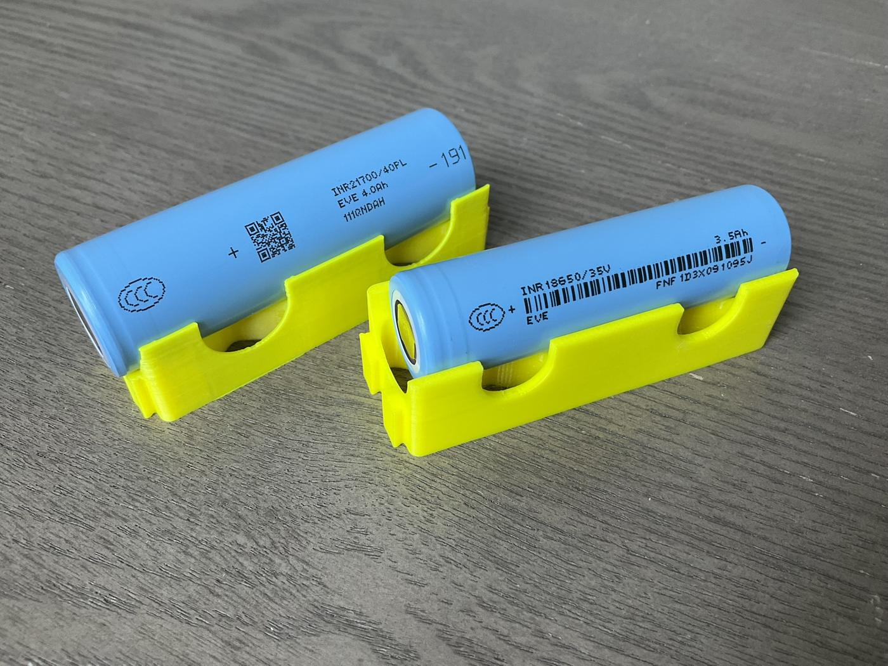

左边是 18650，右边是 21700。看金属壳、正极凸台和绝缘圈。容量和内阻以这颗电芯的 datasheet 为准，不要按外壳尺寸猜。

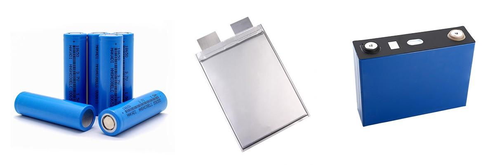

三种封装只是壳不同。来源与许可见 [照片来源](../circuits/assets/photos/PHOTOS.md)。

充电和放电时，锂离子在两个电极之间来回移动：


> **图说**　锂离子走电芯内部的电解液；电子经过外部电路。放电时，外电路中的电子经过用电设备。

> **口诀**　离子走里面，电子走外面。两头不能走同一条路。

常见电芯还会因正极材料不同而表现出不同特性：

| 正极材料 | 常见特点 | 使用时要留意 |
|---|---|---|
| 三元锂 NCM | 能量密度较高，常见于乘用车 | 热稳定性与具体配方、结构和冷却设计有关 |
| 磷酸铁锂 LFP | 热稳定性较好，循环寿命通常较长 | 电压平台较平，单靠电压估剩余电量较难 |
| 钴酸锂 LCO | 常见于手机、平板等消费电子 | 充电上限和过充保护要按具体电芯资料核对 |

> **原理**　锂离子走电解液，电子被隔膜挡住、只能绕外电路。电池对外供电，就是逼着电子走这段绕路。
> **证据**　锂离子走电解液、电子走外电路，扫盲对照 [瑞萨《BMS 教程》中文导读](../renesas-bms-tutorial-中文导读.md) 与 [瑞萨原文 PDF](https://www.renesas.com/en/document/whp/battery-management-system-tutorial)（英文，可选）。
> **延伸阅读**　[BU-409 锂电怎么充](https://batteryuniversity.com/article/bu-409-charging-lithium-ion)（英文，可选）。固体电解质和碳纤维结构电池在 [§0.1.8](stage-0-前置知识.md#018-固态电池固体电解质换掉了什么-理解)、[§0.1.9](stage-0-前置知识.md#019-碳纤维结构电池电极在承力外壳是另一件事-理解)，读完这一节再看。

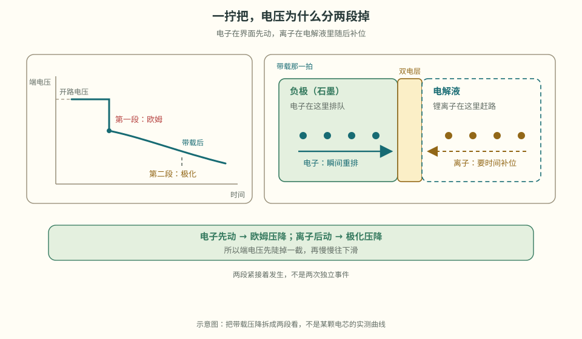

> **看图**　本节开头那一拧把，为什么端电压先陡掉一截、再慢慢往下滑？

**短自测**

1. 隔膜挡住的是离子，还是电子？
2. 三元和铁锂，谁的电压平台更平？

<b>参考答案（先自己想完再展开）</b>

1. 电子。离子走电解液，电子绕外电路。设备用的电，就是这段绕路。
2. 铁锂。所以后面用电压猜 SOC，会在平台上迷路。性格表是定性的，红线以这颗电芯的手册为准。

**练完你会怎样**：你能指着三明治说：设备用的电，是电子被逼着绕外电路打工。

> **边界**　三明治是给 BMS 用的简化图。真实电芯还有 SEI、电解液添加剂、集流体和封装；做材料设计要另看文献。对 BMS 来说，记住“离子走里、电子走外、隔膜怕扎”就够了。

电压为什么是弯的，不在「还剩多少水」，而在格子里还空不空。

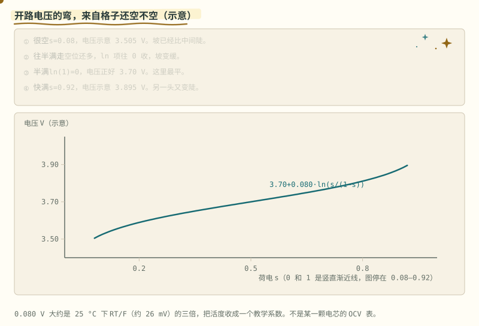

> **图说**　盯住黄点走过的坡，不要盯死某一个点：半满最缓，越靠近两端越陡。

> **口诀**　半满最平，两头变陡。0 和 1 是墙，不是表上的点。

**看动画时盯住哪里**

黄点从左往右，是在充电。盯坡，不要盯某一个点。中间最缓，两头明显变陡。

示意公式写在图上：$V(s)=3.70+0.080\ln\frac{s}{1-s}$。$s$ 是荷电，从 0 到 1。25 °C 时 $RT/F$ 大约 26 mV，这里的 0.080 V 大约是它的三倍，把活度收成一个教学系数。半满时 $\ln 1=0$，电压就是 3.70 V。$s=0.08$ 大约 3.505 V，$s=0.92$ 大约 3.895 V，左右对称。半满处的斜率大约是每个百分点 3.2 mV。越靠近 0 或 1，分母 $s(1-s)$ 越小，坡越陡，最后竖直。图在 0.08 和 0.92 停住，是因为再往外就冲出这张坐标。

BMS 的开路电压表要在两头排密一点。用一条直线从空画到满，膝部的 SOC 会偏。常见的坑：把半满那一段的平坡，拿去解释快充满时的电压。

**短自测**

1. $s=0.5$ 时，这张示意公式给出多少伏？
2. 为什么表不能在 0 和 1 上各放一个点就用直线连起来？

<b>参考答案（先自己想完再展开）</b>

1. 3.70 V。对数项是 0。
2. 0 和 1 是竖直渐近线，电压公式在那里不给出有限值。真实电芯也不会让你用一条直线代替整条 OCV。数字都是示意。

**练完你会怎样**：你看见一条弯的开路电压，会先问「这是半满的平，还是两头的陡」，而不是背一个斜率。

### 0.1.2 过充：一场逐级升级的事故 [理解]

> **先看一个场景**　充电棚里一块电池鼓了包。它不是突然坏的：在鼓包被你看见之前，事故已经按剧本演了好几幕。
>
> **算一笔账**　三元常见满充 4.2 V（示意）。如果充电器把每节多顶 100 mV，相对值只有 2.4%；但化学窗口没有这 2.4% 的余量。16 串就是整包多 1.6 V——这不是“多一点”，是越过了手册的红线。

4.2 V（铁锂约 3.65 V）是常见的**充电截止电压**，这里只作示例，实际值看电芯手册。超过上限后，可能出现以下相互影响的变化；它们不是每次都按同一顺序发生：

1. **正极过度脱锂**：正极材料里的锂被抽走太多，晶体结构像被抽了砖的墙，开始坍塌——容量永久损失，这一步不可逆；
2. **电解液氧化分解**：高电压下电解液在正极表面被氧化，产生气体——电池开始**鼓包**。摸到鼓包的电池，事故已经演到第二幕了；
3. **负极析锂**：锂离子来得太猛、石墨层间住不下，只能在负极表面"露宿"——以金属锂的形式析出，长成针状结晶（**锂枝晶**）；
4. **枝晶刺穿隔膜**：还记得那层膜吗？针越长越长，扎穿它——正负极在内**部**短路；
5. **热失控**：内短路点瞬间放出大量热 → 温度飙升 → 电解液、正极材料分解加剧 → 放出更多热 → 链式反应，几百摄氏度的喷发，伴随火焰。这就是新闻里"电池自燃"的真身。

**热失控会自我加速**：放热让温度升高，温度升高又可能加快放热。相邻电芯也可能被加热，引发热蔓延。因此，过充保护不能只依赖一道判断；具体安全等级要按应用和风险分析确定。

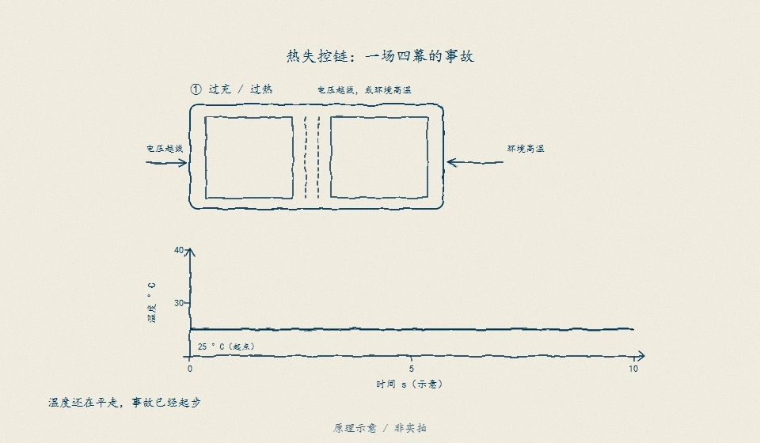

> **看图**　图里是可能的失效路径，不是诊断某节电芯所处“第几步”的依据。鼓包、漏液或异常发热时停止使用；4.2 V / 3.65 V 只是常见示例。

> **原理**　超过电芯允许的充电条件，可能造成材料损伤、产气或析锂；内短路与持续生热会增加热失控风险。
>
> **三个电压数别混**（全部是示意，以电芯手册和保护 IC 手册为准）：

| 名字 | 谁定的 | 典型示意值 | 它在管什么 |
|---|---|---|---|
| 充电截止电压 | 充电器的恒压段 | 三元常见 4.20 V；铁锂常见 3.65 V | 正常充电停在哪 |
| 过充检测电压 | 保护 IC 或软件 | 略高于左边那行：DW01A 手册 4.30 V±50 mV，教学固件示例 4.25 V | 开始断充的门槛 |
| 化学上限 | 电芯手册（厂家定） | 本仓库不给通用数 | 绝对不许越过的线 |

> 三个数来源不同，不能互相替代。
> **证据**　过充热失控链（析锂、枝晶刺膜、正极释氧）见 [《过充与过热热失控的差异》](https://www.mdpi.com/2313-0105/11/7/242)（Batteries 2025，英文，可选，开放获取）。充电习惯对照 [BU-808](https://batteryuniversity.com/article/bu-808-how-to-prolong-lithium-based-batteries/)（英文，可选）。五步顺序是教学压缩，细节以这篇和电芯手册为准。
> **延伸阅读**　[瑞萨《BMS 教程》中文导读](../renesas-bms-tutorial-中文导读.md)（可选扫盲）
> **动手**　跑 `python bms-book/code/overcharge_chain.py`：复算三个电压档的 50 mV 刹车距离、100 mV 在 16 串上累积成 1.6 V，以及 1 s 延时在 1C 下多灌的电荷。

**短自测**

1. 鼓包出现时，事故大概演到哪一幕？
2. 热失控为什么会从一节变成一包？

<b>参考答案（先自己想完再展开）</b>

1. 电解液已经在产气。那是教学链条的第二幕。不要再充，不要拆。
2. 放热把旁边的电芯烤热，旁边的也跟着失控。所以过充防护要留余量，阶段 6 还会把它当成高安全等级来设计。

**练完你会怎样**：摸到鼓包，你知道至少演到第二幕，充电器会先放下。

> **边界**　过充不是只看电压。低温大电流、充电时间过长、充电器采样线接错，都可能把电池推到同一个析锂结局。保护要同时看电压、电流、温度和时间。

### 0.1.3 过放：安静的杀手 [理解]

> **先看一个场景**　一辆电动自行车在车棚放了一冬天。开春插上充电器，充不进去；拆开一量，单体只剩 1.2 V。这里借低压两轮车讲过放，不把它当电动摩托车或电动汽车的整车架构。过充轰轰烈烈，过放安安静静。
>
> **算一笔账**　过放保护常在 2.8–3.0 V 动作，铜溶解门槛大约 1.5 V（示意）。中间这 1.3 V 就是“刹车距离”。保护点不是危险点；它必须提前，否则等你测到 1.5 V，铜已经在电解液里了。

过充死得轰轰烈烈，过放死得悄无声息。

电压放到很深（单体朝着大约 1.5 V 或更低走，负极电位跟着抬高），负极的**铜集流体可能被氧化溶解**——铜变成铜离子跑进电解液。这时候电池往往还很"安静"，不鼓包不发热。大约 2.5–3.0 V 不是这个溶解点，那是常见的小电流预充门槛。

但下次充电时，溶解的铜会在隔膜上重新沉积成金属铜——同样长成枝晶，同样可能刺穿隔膜。更直白地说：**深放过放的电池不是坏了，是可能变成一颗定时炸弹**。很多厂家对放到大约 1.5–2 V 以下、或在那里放了很久的电芯，要求直接报废，而不是拿回来「激活」。

所以 BMS 的过放保护（一般 2.8–3.0V 动作）留的是截止余量，不是铜溶解电压。过放保护板会进入微安级休眠——它宁可"装死"也不让你继续把这节电池往深渊里拖。

> 工程经验：一块静置多年的旧电池，量电压只有 1 V 多，已经在深放危险带里。不要大电流「激活」，也不要默认用 0.05C 把它充回去。低于大约 3.0 V（或这颗电芯手册里的预充门槛）、又还没深放到大约 1.5–2 V 的，才按手册用很小的电流，教学换算是 0.05C，直到回到门槛以上。深放、放很久、鼓包、漏液，或者拿不准：报废。


> **图说**　过放时铜离子离开集流体，电池可以不鼓包、不发热。

> **口诀**　过放当时安静。铜针长在下一次充电。

**看动画时盯住哪里**

蓝线穿过大约 3.0 V 和 2.8 V 的保护余量，再进入浅黄预充带，最后掉进浅红深放带（大约 2.0 V 以下）。深放风险指数在大约 2.0 V 以下才离开 0，到大约 1.5 V 记满。这是方向，不是某一颗电芯的放电记录。大约 2.5 V 落在预充带里，不是铜溶解点。再次充电，已经溶解的铜才可能在隔膜附近长成针。深放优先报废，不要激活。

**练完你会怎样**：你能用上面那句口诀，把这张图讲给别人听。

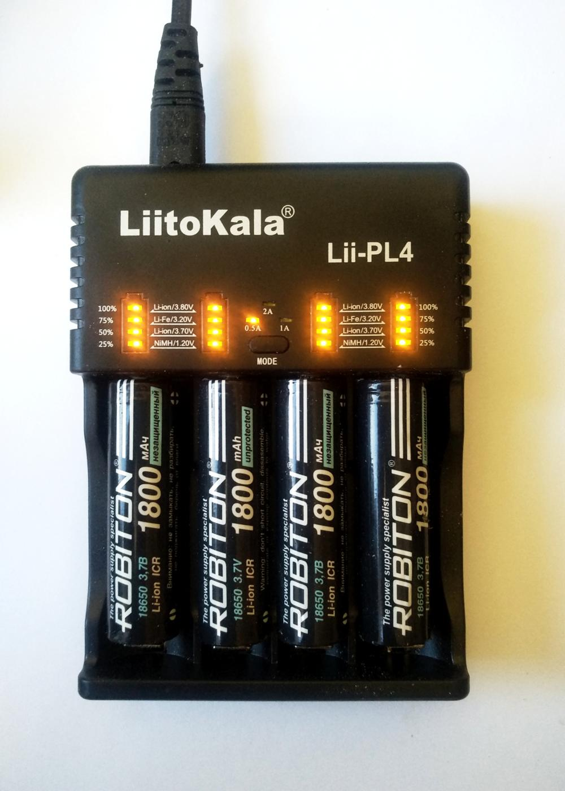

这是充电器里的圆柱电芯，不是保护板。有一节已经掉了外皮——掉皮、鼓包、漏液的不要继续充。

> **原理**　单体电压朝着大约 1.5 V 或更低走时，负极电位抬高，铜集流体可能溶解；再次充电会在隔膜上沉积成枝晶。深放的电池可以看起来很安静。大约 2.5–3.0 V 是常见预充门槛，不是溶解点。
> **证据**　过放后铜集流体溶解、再充电沉积，见 [Zhang 等，International Journal of Energy Research，2023](https://onlinelibrary.wiley.com/doi/10.1155/2023/8571535)（英文，可选，开放获取）。这篇说明的是溶解再沉积，不是把 2.5 V 写成溶解电压。深放优先按厂家要求报废；预充电流以电芯 datasheet 为准。拿不准就报废。
> **延伸阅读**　[瑞萨《BMS 教程》中文导读](../renesas-bms-tutorial-中文导读.md)（可选扫盲）

**短自测**

1. 过放当时，电池一定又热又鼓吗？
2. 1 V 多的旧电芯，能直接大电流激活吗？

<b>参考答案（先自己想完再展开）</b>

1. 不一定。深放时铜集流体可以安静地溶解。针长在下一次充电。
2. 不能，也不该拿小电流去「激活」。1 V 多已经在深放危险带里，很多厂家要求报废。鼓包、漏液直接报废。拿不准就报废。大约 2.5–3.0 V 的预充小电流，只适用于手册允许、又没有放到这么深的那一档。

**练完你会怎样**：看到安静的亏电电芯，你先想到铜针，不想到「抢救一下」。

还没落到深放带、手册又允许预充的，电流上限按这颗电芯的 datasheet。没有手册时，下面只用教学 5 Ah 把 0.05C 换算给你看，而且只画在大约 2.0–3.0 V。不能抄进保护板，也不能拿去救 1 V 多的旧电芯：


> **图说**　浅红是深放，允许电流是 0。浅黄预充带里蓝线才是 0.25 A。红虚线是 5 A，标成不要。

> **口诀**　预充只走细流。深放优先报废。

**看动画时盯住哪里**

教学容量 5 Ah，0.05C 是 0.25 A，只画在大约 2.0–3.0 V 的预充带里。1.2 V 那一拍允许电流是 0，优先报废。红虚线是 1C、5 A，不要用它去充电。回到大约 3.0 V 以上之后，电流以这颗电芯的手册为准。鼓包、漏液，或拿不准，不走这条曲线。

**短自测**

1. 图上 0.25 A 是哪一颗电芯的手册电流？
2. 为什么红线标成不要？

<b>参考答案（先自己想完再展开）</b>

1. 都不是。5 Ah 和 0.05C 是本节的教学换算，用来记住「很小」。真实上限在这颗电芯的 datasheet 里。
2. 5 A 是这套教学容量的 1C。预充带里也不许走它。深放电芯里若已经有溶解的铜，大电流会更快把它镀成针；那种电芯优先报废，不是先拿 0.05C 去试。

**练完你会怎样**：你看到 1 V 多的旧电芯，先想到报废，不想到「用小电流激活」。预充小电流只留给手册允许、又还在大约 3 V 附近的那一档。

### 0.1.4 温度：电池的脾气 [理解]

> **先看一个场景**　零下二十度，满电的电动自行车一拧把掉两格。不是电量没了，是内阻把端电压拉低了。电动摩托车与电动汽车同样会降额，但通常由 SOP 与整车扭矩控制表达，不应照搬这块仪表的格数。
>
> **算一笔账**　示意曲线里，25 °C 内阻 20 mΩ，−20 °C 约 120 mΩ，差 6 倍。20 A 放电，压降从 0.4 V 变成 2.4 V；3.7 V 的单体只剩 1.3 V。BMS 看到的是一节“快空”的电芯，可它的电量其实还在。

电池有两副面孔，全看温度：

- **低温（<0°C）**：电解液变"稠"，锂离子跑不动。这时大电流充电，锂离子来不及钻进石墨层间，只能在负极表面析出金属锂——**和过充第三幕一模一样的析锂**，只不过导演从高压换成了低温。这就是"冬天快充伤电池"的物理本质，也是 BMS 必须**低温禁充或限流**的原因。
- **高温（>45°C）**：一切副反应加速。口诀是温度每升高约 10°C，老化速率大致翻倍。它不是定量定律，见下面的证据。夏天把手机落在暴晒的车里，就是在用几倍速消耗电池寿命。

**温度保护和电压保护一样，是 BMS 的基本工作。**


> **图说**　盯住左边那一幕只在充电时出现：低温充电会析锂，右边的高温则是每一次都在把老化按快放。

> **口诀**　低温充电会析锂。高温是把老化按快放。

左边那幕只在**低温充电**时上演——低温放电只是没劲，不会析锂；右边那幕每一次高温都在累积。所以 BMS 的功率限制按温度分档：低温先砍充电，高温充放一起砍。

> **原理**　低温大电流充电会在负极表面析锂，所以 BMS 必须低温禁充或限流；高温则让副反应变快，老化和热失控风险一起上升。
> **证据**　低温充电析锂、高温加速副反应，先对照 [BU-808](https://batteryuniversity.com/article/bu-808-how-to-prolong-lithium-based-batteries/)（英文，可选）。「每升高约 10°C 老化翻倍」只是口诀；[Diao 等，Applied Sciences 2018](https://www.mdpi.com/2076-3417/8/10/1786)（英文，可选）说明它不是定量定律。
> **延伸阅读**　[瑞萨《BMS 教程》中文导读](../renesas-bms-tutorial-中文导读.md)（可选扫盲）

**短自测**

1. 低温放电会析锂吗？
2. 「每升高约 10 °C 老化翻倍」能写进公式吗？

<b>参考答案（先自己想完再展开）</b>

1. 不会。析锂是低温充电：离子来不及嵌进石墨。低温放电只是没劲。
2. 不能。它是口诀。Diao 等 2018 说明它不是定量定律。高温仍然要限功率。

**练完你会怎样**：冬天你先砍充电。夏天你知道高温在加速老化，而不是背下一条定律。

内阻也跟着温度变。冷的时候电解液变稠，同一颗电芯会软一大截：

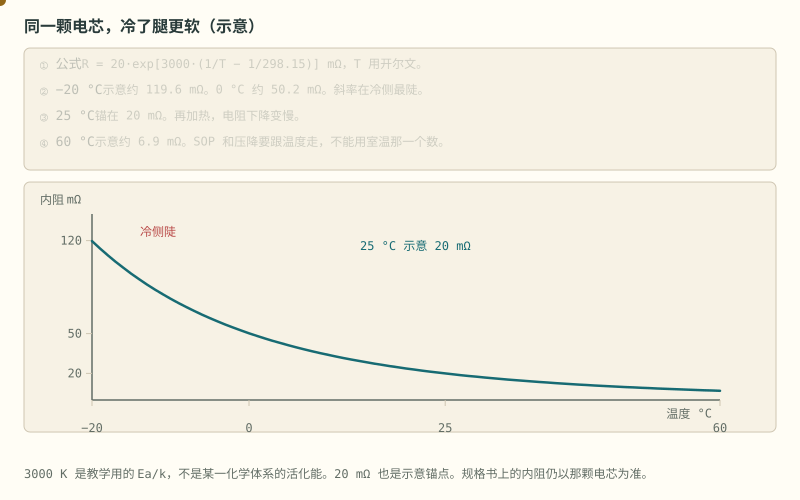

> **图说**　示意 $R = 20\exp[3000(1/T-1/298.15)]$ mΩ，T 用开尔文。

> **口诀**　越冷内阻越大，而且冷侧涨得更陡。

**看动画时盯住哪里**

25 °C 锚在 20 mΩ。−20 °C 约 120 mΩ，0 °C 约 50 mΩ，60 °C 约 6.9 mΩ。冷侧陡，热侧变缓。

- 黄点从冷往热走，电阻往下掉。
- 左边那截很陡：再冷一点，电阻多一大截。
- 25 °C 的 20 mΩ 是这张图的锚，不是你的电芯。

**短自测**

1. 为什么不能拿室温内阻去算冬天的压降？
2. 这张示意里，−20 °C 和 25 °C 大约差几倍？
3. 3000 K 能写进保护公式吗？

<b>参考答案（先自己想完再展开）</b>

1. 冷侧按这张示意会大好几倍。压降、峰值电流都会跟着变。
2. 大约 6 倍。120 mΩ 对 20 mΩ。两个数都是示意。
3. 不能。它是教学用的 Ea/k，用来记住形状。活化能以你的电芯辨识为准。

**练完你会怎样**：你算压降之前，会先问这颗电芯现在多冷。

同一条「越冷越陡」的形状，也解释了冬天要多等一会儿才能查开路电压。那一笔在阶段 4。这里先记住：内阻不是一个常数。

> **边界**　“每升高 10 °C 老化翻倍”是口诀，不是定量定律；低温放电只是没劲，不会析锂；低温充电才伤芯。功率限制要按温度分档，不能拿一条直线套全年。

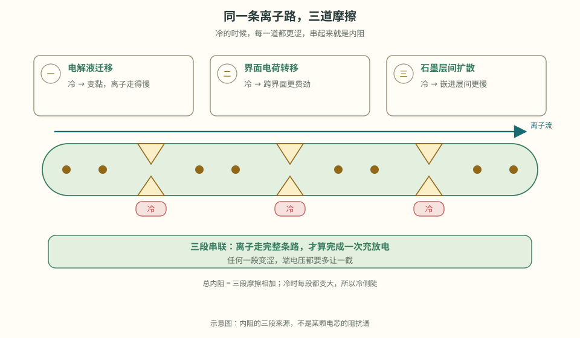

> **看图**　同一颗电芯，为什么冷的时候内阻会大好几倍？

温度之外还有一层：就算温度固定，「内阻」是多少还取决于你量了多久。

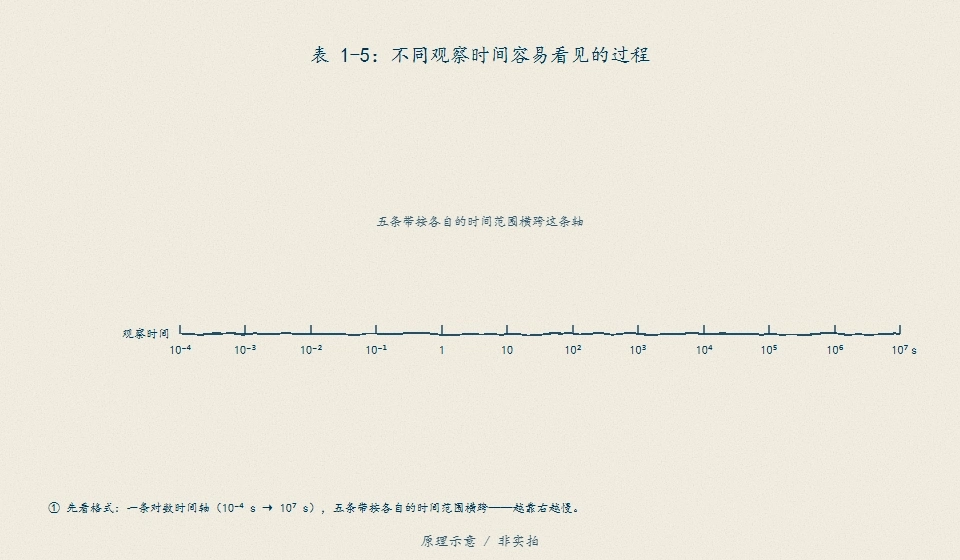

> **图说**　把快速压降、双电层、扩散等几条过程摆到同一条对数时间轴上：10 ms 窗只圈进快速压降和一部分双电层，10 s 窗里双电层已经做完、扩散才刚开始——两道窗量出来的「内阻」不是同一个数。所以报内阻必须同时报测量窗口，否则两份数据没法比。书稿 §1 的表 1-5 是同一口径。

[继续阅读](./stage-0-主线-充电与电量.md) · [完整讲义与原有锚点](./stage-0-前置知识.md)

<!-- Generated by prepare-stage0.mjs; edit stage-0-前置知识.md. -->
