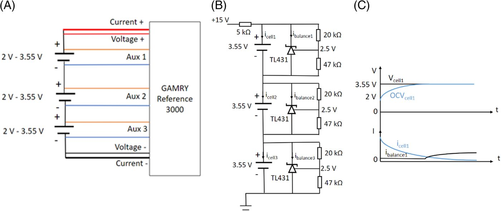
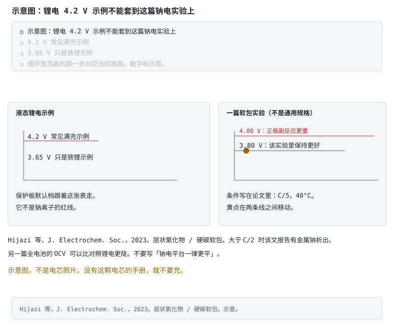
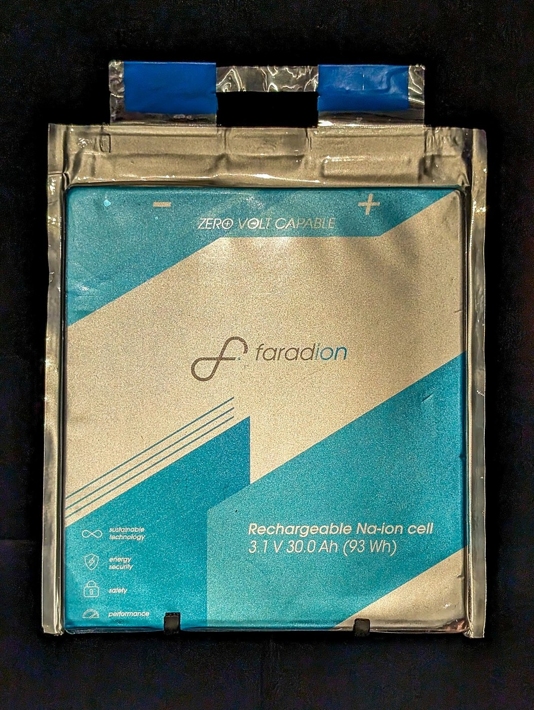

# 阶段 0 选读：固态、结构与钠离子电池

读完液态锂电主线后再看这些材料。不同体系的电压窗口、集流体和保护条件不能互相照搬。

### 0.1.8 固态电池：固体电解质换掉了什么 [理解]

> **第一性原理**　固态电池仍要看电压、电流和温度，保护边界要按材料体系重新核对。电子仍走外电路，短路和过充的物理后果仍在。

这里说的固态电池，是用固体电解质代替液态有机电解液和多孔隔膜、或代替其中大部分的锂电池。文献里常分成氧化物（例如石榴石型 LLZO）、硫化物和聚合物几类。三类的电压窗口和温度窗口并不共用一张表，以你拿到的那颗电芯手册为准。

和 §0.1.1 比，变的是离子走的那一层：

- 锂离子改走固体。电子仍然穿不过电解质，还是绕外电路。供电的道理没变。
- 高能量的宣传多半还指望负极换成金属锂，而不是石墨那种一层层抽屉。金属锂的电位几乎是平的，电芯电压更跟着正极走。阶段 4 里「石墨 OCV 有台阶，静置可以查表」这套做法，要换成这颗电芯自己的曲线。
- 名字叫固态的样品，正极一侧仍可能点了少量液体或凝胶，用来降低界面电阻。Bates 等人把这种做法看成从液态走到全固态的过渡。看到「固态」先问两句：电解质里还有没有液体，负极是石墨、硅，还是金属锂。

对 BMS，有四件事先记住：

1. **保护阈值不能沿用**三元 4.2 V、铁锂 3.65 V 那些示例。允许电压、电流和温度以这颗电芯的 datasheet 为准。没有手册，就不要用现成保护板的默认档去充。
2. **短路和过充保护还在。** 固体电解质挡住电子，锂仍可能沿缺陷长进电解质里。Bates 等用热力学模型、以 LLZO 为例算过：外部加热时，全固态的放热可以低于常规液态锂电；短路时温升可以更高，包装和旁边的材料仍可能着火。这是模型，不是某台车上测到的温度。能带走的结论只有一句：固态电芯仍会在失效时放出大量热，BMS 的电压、电流和温度保护不能拆。
3. **界面电阻往往更大，也更吃温度。** 低温限流的理由还在。热管理没有因为「换掉液体」而消失。谁测温、谁限功率，仍按 [阶段 6 §6.1.6](stage-6-精通与毕业项目.md#616-bms-与热管理tms的边界-评价)。
4. **安时积分的形式还在**：流过的电荷仍要记。库仑效率、不可逆的锂损失、电压曲线都换了。SOC、SOH 的定义（还剩多少、还能装多少）可以留着，液态石墨电芯的查找表不能留着。

本仓库没有找到一份把固态电芯写进现行保护 IC 默认阈值的公开标准。接口仍是电压、电流、温度；数值来自该电芯。

成熟度按综述的原话收，不按发布会收。Janek 与 Zeier 在 2023 年写的是：固态被寄望成更安全、更稳、能量和倍率都更高的技术，但长期性能、比功率和经济性仍是问题；复合正极里要有够快的离子通道；高性能负极和界面保护仍然关键；金属锂也不一定是终点。他们要正视的是离规模化量产还差的那些关口。车展续航和「即将上车」不写进这里当事实。

> **图说**　红线落得更低、更慢。界面电阻和秒数是教学数，不能拿去改保护阈值。

> **口诀**　换的是离子通道。碳纤维外壳里仍是普通电芯。

**看动画时盯住哪里**

示意放电 1 A。液体支路 20 mΩ、时间常数 1 s；固体界面 80 mΩ、8 s。金点沿红线走。这不是 LLZO 的手册曲线，也不是某一台车的实测温度。碳纤维外壳里仍是普通电芯，按那些电芯的手册读。短路保护不能因为「换掉液体」就拆掉。

QuantumScape 自己的问答页写明：陶瓷隔膜和有机液体正极电解液一起用；电芯按无负极制成，金属锂在第一次充电时在隔膜上形成。同一页写明多层商用电芯还没开发完，所以还没有对商用目标电芯和电池包做过安全测试。这和上面「界面仍可能有液体」是同一件事的厂商表述。他们写下的体积能量密度目标不收进正文当规格。

还缺的公开文件，名字就叫：QuantumScape 或 Solid Power 的量产包 BMS 手册（单体电压窗口、保护阈值、均衡方式、温度测点）。本轮公开检索没有找到这份手册。

> **原理**　固态电池换的是离子通道：液体电解液换成固体电解质，电子仍走外电路。金属锂负极会改掉电压曲线。少量残液、锂丝穿入固体、短路放热，都让「没有可燃电解液所以可以不设 BMS」站不住。
> **证据**　量产差距见 Janek、Zeier，[Nature Energy 2023](https://doi.org/10.1038/s41560-023-01208-9)（英文，可选）：长期性能、比功率和经济性仍是问题，金属锂不一定是终点。安全模型见 Bates 等，[Joule 2022](https://doi.org/10.1016/j.joule.2022.02.007)（英文，可选）：正极侧常加入少量液体以降低界面电阻；以 LLZO 做的热力学计算里，短路时全固态的温升可以高于常规液态锂电。两个结论都是论文口径，不是某款车的实测温度。厂商自己的表述见 [QuantumScape 技术问答](https://www.quantumscape.com/battery-technology)（英文）：陶瓷隔膜配有机液体正极电解液；多层商用电芯未完成，商用目标电池包的安全测试尚未做。
> **延伸阅读**　热管理分工仍在 [阶段 6 §6.1.6](stage-6-精通与毕业项目.md#616-bms-与热管理tms的边界-评价)。OCV 查表的前提在 [阶段 4 §4.3](stage-4-SOC-SOH算法.md#43-ocv-法好尺子但经常够不着-分析)。包级手册必须有的栏目和仍缺的文件名，见 [包级手册缺口](../t13-包级手册缺口.md)。

**短自测**

1. 换成固体电解质，短路保护可以拆掉吗？
2. 碳纤维外壳的电池包，算结构电池吗？

<b>参考答案（先自己想完再展开）</b>

1. 不能。固体挡电子，挡不住锂沿缺陷长进去。Bates 等的模型里，短路时温升可以更高。那是模型，不是某台车的实测。电压、电流、温度保护都留着，数字跟这颗电芯走。
2. 不算。外壳是箱子，里面仍是普通电芯，按那些电芯的手册读。结构电池是碳纤维自己做电极。量产包的 BMS 手册仍然没有，不要编一份。

**练完你会怎样**：听到「固态所以不用 BMS」，你会摇头。包级手册该缺的还缺。

### 0.1.9 碳纤维结构电池：电极在承力，外壳是另一件事 [理解]

两件东西都可能被叫成「碳纤维电池」，结构完全不同。

**结构电池**里，碳纤维同时做电极和承力件。离子走结构电解质（既要传力，也要导离子），正负极之间仍有隔膜或织物。材料既是结构，也是电池。

**碳纤维外壳**里，碳纤维是包的壳体。壳体里面仍是普通液态锂电芯。轻的是箱子。电压窗口、采样线和保护阈值按那些电芯来，和结构电池无关。

查尔姆斯一条实验室路线（Asp 等，2021）是：碳纤维做负极兼集流体，玻璃纤维隔开，正极是铝箔上的磷酸铁锂，中间是结构电解质。报道的能量密度约 24 Wh/kg，弹性模量约 25 GPa，拉伸强度超过 300 MPa。2024 年同一方向的全碳纤维试样（Chaudhary 等）：碳纤维做负极，表面涂了磷酸铁锂的碳纤维做正极，纤维素隔膜，能量密度 30 Wh/kg，电化学循环到约 1000 次、库仑效率约 100%，顺着纤维的模量超过 76 GPa。这些是复合材料试样的论文数字，不是装车电池包的规格。循环次数和模量若是分开测的，不要读成「承重的同时循环了一千次」。

Gray 等 2024 年的综述用一架设想中的双座电动飞机作对照：他们写下的门槛大约是 52 Wh/kg 和 103 W/kg，并认为当时的结构电池能量和功率都还没到，功率差得更远。那是综述里的对照，不是适航标准原文。和车用液态电芯比，结构电池赢的是「这块板子本来就要有重量」，单芯比能量仍低一个数量级上下；电芯侧的具体 Wh/kg 以 datasheet 为准，不要用这里的试样数字去换算续航。

对 BMS：

- 没有一节一节的圆柱电芯可采样。电极铺成一块板，量到的是这块板的端电压。局部干湿、局部受力和局部 SOC 可以对不齐。现成多串 AFE 的引脚图对不上这种几何。
- 负极仍是碳，锂仍要嵌进去。过充和析锂的担心还在，聚合物和结构电解质的热行为也要单独查。不要用三元保护板的默认阈值去充一块结构电池试样。不要拆开试样。
- 力学和电化学绑在一起。SOH 若只剩「容量」和「内阻」两个数，会漏掉载荷历史对接触的影响。这句话是从结构推出来的，还没有量产 BMS 手册可以核对。
- 安时积分仍然记电荷。容量小、面积大、内阻高，阶段 4 的噪声和漂移要重做。没有这件样品自己的 OCV 和容量曲线，就不要套铁锂或三元的表。

成熟度停在实验室和论文样件。本仓库没有可核验的「碳纤维结构电池已经作为量产车的主电池，并配有公开 BMS 手册」。碳纤维外壳的量产包按普通锂电 BMS 读。

Xu 等 2022 年把三节结构电池试样串联，并用被动均衡把整组充满。Figure 4B 用 TL431 作电压基准，参考电压 2.5 V，分压电阻 R1 = 20 kΩ、R2 = 47 kΩ，单节上限设成 3.55 V。单节窗口写的是 2.0–3.55 V。这是实验室电路图，CC BY 4.0。它没有采样脚位，也没有量产包的寄存器地图。

Figure 4 从左到右是四线测量、TL431 被动均衡、电流旁路。全文在 [Chalmers 542348](https://research.chalmers.se/publication/542348/file/542348_Fulltext.pdf)，期刊页 [EcoMat 2022](https://doi.org/10.1002/eom2.12180)。来源见 [照片来源](../circuits/assets/photos/PHOTOS.md)。

还缺的公开文件，名字就叫：结构电池包的采样接口与保护阈值手册。没有这份文件，就不写结构电池的过充点和采样脚位。

> **原理**　结构电池让碳纤维兼做电极和承力件，能量存在承力路径里。碳纤维外壳只减轻壳体，电芯仍是普通锂电，BMS 假设不用改。结构电池的端电压是一整块板的平均，局部 SOC 和载荷可以对不齐。
> **证据**　Asp 等，[Advanced Energy and Sustainability Research 2021](https://doi.org/10.1002/aesr.202000093)（英文，可选）：碳纤维负极兼集流体，约 24 Wh/kg、弹性模量约 25 GPa、拉伸强度超过 300 MPa。Chaudhary 等，[Advanced Materials 2024](https://doi.org/10.1002/adma.202409725)（英文，可选）：全碳纤维试样约 30 Wh/kg，电化学循环约 1000 次，纤维方向模量超过 76 GPa。Gray 等，[Journal of Materials Chemistry A 2024](https://doi.org/10.1039/D4TA01008F)（英文，可选）：用 52 Wh/kg、103 W/kg 作设想中的飞机对照，并认为当时的结构电池还没达到，功率差得更远。Xu 等，[EcoMat 2022](https://doi.org/10.1002/eom2.12180)（英文，可选）：三串试样用 TL431 被动均衡，R1 = 20 kΩ、R2 = 47 kΩ，单节上限 3.55 V。这四篇都是试样或综述，不是装车规格。
> **延伸阅读**　对照图和安全注记在 [§0.1.8](stage-0-前置知识.md#018-固态电池固体电解质换掉了什么-理解)。热管理边界在 [阶段 6 §6.1.6](stage-6-精通与毕业项目.md#616-bms-与热管理tms的边界-评价)。结构电池包的采样接口与保护阈值手册仍缺，见 [包级手册缺口](../t13-包级手册缺口.md)。

**短自测**

1. 结构电池试样上量到的电压，是每一节圆柱的电压吗？
2. Xu 等 Figure 4 的 3.55 V 能当成量产过充点吗？

<b>参考答案（先自己想完再展开）</b>

1. 不是。电极铺成一块板，量到的是这块板的端电压。现成多串 AFE 的引脚对不上这种几何。
2. 不能。那是三节试样上 TL431 电路的单节上限，实验室图，没有寄存器地图。

**练完你会怎样**：你能把「碳纤维做电极」和「碳纤维做箱子」分成两件事。

### 0.1.10 钠离子：硬碳和另一套电压窗口 [理解]

> **先看一个场景**　维修站里，一块按锂电设计的保护板，被拿去充钠离子电芯。板子的过充点停在 4.2 V 附近，还没动作；可这颗电芯的规格表，可能 3.95 V 就是上限。
>
> **算一笔账**　同一颗层状氧化物/硬碳软包，在 C/5、40 °C 下，充到 3.80 V 比充到 4.00 V 更稳；两者只差 200 mV，副反应却已经换了一档。锂电保护板的 4.2 V 档，对这颗电芯来说太晚了。

钠离子电池用钠离子代替锂离子在正负极之间来回走。电子仍走外电路。眼下常见的一种搭配是层状氧化物正极、硬碳负极。它不是把锂电保护板上的 4.2 V 档换个名字。

对 BMS，先分开三件事：

1. **电压窗口跟这颗电芯走。** Hijazi 等人 2023 年测的是一种层状氧化物 / 硬碳软包，正极写成 NaCa₀.₀₃[Mn₀.₃₉Fe₀.₃₁Ni₀.₂₂Zn₀.₀₈]O₂。在 C/5、40°C 下，充电上限收到 3.80 V 时，容量保持、极化和产气都好于同一批充到 4.00 V 的电芯；充过 3.80 V 之后，正极一侧的阻抗上升变明显。

同一实验里，40°C 下充电倍率大于 C/2 时，超高精度库仑法看到明显的金属钠析出。这是这一化学体系、这一温度和这些倍率下的结果，不是所有钠离子的红线，也不能写进保护 IC 当默认档。锂电单节保护板上常见的 4.2 V 过充点，对这颗电芯来说已经落在论文里副反应更重的一侧。没有这颗电芯的手册，不要用锂电保护板去充。
2. **OCV 不是一律更平。** 硬碳对金属钠的半电池在低压段可以有平台；全电池的形状还要看正极。Quade 等人比较了三颗电芯上的实时 SOC 算法：他们测的 NaMO₂ / 硬碳全电池，OCV(SOC) 是三条曲线里最陡的，电压误差对 SOC 的伤害小于他们对照的锂电。所以「钠电平台更平，电压法更没用」不能当成通用句。磷酸铁锂平台区的教训留在 [阶段 4 §4.3](stage-4-SOC-SOH算法.md#43-ocv-法好尺子但经常够不着-分析)。换化学体系就换曲线。
3. **SOP 也不能借用。** 允许的持续电流、脉冲和低温限流以这颗电芯的手册为准。上面那篇软包实验只说明：在 40°C、大于 C/2 时那一化学体系会析钠。本仓库没有一张可以套用的钠离子 SOP 表。

安时积分的形式还在：流过的电荷仍要记。库仑效率、不可逆损失和电压曲线都换了。液态石墨电芯的 OCV 表、4.2 V / 3.65 V 示例阈值，不能直接贴过去。钠在负极析出是另一件事，不要和锂枝晶写成同一句。锂电过放的铜集流体溶解（[§0.1.3](stage-0-前置知识.md#013-过放安静的杀手-理解)）也不要抄到钠电上；集流体是铜还是铝，看这颗电芯。

> **图说**　左边是液态锂电的示例线，4.2 V 和 3.65 V 只属于常见锂电体系。

> **口诀**　阈值跟这颗电芯走，不跟锂电的 4.2 V。

**看动画时盯住哪里**

右边是 Hijazi 2023 那篇软包实验的两条线：3.80 V 保持更好，4.00 V 正极副反应更重，条件是 C/5、40°C。黄点在这两条线之间移动。这张是示意图。

**练完你会怎样**：你能用上面那句口诀，把这张图讲给别人听。

伦敦科学博物馆能源展厅里的 Faradion 钠离子电池，藏品号 2023-357。展签写着 Sodium-ion battery 和 Faradion Limited。看的是展品外形。电压窗口和保护阈值不在这张照片上，见下一节的电芯规格书。来源见 [照片来源](../circuits/assets/photos/PHOTOS.md)。

**故障分析**

- 把「还没到 4.2 V」当成安全。对那篇软包，4.00 V 已经比 3.80 V 更伤正极，而锂电保护板这时往往还不动作。
- 把「钠电 OCV 更平」当成必须换更贵电压采样的唯一理由，或反过来当成可以少看电压。Quade 的那颗电芯斜率更陡；另一款全电池可能又平。先看这颗的曲线。
- 过放之后套用铜枝晶故事。材料不对，失效外观也不对。

**案例解析**（教学案例，不是事故调查，也不是本仓库的实测）

发生了什么：一块按锂电单节设计的保护板，拿去充 Hijazi 2023 那种层状氧化物 / 硬碳软包。板子的过充点停在锂电常用的 4.2 V 附近（以该板手册为准）。电芯电压可以在 3.80 V 以上停留，保护板仍不切断。

信号：保护板无动作。若按那篇论文的条件充到 4.00 V（C/5、40°C），容量保持变差、正极阻抗上升、产气更多；大于 C/2 时论文报告有金属钠析出。这些是论文里的电池。

根因：比较器的电压和化学体系不是同一张表。

BMS 上的教训：过充点、回差和温度降额跟电芯手册走。软件里写一个「钠电兼容」标志、却不改硬件比较器的分压，等于这道保护还停在锂电上。SOC 查这颗电芯自己的 OCV，不用三元或铁锂的表。

> **原理**　钠离子换的是来回走的离子，以及常见的硬碳负极和另一套电压窗口。电子仍走外电路。锂电保护板的 4.2 V 档、铁锂的 OCV 表和锂电过放的铜溶解故事都不能直接搬过去。
> **证据**　电压窗口和析钠见 Hijazi 等，[Journal of The Electrochemical Society 2023](https://doi.org/10.1149/1945-7111/ace4fa)（英文，可选）：该层状氧化物 / 硬碳软包在 C/5、40°C 下，充到 3.80 V 优于充到 4.00 V；大于 C/2 时观察到金属钠析出。OCV 斜率见 Quade 等，[Batteries & Supercaps](https://doi.org/10.1002/batt.202500456)（英文，可选）：他们测的 NaMO₂ / 硬碳全电池是三条曲线里最陡的，电压误差对 SOC 的影响更小。两篇都是特定电芯，不是行业默认阈值。
> **延伸阅读**　铁锂平台区在 [阶段 4 §4.3](stage-4-SOC-SOH算法.md#43-ocv-法好尺子但经常够不着-分析)。能公开点开的电芯规格书在 [§0.1.11](stage-0-前置知识.md#0111-公开规格书里的钠离子保护要求-理解)。包级寄存器手册仍缺，见 [包级手册缺口](../t13-包级手册缺口.md)。

**短自测**

1. 锂电单节保护板的 4.2 V 档，能拿去充 Hijazi 2023 那种软包吗？
2. 「钠电 OCV 一律更平」对吗？

<b>参考答案（先自己想完再展开）</b>

1. 不要。那篇在 C/5、40 °C 下，3.80 V 比 4.00 V 更稳。4.2 V 档这时往往还不动作。这不是所有钠离子的红线。
2. 不对。Quade 等测的那颗全电池，斜率比他们对照的锂电更陡。换电芯就换曲线。

**练完你会怎样**：你能说出：阈值跟这颗电芯走，不跟锂电的 4.2 V。

### 0.1.11 公开规格书里的钠离子保护要求 [理解]

> **先看一个场景**　把超钠 50 Ah 的 4.0 V 锁定，抄进海四达 70 Ah 的比较器：板子还没动作，电芯已经越过它自己的规格表。
>
> **算一笔账**　海四达规格表写充电上限 3.95 V，循环程序却是 3.9 V / 2.0 V。同一份 PDF 里有两套端点，差 50 mV。阈值要写“这颗电芯、这一版规格”，不能写“钠电通用”。

§0.1.10 的论文给出的是某一颗软包的实验窗口。能公开点开、并且写了 BMS 最低动作的，目前是两份电芯规格书。两份都托管在经销商网站，页眉或正文能对上厂商名称；没有在厂商自己的域名上再核过一份。它们是电芯规格，不是包的原理图，也不是寄存器手册。两家的电压不要并成一张「钠电阈值表」。

**湖州超钠新能源科技有限公司**，50 Ah、标称 2.9 V 钠离子电芯，规格书 Rev 1.0。页眉地址是湖州市南太湖新区霅水桥路 839 号。§4.5 写的是 BMS 最低检测和控制，中文句子为准：

| 条款 | 这一颗电芯上的动作 |
|---|---|
| 4.5.1 充电终止 | 电压到 3.9 V，BMS 申请终止充电 |
| 4.5.2 第一级过充 | ≥3.95 V，强制终止充电 |
| 4.5.3 第二级过充 | ≥4.0 V，强制终止充电，并且锁定到技术人员处理 |
| 4.5.4 放电终止 | 电压到 1.5 V，BMS 申请终止放电。英文行写成减小放电电流，和中文不一致 |
| 4.5.5 第一级过放 | 电压到 1.4 V，强制终止放电 |
| 4.5.6 短路 | 由过流保护装置断开 |
| 4.5.7 / 4.5.8 | 电流和温度按 §2.2、§2.3 |
| 4.5.10 | 充电长于 8 小时则终止充电 |

同一份里，§2.2.7 把绝对充电电压写成最大 3.9 V，标准充电是 0.5C 恒流恒压到 3.9 V、截止 0.05C；放电截止是 1.5 V。绝对充电温度 0–60°C，绝对放电温度 −40–60°C。25°C 下最大持续充电 1C，最大持续放电 2C。§3.1：内阻超过该电芯最初内阻的 200%，或 25°C 下容量小于等于标称容量的 60%，停止使用。

§2.6.1：安全测试、寿命测试和成组设计要加预紧力，新鲜电芯 500–5000 N，建议公差 ±200 N。循环条款另写 25°C、300 kgf、1.8–3.8 V。3.9 V 的申请停止、3.95 V 的强制停止、4.0 V 的锁定，以及循环用的 3.8 V，留在各自的条款里。

**江苏海四达电源有限公司**，型号 NaCP50160118-70H3，企业标准 Q/KAGG1429-2023。规格表：标称容量 70 Ah，标称电压 3.0 V，充电电压 3.95 V，标准充电 0.5C，最大充电 2C，放电截止 1.8 V，标准放电 0.5C，最大持续放电 4C，100% SOC、25±2°C 下脉冲放电 6C、30 s。充电温度 −10–55°C，放电温度 −40–60°C。操作注意事项写明充电电压不得超过 3.95 V/电芯，这是充电电压最高极限。§6.6.3：电压低于 1.8 V 时，电芯内部可能遭到永久性损坏。标准循环程序却是另一套端点：1C 恒流恒压充到 3.9 V、截止 0.1C，再 1C 放到 2.0 V。规格表的 3.95 V / 1.8 V 和循环程序的 3.9 V / 2.0 V 同时留着。

文件名里带 Na-Ion 的 [ENJIE EMU1102 24S 手册](https://www.enjiebms.com/uploads/file/20250427/emu1102-72100-1102-10e-24s-na-ion-en.pdf)（英文），封面产品名是 72V100A LTO Battery Management System，正文写的是 17–24 串 LTO。这份的默认电压不收进钠离子。

**故障分析**

- 把超钠的 4.0 V 锁定和 1.4 V 过放，写进海四达那颗电芯的比较器。两份规格的满充和截止本来就不是同一对数。
- 只读超钠英文行的 “minimize the discharging current”，在 1.5 V 以后继续放电。中文写的是申请终止放电。
- 把电芯规格书当成包级寄存器手册。上面没有采样芯片地址，也没有接触器时序。
- 按 PDF 文件名收化学体系。EMU1102 那份文件名写钠离子，正文写 LTO。

**案例解析**（教学案例，对照的是这两份规格书，不是某台包的测试）

发生了什么：一块保护板要同时兼容「钠离子」。比较器按超钠 §4.5 设成 4.0 V 锁定、1.4 V 强制停放，去充海四达 NaCP50160118-70H3。

信号：海四达规格表的充电电压是 3.95 V，操作注意事项把 3.95 V/电芯写成最高极限。循环程序甚至收到 3.9 V 才截止、放到 2.0 V 就停。板子要到 4.0 V 才锁定时，这颗电芯已经越过它自己的规格表。

根因：把另一颗电芯的保护动作当成这颗的，又把同一份 PDF 里的规格表和循环程序收成一个数。

BMS 上的教训：过充点、过放点和温度窗口跟你装进去的那颗电芯的那一版规格走。经销商托管的 PDF 要核对页眉厂商。包级原理图和寄存器手册仍然没有：缺的文件名叫「超钠或海四达的包级 BMS 原理图或寄存器手册」。

> **原理**　钠离子的保护阈值写在这颗电芯的规格书里，而且同一份规格书里的工作窗口、循环程序和强制保护可以是三套数。电芯规格书交代单体该在哪停；包级手册才交代采样、均衡和接触器。文件名不能代替正文里的化学体系。
> **证据**　超钠 50 Ah 规格书（经销商托管，Rev 1.0）[PDF](https://www.gobelpower.com/download/horizontal-na-hna-50ah-sodium-ion-cell-specification.pdf)：§4.5 的 3.9 / 3.95 / 4.0 V 与 1.5 / 1.4 V，§2.2.7 绝对充电电压最大 3.9 V，§3.1 的 200% 内阻或 60% 容量，§2.6.1 的 500–5000 N。海四达 NaCP50160118-70H3，Q/KAGG1429-2023（经销商托管）[PDF](https://srikobatteries.com/wp-content/uploads/2024/09/NaCP50160118-70H3%E6%8A%80%E6%9C%AF%E8%A7%84%E6%A0%BC%E4%B9%A6-1429-2023.pdf)：规格表充电 3.95 V、放电截止 1.8 V；循环程序 3.9 V / 2.0 V。两份都不是包级手册。
> **延伸阅读**　论文窗口在 [§0.1.10](stage-0-前置知识.md#0110-钠离子硬碳和另一套电压窗口-理解)。包级手册必须有的三页、已废止的团体标准，以及仍缺的三份文件，见 [包级手册缺口](../t13-包级手册缺口.md)。

**短自测**

1. 超钠规格书的 4.0 V 锁定，能直接抄到海四达那颗上吗？
2. 电芯规格书等于包级寄存器手册吗？

<b>参考答案（先自己想完再展开）</b>

1. 不能。海四达规格表的充电电压是 3.95 V。同一份 PDF 里，规格表和循环程序也可以不是同一个数。
2. 不等于。规格书告诉你这颗电芯该在哪停。采样地址和接触器时序仍然没有。缺的文件名还在 T13，这次也不编。

**练完你会怎样**：你不会把两家钠电并成一张「通用阈值表」。

### 自测 0.1 [理解]

> **先读/后读**：九题都在考理解。第 4 题要用参数表做计算，仍然是在用机制，不是动手实测。第 7、8、9 题不挡进入阶段 1。

1. 隔膜的作用是什么？热失控链条里它在哪一幕"阵亡"？
2. 为什么低温下大电流充电和过充会造成同一种损伤（析锂）？
3. 过放电池为什么"放着放着就坏了"，直接大电流激活有什么风险？
4. 16 串 50Ah 三元锂包，1C 充电电流多大？整包满充电压多少？
5. 为什么"电压到 4.2V"不能作为充满判据？满充的可靠判据是什么？
6. 一块 SOH=80% 的电池显示 SOC=100%，实际电量是出厂时的多少？
7. 固态电池换掉了液态锂电的哪一层？为什么还要留着短路和过充保护？
8. 碳纤维做电极的结构电池，和碳纤维做外壳的电池包，BMS 各按什么读？
9. 为什么不能用锂电单节保护板的 4.2 V 档去充一颗钠离子电芯？「钠电 OCV 一律更平」错在哪？

<b>参考答案（先自己想完再展开）</b>

1. **隔膜**是一层多孔塑料膜，职责有两条：只许锂离子通过、**坚决不许电子通过**；同时是防止正负极直接接触的最后一道物理屏障。它在五步链条的**第 4 幕**阵亡——负极析出的锂枝晶越长越长，把它扎穿，正负极在内部短路，直接引出第 5 幕热失控。
2. 两者的共同机制是**锂离子到达负极的速率超过它嵌入石墨层间的速率**，供过于求的那部分只能在负极表面以金属锂形式析出。过充是"来得太猛"（电压/电流把锂抽得太快），低温是"进得太慢"（电解液变稠、离子迁移与嵌入动力学变慢）。导演不同（高压 vs 低温），剧情一样：析锂 → 长枝晶 → 刺穿隔膜。
3. 单体放到大约 1.5 V 附近或更低时，负极的**铜集流体可能被氧化溶解**成铜离子进入电解液。此时电池可以不鼓不热，所以"放着放着就坏了"。下次充电时溶解的铜会在隔膜上重新沉积成金属铜枝晶，可能刺穿隔膜。大约 2.5–3.0 V 是常见预充门槛，不是这个溶解点。直接大电流「激活」= 往一颗可能已有内短路隐患的电池里灌大电流。低于大约 3.0 V、手册又允许时，只用很小的电流（教学示例 0.05C）抬回门槛以上。放到大约 1.5–2 V 或更低、或在那里放了很久的，很多厂家要求报废。鼓包、漏液，或拿不准，也报废。
4. 1C 电流 = 50Ah × 1C = **50A**（C 倍率只看容量，与串数无关）；满充电压 = 4.2V × 16 = **67.2V**（标称 3.7V × 16 = 59.2V，就是俗称的"60V 包"）。
5. 因为 4.2V 只是**进入 CV 段的入场券**。CC 段末端的端电压里含有 $IR_0$ 压降和极化电压，电压读到 4.2V 时电池内部实际还没充满（撤掉电流电压会回落）。可靠判据是 **CV 段电流衰减到截止电流（0.05–0.1C）**——此时极化已松弛、内外基本平衡。BMS 的 SOC=100% 校准就取这一刻。
6. **80%**。因为 SOC 的分母是"**当前**满充容量"而不是标称容量：SOC=100% 的含义是"装满了当前这个已经缩水的油箱"。这正是老手机满电也不耐用的原因。
7. 换掉的是离子通道：液态有机电解液和多孔隔膜，改成固体电解质（有的样品界面仍留少量液体）。电子仍走外电路。固体挡电子，挡不住锂沿缺陷长进去；Bates 等的热力学模型里，短路时温升可以更高。所以电压、电流、温度保护都要留，阈值改看这颗电芯的手册，不能沿用 4.2 V / 3.65 V 示例。
8. 结构电池：碳纤维是电极兼承力件，量到的是整块板的端电压，不能套现成多串 AFE 和液态电芯的 OCV 表。碳纤维外壳：碳纤维只是壳体，里面仍是普通电芯，BMS 按那些电芯的手册读。
9. 电压窗口跟电芯走。Hijazi 等 2023 年那颗层状氧化物 / 硬碳软包，在 C/5、40°C 下充到 3.80 V 比充到 4.00 V 更稳，锂电保护板的 4.2 V 档这时往往还不动作。OCV 也不一律更平：Quade 等测的 NaMO₂ / 硬碳全电池，斜率比他们对照的锂电更陡。换电芯就换曲线和阈值。公开规格书里，超钠和海四达的停充点也不是同一个数，见 §0.1.11。

---

> **原理**　这些题考的是上面几节的机制。先盖住折叠答案，用自己的话讲完再展开。
> **证据**　前六题考过充、过放、温度和 CC-CV。对照 [BU-409](https://batteryuniversity.com/article/bu-409-charging-lithium-ion)（英文，可选）与 [《过充与过热热失控的差异》](https://www.mdpi.com/2313-0105/11/7/242)（英文，可选）。第 7、8 题的论文在 [§0.1.8](stage-0-前置知识.md#018-固态电池固体电解质换掉了什么-理解) 和 [§0.1.9](stage-0-前置知识.md#019-碳纤维结构电池电极在承力外壳是另一件事-理解)。第 9 题的论文在 [§0.1.10](stage-0-前置知识.md#0110-钠离子硬碳和另一套电压窗口-理解)，规格书在 [§0.1.11](stage-0-前置知识.md#0111-公开规格书里的钠离子保护要求-理解)。
> **延伸阅读**　[BU-808](https://batteryuniversity.com/article/bu-808-how-to-prolong-lithium-based-batteries/)（英文，可选）

[继续阅读](./stage-0-选读-电路.md) · [完整讲义与原有锚点](./stage-0-前置知识.md)

<!-- Generated by prepare-stage0.mjs; edit stage-0-前置知识.md. -->
