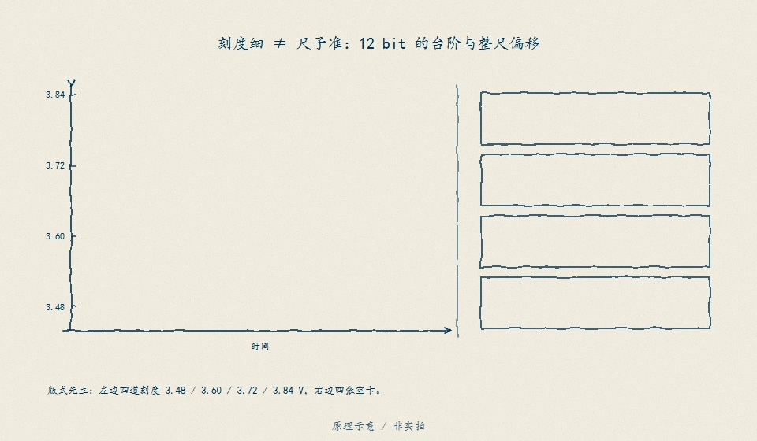
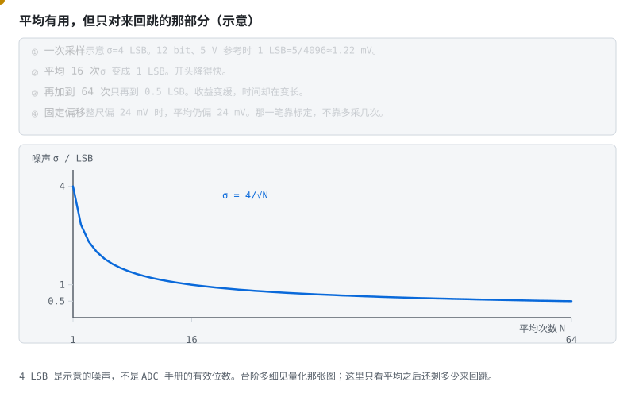
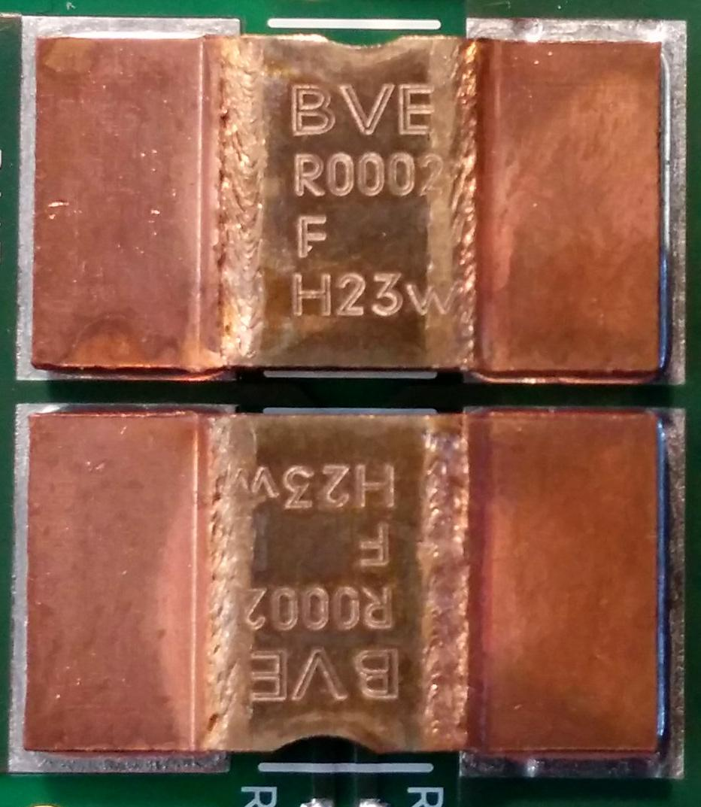

# 阶段 0 选读：BMS 用到的电路

准备做保护板时，再用这一篇补采样误差与开关通路。

## 0.2 电路基础：只学 BMS 用得上的 [理解]

> **算一笔账**　AFE 采样脚漏电流按 1 µA 估（示意），采样电阻 1 kΩ 上就是 1 mV；换成 10 kΩ 就是 10 mV——已经两倍于 ±5 mV 的预算。C 加大则拖慢均衡后的稳定，读数是旧闻。第一块板，RC 照抄手册。
>
> **再算一笔**　5 V、12 bit，1 LSB ≈ 1.22 mV；24 mV 的固定偏移约等于 20 个 LSB。平均 16 次能把 4 LSB 的随机噪声压到 1 LSB，但压不掉这 20 个 LSB。分辨率是刻度，精度是尺子。

> **先读/后读**：§0.2.4 三条采样路线是 [分析]（在比代价）；其余是 [理解]。抄板前再精读，零基础可以先去阶段 1。

> 📌 **可后补**：若你只想先搞清「BMS 是干什么的」，读完 §0.1 与自测 0.1 即可进 [阶段 1](stage-1-认识BMS.md)；本节在拆保护板（阶段 2）前补齐即可。

不用啃完一整本《模拟电路》。BMS 原理图翻来覆去就用这五块电路，学透就够开工了。

> **原理**　不用啃完一整本《模拟电路》。BMS 原理图翻来覆去就用这五块电路，学透就够开工了。
> **证据**　只留 BMS 会用到的 RC、ADC、MOS、采样和隔离。扫盲 [瑞萨《BMS 教程》中文导读](../renesas-bms-tutorial-中文导读.md)。
> **延伸阅读**　[TI 储能 BMS 方案](https://www.ti.com.cn/solution/zh-cn/ess-battery-management-system-bms)（中文）

### 0.2.1 RC 滤波：手册让你放，你就放 [理解]

每串电池进 AFE 之前都有一级 RC：限流保护 + 滤掉高频干扰 + 泄放静电。截止频率 $f_c = \dfrac{1}{2\pi RC}$。

新人最爱问："滤波更强点不好吗？我把电容加大十倍！" 不好，原因有两个：

- **R 太大**：AFE 采样瞬间要从引脚吸一小口电流（漏电流），它在 R 上产生的压降会被原样算进你的测量值——R 越大，误差越大，而且漏电流随温度变，误差还会"漂移"；
- **C 太大**：均衡开关每次动作后，电压要等好几个 RC 时间常数才稳定——均衡期间你测到的全是"旧闻"。

**第一块板子，RC 值一个都别改，照抄手册典型应用电路。** 等你能在示波器上说出波形差异了，再谈优化。

> **原理**　每串电池进 AFE 之前都有一级 RC：限流保护 + 滤掉高频干扰 + 泄放静电。截止频率 $f_c = \dfrac{1}{2\pi RC}$。
> **证据**　采样电阻电容照抄 AFE 手册：R 过大带来漏电误差，C 过大拖慢稳定。芯片族入口 [TI 储能 BMS 方案](https://www.ti.com.cn/solution/zh-cn/ess-battery-management-system-bms)（中文）。
> **延伸阅读**　[瑞萨《BMS 教程》中文导读](../renesas-bms-tutorial-中文导读.md)

> **口诀**　R 加大，漏电流算进电压。C 加大，均衡时你读到旧闻。

**短自测**

1. 把采样电阻加大十倍，读数会怎样？
2. 把电容加大十倍，均衡时测到的是什么？

<b>参考答案（先自己想完再展开）</b>

1. AFE 那一小口漏电流在电阻上的压降变大，算进这串电压。误差还会随温度漂。
2. 旧闻。电压要等好几个 RC 才稳住。第一块板，RC 照抄手册。

**练完你会怎样**：你不再一上来就把滤波电容加大十倍。

### 0.2.2 ADC 与误差：刻度细 ≠ 尺子准 [理解]

新人最容易混淆的一对概念：

- **分辨率**：尺子上的刻度有多细（12bit ADC 把量程分成 4096 格）；
- **精度**：尺子本身准不准（基准电压偏没偏、零点漂没漂、线性好不好）。

一把刻度细到 0.1mm 但受热会伸缩的塑料尺，量不出 0.1mm 的精度。BMS 要求单体电压 ±5mV，靠的是：AFE 内部出厂校准 + 你产线上的出厂标定（阶段 6 讲），而不是"ADC 位数高"。分析误差从**基准源的温漂**开始算起——它错了，后面全错。

> **看图**　台阶越细，读数就越准吗？盯住整把尺子的零点——它一偏，是只有一格偏，还是每一格都在同一方向偏。

> **图说**　盯住放大的台阶和整尺上移的那一截：示意 5 V、12 bit，1 LSB 约 1.22 mV；上移的 24 mV 多采几次也消不掉。

> **口诀**　位数是台阶大小。基准偏了，每一级一起偏。

动画把两件事分开演：台阶是分辨率（12bit 已经足够细），整尺平移才是精度事故——基准源一偏，所有读数同方向偏。出厂标定校的就是这后一笔。盯住下栏：5 V 参考、12 bit，1 LSB = 5/4096 ≈ 1.22 mV。黄点沿着放大的台阶走。整尺上移的 24 mV，多采几次也消不掉。

> **原理**　分辨率是刻度有多细，精度是尺子有没有偏。基准一偏，所有读数同方向错，跟 ADC 位数无关。
> **证据**　可核验演示：本节 SVG（浏览器打开即播），正文有不看动画也能读的说明。分辨率不是精度，基准一偏全偏。本地动画把量化台阶画出来了。扫盲对照 [瑞萨《BMS 教程》中文导读](../renesas-bms-tutorial-中文导读.md)。
> **延伸阅读**　[TI 储能 BMS 方案](https://www.ti.com.cn/solution/zh-cn/ess-battery-management-system-bms)（中文）

**短自测**

1. 12 bit 就保证单体 ±5 mV 吗？
2. 误差预算从 ADC 位数开始减，还是从基准开始加？

<b>参考答案（先自己想完再展开）</b>

1. 不保证。位数是台阶大小。基准偏了，每一级一起偏。±5 mV 还要出厂标定。
2. 从基准开始加。尺子先歪了，刻度再细也量不准。

**练完你会怎样**：别人炫耀位数，你先问基准漂了没有。

平均能把来回跳的噪声按平方根压下去。它压不掉上面那一截固定偏移：

> **图说**　示意噪声 σ = 4/√N 个 LSB。

> **口诀**　平均压的是来回跳。整尺偏了，平均也偏。

**看动画时盯住哪里**

采 1 次是 4 LSB，16 次变成 1 LSB，64 次变成 0.5 LSB。开头降得快，后来很慢。若 1 LSB ≈ 1.22 mV，4 LSB 大约是 4.9 mV 的来回跳。整尺偏 24 mV 时，平均完还是偏 24 mV。

- 黄点贴着 4/√N 往下走。
- 从 1 次到 16 次掉得厉害，从 16 次到 64 次只再掉一半。
- 纵轴是噪声，不是偏移。

**短自测**

1. 为什么平均 64 次不比 16 次好四倍？
2. 基准偏了 24 mV，平均 16 次还剩多少？
3. 4 LSB 是这颗 ADC 的手册指标吗？

<b>参考答案（先自己想完再展开）</b>

1. 噪声按平方根下降。16 次是 1 LSB，64 次是 0.5 LSB，只再好一倍，时间却多了四倍。
2. 还是大约 24 mV。平均消不掉固定偏移，那一笔靠标定。
3. 不是。4 LSB 是这张图的示意噪声，用来看 1/√N 的形状。

**练完你会怎样**：你知道该平均几次就停，也知道偏移得另做标定。

### 0.2.3 MOSFET：电控闸门 [理解]

三个阶段要用的知识先给个底（深度解析在 [电路详解 ①](../circuits/01-功率回路-MOS保护与预充.md)，有动画）：

- 栅极 G 是把手：VGS 够高就开，撤掉就关，几乎不耗驱动电流；
- **体二极管**：制造工艺白送的一个并联单向阀，导致**单颗 MOS 永远有一个方向关不死**——所以保护开关要两颗背靠背：M1 防放电、M2 防充电（M1 靠电池 B-、M2 靠对外 P-）；
- 选型三参数：$V_{DS}$ 耐压（> 整包最高压 ×1.5）、$R_{DS(on)}$ 导阻（决定发热 $I^2R$）、$Q_g$ 栅电荷（决定驱动难易）。

> **口诀**　单颗关不死两个方向。保护开关要背靠背。
>
> 动画在 [详解①](../circuits/01-功率回路-MOS保护与预充.md)。

> **原理**　栅极电压决定通断，体二极管让单颗 MOS 总有一个方向关不死，所以保护开关要两颗背靠背。
> **证据**　栅极电压决定通断，体二极管决定为什么要两颗。入口 [瑞萨中文导读](../renesas-bms-tutorial-中文导读.md)。
> **延伸阅读**　[详解①](../circuits/01-功率回路-MOS保护与预充.md)

**短自测**

1. 为什么单颗 MOS 做不成双向保护？
2. 第一块板的栅极电阻，先改还是先抄？

<b>参考答案（先自己想完再展开）</b>

1. 体二极管白送了一个单向阀。关断沟道之后，另一个方向仍能流。两颗背靠背，两个方向才都断得了。
2. 先抄手册典型电路。改驱动之前，先看懂背靠背。

**练完你会怎样**：你能在保护板上指出：这两颗是一对，不是多余的。

### 0.2.4 电流采样：三条路线 [分析]

| 方案 | 一句话原理 | 代价 |
|---|---|---|
| 低边分流 | 在 B- 回路串个毫欧电阻测压降 | 抬高地电位；检不出对地短路 |
| 高边分流 | 在 B+ 侧测 | 需要耐高共模的放大器 |
| 霍尔/磁通门 | 测电流产生的磁场，天然隔离 | 零漂是软肋，出厂必须标定 |

> **实物对照**　图中是贴片检流电阻，用它两端很小的压降算电流。照片无法说明它装在高边还是低边；那由接线位置决定。照片：wdwd，CC BY-SA 4.0；[来源与原图](../circuits/assets/photos/PHOTOS.md)。

选电流传感器时就要计算零偏、增益误差和温漂；后面的 SOC 积分会累积这些误差。

> **原理**　记住一句：**SOC 安时积分的精度天花板，在你选电流传感器那一刻就定死了。**
> **证据**　误差预算里标定只能修掉系统性增益和失调。AFE 侧对照 [TI 储能 BMS 方案](https://www.ti.com.cn/solution/zh-cn/ess-battery-management-system-bms)（中文）。
> **延伸阅读**　[详解②](../circuits/02-采样链与AFE芯片.md)

> **口诀**　安时的天花板，在选电流传感器那一刻就定了。

**短自测**

1. 低边分流为什么检不出对地短路？
2. 霍尔传感器最要标定的是什么？

<b>参考答案（先自己想完再展开）</b>

1. 电流没经过 B− 上那颗电阻。对地短路绕开了它。
2. 零漂。不标，SOC 出厂就偏。

**练完你会怎样**：你选传感器的时候，已经在想后面的安时积分会漂多少。

### 0.2.5 隔离：电池包上没有"随便接地" [理解]

低压板子里"地"是公共参考，随便连。电池包里不行：

- 电池包负极和大地/车体**不是**一个电位，可能浮动几十上百伏；
- 菊花链上相邻两块从板，"地"之间隔着十几节电池的电压。

通信口直连 = 拿几百伏的电位差去亲吻你的 MCU。判断标准不是"用了什么总线"，而是**链路两端是否跨电位**：跨高压、跨不同地的对外通信（UART/CAN）要做隔离——数字隔离器、隔离电源、变压器耦合，让信号过去、把电位差挡住；isoSPI 这类 AFE 板间链路则干脆把隔离做进了协议层（变压器耦合，详解 ② 有动画）；同一块低压板上、共地的短距离通信不需要隔离。画板时这是你布局的第一条纪律。

> **口诀**　跨了电位就隔离。同一块低压板上的短线不必。

> **原理**　电池包里各串的参考电位不一样。把低压地和功率地随便短在一起，等于拿 MCU 去摸高压。
> **证据**　电池包的地和逻辑地可以差几百伏，直连等于把高压灌进芯片。隔离思路见 [ENNOID-BMS](https://github.com/EnnoidMe/ENNOID-BMS)（英文，可选）。
> **延伸阅读**　[TI 储能 BMS 方案](https://www.ti.com.cn/solution/zh-cn/ess-battery-management-system-bms)（中文）

**短自测**

1. 调试器直连包上的 UART 之前，先确认什么？
2. 同一块板上、共地的短 SPI，也要再加一只数字隔离器吗？

<b>参考答案（先自己想完再展开）</b>

1. 两端是不是同一个地。包地和笔记本地可以差一截。跨电位就要隔离。不隔离，口会烧。
2. 不必。隔离看的是链路两端跨不跨电位，不是看总线名字好不好听。

**练完你会怎样**：你不会把笔记本地接到 B− 上。

### 自测 0.2 [理解]

1. 为什么 AFE 输入的 R、C 值不能自行加大？
2. 12bit ADC 就一定能测准 ±5mV 吗？还缺什么条件？
3. 为什么单颗 MOS 做不成双向保护开关？
4. 低边和高边电流采样各自的代价是什么？
5. 用调试器直连 BMS 的 UART 前，要先确认什么？

<b>参考答案（先自己想完再展开）</b>

1. **R 加大**：AFE 采样时要从引脚抽一小口电流（漏电流），它在 R 上的压降被原样算进测量值 → 该串读数系统性偏低；而且漏电流随温度变，这个误差还会**漂移**，一次出厂标定消不掉。**C 加大**：均衡开关动作后电压要等好几个 RC 时间常数才稳定 → 均衡期间测到的全是"旧闻"。（C 改小则抗混叠与抗 ESD 能力下降。）所以第一块板子照抄手册典型应用电路。
2. 不一定。12bit 是**分辨率**（刻度细），不是**精度**（尺子准）。还缺：基准源的初始误差与温漂（误差预算第一项）、ADC 的失调/增益/INL、输入链路的漏电流压降与 MUX 导阻、布局引入的干扰，以及产线上的出厂标定。一把刻度 0.1mm 但受热伸缩的塑料尺，量不出 0.1mm 的精度。
3. 因为制造工艺天然形成的**体二极管**并联在 D-S 之间。关断沟道后，电流仍能从体二极管的正向方向流过——所以单颗 MOS 永远有一个方向关不死。要双向阻断必须两颗背靠背，让两个体二极管方向相反对顶：M1 防放电、M2 防充电（M1 靠 B-、M2 靠 P-）。
4. **低边**（B- 回路串毫欧电阻）：抬高/扰动地电位（地弹），且检不出对地短路；好处是成本低、放大器不需要耐高共模。**高边**（B+ 侧）：地干净，但需要耐高共模电压的放大器，成本与设计难度上去了。（第三条路线霍尔/磁通门天然隔离，代价是零漂，出厂必须标定。）
5. 三件事：①**电平**——3.3V TTL 还是 RS232 的 ±12V？插反可能烧口；②**是否跨电位、共地是否安全**——UART 共地意味着你的电脑和电池包连成一体，要么笔记本脱开适配器用电池供电，要么用隔离 USB 串口，别把市电地引进电池包；③**波特率与帧格式**——差 2% 以上就会偶发乱码，然后你会去怀疑程序。判断要不要隔离的标准不是"用了什么总线"，而是**链路两端是否跨电位**。

---

> **原理**　这些题考的是上面几节的机制。先盖住折叠答案，用自己的话讲完再展开。
> **证据**　这些题考 RC、ADC、MOS 和隔离。对照 [瑞萨《BMS 教程》中文导读](../renesas-bms-tutorial-中文导读.md) 与 [TI 储能 BMS 方案](https://www.ti.com.cn/solution/zh-cn/ess-battery-management-system-bms)（中文）。
> **延伸阅读**　[LibreSolar 固件](https://github.com/LibreSolar/bms-firmware)（英文，可选）

[继续阅读](./stage-0-选读-嵌入式.md) · [完整讲义与原有锚点](./stage-0-前置知识.md)

<!-- Generated by prepare-stage0.mjs; edit stage-0-前置知识.md. -->
