# 阶段 1 教程：认识 BMS

> **任务**　用 1 周弄清木桶效应、五大功能、五大保护，并能判断该用保护板还是智能 BMS。
> **前置**　完成阶段 0 的 §0.1 最低验收；电路和嵌入式可后补，见 [前两周怎么走](getting-started.md)。
> **选读**　[电路详解 ① 功率回路](../circuits/01-功率回路-MOS保护与预充.md) · [ECE5720 Notes01《BMS 需求》中文导读](../ece5720-notes01-中文导读.md)

---

## 本页目录

按层走先看 [能力地图](bloom-map.md)。标题末尾的 `[记忆]` … `[创造]` 是布鲁姆层级。

- [1.1 从一节电池到一支"马拉松队伍" [理解]](stage-1-认识BMS.md#11-从一节电池到一支马拉松队伍-理解)
- [1.2 木桶效应：亲眼看看浪费有多大 [理解]](stage-1-认识BMS.md#12-木桶效应亲眼看看浪费有多大-理解)
- [1.3 BMS 的五大功能模块 [理解]](stage-1-认识BMS.md#13-bms-的五大功能模块-理解)
- [1.4 五大保护：名词、断口与三要素 [记忆]](stage-1-认识BMS.md#14-五大保护名词断口与三要素-记忆)
- [1.4b 五大保护：每一条背后都有一个事故 [理解]](stage-1-认识BMS.md#14b-五大保护每一条背后都有一个事故-理解)
- [1.5 热失控链：为什么安全是最高优先级 [理解]](stage-1-认识BMS.md#15-热失控链为什么安全是最高优先级-理解)
- [1.6 BMS 的三种形态 [理解]](stage-1-认识BMS.md#16-bms-的三种形态-理解)
- [1.7 保护决策逻辑（状态机雏形） [理解]](stage-1-认识BMS.md#17-保护决策逻辑状态机雏形-理解)
- [1.8 均衡初步 [理解]](stage-1-认识BMS.md#18-均衡初步-理解)
- [1.9 自测题 [理解]](stage-1-认识BMS.md#19-自测题-理解)
- [1.10 动手任务 [应用]](stage-1-认识BMS.md#110-动手任务-应用)
- [1.11 验收清单 [评价]](stage-1-认识BMS.md#111-验收清单-评价)

## 1.1 从一节电池到一支"马拉松队伍" [理解]

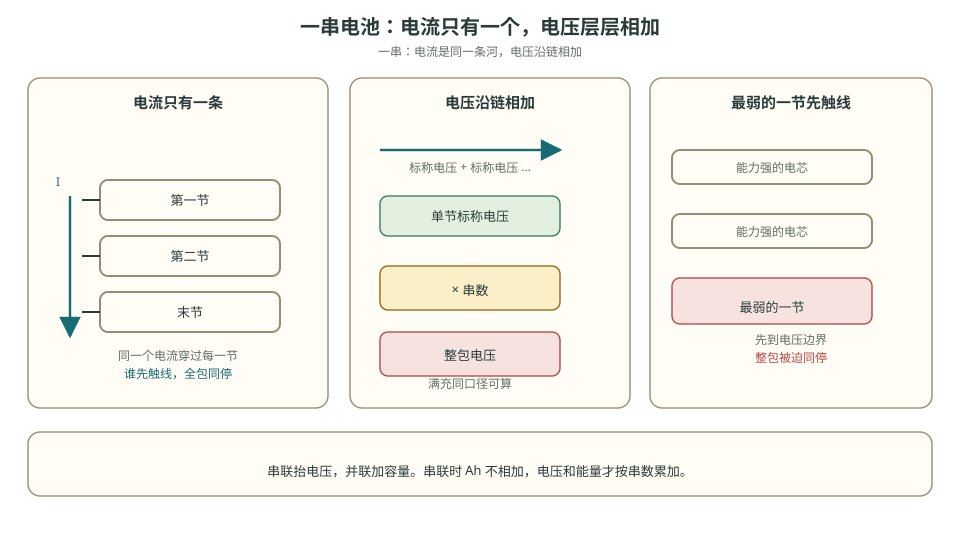
> **看图**　这一串里电流有几条？电压又是怎样相加的？

阶段 0 的结论：锂电池过充会起火，过放会慢性自杀。一节电池配一块保护电路就够了——手机电池就是这么活的。

**视频**　B 站 · [《BMS 项目实战》](https://www.bilibili.com/video/BV1pv4y1T7Xi/)

这条中文视频先用一个小项目回答「为什么要有 BMS」。播放器打不开时用原页；门户页也有内嵌：[视频教程](../../BMS学习路径.html#videos)。

但设备要的电压越来越高。单节锂电池满打满算 4.2 V，只能靠串联往上抬——下面这张表就是「一串多少节」的数量级：

| 设备 | 常见包电压 | 大约几串 | 单节怎么算 |
|---|---:|---:|---|
| 电动工具 | 12–21 V | 3–5 串 | 3.7 V × N |
| 电动自行车 / 电动摩托车 | 48–72 V | 13–20 串 | 3.7 V × N |
| 户用储能模块 | 51.2 V | 16 串 | 3.2 V（磷酸铁锂）× 16 |
| 电动汽车牵引包 | 数百伏 | 上百串 | 3.7 V × N |

这里只在讲串联的数量级，**车辆分类不按电池电压划线**。串数一多，规则就变了。把 16 节电池看成一队绑腿跑的运动员：

- 电流相同——**所有人的配速完全一样**（串联电流处处相等）；
- 但每个人的"体力"（容量、内阻、自放电率）天生不同，跑步时的体温（环境温度）也不一样；
- 裁判只看一件事：**任何一个人倒下（过放）或撞线（过充），全队立即停止。**

最弱的一节决定整包成绩，而且总是最先触线，老化也会更快。BMS 必须逐节监测、及时保护，并尽量缩小差异。

串联解决电压，并联解决容量——两种组合可以同时上（4S2P 之类）：


> **口诀**　串联抬电压，并联加容量。采样路数等于串联数。

底栏按 $V=3.7\times N_s$ 画线：4 串是 14.8 V。并联增加容量，不改变串数。BMS 实际测的是并联块；块内电芯被导线拉成同一电位，无法逐颗测量，所以 4S2P 只需 4 路电压采样。


> **口诀**　并联块只有一个电压。块里坏一颗，端电压可以仍正常。

图中总电流保持 10 A。两支路示意为 20 mΩ 和 40 mΩ，电流约 6.67 A 和 3.33 A；这不是实测内阻。两支路对外仍只有一个电压，因此 4S2P 仍是 4 路采样，不是 8 路。

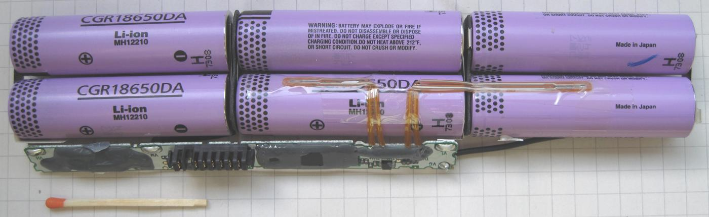

打开的笔记本电池包：圆柱电芯串在一起，底部小电路板是充电和安全电路，有的电芯上贴着温度传感器。采样和保护是贴着电芯做的。来源见 [照片来源](../circuits/assets/photos/PHOTOS.md)。

> **核对**　[瑞萨《BMS 教程》中文导读](../renesas-bms-tutorial-中文导读.md) · [《过充与过热热失控的差异》](https://www.mdpi.com/2313-0105/11/7/242)（英文）

## 1.2 木桶效应：亲眼看看浪费有多大 [理解]


> **口诀**　串联电流一样。最矮的那一节锁死整桶。

动画里 3 号电池只有 35 Ah，其余三节都是 50 Ah。最弱节从 50 Ah 降到 35 Ah，整包可用容量也降到 35 Ah：

- **充电**：同样的电流灌进去，3 号先到自己的满充线——BMS 必须停充，其他三节只充到七成；
- **放电**：水的确是一起往下走的（串联电流相同），但**端电压**不一样——3 号容量小（SOC 掉得快）、内阻通常还更大（IR 压降更狠），同样电流下它的端电压最先跌破截止线 → BMS 必须停放；
- **结果**：整包可用容量被锁在 **35 Ah**。串联时 Ah 不相加；电压和能量才按串数累加。其余三节各有约 15 Ah 用不到，按 3.2 V 估算，每节约损失 48 Wh。

> 这里的“最弱”指先触线的单体。充电时是端电压最高者先触发 OVP，放电时是端电压最低者先触发 UVP，两者不一定是同一节。容量、内阻、温度和初始 SOC 都会影响结果。

最弱单体反复接近最高和最低 SOC，通常老化更快，容量差会继续扩大。

下面用固定增长的示意数说明均衡窗怎样限制压差：

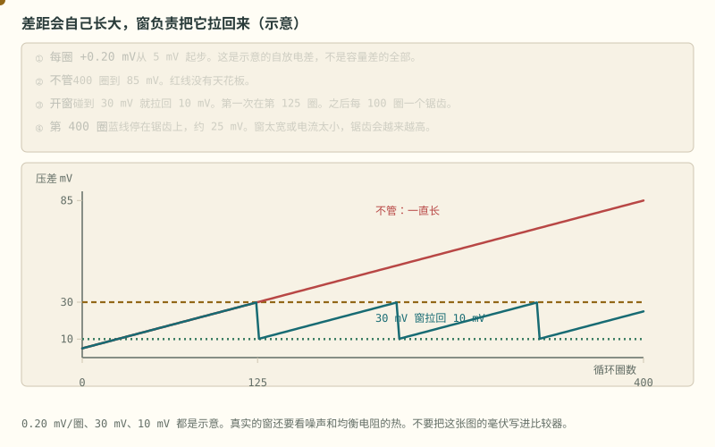

> **口诀**　不管，差距按圈往上爬。窗负责在门槛上把它拉回来。

示意从 5 mV 起步，每圈增加 0.20 mV。不干预时，400 圈后到 85 mV；启用均衡窗后，压差碰到 30 mV 就拉回 10 mV。第一次发生在第 125 圈，此后每 100 圈一次，第 400 圈约为 25 mV。

- 红线一直爬，没有回头。
- 蓝线和黄点走锯齿：上到 30 mV，回到 10 mV。
- 两条横线就是这个窗。窗太宽，锯齿会越来越高。

**短自测**

1. 为什么第 125 圈才第一次拉回来？
2. 400 圈不管和开窗，示意各是多少毫伏？
3. 30 mV 能写进你的比较器吗？

<details>
<summary><b>参考答案（先自己想完再展开）</b></summary>

1. (30−5)/0.20 = 125。这是这张图的口算，不是你的包长多快。
2. 不管约 85 mV，开窗后落在锯齿上，约 25 mV。
3. 不能。30 mV 和 10 mV 是教学窗。真实门槛还要看噪声和均衡电阻的热。

</details>

均衡电流搬得动这点自放电差，搬不动两节电芯本来就不在同一容量档。错芯那一节，加大均衡没有用，见阶段 6。

恶性循环的终点比"缩水"更可怕——放电末端如果没人喊停，最弱那节会被同伴的电流**反向充电**：

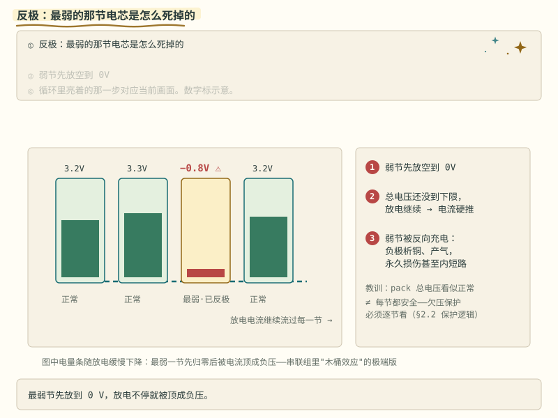

> **口诀**　总电压还没到下限，最弱的一节可以已经反极。

最弱节先放空到 0 V 后，如果整包仍继续放电，串联电流会把它推入负压，可能析铜、产气并形成内短路。因此欠压保护必须逐节判断：总压正常不等于每节安全。

BMS 的两件武器：**监测**（看见每个人的状态）和**均衡**（把水位拉齐——本阶段末讲原理，阶段 3 讲电路）。

> **核对**　成组关系见 [瑞萨《BMS 教程》中文导读](../renesas-bms-tutorial-中文导读.md)。


再把「最弱节锁死整包」写成容量关系：

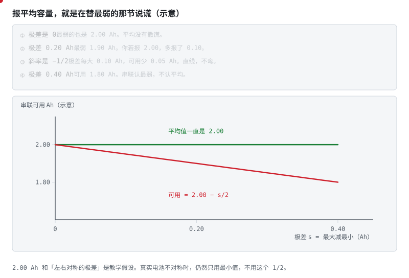

> **口诀**　串联认最小。平均是安慰，不是容量。

图中平均容量固定为 2.00 Ah，且极差 $s$ 在平均值两侧对称，因此最弱节为 $2.00-s/2$。极差 0.20 Ah 时可用 1.90 Ah；极差 0.40 Ah 时可用 1.80 Ah。平均值不代表整包可用容量。

若四节并不对称，比如 2.10、2.00、1.95、1.80 Ah，平均大约 1.96 Ah，整包仍是 1.80 Ah。这时不要再用 $s/2$。最小值永远对，对称公式只在这张图的假设里对。

**短自测**

1. 极差 0.40 Ah、平均 2.00 Ah、左右对称时，可用多少？
2. 上面那四节不对称的例子，为什么不能用 $s/2$？

<details>
<summary><b>参考答案（先自己想完再展开）</b></summary>

1. 1.80 Ah。
2. $s/2$ 假定最弱和最强到平均值的距离一样。不对称时只取最小的那一节。2.10 与 1.80 的极差是 0.30 Ah，可用仍是 1.80，不是 $2.00-0.15$。

</details>

## 1.3 BMS 的五大功能模块 [理解]

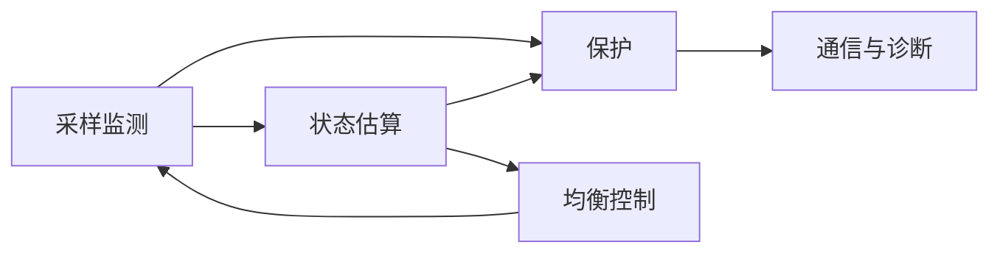

| 模块 | 干什么 | 关键指标 |
|---|---|---|
| **采样监测** | 测每串电压、总压、电流、温度（NTC） | 电压精度 ±5mV 级；电流精度 <1% |
| **保护** | 超限时断开充放电回路（MOS/继电器） | 阈值、延时、恢复条件 |
| **均衡** | 缩小单体间电压/容量差异 | 均衡电流（被动常见 50–200mA，示例范围） |
| **状态估算** | 算 SOC（剩多少电）、SOH（老没老）、SOP（能出多大力） | SOC 误差 <5% |
| **通信诊断** | 上报数据、记录故障、接受控制 | UART/CAN/RS485/BLE + CRC |

保护只是五项功能之一。采样精度和状态估算决定系统能不能真正“管理”电池。五项功能也不是同时完成的，一拍数据要排队：

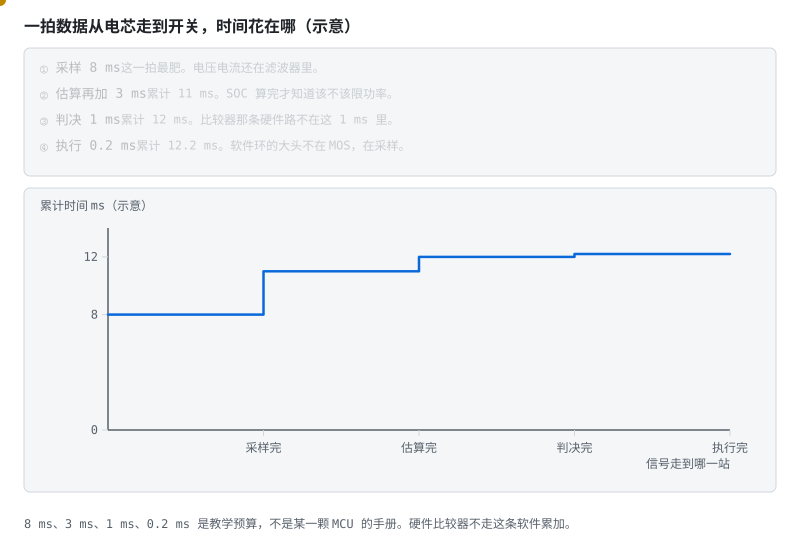

> **口诀**　软件这一拍，大头在采样，不在 MOS。

示意预算为采样 8 ms、估算 3 ms、判决 1 ms、执行 0.2 ms，累计 12.2 ms。过流和短路的硬件比较器不经过这条软件链，不计入 12.2 ms。

设计时若把「MOS 只要 0.2 ms」当成整条保护的速度，软件环的 8 ms 采样就被藏起来了。

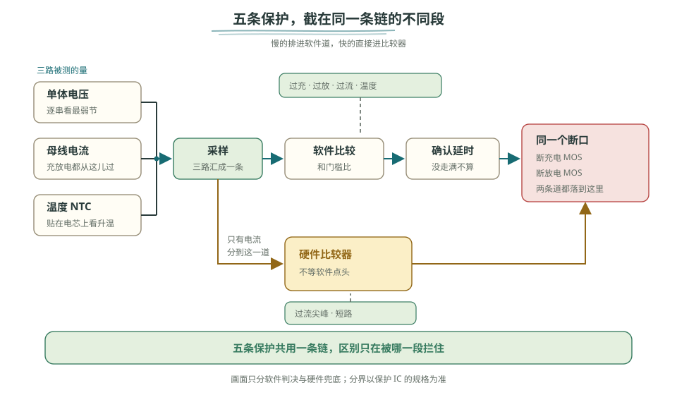

> **看图**　短路保护为什么不和过充保护排在同一条队里？

**短自测**

1. 四段加完是多少毫秒？
2. 短路比较器为什么不在这张累加里？

<details>
<summary><b>参考答案（先自己想完再展开）</b></summary>

1. 12.2 ms。
2. 它不经过 MCU 这一拍。微秒级关断是另一条硬件路。这里的数字都是示意预算。

</details>

> **核对**　[瑞萨《BMS 教程》中文导读](../renesas-bms-tutorial-中文导读.md) · [ECE5720 Notes01 中文导读](../ece5720-notes01-中文导读.md) · [BU-808](https://batteryuniversity.com/article/bu-808-how-to-prolong-lithium-based-batteries/)（英文）


## 1.4 五大保护：名词、断口与三要素 [记忆]

要求先背下来的五条。下面的电压是三元锂体系的**示例值**——铁锂、钛酸锂完全不同，以保护 IC 的阈值版本与产品规格为准。

| 保护 | 触发（示例值） | 断哪个 MOS | 恢复条件 |
|---|---|---|---|
| 过充 OVP | 任一单体 > 阈值（如 4.25 V，示意的**过充检测值**，不是截止 4.20 V，也不是化学上限；三个数见 [阶段 0 §0.1.2](stage-0-前置知识.md#012-过充一场逐级升级的事故-理解)） | 充电 MOS | 接负载放电后 |
| 过放 UVP | 任一单体 < 阈值（如 2.8 V） | 放电 MOS | 插充电器后 |
| 过流 OCP | 电流 > 阈值且持续超过延时 | 对应方向 MOS | 卸载并延时 |
| 短路 SCD | 电流瞬间暴增 | 放电 MOS（**微秒级**，硬件路径） | 卸载并延时 |
| 温度 OTP/UTP | 高温 / 低温 | 高温两向都断；低温只断充电 | 回到允许温区 |

**保护三要素**就三个词：**阈值 + 延时 + 恢复条件**。恢复条件先记这三句搭配：过放后插充电器恢复；过充后接负载放电恢复；短路后卸载并延时恢复。

> **先读/后读**：本节只记名字、断哪个开关、三要素叫什么（记忆）。每一条「没有它会怎样」、以及延时为什么不能省，在下一节（理解）。

> **核对**　[华之美 DW01A 数据手册](https://hmsemi.com/downfile/DW01A.PDF) · [ABLIC S-8254A 中文手册](https://www.ablic.com/cn/doc/datasheet/battery_protection/S8254A_C.pdf)

## 1.4b 五大保护：每一条背后都有一个事故 [理解]

1. **没有 OVP**：充电机失控或充电器不匹配时，过充可能走向热失控。
2. **没有 UVP**：继续深放可能导致集流体溶解和析铜，留下内短路风险。
3. **没有 OCP**：电机堵转或控制器击穿时，线束和 MOS 会快速发热。
4. **没有 SCD**：端子硬短路时电流可能极大，**毫秒都嫌慢**。
5. **没有 OTP/UTP**：低温充电容易析锂；高温会加速副反应和老化。

电机启动和负载突变会产生短尖峰，无延时容易误触发。过充检测可用秒级延时躲开电压毛刺；短路按 I²t 快速积热，需要更快的硬件路径。

工程里还有「故障分级」：提示 → 限功率 → 断开（阶段 6 展开）。

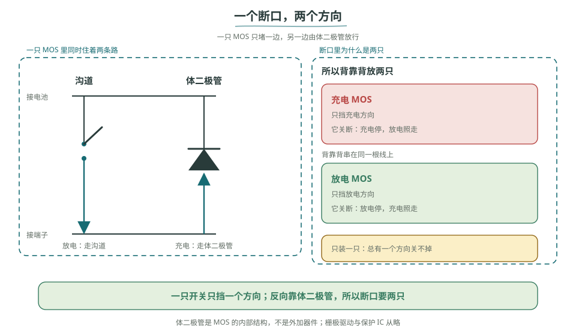

> **看图**　放电 MOS 关断以后，充电电流为什么还能进电池？

> **核对**　[《过充与过热热失控的差异》](https://www.mdpi.com/2313-0105/11/7/242) · [BU-808](https://batteryuniversity.com/article/bu-808-how-to-prolong-lithium-based-batteries/)（英文）

## 1.5 热失控链：为什么安全是最高优先级 [理解]


> **口诀**　过充把锂逼出来，刺穿隔膜才到起火。

底栏两条线都从 25 °C 出发。10 s 后，0.05 °C/s 对应 25.5 °C，1 °C/s 对应 35 °C。完整的非线性升温和早警在阶段 6 展开。


动画把阶段 0 的五步压成四幕。热失控可能在几分钟到几十分钟内发展，而某节温升速率异常通常早于绝对温度越线。

所以量产 BMS 不只盯绝对温度，还盯 **dT/dt（温升速率）**——一节电池在整包都正常时独自快速升温，就是热失控的最早可观测信号。很多项目把防过充定为 BMS 里等级最高的安全条目（示例：ASIL C/D，具体由 HARA 定级决定，阶段 6 细讲）。

> **核对**　[Batteries 2025 综述](https://www.mdpi.com/2313-0105/11/7/242)（英文） · [阶段 0 §0.1.8](stage-0-前置知识.md#018-固态电池固体电解质换掉了什么-理解)

## 1.6 BMS 的三种形态 [理解]

> **先读/后读**：本节讲每种形态是什么（理解）。该买保护板还是做智能 BMS，是评价，去 [按目标选路线](按目标选路线.md)。

| 形态 | 构成 | 能做什么 | 不能做什么 | 典型场景 |
|---|---|---|---|---|
| **保护板** | 保护 IC + MOS（无 MCU） | 五大保护（阈值写死） | 无 SOC、无通信、不可配置 | 小家电、电动工具 |
| **智能 BMS** | AFE + MCU | 可编程保护、SOC 估算、通信、均衡调度 | — | 储能、两轮车、机器人 |
| **分布式 BMS** | 主控 BMU + 从板 CMU×N | 几十到几百串、菊花链、功能安全 | 贵 | 电动汽车牵引包、大型储能电站 |

本路线以智能 BMS 为主：阶段 2 先做保护板，阶段 3 进入 AFE + MCU，阶段 6 再看分布式系统。

**视频**　YouTube · 英文，可选 · [GreatScott!《BMS || DIY or Buy》](https://www.youtube.com/watch?v=rT-1gvkFj60)

视频从硬件角度比较自制板和成品板，需要能访问 YouTube；中文门户页有内嵌播放器。

[](https://www.youtube.com/watch?v=rT-1gvkFj60)

> **核对**　[瑞萨《BMS 教程》中文导读](../renesas-bms-tutorial-中文导读.md) · [LibreSolar 固件](https://github.com/LibreSolar/bms-firmware) · [foxBMS 2](https://github.com/foxBMS/foxbms-2)（英文）

再用扫描时间比较集中式和分布式：

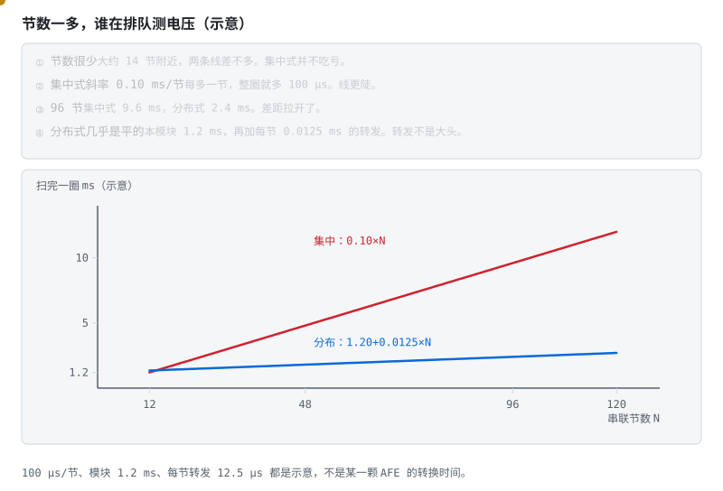

> **口诀**　节数少，集中式不吃亏。节数多，排队的是集中式。

示意：集中式 $T=0.10\times N$ ms，每节 100 µs。分布式 $T=1.20+0.0125\times N$ ms：本模块先花 1.2 ms，转发每节再加 12.5 µs。两条线大约在 14 节附近碰上。96 节时，集中式 9.6 ms，分布式 2.4 ms。分布式的斜率很浅，大头是那固定的 1.2 ms，不是线上的飞行。

4 串的小包去上分布式，多半是在为还没出现的节数付钱。一百节仍用一根长线轮流测，圈时间会先爆。

**短自测**

1. 96 节时两条线各是多少毫秒？
2. 为什么节数很少时分布式不一定更快？

<details>
<summary><b>参考答案（先自己想完再展开）</b></summary>

1. 集中式 9.6 ms，分布式 2.4 ms。
2. 分布式有 1.2 ms 的固定账。交点大约在 14 节。100 µs、1.2 ms、12.5 µs 都是示意，不是某一颗 AFE 的转换时间。

</details>

## 1.7 保护决策逻辑（状态机雏形） [理解]

保护不是"超限就断"的一锤子买卖，而是一套决策：

```
正常 ──超限且超过延时──▶ 保护状态（断开 MOS）
  ◀──满足恢复条件──────┘
```

每个保护项都要回答三个问题：什么条件触发（阈值+延时）、断哪个开关、什么条件放人（恢复）。把这张表写清楚，你已经迈出了固件状态机设计的第一步（阶段 3 把它写成代码）。

看一个完整剧情（三元锂 3S 保护板，示例值）：单体 2.90V → 什么都没发生（高于 2.80V 阈值）；跌到 2.79V 但只持续 0.9s → 还是没发生（没超过 1s 延时）；2.79V 持续 1.1s → **触发**，断放电 MOS；卸载并插入充电器，电压回到 3.0V → **恢复**。阈值、延时、恢复条件，一个不缺才构成一次合格的保护。


> **口诀**　毛刺清零。持续越线才断。回来要过回差。

上面剧情里的"1 秒延时"就是去抖：毛刺短于它，计时器清零、不动作；持续超限才走满计时、断开 MOS。恢复线比阈值更保守（回差），是为了防止电压在阈值附近抖动时开关反复跳。


> **核对**　状态机练习在 `code/firmware` 的 `test_bms`；工程参考 [LibreSolar/bms-firmware](https://github.com/LibreSolar/bms-firmware)（英文）。

**短自测**　过程在 [保护去抖与回差](../circuits/assets/protection-debounce.svg)。数字沿用上面的三元 3S 示例。

1. 阈值 2.80 V、延时 1 s。单体在 2.79 V 停了 0.9 s，放电 MOS 断吗？
2. 恢复线如果也画在 2.80 V，纹波贴着这条线时开关会怎样？
3. 去抖挡的是哪一种误动作，回差挡的是哪一种？

<details>
<summary><b>参考答案（先自己想完再展开）</b></summary>

1. 不断。0.9 s 短于 1 s，计时清零。剧情里要 2.79 V 持续到 1.1 s 才断放电 MOS。
2. 会来回打。电压在阈值附近一抖，刚恢复又触发。恢复要设得更保守，示例里是回到 3.0 V 才放行。
3. 去抖挡短毛刺：没走满延时就当没发生。回差挡回来的路上来回跳：触发线和恢复线分开。

</details>

## 1.8 均衡初步 [理解]

- **被动均衡**：给电压偏高的单体并一颗电阻，把多余能量变成热。常在充电末端工作，电流示例为 50–200 mA；
- **主动均衡**：用电感或电容把能量从高电压单体搬到低电压单体。电流可达安培级，但开关和磁件更复杂，也有损耗；
- 关键认知：**均衡治不了根本**。均衡电流比充放电电流小两三个数量级，只能缓慢修正差异——一致性要靠选型配组、热设计、均衡三管齐下。

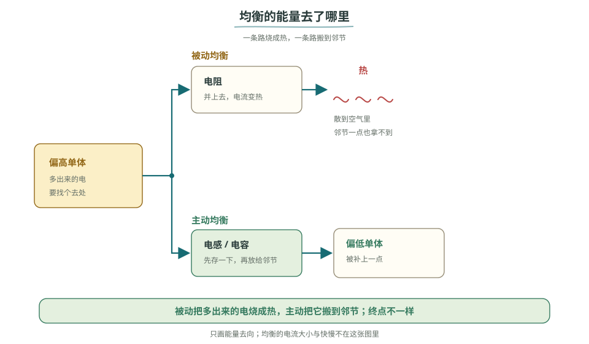

> **看图**　被动均衡把偏高单体多出来的能量交给了谁？

**视频**　YouTube · 英文，可选 · [How does a BMS work? 被动与主动均衡](https://www.youtube.com/watch?v=q4wDa_m9-8E)

视频直观比较「烧掉」和「搬走」两条路径；效率仍以论文和手册为准。

[](https://www.youtube.com/watch?v=q4wDa_m9-8E)

> **核对**　[MPS《主动均衡》](https://www.monolithicpower.com/en/learning/resources/active-balancing-how-it-works-and-its-advantages)（厂商资料） · [电感均衡拓扑综述](https://www.mdpi.com/2313-0105/11/2/77)（英文）；效率对比见 [共建任务板](../共建任务板.md) T8。

50–200 mA 是这一节的示例范围。拿教学 5 Ah 把「1 个百分点要多久」换算出来，就能看见它为什么搬不动整包的充放电：


> **口诀**　均衡是细流。包电流是大河。细流补不齐容量档。

示意容量为 5 Ah，搬 1 个百分点就是 0.05 Ah。50 mA 需要 1 小时，200 mA 需要 0.25 小时；同一笔账里，1C（5 A）只需 36 秒。这里比较的是时间量级，不包含效率。

**短自测**

1. 200 mA 把这 0.05 Ah 搬完，大约要多久？
2. 为什么不能靠把均衡电流加大，去补两节本来就不在同一容量档？

<details>
<summary><b>参考答案（先自己想完再展开）</b></summary>

1. 0.25 小时。0.05 Ah / 0.2 A = 0.25 h。50 mA 则是 1 小时。
2. 均衡电流比充放电小两三个数量级，只能慢慢修微小差异。35 Ah 和 50 Ah 串在一起，差的是 15 Ah，不是图上这 0.05 Ah。配组和热设计仍要在。

</details>

## 1.9 自测题 [理解]

> **先读/后读**：第 3 题是 [记忆]（背出五条和断口）；其余是 [理解]。

1. 为什么串联组不能只看总电压判断状态？（提示：两节 3.0V + 两节 4.1V 的 4 串，总压是多少？）
2. 木桶效应里"死容量"是怎么产生的？为什么最弱单体老化会加速？
3. 背出五大保护及各自断哪个 MOS。
4. 为什么短路保护必须微秒级，而过充保护可以秒级？
5. dT/dt 报警为什么比绝对温度报警更早？
6. 保护板和智能 BMS 的本质区别是什么？
7. 过放保护的恢复条件为什么设计成"插充电器"？
8. 为什么说均衡不能替代配组？

<details>
<summary><b>参考答案（先自己想完再展开）</b></summary>

1. 总压为 3.0×2 + 4.1×2 = **14.2 V**，与四节都为 3.55 V 相同。总压掩盖了单体极差，因此保护必须逐串监测。
2. 充电时最高电压单体先触发 OVP，放电时最低电压单体先触发 UVP，其余单体未用到的余量就是死容量。最弱节反复靠近两端 SOC，通常老化更快，差距继续扩大。
3. **OVP** 过充 → 断**充电** MOS；**UVP** 过放 → 断**放电** MOS；**OCP** 过流 → 断对应方向的 MOS（充电过流断充电、放电过流断放电）；**SCD** 短路 → 断**放电** MOS，μs 级；**OTP/UTP** 温度 → 高温禁充放（两个都断）、低温禁充（断充电 MOS）。
4. 短路按 $I^2t$ 快速积热，需硬件比较器在微秒级关断。过充是较慢的化学过程，秒级延时可过滤电压毛刺。
5. 热失控会自加速。某节的 dT/dt 异常通常早于绝对温度越线，因此两者都要监测。
6. 保护板的阈值和逻辑写死在保护 IC 中；智能 BMS 用 AFE 采样和硬件兜底，用 MCU 实现可编程策略、估算、通信与记录。
7. 只靠电压回弹恢复，可能反复放电并继续加深过放。检测到充电器接入或外部把电压抬到恢复值后再放行，才能确认有能量输入。
8. 均衡电流通常只有几十到几百毫安，只能慢慢修正小差异，补不回 35 Ah 与 50 Ah 之间的容量档差。配组、热设计和均衡缺一不可。

</details>

## 1.10 动手任务 [应用]

1. 找一块成品保护板的规格书，把它的 OVP/UVP/OCP/SCD/温度保护的**阈值、延时、恢复条件**抄成一张表——大部分规格书只给阈值，想想为什么；
2. 不看资料，默画 BMS 功能框图并标注每个模块的输入输出；
3. 算一算：12 串铁锂包，11 节 50Ah、1 节 46Ah，可用容量（Ah）和可用能量（Wh）各是多少？（答案：容量 ≈ **46Ah**——串联 Ah 不相加，被最弱那节锁死；能量 ≈ 46Ah × 12 × 3.2V ≈ **1.77kWh**）
4. 跑 `python bms-book/code/weakest_cell_pack.py` 核对三件事：16 串样例里平均电压放行而最弱单体保护；串联 Ah 不相加；「平均 − 半个极差」只在对称分布下成立，不对称时答案仍是 1.80 Ah 而不是 1.85。

四项都要留下可核对的表格、框图或计算过程。

## 1.11 验收清单 [评价]

- [ ] 能画出 BMS 功能框图并说清每个模块的输入输出
- [ ] 能默写五大保护 + 保护三要素
- [ ] 能讲清木桶效应与恶性循环
- [ ] 能说出三种 BMS 形态的差异与适用场景
- [ ] 能解释 dT/dt 早警的意义

> **本阶段一句话**：BMS 逐节监测，超限时保护，并用均衡减小差异。

全部通过 → 进入 [阶段 2：单节保护板](stage-2-主线-单节保护板.md)（总纲入口：[阶段 2](../bms-resources.md#阶段-2基础实践保护板24-周)）。

---

**上一篇**　[阶段 0 前置知识](stage-0-前置知识.md) ｜ **目录**　[阶段教程](../../README.md#阶段教程) ｜ **下一篇**　[阶段 2 单节保护板](stage-2-主线-单节保护板.md) ｜ [学习路线总纲](../bms-resources.md) ｜ [术语表](../glossary.md)

> **延伸阅读**　[《车用 BMS 功能安全设计方法论》](https://www.mdpi.com/1996-1073/14/21/6942)（英文）
