# 阶段 2 主线：单节保护板

先拿到一块板，认清 B+、B−、P+、P−、保护 IC、检流电阻和背靠背 MOS，再顺着 DW01 的三类保护条件走一遍。

> **安全条件**　短路和过流测试只用限流可调电源或电芯模拟器。不要用真电芯短接；操作区使用防火垫并佩戴护目镜。

## 2.1 识别保护板器件与端子 [应用]

> **先读/后读**：端子字母是 [记忆]；对着板子指认电流路径是 [应用]。

找一块最便宜的 3S 保护板（几块钱那种），翻到背面，按图索骥：

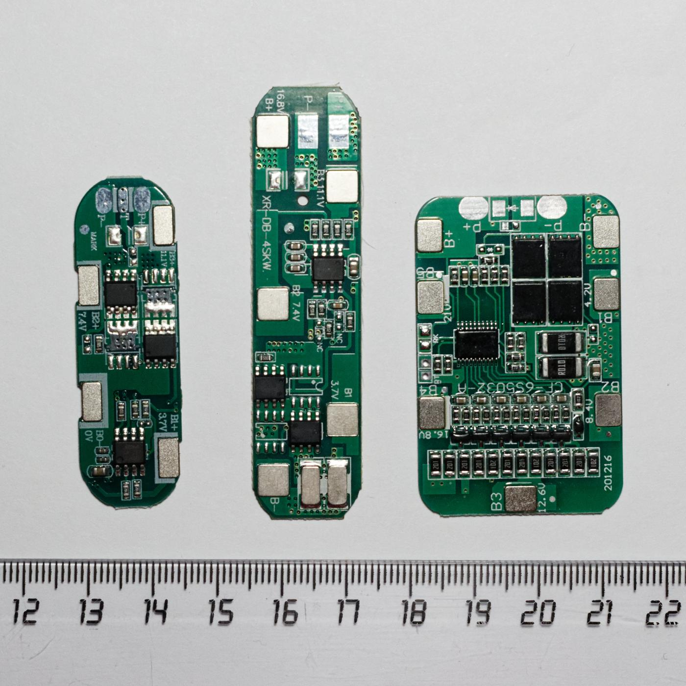

从左到右大约是 6S、4S、3S，旁边有尺子。串数变了，板长和采样焊盘数量跟着变。

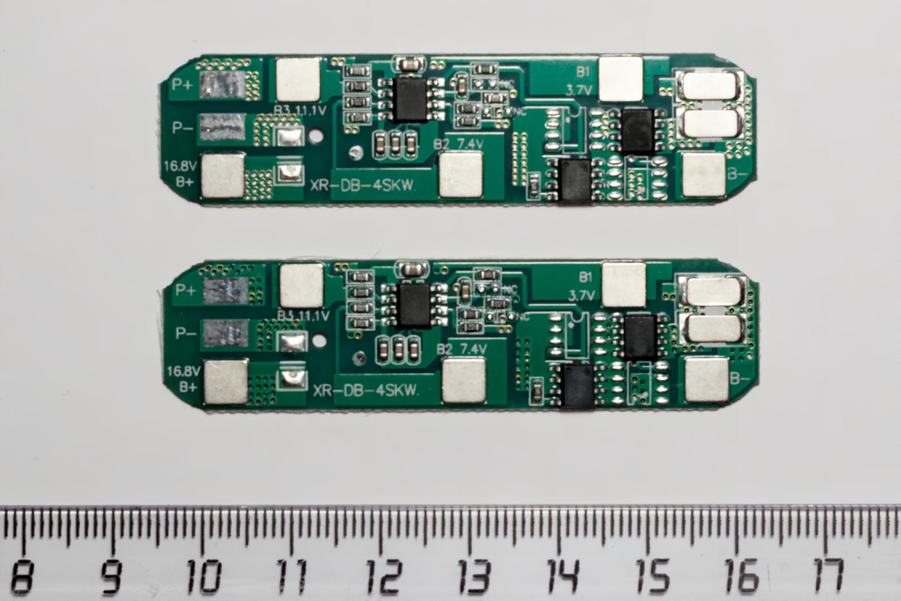

近看：找功率 MOS、采样排针、丝印 B- 和 P-。图里有飞线焊在功率端上，那是拍摄者的改动，不要当成推荐接法。

**视频**　B 站 · [《锂电池保护板原理》](https://www.bilibili.com/video/BV1F7411t7Xq/) · [开源保护板硬件原理](https://www.bilibili.com/video/BV1CB4y1d7Fx/)

这两条中文片对着原理图讲保护板，适合和手里的板一起看。播放器打不开时用原页。门户页有内嵌：[视频教程](../../BMS学习路径.html#videos)。

- **保护 IC**：通常是较小的 SOT 封装，负责比较电压、电流并输出关断信号；
- **功率 MOS**：两颗或更多较大的 SO-8 封装，背靠背串联，负责切断充电或放电；
- **检流电阻**：一两个毫欧级贴片电阻，常印 R005、R010，用压降反推电流；
- **NTC**：小黑头或贴片热敏电阻，贴电芯测温；
- **采样排线**：B1、B2、B3……每节电芯对应一个采样节点。

**接线端子必须分清**（接错一个就烧板）：

| 端子 | 含义 |
|---|---|
| B+ / B- | 电池组总正 / 总负（接电芯） |
| P+ / P- | 对外端口（接负载与充电器） |
| C- | 充电负极（仅分口板） |
| D- | 放电负极（仅分口板） |

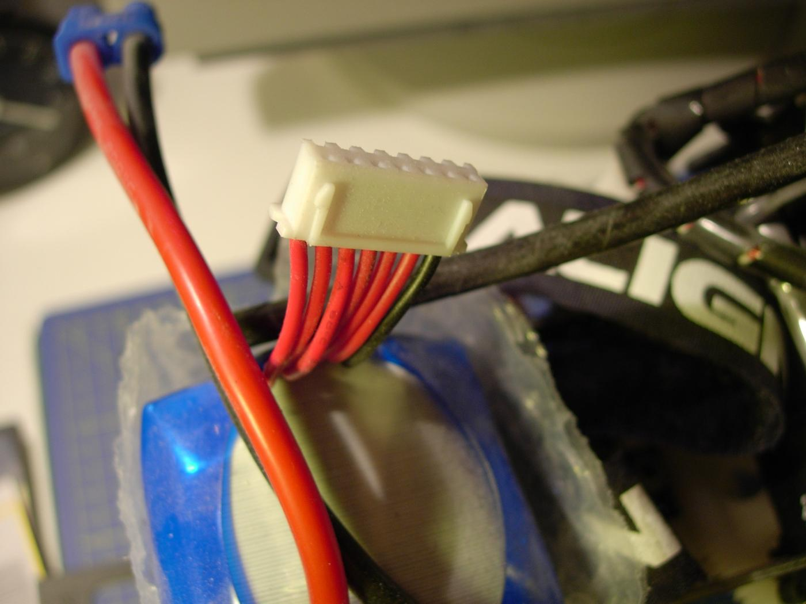

多串包上常见的小间距平衡插头（图中是 XH）。针数一般是串联数加 1。插反或少插一针，采样会错位。

- **同口板**：充放电共用 P-，一组背靠背 MOS——便宜量大；
- **分口板**：充放电 MOS 分开，可独立切断——UPS、太阳能场景常见。

检流电阻还有个看不见的细节——它是怎么"量"的：


> **图说**　盯住只沿绿线走的黄点：50 A 时本体示意 50 mV，把两侧走线算进去是 66 mV，该信的是绿的那一截。

> **口诀**　电流取样走电阻本体的内侧。走线压降不要算进电流。

图中检流电阻为 1.00 mΩ，50 A 时本体压降为 50 mV；若把两侧共 0.32 mΩ 的走线也算进去，读数会变成 66 mV。毫欧级电阻与走线、焊盘压降处于同一量级，因此采样线应从电阻本体内侧引出，形成四线开尔文连接。

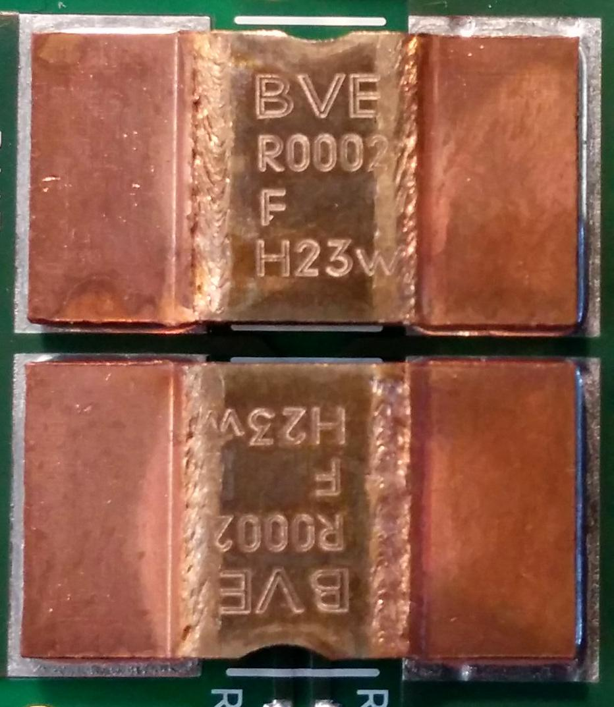

贴片检流电阻很小，阻值印在本体上（R010 常见是 10 mΩ，以该厂丝印规则为准）。采样从哪引出，上面的动画已经讲了。来源见 [照片来源](../circuits/assets/photos/PHOTOS.md)。

> **原理**　保护板上能看见采样电阻、保护 IC、背靠背 MOS 和 NTC。采样点从电阻内侧引出还是从焊盘随便拉，决定电流精度的上限。
> **证据**　可核验演示：本节 SVG（浏览器打开即播），正文有不看动画也能读的说明。板上要能指认保护 IC、功率 MOS、检流电阻、NTC 和采样线。单节手册 [华之美 DW01A 数据手册](https://hmsemi.com/downfile/DW01A.PDF)。实测讨论 [EEVblog 电芯模拟器讨论](https://www.eevblog.com/forum/projects/lithium-battery-cell-simulatoremulator-for-bms-testing/)。
> **延伸阅读**　[ABLIC S-8254A 中文手册](https://www.ablic.com/cn/doc/datasheet/battery_protection/S8254A_C.pdf)

## 2.2 DW01：三类保护条件 [理解]

> **先读/后读**：阈值表是 [记忆]，而且是示例，以料号 datasheet 为准。三道判断和断口方向是 [理解]。

DW01 是常见的单节保护 IC。下面列出的 VDD、VSS、CS、OD、OC、TD 共 6 个引脚；应用图中另标的 VM 与 R3 接法仍待按具体厂商手册核对。芯片监视三类条件：

- **VDD/VSS**：跨接电芯，判断过充与过放；
- **CS**：感知 VSS 与 CS 间的压差，判断两个方向的过流与短路；
- **OD/OC**：两个执行输出，分别驱动放电 MOS 与充电 MOS 的栅极；
- **TD**：测试引脚——出厂测试时用来**缩短**延时，快速验证保护功能；各类保护延时由芯片**内部产生**，不需要外接任何定时元件。

典型保护参数（**以手头手册为准**；表中数值与延时均为「数值以官方 datasheet 为准、待核」，不同厂家和版本会不同）：

| 保护项 | 典型阈值 | 典型延时 |
|---|---|---|
| 过充 | 4.30V ±50mV | 80–200 ms（约 0.1 s 级） |
| 过放 | 2.40V ±100mV | 100ms 级 |
| 放电过流 | CS > 150mV（120–180mV） | 10ms 级 |
| 短路 | CS 典型 1.2 V（1.0–1.4 V） | **微秒级** |
| 充电过流 | CS 反向阈值 | 10ms 级 |

过放保护后 DW01 进入微安级低功耗模式（宁可装死也不让电池继续掉电），插充电器或电压回升后恢复。配套 MOS 常用 8205A——单封装里两颗 N-MOS，天然背靠背。

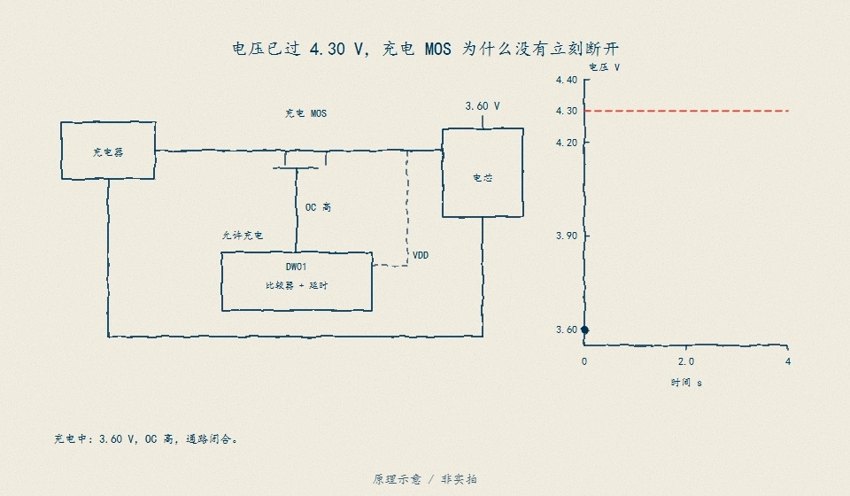

> **看图**　电压已经越过 4.30 V 的那一瞬间，充电 MOS 为什么没有立刻断开——盯着比较器后面那段内部延时，看「确认」比「检测」慢了多少。

> **图说**　盯住从 4.20 V 爬到红线的黄点：每秒加 50 mV，2.0 s 碰到 4.30 V。回差和确认时间在下一张图。

> **口诀**　电压越线，比较器拉栅，MOS 断开。软件可以不在这条路上。

图中电压从 4.20 V 以每秒 50 mV 上升，2.0 s 后到达示意阈值 4.30 V。随后要经过确认延时，OC 才拉低并关断充电 MOS；恢复还要满足另一条电压条件。判断一个保护动作时要同时核对**阈值、延时和恢复条件**。

再沿典型应用电路检查采样、判流和执行路径：


> **图说**　盯住底栏：左边 CS 沿直线爬过短路典型 1.2 V（范围 1.0–1.4 V）；右边游标在过充窗口 80–200 ms 里走。上面六只脚仍是 VDD 采样、CS 判流、OD/OC 关两颗 MOS。

> **口诀**　三道判断题：过充、过放、过流。答案是断哪一只 MOS。

- **采样**：B+ 经 R1（100Ω）进 VDD，C1（0.1µF）跨 VDD–VSS 滤高频；
- **执行**：OD/OC 分别进 8205A 的两个栅极——M1（靠 B- 侧）防放电、M2（靠 P- 侧）防充电，与 [详解 ① §1.2](../circuits/01-功率回路-MOS保护与预充.md) 的口诀同向；
- **判流**：CS 经 R2（1k）看 B- 侧压差；R3（5.1k）用于充电器接入检测（图中标为 VM 的脚与上面 6 脚列表对不上，接法**数值以官方 datasheet 为准、待核**）；
- 阻容取值是 datasheet 典型应用的**示例值**，换兼容料号先查手册。

这张应用图包含四条关键路径：VDD 采样、CS 判流、OD/OC 驱动 MOS，以及芯片内部延时。多串保护还要处理不同采样节点的共模电压。

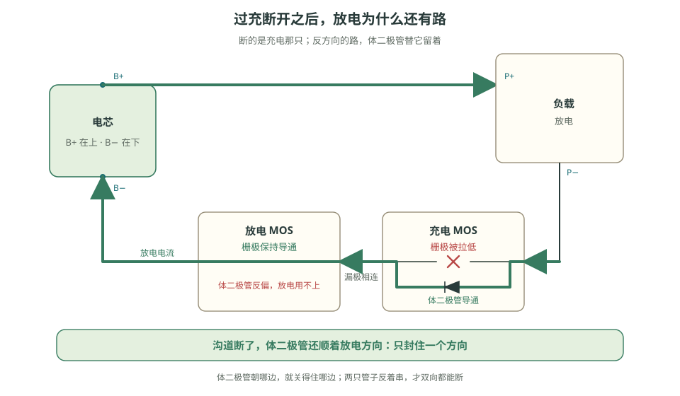

> **看图**　过充保护断开以后，为什么这块板还能对外放电？

**视频**　B 站 · [《DW01 工作原理》](https://www.bilibili.com/video/BV1fMWBesE6M/)

视频顺着六个引脚讲解信号路径；阈值仍以手头料号的手册为准。


> **图说**　单节板上先找六脚的保护 IC，印字里应有 DW01；再找八脚的双 MOS，印字里应有 8205A。

> **口诀**　先对印字，再谈引脚。封装相同的料很多。

封装相同的料很多，以印字为准。上面这张是示意图，用来标位置，不是实拍。

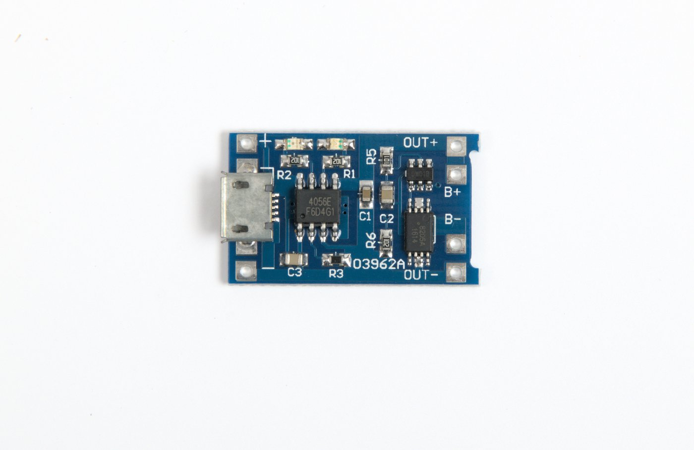

看右侧两颗黑色芯片。上传者在共享资源说明里写明：六脚是 DW01A，八脚是 8205A；左边大芯片是充电用的 TP4056，不是保护 IC。仓库里这张图长边压到 1400 像素，激光印字会变小，对不清请打开原图。本仓库用 tesseract 扫过原图，没有稳定抽出完整料号，所以料号以上传者说明和原图为准，不把自动识别当证据。来源见 [照片来源](../circuits/assets/photos/PHOTOS.md)。

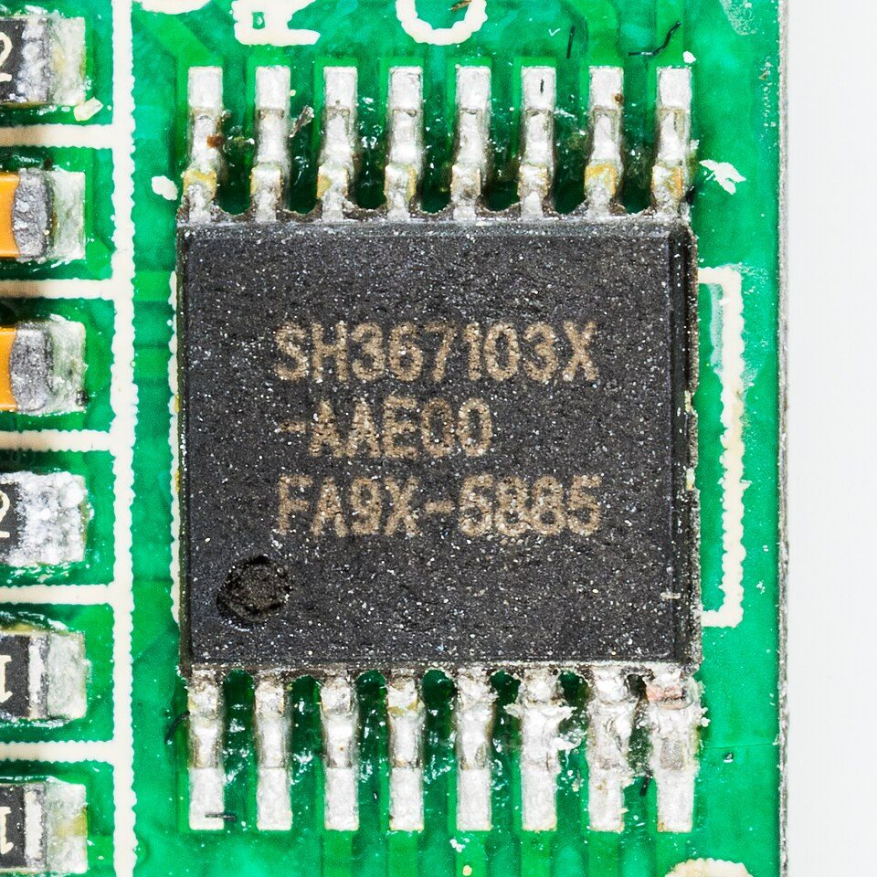

这张是另一颗锂电保护 IC 的丝印特写，用来练眼睛：字符印在封装顶上，料号以能读出的印字为准。它是中颖 SH367103X，不是 DW01，也不是 8205A。来源见 [照片来源](../circuits/assets/photos/PHOTOS.md)。

> **原理**　DW01 用比较器看电压和电流，延时确认不是毛刺，再分别关掉充电或放电 MOS。过放后它会进微安休眠，避免把电芯继续放空。
> **证据**　[华之美 DW01A 数据手册](https://hmsemi.com/downfile/DW01A.PDF)（过充典型 4.30V±50mV，过充延时典型约 80–200 ms）。原厂英文稿：[Fortune DW01A-DS-11](http://www.ic-fortune.com/upload/Download/DW01A-DS-11_EN.pdf)。阶段 2 的表和电路图底栏按这两份手册写：过充延时 80–200 ms，短路保护电压典型 1.2 V（1.0–1.4 V）。以手头手册为准。
> **延伸阅读**　[B 站：DW01 工作原理](https://www.bilibili.com/video/BV1fMWBesE6M/)

过充不是「电压一过线就断」。比较器、回差、确认时间叠在同一条波形上。

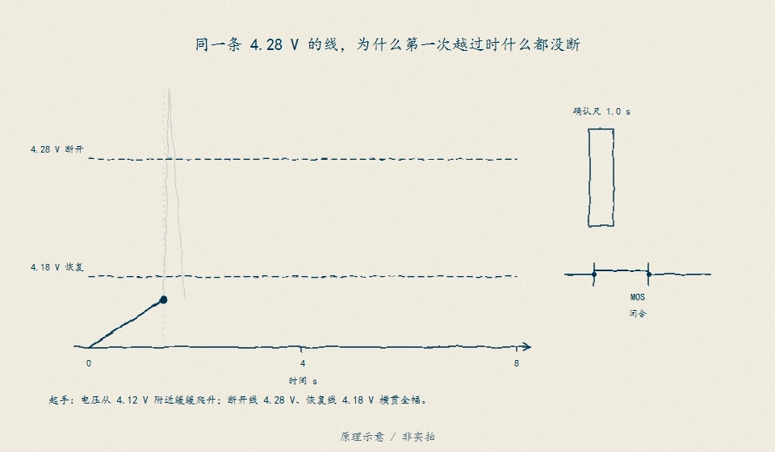

> **看图**　同一条 4.28 V 的线，为什么第一次被越过时什么都没断？看那根 1.0 s 的确认尺，在 1.5–1.8 s 和 3.0 s 之后各自走了多远。

> **图说**　盯住先冲过红线又回来的那一下，再看停在红线上方直到落到绿线下面：毛刺不断，确认满了才断。

> **口诀**　毛刺不够时间，不算过充。松开要比抓住更晚。

黄点先冲过红线又回来（毛刺），再在红线上方停够，然后才落到绿线下面。红线是断开，绿线是恢复。

示意波形，不是示波器：断开线 4.28 V，恢复线 4.18 V，确认 1.0 s。1.5 s 到 1.8 s 有一个 4.34 V 的尖，只持续 0.3 s，MOS 不动。3.0 s 起电压停在 4.32 V，比较器翻了，开始计时。4.0 s 确认满，充电 MOS 断开。之后电压掉到 4.22 V，仍在两条线中间，保持断开。6.2 s 落到 4.12 V，低于 4.18 V，才允许合上。回差是 0.10 V。

铁锂的门完全不是这组数字。把断开和恢复设成同一个电压，负载一抖，MOS 会来回打。

**短自测**

1. 那个 0.3 s 的尖为什么不断开？
2. 4.0 s 断开之后，电压回到 4.22 V，为什么还不合？

<b>参考答案（先自己想完再展开）</b>

1. 确认时间是 1.0 s，0.3 s 不够。
2. 恢复线在 4.18 V。4.22 V 还在回差里面。要到 6.2 s 的 4.12 V 才松开。全是示意，不是某颗保护 IC 的电气表。

> **自检**　指出断开线与恢复线，并解释电压处在两线之间时为什么保持断开。

---

[下一篇：多节保护与接口](./stage-2-主线-多节与接口.md) · [完整讲义与原有锚点](./stage-2-保护板实践.md)

[选读：完整自测](./stage-2-选读-完整自测.md)

<!-- Generated by prepare-stage2.mjs; edit stage-2-保护板实践.md. -->
