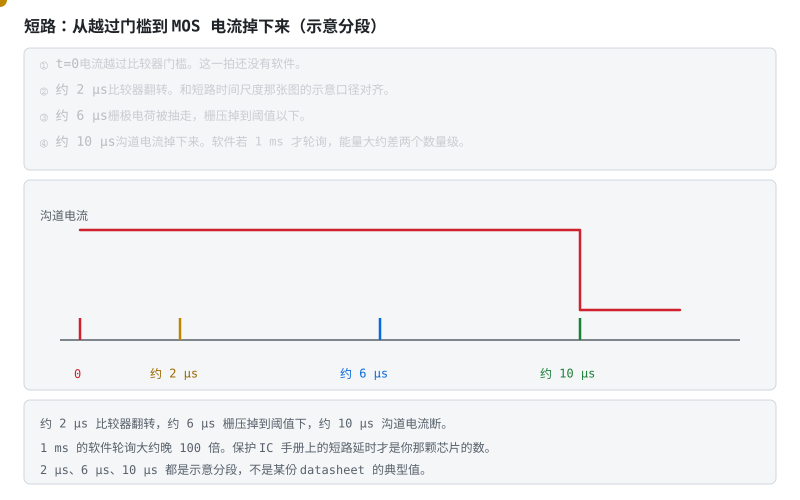
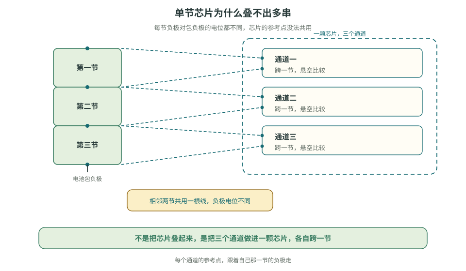
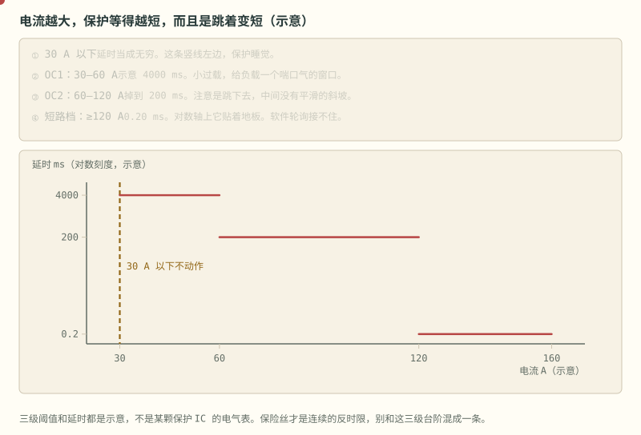
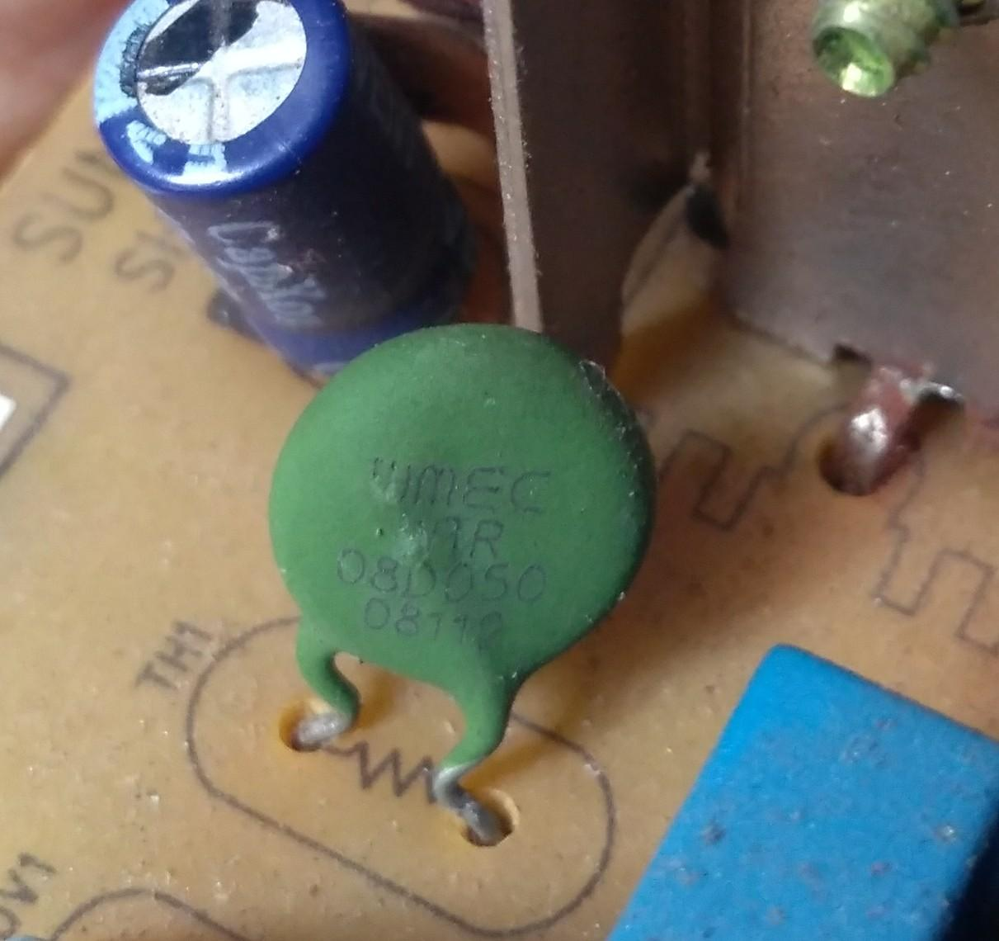
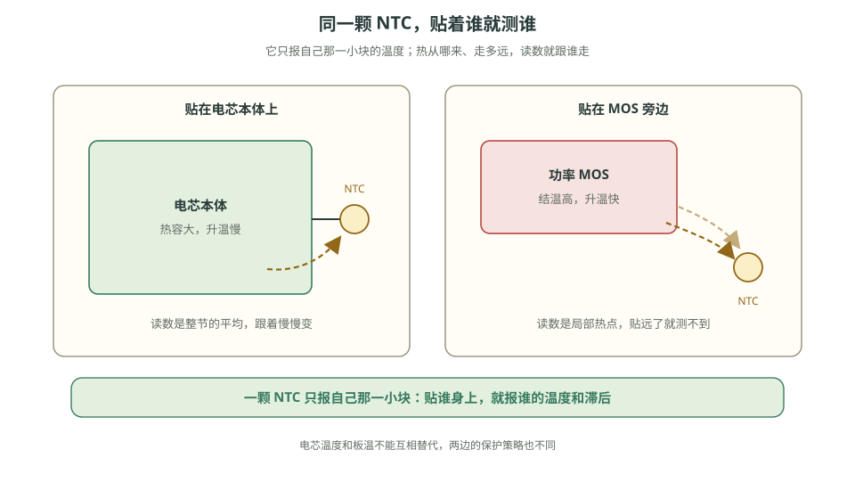
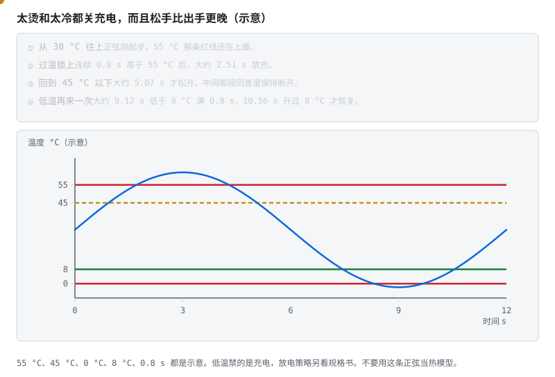

# 阶段 2 主线：多节保护与接口

单节方案不能直接复制到多串电池包。这一篇把采样线顺序、公共端、MOS 选型、温度检测和身份识别放到同一条硬件链上。

> **安全条件**　短路和过流测试只用限流可调电源或电芯模拟器。不要用真电芯短接；操作区使用防火垫并佩戴护目镜。

## 2.3 多节保护：S-8254A 与多通道芯片 [理解]

单节方案不能直接堆叠成多串，因为每一节相对电池包负端的电位不同。多串保护 IC 的处理方式是：

- 内部集成多个独立检测通道，每通道跨接一节电芯（VDD1-VSS1、VDD2-VSS2…），各自悬空比较；
- **S-8254A**：一颗管 3–4 节（SEL 引脚选 3/4 节模式）；官方手册就定位在 3/4 串，**没有多颗级联方案**——别指望两颗拼 7 串；
- **三段过流检测**：过流 1（小过载，延时较长）→ 过流 2（大过载，延时短）→ 短路（微秒级瞬间动作）——为什么短路必须这么快？看动画：

> **图说**　盯住微秒那一格里栅压掉下去的时刻：软件那一拍还没醒，关闸的是硬件比较器。2 µs、10 µs 是示意。

> **口诀**　短路按微秒关。软件那一拍来不及。
> **动态**　初始态：负载电流在正常范围，MOS 导通。扰动：输出被短路，电流在微秒里冲上去。中间态：硬件比较器翻转，栅极电荷被抽走；这一拍还在软件轮询之外。保护态：MOS 关断，回路断开。图上约 2 μs、10 μs 是示意，以保护 IC 手册和系统验证为准。

> **图说**　电流越过门槛是 t=0。

> **口诀**　先翻转，再抽栅，最后电流才断。三拍都在微秒里。

示意大约 2 µs 比较器翻转，大约 6 µs 栅压掉到阈值下，大约 10 µs 沟道电流掉下来。2 µs 和 10 µs 与上面那张时间尺度是同一口径。软件若 1 ms 才轮询，大约晚 100 倍。每一段都不是某一颗保护 IC 的典型值。

- 第一根竖线：电流越线。
- 第二根大约 2 µs：比较器。第三根大约 6 µs：栅压。第四根大约 10 µs：电流断。
- 黄点沿时间轴走，看它还没走到栅压时，软件根本还没醒。

**短自测**

1. 示意里，比较器翻转和 MOS 电流掉下来，各在什么时候？
2. 1 ms 的软件轮询，大约比 10 µs 晚几倍？
3. 6 µs 能写进选型报告吗？

<b>参考答案（先自己想完再展开）</b>

1. 大约 2 µs 和大约 10 µs。中间大约 6 µs 是栅压掉下去的示意。
2. 大约 100 倍。接通时间长两个数量级，I²t 也按这个放大。
3. 不能。它是把「检测」和「栅极」拆开的示意。延时以保护 IC 手册和整机验证为准。

> **自检**　把“微秒级关断”拆成比较器翻转、栅压下降和沟道电流下降三段，并分别标出示意时间。

索引见 [电路动态分析](../circuits/README.md#电路动态分析)。

短路电流下，$I^2t$ 会快速累积。MCU 毫秒级轮询通常赶不上第一道保护，因此短路必须由硬件比较器直接关断；图中的 2 µs、10 µs 只表示时间尺度，实际值查保护 IC 手册并做系统验证。

> **图说**　示例取 500 A，不是示波器截图，也不是某颗 MOS 的安全工作区。

> **口诀**　短路按微秒关。软件那一拍来不及。
> **算一笔**　I²t 按电流平方乘以接通时间。时窗从 10 μs 放到 1 ms，能量大约乘 100。
> **错了会怎样**　只靠软件毫秒轮询，这一示例里的能量先耗在 MOS 里。

10 μs 切断时 I²t = 500² × 10 μs = 2.5 A²s。1 ms 才切断时 I²t = 250 A²s，大约 100 倍。

- 保护阈值由出厂激光修调固定：三元 4.2V 满充与铁锂 3.65V 满充的保护板**阈值版本不同，不能混用**——买板子时先报化学体系；
- 外置延时电容只有两个引脚：**CDT** 同时管过放与过流 1 的延时（两者固定 10:1），**CCT** 管过充；更快的过流 2 与短路延时由内部固定，不可调（注意这和 DW01 的内部延时不同，别记混）。

更多串数通常使用多通道单芯片，例如中颖 SH367309。公开资料对它的串数范围写法不一，有的写 1–17 串，有的按 6–17 串理解；这里不采用未经核实的范围，选型时查官方 datasheet。其基本检测思路与 S-8254A 相同。

> **看图**　为什么不能把三颗单节保护芯片摞起来，当作三串用？

> **原理**　多串不能把单节芯片按各自的地叠起来。多串芯片把每一节变到自己能测的范围；短路仍要硬件比较器直接关闸，软件轮询来不及。
> **证据**　[ABLIC S-8254A 数据手册（简体中文）](https://www.ablic.com/cn/doc/datasheet/battery_protection/S8254A_C.pdf)；英文版 [S8254A_E.pdf](https://www.ablic.com/en/doc/datasheet/battery_protection/S8254A_E.pdf)（可选）。SEL 选 3/4 串，过充/过放阈值按料号步进，延时由 CCT/CDT 外接电容设定。
> **延伸阅读**　[CSDN：S-8254A 保护方案解析](https://bbs.csdn.net/weixin_29169899/article/details/100241878)

过流也不是一条光滑的反时限曲线。很多保护 IC 是三级台阶。

**短自测**　先看 [短路时间尺度](../circuits/assets/short-circuit-timeline.svg)，再看 [I²t 时窗](../circuits/assets/short-i2t-window.svg)。

1. 短路这一拍，谁来关闸？
2. 示例 500 A。10 μs 切断和 1 ms 切断，I²t 各是多少？

<b>参考答案（先自己想完再展开）</b>

1. 硬件比较器直接关闸。软件走采样、判定、去抖、输出，周期本身就在毫秒，赶不上这一拍。
2. 10 μs 是 $500^2 \times 10\,\mu\mathrm{s} = 2.5$ A²s。1 ms 是 250 A²s，大约 100 倍。图上 2 μs、10 μs 是示意，以保护 IC 手册为准。栅极回路若绕远，这扇窗还会再被电感吃掉，见 [详解⑤ §3](../circuits/05-BMS电路板绘制与设计要点.md#3-功率回路-应用)。

> **图说**　盯住三条水平台阶上跳的红点：示意 4000 ms、200 ms、0.20 ms，中间没有斜坡。

> **口诀**　小过载等得久，短路几乎不等。中间是跳，不是滑。

红点在三条水平台阶上跳，不沿对角线滑下去。30 A 左边是空的。

示意：30 A 以下不动作，延时当成无穷。30–60 A 是 OC1，4000 ms。60–120 A 是 OC2，200 ms。120 A 以上是短路档，0.20 ms。纵轴是对数，否则 0.20 和 4000 没法画在一起。台阶之间没有斜坡。保险丝才是连续的 $I^2t$，别和这三级混成一条。

0.20 ms 那一档，软件轮询接不住。200 ms 有时还能在 MCU 里做，但要以这颗芯片的手册为准，不要抄这张示意。

**短自测**

1. 45 A 和 80 A，示意延时各是多少？
2. 为什么纵轴要用对数？

<b>参考答案（先自己想完再展开）</b>

1. 45 A 在 OC1，4000 ms。80 A 在 OC2，200 ms。
2. 0.20 ms 和 4000 ms 差了两万倍。线性轴上短路档会贴成一条看不见的线。数字都是示意。

> **自检**　看到“过流保护”参数时，同时查动作档位、阈值和延时，不只查电流值。

## 2.4 MOS 与驱动细节 [分析]

- **背靠背两种接法**：**共漏**（两漏极相连）——两源极电位不同，两个栅极必须**分别驱动**（DW01 的 OD/OC 正是分两路输出各驱各的），胜在 8205A 这类共漏双 MOS 封装便宜易得，保护板主流；**共源**（两源极相连）——两栅可共用一路驱动，但共同源极悬浮在回路中间，驱动需要浮地设计。两种接法的体二极管都反向对顶，双向阻断能力相同，差别在驱动方式；
- **VGS 红线 ±20V**：栅氧层薄，多串回路的驱动电压稍不注意就击穿——保护 IC 内部已处理，自己设计驱动时必查；
- **并联扩流**：大电流板（>30A）多颗 MOS 并联摊薄 I²R 发热。并联不是白捡的：器件要同批次、布局要对称，否则电流分配不均，热的更热；
- **发热估算**：$P = I^2 \times R_{DS(on)}$，温升靠 PCB 铜箔和散热片带走——阶段 0 的公式在这里变现。

> **图说**　盯住开口向上的曲线和越爬越快的黄点：示意 5 mΩ 时 20 A 是 2 W，40 A 是 8 W。右下角那句是越热电阻越大。

> **口诀**　发热跟电流的平方走。越热电阻越大，再越热。

按图中 5 mΩ 计算，$P=I^2\times 0.005$：20 A 时为 2.00 W，40 A 时为 8.00 W。电流翻倍，导通损耗变为四倍；$R_{DS(on)}$ 还会随结温上升。并联器件能分流，但不能假定自动均流良好，仍要控制批次、驱动、铜皮和热耦合的一致性。

> **原理**　共漏是两漏极相连，两个栅极必须分开驱动；共源可以共栅，但源极悬浮，驱动要浮地。两种接法都能双向关断，差在驱动怎么做。
> **证据**　可核验演示：本节 SVG（浏览器打开即播），正文有不看动画也能读的说明。发热按电流平方涨，导通电阻还随温度升高。背靠背的原因见 [瑞萨《BMS 教程》中文导读](../renesas-bms-tutorial-中文导读.md)，执行端对照 [华之美 DW01A 数据手册](https://hmsemi.com/downfile/DW01A.PDF)。
> **延伸阅读**　[EEVblog 电芯模拟器讨论](https://www.eevblog.com/forum/projects/lithium-battery-cell-simulatoremulator-for-bms-testing/)

## 2.5 NTC 与 ID：温度和身份识别 [理解]

- **NTC**：负温度系数热敏电阻——越热阻值越小。与固定电阻分压送 ADC（或保护 IC 温度脚），换算靠 B 值方程或查表。贴的位置有讲究：贴电芯本体测的是电芯温度，贴 MOS 旁测的是板子温度，保护策略不同；
- **ID 引脚**：用电阻值编码电池型号/容量档，主机一读电阻就知道"插上的是哪块电池"——也是低成本防兼容的手段。

带引线的 NTC，头要贴到被测的那一节或那颗 MOS 上，不要悬在空气里。板子上的贴片热敏电阻是同一类器件，外形不同。

> **原理**　NTC 越热阻值越小。贴在电芯上测的是电芯温度，贴在 MOS 旁测的是板温，两边的保护策略不能混用。
> **证据**　NTC 越热阻值越小，和分压电阻一起送给 ADC。保护板侧的接法见 [EET《ID 与 NTC》](https://www.eet-china.com/mp/a179929.html)。
> **延伸阅读**　[详解②](../circuits/02-采样链与AFE芯片.md)

> **看图**　同一颗 NTC，贴电芯和贴 MOS 旁，为什么读到的不是同一个温度？

温度保护是一扇窗，不是一个点。太烫和太冷都关充电，而且松手比出手更晚。

> **图说**　盯住沿正弦走的黄点，以及上下两对线：停在高线之上才禁充，回到低线之下才松开。

> **口诀**　出手看高线，松手看低线。两边都要等够时间。

黄点沿正弦走。上面两条是 55 和 45，下面两条是 0 和 8。点在高线之上停一阵，再掉到低线之下，中间那段就是回差。

示意正弦 $T=30+32\sin(2\pi t/12)$，单位 °C 和 s。最高 62 °C，最低 −2 °C。过温：连续 0.8 s 高于 55 °C 才禁充，大约在 2.51 s；回到 45 °C 以下才松开，大约 5.07 s。低温：连续 0.8 s 低于 0 °C，大约 9.12 s 禁充；升过 8 °C 才恢复，大约 10.56 s。这张图禁的是充电。放电在低温下要不要断，看规格书，不要把两条策略并成一个开关。

**短自测**

1. 过温大约哪一秒锁上，哪一秒松开？
2. 为什么松开的温度比锁上的低？

<b>参考答案（先自己想完再展开）</b>

1. 大约 2.51 s 锁上，5.07 s 松开。低温是大约 9.12 s 到 10.56 s。
2. 回差。锁上用 55 °C，松开用 45 °C，免得在门槛上来回打。0.8 s 是确认。全是示意。

> **自检**　为温度保护写出高温锁定/恢复、低温锁定/恢复和确认时间五个参数。

---

[下一篇：实测与验收](./stage-2-主线-实测与验收.md) · [完整讲义与原有锚点](./stage-2-保护板实践.md)

[选读：完整自测](./stage-2-选读-完整自测.md)

<!-- Generated by prepare-stage2.mjs; edit stage-2-保护板实践.md. -->
