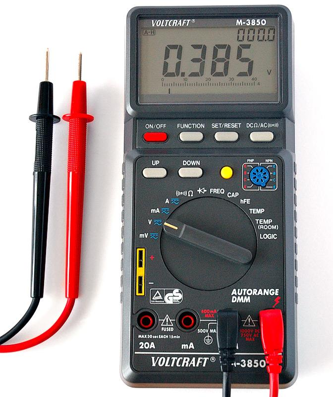
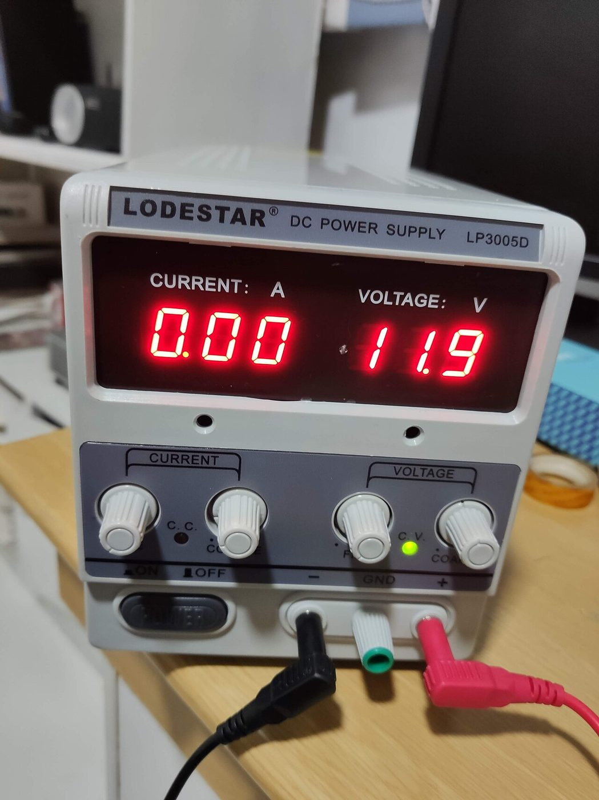
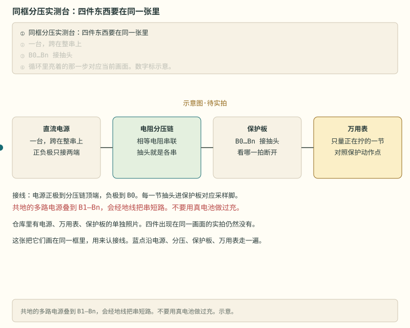

# 阶段 2 主线：实测与验收

保护是否有效不能靠“碰一下就断了”。先写规格，再设安全条件，逐项改变输入，记录动作点、延时、恢复条件和偏差。

> **安全条件**　短路和过流测试只用限流可调电源或电芯模拟器。不要用真电芯短接；操作区使用防火垫并佩戴护目镜。

## 2.6 保护板实测：条件、步骤与记录 [应用]

保护动作测试使用限流电源、分压链或电芯模拟器。真电芯只用于正常工作范围内的功能验证，不用来触发过充、过放、过流或短路。

测动作电压用直流电压档，看清表笔和量程。微安级休眠电流要换到电流档并串进回路，不要用电压档去「量电流」。

电源长这样：一台可调直流源。这张照片里没有保护板，也没有万用表。来源见 [照片来源](../circuits/assets/photos/PHOTOS.md)。

> **图说**　一台电源跨接一串相等的电阻，抽头接到保护板各串采样点，万用表只量正在拧的那一节。

> **口诀**　用分压链代替真电池。共地的多路电源会把串短路。

共地的多路电源叠到 B1–Bn 上，会经地线把电池串短路。图中接线是示意，不是实拍；同框实验台照片仍列在[共建任务板 T11](../共建任务板.md)。

> **图说**　同一框里从左到右是直流电源、电阻分压链、保护板、万用表。

> **口诀**　电源、分压、保护板、万用表要在同一拍对上。

电源只接分压链两端，每一节抽头进保护板对应采样脚，万用表只量正在拧的那一节。蓝点沿这四件走一遍。示意图·待实拍。仓库里的电源、万用表、保护板仍是分开的照片。

1. **电芯模拟**：首选**单电源 + 电阻分压链**——一串电阻跨接一台电源，各分压点天然串联参考，安全便宜（做法参考 [EEVblog 实操帖](https://www.eevblog.com/forum/projects/lithium-battery-cell-simulatoremulator-for-bms-testing/)）。若用多路可调电源，**每一路必须是隔离浮地输出**，并按"上一路负极接下一路正极"串联叠成电池串。⚠️ **共地（非隔离）的多路电源直接接到 B1–Bn，会把电池串经地线短路——烧板烧电源**，这是新手烧掉的第一块板子的最常见死因；
2. **测过充**：缓慢上调某一"节"电压，记录动作电压与延时，对照规格书（偏差应在规格允许范围内，典型 ±50mV 量级，以具体料号为准）；
3. **测过放**：缓慢下调，同上；
4. **测过流**：P 口接电子负载，阶梯加大电流，记录各段动作点与延时；
5. **测静态功耗**：微安表串入 B+ 回路，正常态与过放休眠态各测一次（μA 级是常见合格线，以产品规格为准——储能板待机一年不能抽干电池）；
6. **测恢复**：触发保护后验证恢复条件（卸载 / 插充）；
7. **带均衡的板子**：把一节电压调高，充电至末端，摸（或热成像看）该节均衡电阻是否温热工作。

### 怎么测、记什么、交回什么

先按同框接线确认电源、分压链、保护板和万用表的位置。下面的空表用于记录规格值、实测值和判定。

> **口诀**　三格先留白：阈值、延时、判定。旋钮没拧过，数字不许写。

**怎么测。** 坐下按这个顺序。不要用真电池做过充。

1. 一台电源加一串电阻，当作假电芯。共地的多路电源不要叠到 B1–Bn 上，地线会把串短掉。
2. 过充：慢慢拧高正在看的那一节，万用表只量这一节。记下闸断时的电压，再记从越线到断开过了多久。
3. 过放：反方向拧低。同样记电压和延时。
4. 过流：P 口接电子负载，电流一档一档加。放电过流必填。这块板有充电过流，才填那一行。
5. 示波器要上的话，地夹就是大地。夹错点会烧板。用差分探头，或隔离供电的示波器。

**记什么。** 空着就空着。抄邻居的板，不算你的数。

表头四行都要有字：板子型号和丝印、保护 IC 型号和阈值版本、日期、方法写成「分压链」或「电子负载」。真电池过充不收。

| 项目 | 规格书阈值 | 规格书延时 | 实测阈值 | 实测延时 | 怎么测的 | 判定 |
|---|---|---|---|---|---|---|
| 过充 |  |  |  |  |  |  |
| 过放 |  |  |  |  |  |  |
| 放电过流 |  |  |  |  |  |  |
| 充电过流（这块板没有这一档就整行留空） |  |  |  |  |  |  |

规格书两列从**你这块板**的手册抄。实测两列只有你拧过旋钮才填。判定写「落在手册允差里」，或「偏了多少、你怎么看」。仓库里不预填任何一格。DW01A 手册上的 4.30 V、大约 80–200 ms，是那一档料号的例子，不是这张表的默认答案。

**提交什么。** 开一条标题为 `[实测] T1` 的 Issue，或按[任务板](../共建任务板.md)提 PR，附上填好的表。型号、方法或实测值缺失时先补齐；可以附照片，但不要带电拍高压母线。

**短自测**（先盖住再想）

1. 规格书列能不能先填？实测列能不能先写一个「大概 4.2 V」？
2. 共地的双路电源，负极接在一起，能不能代替分压链？
3. 表上有过充电压，没有延时，也没写方法。这算交回了吗？

<b>参考答案（先自己想完再展开）</b>

1. 规格书列可以抄你这块板的手册。实测列必须留空，直到你自己测到。「大概」不是实测。
2. 不能。共地会从电源内部把串短掉。用一台电源加分压链。
3. 不算。延时和方法都是栏目。缺一栏先补再交。T1 欢迎读者贡献，空表继续空着。

> **完成标志**　交出一张别人能按相同条件复测的表；未测项目保持空白，不填估计值。

> **安全**　台式示波器探头地夹通常接保护地。夹在 B− 以外的节点可能造成对地短路；跨浮地节点测量时使用额定等级合适的差分探头或经过验证的隔离测量方案。

> **原理**　用受控电源改变输入，才能在不把真电芯推向危险边界的前提下重复测量阈值、延时和恢复条件。
> **证据**　分压链怎么代替电芯，讨论见 [EEVblog 电芯模拟器帖](https://www.eevblog.com/forum/projects/lithium-battery-cell-simulatoremulator-for-bms-testing/)。动作电压仍对 [DW01A 手册](https://hmsemi.com/downfile/DW01A.PDF) 的那一档，不要把示意图上的 4.28 V 当成你这块板的规格。
> **延伸阅读**　[术语表](../glossary.md) · [总纲](../bms-resources.md)

> **完成标志**　能用分压链触发并恢复保护，能说明示波器地夹和共地电源的风险，并提交包含阈值、延时、方法与判定的记录。

## 2.8 动手任务 [应用]

1. 拆解一块成品 3S 保护板，画出原理框图（IC、MOS、检流、NTC、端子），标注电流路径；
2. 按 2.6 七步流程实测一块板子，填测试报告表；
3. 调试 [立创开源 BQ76920 5S 工程](https://oshwhub.com/kaijun/mps-energy-station)，对比它与纯硬件保护板的差异——能读到每串电压的那一刻，你已经站在阶段 3 的门口了。

> **原理**　动手是把机制变成一次可核对的记录：条件、读数、和规格差在哪。没有记录的操作不算做完。
> **证据**　本节可点击来源：[立创开源 BQ76920 5S 工程](https://oshwhub.com/kaijun/mps-energy-station)。阈值与宣传口径仍以 datasheet / 标准原文为准。
> **延伸阅读**　[术语表](../glossary.md) · [总纲](../bms-resources.md)

## 2.9 验收清单 [评价]

- [ ] 能指认陌生保护板上每个关键器件并说明作用
- [ ] 能用电芯模拟器完成 OVP/UVP/OCP 三项实测并判定合格与否
- [ ] 能解释背靠背 MOS、检流电阻、短路 μs 级动作三个细节
- [ ] 测试数据整理成表，规格值与实测值的偏差能给出解释

> **本阶段结论**　保护 IC 比较电压和电流，背靠背 MOS 执行充放电关断；保护动作使用电芯模拟器或受控电源测试，不用真电芯触发危险边界。

全部通过 → 进入 [阶段 3：AFE 与采样](stage-3-主线-AFE与采样.md)（总纲入口：[阶段 3](../bms-resources.md#阶段-3进阶afe--mcu-的智能-bms12-个月)）。

---

[返回：单节保护板](./stage-2-主线-单节保护板.md) · [完整讲义与原有锚点](./stage-2-保护板实践.md)

[选读：完整自测](./stage-2-选读-完整自测.md)

<!-- Generated by prepare-stage2.mjs; edit stage-2-保护板实践.md. -->
