# 阶段 3 主线：AFE 与采样

先回答采样为什么不能只靠 MCU ADC，再沿 BQ769 系列的扫描与通信路径走到高压从板。

## 3.1 从固定保护到 AFE + MCU [理解]

阶段 2 的保护板有个本质限制：**保护逻辑写死在模拟电路里**。阈值是激光修调的，延时是电容定的，它不认识 SOC，不会说话，更不能升级。

智能 BMS 把"感知"和"决策"分开：

```
电芯 → RC 滤波 → AFE（高精度采样 + 硬件保护兜底）
                    │ I2C / SPI
                    ▼
                  MCU（策略、算法、通信）→ MOS 驱动 / 继电器
                    │
                    ▼
              UART / CAN / BLE 对外
```

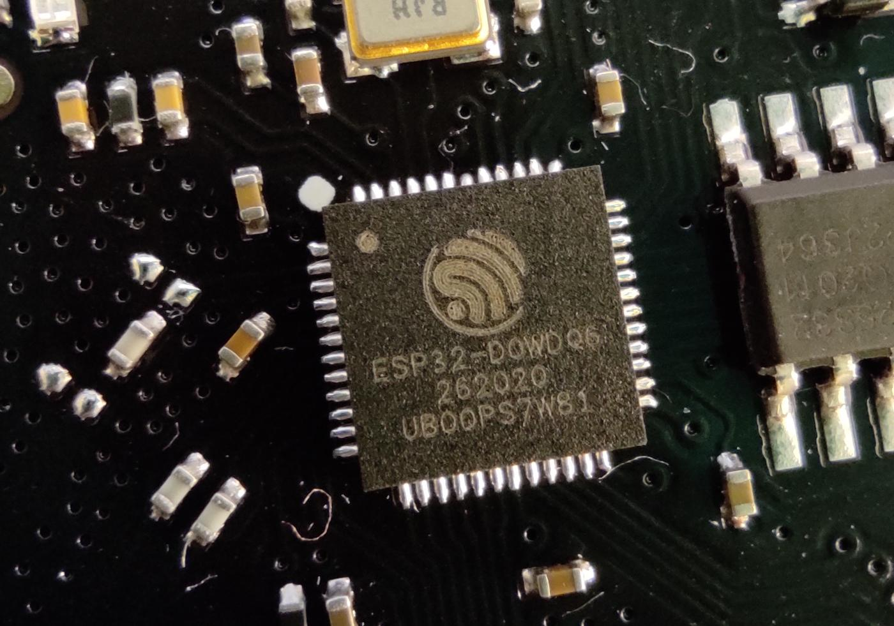

这是主控模组（图中为 ESP32），负责策略和通信。它不是 AFE，也不是保护板。不要把开发板引脚直接接到电池包的高压上。

**视频**　B 站 · [达尔闻《1 小时讲透 BMS 设计》](https://www.bilibili.com/video/BV1NwnRzAEb3/)

放在架构之变，是因为这条中文片从系统原理讲到保护回路和 MOS，适合对照上面的分工图。门户页有内嵌：[视频教程](../../BMS学习路径.html#videos)。

- **AFE** 干粗活：多串电压高精度测量、温度采集、内置独立硬件保护（MCU 死机也能保护）、均衡开关驱动；
- **MCU** 干细活：可编程保护策略、SOC 算法、均衡调度、通信协议、故障记录；
- 第一设计原则，量产门票：**硬件保护（AFE 内置）兜底，软件保护在前**——双通道冗余。软件反应快、可配置，做第一级；硬件独立、不可死机，做第二级。

> **原理**　阶段 2 的保护板有个本质限制：**保护逻辑写死在模拟电路里**。阈值是激光修调的，延时是电容定的，它不认识 SOC，不会说话，更不能升级。
> **证据**　感知在 AFE，策略在 MCU，硬件保护独立兜底。固件参考 [LibreSolar 固件](https://github.com/LibreSolar/bms-firmware)（英文，可选），芯片族 [TI 储能 BMS 方案](https://www.ti.com.cn/solution/zh-cn/ess-battery-management-system-bms)（中文）。
> **延伸阅读**　[立创开源 BQ76920 工程](https://oshwhub.com/kaijun/mps-energy-station)

## 3.2 AFE 精读：以 BQ769x0/x2 为线 [分析]

拿起数据手册，按信号链顺序读，每读一块就问"它替我把哪件事做掉了"。

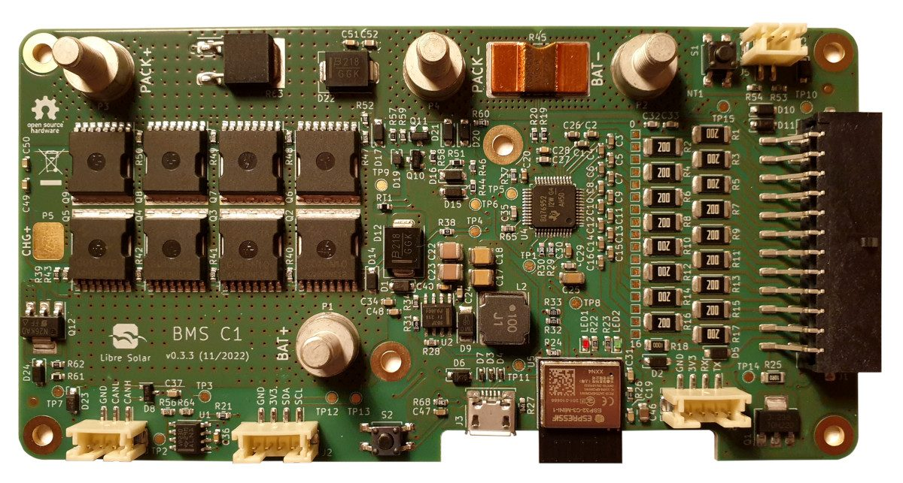

> **实物对照**　LibreSolar BMS C1 v0.3.3：左侧是功率开关，中央是 BQ76952，右侧是采样接口。先认全板位置，再看下面近景。LibreSolar，CC BY-SA 4.0；[来源与授权](../circuits/assets/photos/PHOTOS.md)。

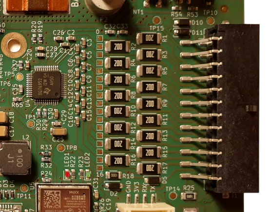

> **看图**　从右侧黑色插座向左找电阻阵列和 BQ76952。这个近景从同一张全板照片裁出，未放大，不另计实物点。引脚定义与接线顺序须查[该板安装手册](https://github.com/LibreSolar/bms-c1/blob/e79f8e99d3393ef2c15a3c979d9fc88d78691cc0/manual/4-installation.md)，不能只按丝印猜。裁剪日期 2026-11-07，LibreSolar，CC BY-SA 4.0。

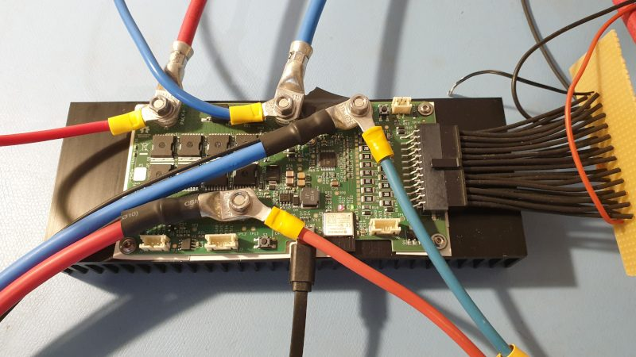

> **实物对照**　先看右侧成束细线进入板边插座，再看接线柱上的粗线：前者把各串电位送到采样前端，后者承载充放电电流。照片来自 LibreSolar BMS C1 的测试布置，按 CC BY-SA 4.0 转载，本节复核日期 2026-11-07；[来源与授权](../circuits/assets/photos/PHOTOS.md)。这是开源 BQ76952 板的接线全貌，没有接口引脚特写，也没有 NTC 贴装位置；不能按照片猜插拔顺序或针脚定义。

> **看图**　采样细线接错一位，大电流线仍可能接对。为什么“板子能上电”不能证明每串电压都测对？请回原理图逐针核对，不接真电池试错。

**输入级**

- VC0…VCn 跨接各串电芯，每路串 RC——**阻值容值照抄手册**（理由在阶段 0：R 大引入漏电流误差，C 大拖慢均衡后的稳定）；
- 串数选型（是**支持范围**，不只是上限）：bq76920 3–5S、bq76930 6–10S、bq76940 9–15S、bq76952 3–16S——先数串数再选芯片；只看"最高支持"会选错（4 串用不了 bq76930，2 串用不了 bq76920）。具体通道数、温度路数、阈值位数因型号而异，以所选料号手册为准；
- **开线检测**：采样线断开时读数会被邻近通道拉偏——AFE 有专门诊断功能，量产必须启用，断线那串等于失去保护。

**测量子系统**


> **图说**　盯住过原点的直线和沿它走的黄点：图上 5 串一圈 0.50 ms，同一条线到 16 串是 1.60 ms。这是时间账。

> **口诀**　一颗 ADC 轮流看每一串。这一拍的电压不是同一瞬间。
> **动态**　初始态：开关停在某一串。扰动：通道号加一。中间态：等这一路稳定再转换。稳态：数字锁进寄存器，再扫下一串。各串的采样时刻沿扫描往后排。同一过程在 [详解② §2](../circuits/02-采样链与AFE芯片.md#2-mux-巡逻式测量一颗-adc-测-16-串-理解)。

盯住底栏，按每串 100 µs 画直线。图上是 5 串，一圈 0.50 ms。同一条线走到 16 串是 1.60 ms。黄点沿直线走，过原点。这是时间账，不是电压误差。

时间账之外，那笔**电压误差账**长什么样？先看最底下一层——ADC 把连续电压切成台阶：

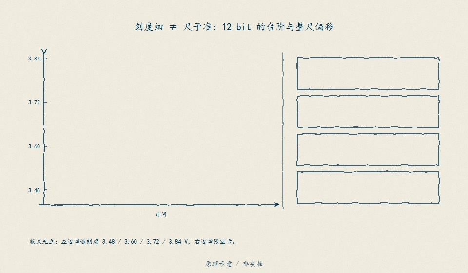

> **看图**　台阶越细，读数就越准吗？盯住整把尺子的零点——它一偏，是只有一格偏，还是每一格都在同一方向偏。

> **图说**　量化是把连续电压压到最近的台阶上，读数与真实值最多差半个最低位（±½ LSB）。台阶宽度由位数定：12 位在 5 V 量程上一格约 1.22 mV。

再把整条链上的误差逐截垒起来，才知道预算够不够：

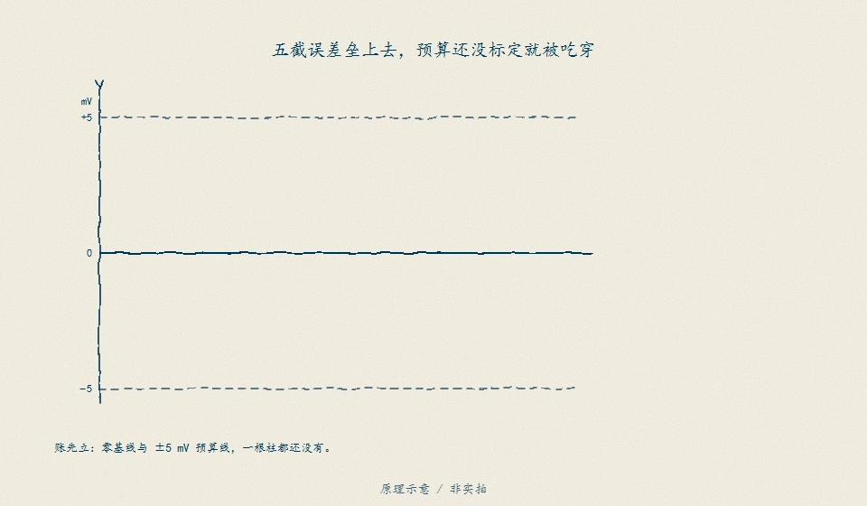

> **看图**　五截误差一截一截垒上去，为什么还没标定，整个 ±5 mV 预算就先被吃穿了？

> **图说**　每一截从前一截的终点往上垒：五截合计 5.5 mV，探出了 ±5 mV 的预算。误差要按链逐截相加，不能只盯其中一截最大的。详解见 [详解② 的误差瀑布](../circuits/02-采样链与AFE芯片.md)。


一圈扫描里电流若还在变，首尾两串会差出一截压降。100 μs、50 A、1 mΩ 的示例在 [详解② §2](../circuits/02-采样链与AFE芯片.md#2-mux-巡逻式测量一颗-adc-测-16-串-理解)。

内部没有 16 颗 ADC，而是**一颗 ADC + 多路选择器巡逻扫描**（动画）。这个架构的两个重要性质：

- 所有串共用一颗 ADC、一个基准 → **串间一致性极好**（均衡和保护关心的正是相对差）；
- 但各串不是同一时刻测的——电流剧烈波动时，首尾两串对应不同瞬间，算法层要留意。

电流测量是独立高速通道：外部检流电阻 + 内部**库仑计**，直接输出电流积分值——硬件替你做了安时积分（阶段 4 的主角之一）。温度靠多路 TS 引脚接 NTC + 片内温度。

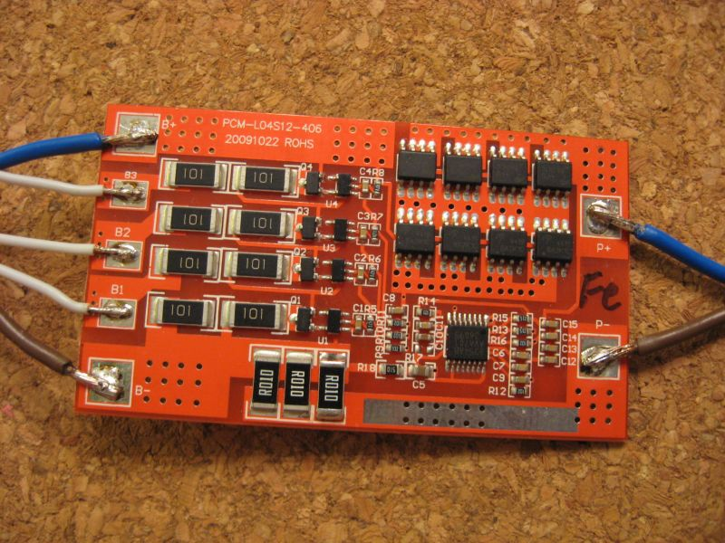

> **实物对照**　先在板下缘找到三枚 R010 检流电阻，再沿粗铜箔辨认大电流路径。它是四节 LiFePO4 **保护与均衡板示例**，不是 BQ769 官方 EVM，也不是 AFE 采样连接器近景；左侧是直接焊上的采样线。照片作者 Hadhuey，按 [CC BY-SA 3.0](https://creativecommons.org/licenses/by-sa/3.0/) 使用，未裁剪、未改图；[原图与区域注释](https://commons.wikimedia.org/wiki/File:Akkuschutzschaltung_mit_Balancer_4S.jpg)。

> **看图**　检流电阻已装在板上，但仅凭照片，能否证明它的开尔文采样与电流标定正确？还缺哪类测量证据？

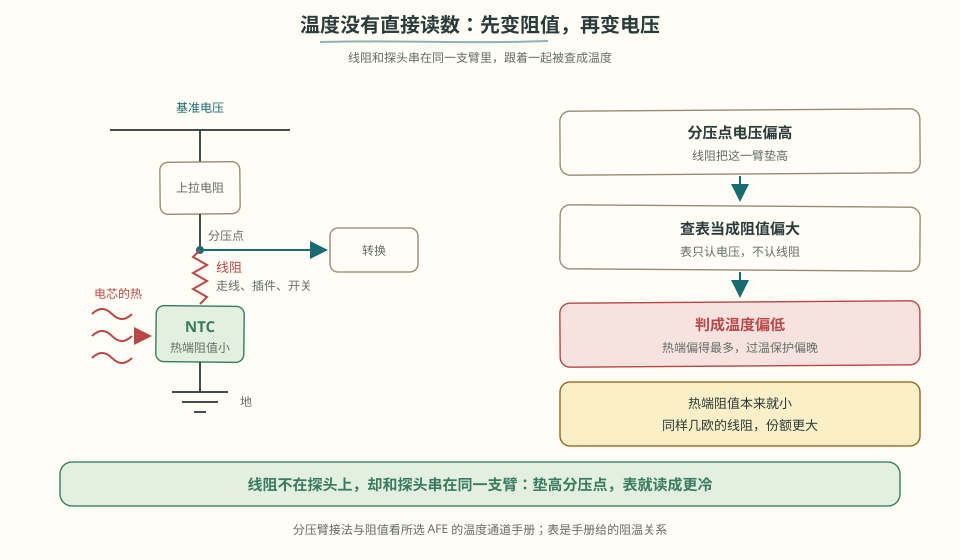

> **看图**　探头温度一路变成寄存器里的数字，线阻是在哪一步把误差掺进来的？

**保护子系统（硬件兜底）**

OV/UV/SCD/OCD/OT/UT 各有独立比较器 + 可配阈值/延时寄存器，触发后**不经过 MCU 直接动作**。回想阶段 2 的短路动画——SCD 微秒级关断就是它干的，软件永远赶不上。

**均衡**

每串一个内部开关 + 外接均衡电阻，MCU 写位选择对哪些串放电。注意手册的占空比/热限制：内部开关长时间导通会发热，多串要均衡时**分时轮询**，别全开。

均衡开着的时候，这一串的电压还能采吗？均衡电流流过回路电阻，把读数拉低；关断之后要等极化回弹才落底：

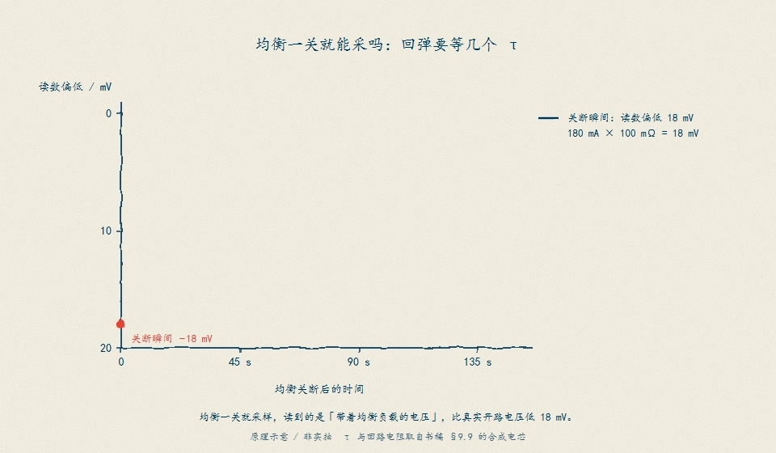

> **图说**　关断瞬间偏低 18 mV（180 mA × 100 mΩ）。1τ = 45 s 只回弹 63.2%，此时仍差 6.6 mV，要等到 2–3 个 τ（90–135 s）才落进 2 mV 以内。偏低量和判据同量级，所以 30 mV 的真实压差在关断瞬间读成 12 mV，低于 15 mV 停止线，均衡提前停而曲线看着正常。τ = R1·C1 = 15 mΩ × 3000 F，取书稿 §9.9 的合成电芯。

**通信与供电**

- I2C（x0）或 SPI/I2C/HDQ（x2），**CRC 校验强烈建议打开**——电池包是强干扰环境；
- AFE 直接从电池组取电，自带 LDO（REGOUT）给 MCU 供电；进出 shutdown 控制整机静态功耗——储能板待机一年不能抽干电池，全靠这个模式。


> **图说**　盯住 CRC 对不上的那一拍：这一帧丢掉重读，不要拿它去做保护决定。

> **口诀**　读数带 CRC。对不上就重读，不要用坏帧。

图上是一笔教学校验，不是某一颗 AFE 的 CRC 多项式：0x12 与 0x34 的低 8 位和是 0x46；第二字节翻成 0x35，和变成 0x47，这一帧丢掉重读。对不上就不要拿去保护。另外记住：读到的是寄存器快照，AFE 自己按转换周期刷新，读得再快也只是把旧数据多拿几次。真实多项式以那颗芯片的手册为准。

> 读手册实操：把 bq76920 手册"寄存器地图"整节过一遍，给每个寄存器标注"状态类 / 配置类 / 保护类"。这一小时会在你写驱动时十倍还回来。

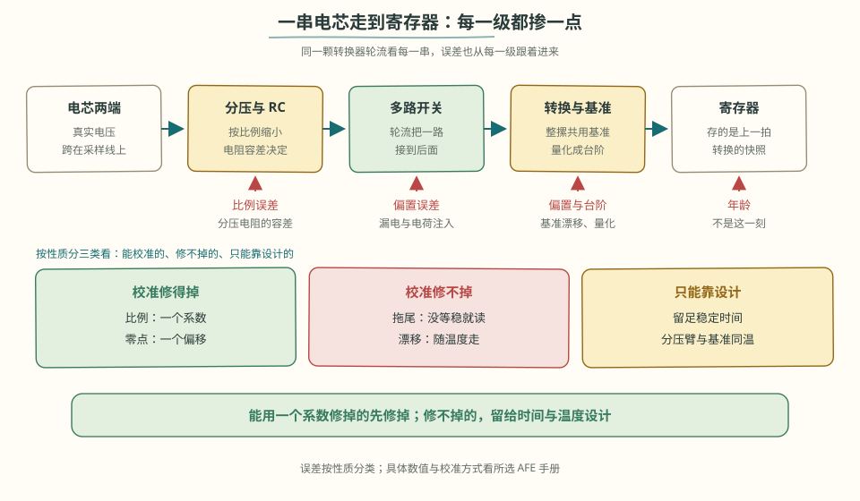

> **看图**　一串电压从电芯走到寄存器，哪一级掺进来的误差是校准修不掉的？

> **原理**　拿起数据手册，按信号链顺序读，每读一块就问"它替我把哪件事做掉了"。MUX 共用一把尺子，所以串间差可信；各串不是同一瞬间测的，脉冲电流下首尾两串不要拿来算瞬时功率。
> **证据**　串数范围和保护分工见 [BQ76952 产品页](https://www.ti.com/product/BQ76952) 与官方介绍 [BQ76942 / BQ76952](https://www.youtube.com/watch?v=f0sG9cH1m8Q)（英文，可选）。中文方案入口 [TI 储能 BMS](https://www.ti.com.cn/solution/zh-cn/ess-battery-management-system-bms)。片子里的精度是宣传口径，以你选的料号手册为准。
> **延伸阅读**　[立创开源 BQ76920 工程](https://oshwhub.com/kaijun/mps-energy-station)。评估板没有可转载的实拍；官方演示里板子出镜，见 [详解② §5](../circuits/02-采样链与AFE芯片.md#5-bq769x0x2-内部巡游以手册功能框图为地图-分析)。那一节的静帧照片仍是笔记本上的 BQ20Z45，不是评估板。


一圈要多久，先把「等稳定」加进去。只算 ADC 转换，会把时间算短。

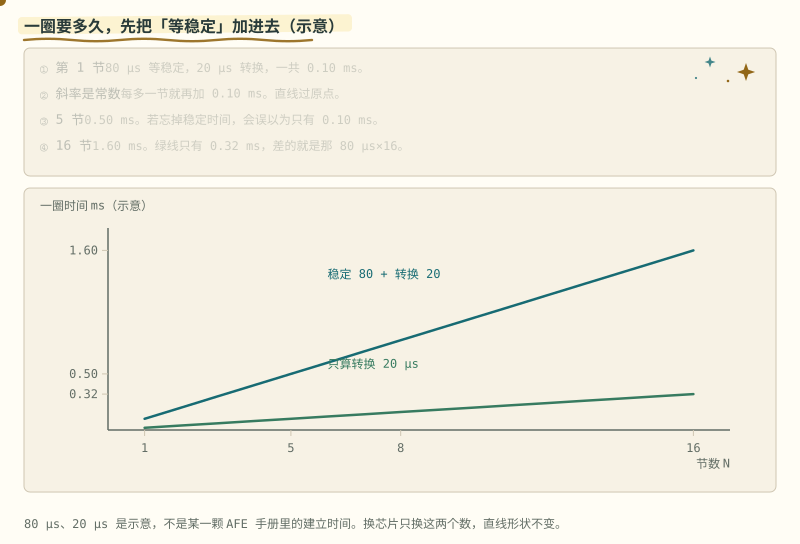

> **图说**　盯住较陡的蓝线和更平的绿线：绿线是忘掉每节等待之后的虚报，两条开口越来越大。

> **口诀**　每节先等，再转换。忘掉等待，整圈会虚报。

黄点沿较陡的蓝线走。绿线是「忘记等待」。两条都过原点，开口越来越大。

示意：稳定 80 µs，转换 20 µs，每节 100 µs。$T=0.100\times N$ ms，直线过原点。5 节是 0.50 ms，16 节是 1.60 ms。若只算转换，16 节只剩 0.32 ms，少掉的就是 $80\times 16$ µs。斜率是常数：每多一节，固定再加 0.10 ms。

采样点若赶在稳定之前，读到的是上一节的尾巴。换芯片只换这两个微秒，直线还是直线。

**短自测**

1. 16 节，含稳定和只算转换，各是多少毫秒？
2. 为什么两条都是直线？

<details>
<summary><b>参考答案（先自己想完再展开）</b></summary>

1. 1.60 ms 和 0.32 ms。
2. 每节的时间相同，总时间正比于节数。80 µs 和 20 µs 是示意，不是某一颗 AFE 手册里的建立时间。

</details>

**练完你会怎样**：你估扫描周期时，会先问「稳定算进去了没有」。


<a id="33-高压与菊花链ltc6811-的世界-分析"></a>

## 3.3 高压采样与隔离菊花链 [分析]

超过 16 串（大型储能，或电动汽车常见的几十到几百串牵引包），换一套主从式思路。电动自行车与电动摩托车是否采用主从式，取决于串数、功率和安全目标，不能只看“车用”两个字：

- **LTC6811**：单芯片 12 串，多颗**菊花链**级联覆盖上百串；
- **isoSPI**：变压器耦合的差分 SPI——每级之间完全电气隔离，数据像接力棒逐级"接收→再生→转发"，共模电压差几百伏也伤不到芯片（动画与原理见 [电路详解 ②](../circuits/02-采样链与AFE芯片.md)）；
- 入门精读工程：[vamoirid/LTC6811+STM32](https://github.com/vamoirid/Battery-Management-System-LTC6811-STM32)，重点看它的驱动分层和断线检测实现。主控 MCU 的选型、外设映射与坑的系统整理见 [STM32 实战专题](../stm32-bms专题.md)。


> **图说**　红线表示从板共模随串数抬高，蓝线表示经变压器耦合的差分通信。图是机制示意，不是 TI 或 ADI 评估板照片。

**主流 AFE / 保护 / 计量芯片速查**（选型先看串数与角色，再看生态与资料厚度）：

| 芯片 | 厂商 | 串数 | 角色 | 一句话定位 | 资料 |
|---|---|---|---|---|---|
| BQ76942 / BQ76952 | TI | 3–10 / 3–16 串 | AFE | 入门首选：I2C/SPI 直读，中文资料最全 | [产品页](https://www.ti.com/product/BQ76942) |
| BQ76920/30/40 | TI | ≤5/10/15 串 | AFE | 上一代主力，手册与应用笔记极成熟（本节寄存器精读对象） | [产品页](https://www.ti.com/product/BQ76920) |
| LTC6811 → ADBMS6815 | ADI | 12 串 | AFE | isoSPI 菊花链标杆，车规高压包主力（无线版见 §6.5） | [产品页](https://www.analog.com/en/products/ltc6811-1.html) |
| ISL78714 | Renesas | 14 串 | AFE | 车规高串数，可菊花链扩展 | [产品页](https://www.renesas.com/en/products/isl78714) |
| MC33771C / MC33772C | NXP | 7–14 / 3–6 串 | AFE | 车规，TPL 菊花链，NXP 生态绑定深 | [产品页](https://www.nxp.com/products/MC33771C) |
| L9963E | ST | ≤14 串 | AFE | 车规级里价格最友好的一档，隔离菊花链 | [产品页](https://www.st.com/en/power-management/l9963e.html) |
| SH367309 | 中颖 | 串数范围以官方 datasheet 为准（待核；资料常写 1–17 串） | 保护 IC | 国产保护板主力：纯硬件保护、无通信接口 | 实战文章见 [阶段 2 多节保护](stage-2-主线-多节与接口.md) |
| DW01 | 多家兼容 | 1 串 | 保护 IC | 单节保护「活化石」，理解保护逻辑的最小样本 | [详解 ① §2](../circuits/01-功率回路-MOS保护与预充.md) |
| BQ40Z50 | TI | 1–4 串 | 电量计 | 阻抗跟踪（Impedance Track）商用标杆，笔记本电池包主流 | [产品页](https://www.ti.com/product/BQ40Z50) |

> **原理**　串数超过单颗 AFE 以后，从板之间地电位可以差几十到几百伏。采样靠菊花链或隔离 SPI 传回主控，不能拿普通导线把从板地连到 MCU。
> **证据**　菊花链从板怎样接到 STM32，见 [LTC6811+STM32 工程](https://github.com/vamoirid/Battery-Management-System-LTC6811-STM32)（英文，可选）。isoSPI 使用变压器耦合；机制可对照[详解② 的菊花链动画](../circuits/assets/isospi-daisy.svg)。可转载的 isoSPI 线束实物图仍缺，记录在[照片来源](../circuits/assets/photos/PHOTOS.md)。
> **延伸阅读**　[术语表](../glossary.md) · [总纲](../bms-resources.md)

<a id="34-固件架构四层--一台状态机-应用"></a>

---

[下一篇：固件与功率开关](./stage-3-主线-固件与功率开关.md) · [完整讲义与原有锚点](./stage-3-AFE-MCU智能BMS.md)

[选读：完整自测](./stage-3-选读-完整自测.md)

<!-- Generated by prepare-stage3.mjs; edit stage-3-AFE-MCU智能BMS.md. -->
