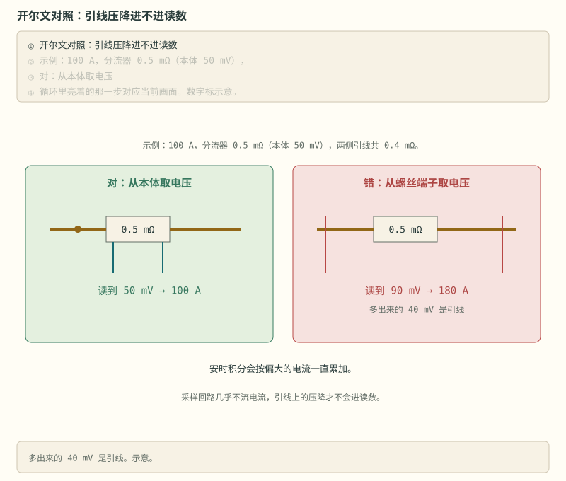
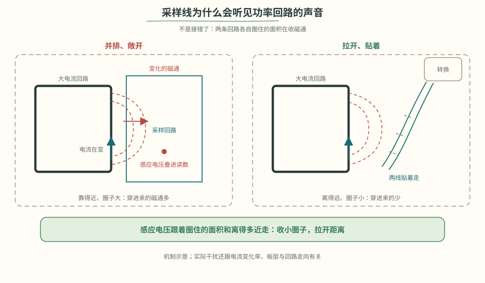
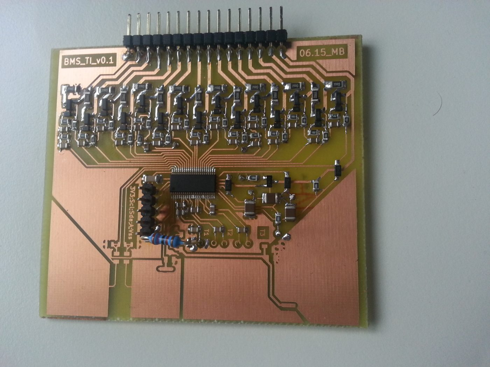
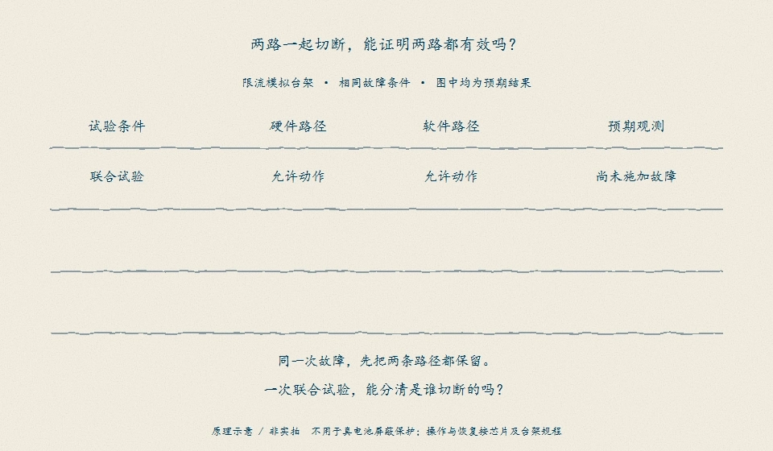
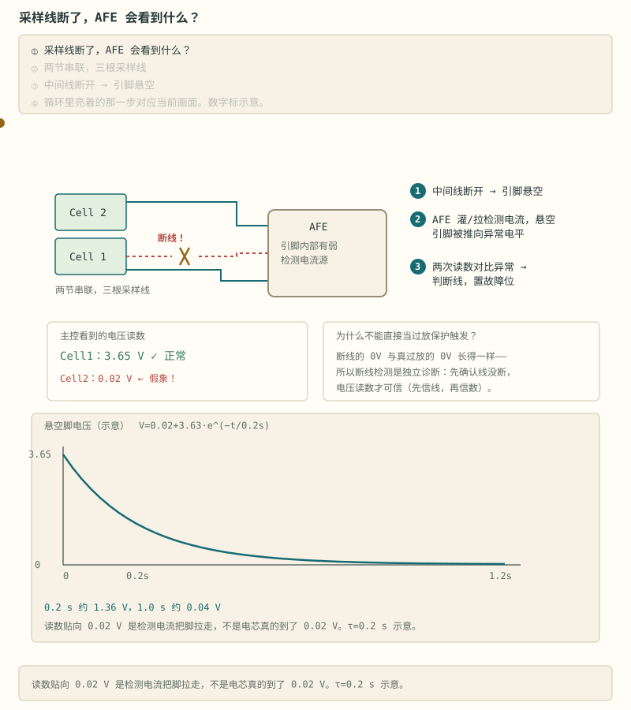

# 阶段 3 主线：PCB 调试与验收

这一篇只处理落地：布局纪律、分级上电、模拟器验证、动手任务和验收。

## 3.6 原理图与 PCB：五条纪律 [应用]

1. **采样走线**：每串采样线等长、紧贴、远离大电流回路；分压点在接插件处就近；
2. **均衡电阻**：按最高单体电压 × 均衡电流选阻值，功率留 2 倍余量；放板边散热，**远离 AFE 基准源**（热会带偏精度）；
3. **功率地 vs 信号地**：检流电阻开尔文接法，两地单点汇合；
4. **隔离区**：通信口与电池侧之间划隔离带，隔离器件下方不走线不铺铜；
5. **ESD/浪涌**：采样输入端、通信口加 TVS。

> **图说**　开尔文取样把测量线直接引到检流电阻本体，两线取样会把铜皮和焊盘压降一起算进去。PCB 上应沿图回查采样点和大电流回路。

这五条是目录。分区、开尔文算式、栅极回流、均衡电阻的热、隔离槽和投板检查表在 [详解⑤](../circuits/05-BMS电路板绘制与设计要点.md)。走线把短路窗口、采样和安时积分做坏的对照，在那一篇 [§8](../circuits/05-BMS电路板绘制与设计要点.md#8-五张对照-理解)。

画完别急着投板——把原理图发到 [EEVblog](https://www.eevblog.com/forum/) 或 EEWORLD 求评，老外和老工程师挑毛病是真不含糊，一遍评审能省你两次打板。

> **看图**　采样线明明没接错，为什么读数里还是混进了尖峰？

> **原理**　采样线远离大电流回路，功率回路短而粗，栅极驱动就近回流。这三条决定噪声、发热和关断是不是干净。
> **证据**　本节可点击来源：[EEVblog](https://www.eevblog.com/forum/)。阈值与宣传口径仍以 datasheet / 标准原文为准。
> **延伸阅读**　[术语表](../glossary.md) · [总纲](../bms-resources.md)

## 3.7 调试：先模拟，后接电池 [应用]

1. 供电：只上电，查 REGOUT、MCU 电源、静态电流；
2. 通信：读 AFE 芯片 ID/状态寄存器——I2C 不通先查上拉和地址；
3. 单串采样：接电芯模拟器，逐串给 3.7V，核对每串误差（目标 <10mV）；
4. 全串与温度：全通道扫一遍 + NTC 对照温度计；
5. 保护：模拟过压/欠压，验证 **AFE 硬件保护与 MCU 软件保护各自独立生效**（分别屏蔽一边测）；
6. 均衡：置一节高压，充电末端看均衡是否按调度工作、板温是否可接受；
7. 真电池接入：先小电流，逐步加大。

> **实物对照**　同一开源项目的调试台架。照片只能说明板卡、电源和仪表怎样摆放，不能证明接线与保护条件正确；上电前仍按七步逐项核对。图片为 Public Domain，[来源与原图](../circuits/assets/photos/PHOTOS.md)。

> **图说**　金点一级一格往上走，第七级落在右边红区；底栏报的是「这一格你读到什么」。末段那条红虚线是跳步的走法：模拟器还没对完表，就拿真电芯去试保护边沿。

- 台阶高度是步序，不是物理量。它只回答「走到第几步」，不回答「多少伏、多少安」。
- 金点每次只停一级，两一级对应上面七步里的相邻两步。
- 右边红区：进去以后每一次越限都是把电芯推向一次边缘，前六步没走完不要到这一格。

第 5 步不是「两路都开着，看到一次切断就算过」。需要分清是哪条路径起作用：

> **看图**　两路一起切断成功，能证明两路各自都能切断吗？

<figure class="book-motion" data-animation="protection-proof-matrix.webp" data-mode="static">

<button type="button" data-book-motion v-book-motion aria-pressed="false" hidden>播放动画</button>
<figcaption>图说　先看联合试验，再分别只保留硬件或软件动作路径。图中都是预期结果，不是实测记录；两组分别成功，只支持已测条件下各自能动作。若共用驱动或 MOS，仍不能称为双重硬件冗余。原理示意 / 非实拍。</figcaption>
</figure>

只在隔离、限流的电芯模拟台架上按芯片与台架规程试验，确认屏蔽、恢复和安全反馈；不得在真电池上停用保护。每组恢复后再切换下一组，并保存故障输入、动作路径与切断反馈。

常见故障速查：采样跳变 → 虚焊/排线接触；某串恒定异常 → 开线或该路 RC 焊错；I2C 全 FF → 上拉缺失或 AFE 未供电。

「某串恒定异常」这一条最容易被放过：断线后的读数会一路贴到 0.02 V，和真过放长得一模一样。

> **图说**　中间采样线一断，引脚就悬空了。AFE 内部的弱检测电流把它推向异常电平，0.2 s 约 1.36 V、1.0 s 约 0.04 V，最后停在 0.02 V——电芯并没有真的放到 0.02 V，可这读数和真过放长得一模一样。所以断线检测得独立做一遍：先确认线没断，电压读数才可信。τ = 0.2 s 为示意值。

> **原理**　调试先确认供电和通信，再用电源或电阻分压看保护动作，最后才接真电池。真电池上的每一次保护，都是把电芯推向一次危险边缘。
> **证据**　调试先用可重复的电芯模拟，不要拿真电池试保护边沿。讨论见 [EEVblog 电芯模拟器讨论](https://www.eevblog.com/forum/projects/lithium-battery-cell-simulatoremulator-for-bms-testing/)。
> **延伸阅读**　[立创开源 BQ76920 工程](https://oshwhub.com/kaijun/mps-energy-station)

**练完你会怎样**：你能说明 AFE 里的比较器不睡觉，MCU 是指挥不是保险丝。自举电容那道就地题在 §3.5。真电池留到模拟器把保护走通之后。

## 3.9 动手任务 [应用]

上板前可先做 [PC 综合实验](../PC综合实验专题.md)：同一组采样经过 SOC、C 状态机和通信解析，生成逐拍日志；它不替代下面的 AFE 调试与实物验收。

1. 以 [LibreSolar bms-c1](https://github.com/LibreSolar/bms-c1) 为蓝本，抄板设计一块 8–16S 智能 BMS（原理图 + PCB），投板焊接；
2. 烧录 [bms-firmware](https://github.com/LibreSolar/bms-firmware)（或自写 bq769x2 驱动），按 3.7 七步流程调试；
3. 写调试记录：每步的现象、数据、结论——这份记录就是你的工程资产，面试时比简历有用。

> **原理**　动手是把机制变成一次可核对的记录：条件、读数、和规格差在哪。没有记录的操作不算做完。
> **证据**　本节可点击来源：[LibreSolar bms-c1](https://github.com/LibreSolar/bms-c1)。阈值与宣传口径仍以 datasheet / 标准原文为准。
> **延伸阅读**　[术语表](../glossary.md) · [总纲](../bms-resources.md)

## 3.10 验收清单 [评价]

- [ ] 全串电压采样误差 <10mV（电芯模拟器下）
- [ ] 硬件保护与软件保护能分别独立触发，阈值与延时符合配置
- [ ] 被动均衡按调度工作，满载均衡时板温可接受
- [ ] 能讲清自己板子上 AFE 每个外围元件的作用，以及保护开关选高边还是低边的理由
- [ ] 固件有完整状态机与故障快照

> **本阶段结论**　AFE 负责多通道测量和硬件保护，MCU 负责状态、诊断、算法与通信；两者的故障路径和恢复条件要分别验证。

全部通过 → 进入 [阶段 4 主线：SOC 估算](stage-4-主线-SOC估算.md)（总纲入口：[阶段 4](../bms-resources.md#阶段-4核心soc--soh--sop-估算算法13-个月)）。

---

[返回：AFE 与采样](./stage-3-主线-AFE与采样.md) · [完整讲义与原有锚点](./stage-3-AFE-MCU智能BMS.md)

[选读：完整自测](./stage-3-选读-完整自测.md)

<!-- Generated by prepare-stage3.mjs; edit stage-3-AFE-MCU智能BMS.md. -->
