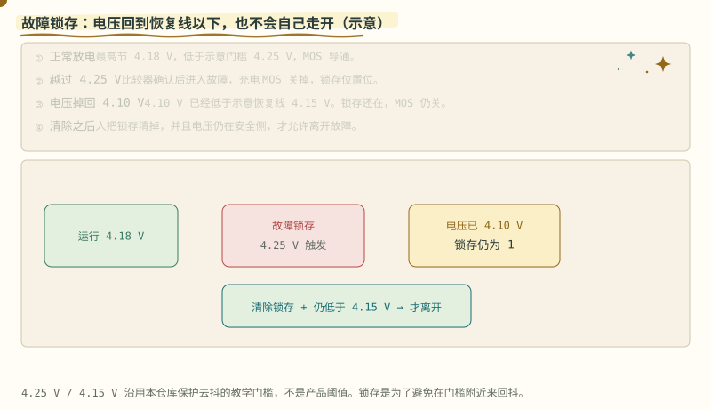
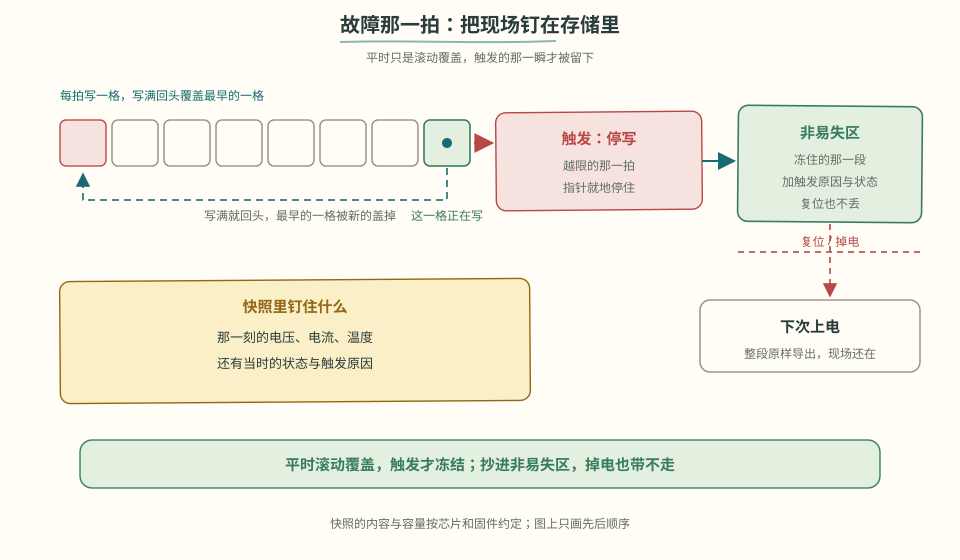
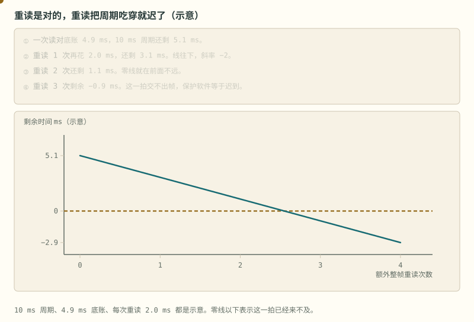
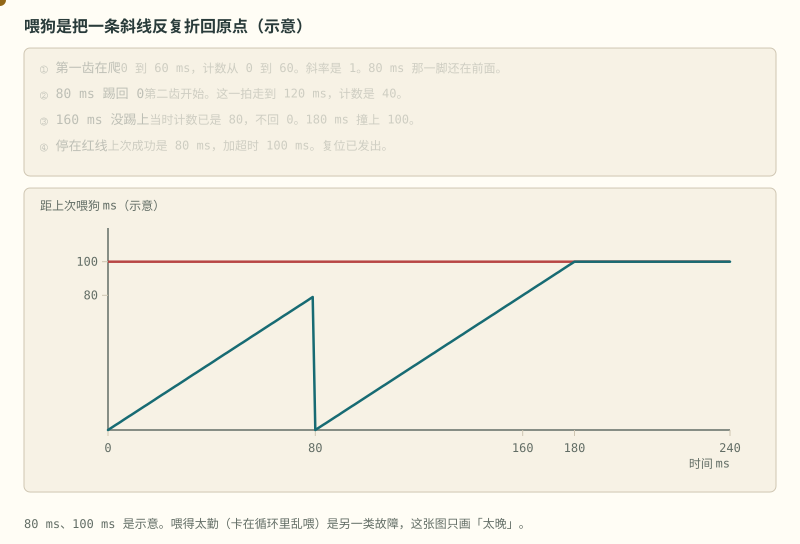
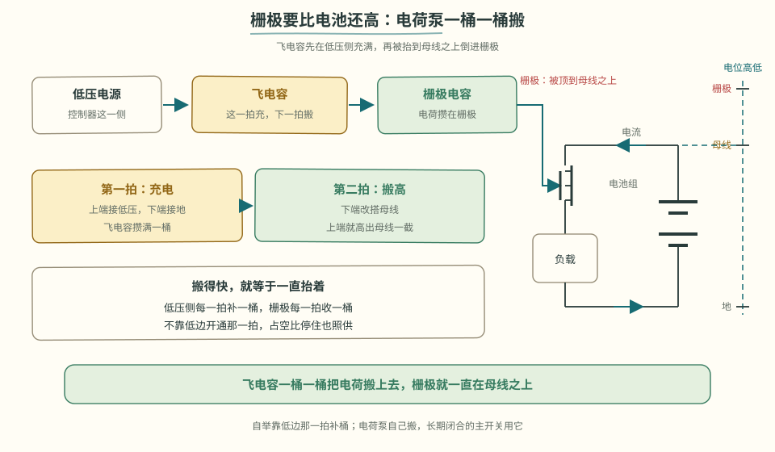

# 阶段 3 主线：固件与功率开关

AFE 提供测量和硬件保护，MCU 负责状态、诊断与控制。重点是故障怎样进入、保持和恢复。

## 3.4 固件分层与状态机 [应用]

> **先读/后读**：四层谁干什么，§3.1 已经是 [理解]。本节把纪律落到状态机，并对着 [code/firmware](../../code/firmware/README.md) 看代码，是 [应用]。

推荐分层（对照 [LibreSolar/bms-firmware](https://github.com/LibreSolar/bms-firmware) 读源码）：

| 层 | 职责 | 要点 |
|---|---|---|
| 驱动层 | AFE 寄存器读写、CRC、开线检测 | 读失败重试并计数，**绝不静默吞错** |
| 服务层 | 周期采样（10–100ms）、保护判定、均衡调度 | 保护判定要**去抖**：连续 N 次超限才动作 |
| 应用层 | 状态机、SOC（阶段 4）、通信协议 | 状态机集中管理，禁止到处散落 if |
| 安全层 | 看门狗、故障锁存、参数校验 | 独立看门狗 + AFE 硬件保护兜底 |

**主状态机**负责组织上电、自检、运行、故障和休眠等系统状态：

> **图说**　盯住一次只停在一个圆里的令牌：底栏红框里电压已经回到恢复线以下，令牌仍留在故障。

> **口诀**　同一时刻只停在一个状态。保护事件可以打断它。

- 令牌一次只停在一个圆里。
- 底栏红框：电压掉回恢复线以下，令牌仍留在故障。
- 「恢复条件」要包括清除锁存。示意门槛仍是 4.25 V 触发、4.15 V 才谈恢复。

> **图说**　最高节 4.18 V 时还在运行。

> **口诀**　进故障很容易。自己走出来不行。要人清锁存，还要原因已经没了。

越过示意门槛 4.25 V，进入故障并锁存，充电 MOS 关掉。后来电压掉到 4.10 V，已经低于示意恢复线 4.15 V，锁存仍为 1，MOS 仍关。只有清除锁存，并且电压仍在安全侧，才离开故障。不然会在门槛附近来回抖。

- 中间红框：锁存位置位的那一拍。
- 右边黄框：电压已经 4.10 V，锁存仍是 1。
- 下面蓝条：清除加上仍低于 4.15 V，两件一起才离开。

**短自测**

1. 电压从 4.28 V 掉到 4.10 V，示意里 MOS 会自己打开吗？
2. 为什么不让它自动恢复？
3. 4.25 V 和 4.15 V 是产品阈值吗？

<b>参考答案（先自己想完再展开）</b>

1. 不会。4.10 V 已经低于 4.15 V，可是锁存还在。
2. 门槛附近来回抖时，自动恢复会让 MOS 反复开关。
3. 不是。它们沿用本仓库保护去抖的教学门槛。产品阈值看手册和电芯规格。

**练完你会怎样**：你能解释：电压已经回到安全侧，故障灯为什么还可以亮着。

工程纪律三条：

1. **所有迁移集中在状态机一处**——出现"某处 if 里偷偷切状态"就是 bug 温床；
2. 每个状态明确"进入动作 / 周期动作 / 退出动作"；
3. **任意状态下，保护触发都可以直接拉进故障态**——安全路径不许绕路。故障态必须记录快照（触发瞬间的电压/电流/温度），现场问题复盘全靠它。

> **看图**　故障发生的那一拍，采样是怎么活过复位的？

> 💻 **参考实现（PC 可跑）**：[code/firmware/](../../code/firmware/) — 上述三条纪律的 C99 状态机骨架（去抖 / 快照 / 锁存 / 均衡 / 休眠）。不含 AFE 驱动与预充，扩展清单见该目录头文件注释。**逐行走读**：[code/README.md §代码走读](../../code/README.md#代码走读带行号-应用)。

> **原理**　固件按采集、保护、状态机、应用分层。保护每拍都先评估完，状态只能按一张迁移表走，故障态也要留下触发瞬间的快照。
> **证据**　本节可点击来源：[LibreSolar/bms-firmware](https://github.com/LibreSolar/bms-firmware)。阈值与宣传口径仍以 datasheet / 标准原文为准。
> **延伸阅读**　[术语表](../glossary.md) · [总纲](../bms-resources.md)

重读是对的。重读把 10 ms 的周期吃穿，这一拍就迟到了。

> **图说**　盯住往下走、穿过 0 的黄点：示意第三次整帧重读已经来不及，这一拍交不出帧。

> **口诀**　重读有预算。第三次整帧重读，这张示意已经穿零。

黄点沿直线往下。金线是 0。点穿过 0 的那一拍，就是交不出帧的地方。

示意：周期 10 ms。底账 4.9 ms，里面是读 2.0、校验 0.4、SOC 1.0、限值 0.5、报文 1.0。一次读对，还剩 5.1 ms。每多一次整帧重读再花 2.0 ms，剩余 $5.1-2n$。重读 2 次还剩 1.1 ms。重读 3 次是 −0.9 ms。零点在 2.55 次，所以第三次整帧重读已经来不及。斜率是 −2 ms/次，直线。

无限重试如果写在这 10 ms 里面，保护软件会饿死。失败要计数，并且给重试封顶。

**短自测**

1. 不重读时剩多少？重读 3 次剩多少？
2. 斜率为什么是 −2？

<b>参考答案（先自己想完再展开）</b>

1. 5.1 ms，以及 −0.9 ms。
2. 每次整帧重读示意花 2.0 ms。10 ms、4.9 ms 都是教学预算，不是某一颗 MCU 的实测。

**练完你会怎样**：你写通信重试时，会先算它最多能占这一拍的几毫秒。

喂狗是把一条斜线反复折回原点。漏了一次，斜线会一直爬到超时。

> **图说**　盯住 80 ms 被折回横轴的一次，和 160 ms 没有折回的那一脚：锯齿变成斜线，180 ms 撞上红线。

> **口诀**　正常是锯齿。漏一脚，锯齿变成撞线。

黄点在 80 ms 被折回横轴一次。160 ms 该折回的时候没有折回，一直爬到红线。红线是 100 ms。

示意：每 80 ms 踢一脚，计数清零。超时在 100 ms，所以每次踢的时候还差 20 ms。斜率是 1：时间走 1 ms，计数加 1 ms。160 ms 那一脚没踢上。这一刻计数已经是 80，不会回到 0。斜线接着爬，180 ms 撞上 100。因为上次成功喂狗在 80 ms，$80+100=180$。撞线之后停在 100，复位已经发出。

这张图只画「喂得太晚」。程序卡在循环里乱喂，是另一类故障，图上没有。

**短自测**

1. 漏喂之后，哪一毫秒撞上超时？
2. 为什么正常喂的时候最高只到 80，不是 100？

<b>参考答案（先自己想完再展开）</b>

1. 180 ms。上次成功喂狗在 80 ms，超时 100 ms，$80+100=180$。漏喂不会把计数清零。
2. 喂的周期是 80 ms，超时是 100 ms，余量 20 ms。数字是示意。

**练完你会怎样**：你看门狗超时和喂狗周期之间，会留出一段余量。漏一次时，复位落在「上次成功喂狗再加超时」，示意就是 $80+100=180$ ms。

## 3.5 高边与低边功率开关 [评价]

保护 MOS（或接触器）可以串在包的**正极回路**（高边）或**负极回路**（低边）。这不是审美问题——决定驱动怎么做、失效模式是什么、成本和 EMC 怎么走。

| | 低边（串在 B−） | 高边（串在 B+） |
|---|---|---|
| **驱动难度** | 源极近地，MCU/驱动器直接推栅极即可 | 源极随负载浮动，栅极必须相对源极偏置 → 电荷泵 / 自举 / 专用高边驱动 IC |
| **成本** | 低；保护板与小功率智能 BMS 主流 | 高；驱动芯片 + 布局约束更多 |
| **失效风险** | 断 B− 后负载端仍可能经漏电/Y 电容带电；对地短路时低边开关未必在回路里 | 断 B+ 后负载侧失电更彻底；对地短路时高边仍在电流路径上 |
| **典型场景** | 电动工具、电动自行车、小储能、入门板 | 电动摩托车高功率包、电动汽车牵引包、高压储能，或系统要求正极断开的场景 |

取舍口诀：**能低边就低边；规范或系统要求"断正极"再上高边**。无论哪边，背靠背两颗（或充放分口）的体二极管纪律不变——只是驱动参考点从"地"变成了"各自的源极"。详见 [电路详解 ① §1.4](../circuits/01-功率回路-MOS保护与预充.md)。

> **图说**　盯住开通之后往下掉的直线：示意每毫秒掉 0.1 V，从 10 V 出发，30 ms 后剩 7 V。不是某一颗驱动器的手册曲线。

> **口诀**　高边栅压要高于母线。自举电容放完就不能一直开着。

盯住底栏开通之后往下掉的那条线：示意 100 nF、漏电 10 µA，$I/C=100$ V/s，也就是每毫秒 0.1 V。栅压余量从卡通里的 10 V 出发，20 ms 后剩 8 V，30 ms 后剩 7 V。黄点沿这条下降的直线走。不是某一颗驱动器的手册曲线。

高边为什么难，一张图就够：源极浮在母线上，要开通就得把栅压顶到比 B+ 还高 10V。自举电容像只小水桶——先充满，再被源极整体抬上去。它便宜，但靠循环充电活着，所以无法 100% 占空比常开：BMS 里长期闭合的主回路开关，得用电荷泵或隔离驱动。

**算一笔**　示例：自举电容 100 nF，栅极需要 50 nC。$\Delta V = Q/C = 50\,\mathrm{nC}/100\,\mathrm{nF} = 0.5$ V。这 0.5 V 是放掉的一截，不是某颗驱动的规格。占空比停在 100% 时，低边没有那一拍把桶重新充满，栅压继续往下掉，MOS 会离开可靠导通。长期闭合的主开关改用电荷泵或隔离驱动。过程看 [高边驱动与自举](../circuits/assets/highside-gate-drive.svg)。

> **看图**　高边开关的栅极凭什么比电池正极还高，而且能一直保持？

> **原理**　保护 MOS（或接触器）可以串在包的**正极回路**（高边）或**负极回路**（低边）。这不是审美问题——决定驱动怎么做、失效模式是什么、成本和 EMC 怎么走。
> **证据**　开关放在正极还是负极，决定驱动和失效模式。对照 [瑞萨原文 PDF](https://www.renesas.com/en/document/whp/battery-management-system-tutorial)（英文，可选）里的切断 FET 讨论，以及 [中文导读](../renesas-bms-tutorial-中文导读.md)。
> **延伸阅读**　[详解①](../circuits/01-功率回路-MOS保护与预充.md)

**短自测**

1. 自举电容为什么撑不住高边 MOS 一直开着？
2. 上面 100 nF、50 nC 这一笔，栅极电压大约掉多少？

<b>参考答案（先自己想完再展开）</b>

1. 桶里的电荷供给栅极之后要有低边开通的那一拍补回来。占空比停在 100%，源极一直浮在母线上，桶没有回路去充电，栅压掉到开不稳。
2. 大约 0.5 V。$Q/C = 50\,\mathrm{nC}/100\,\mathrm{nF}$。数字是示例。真正要高出源极多少伏，看 MOS 的 $V_{GS}$ 和驱动手册。

---

[下一篇：PCB 调试与验收](./stage-3-主线-PCB调试与验收.md) · [完整讲义与原有锚点](./stage-3-AFE-MCU智能BMS.md)

[选读：完整自测](./stage-3-选读-完整自测.md)

<!-- Generated by prepare-stage3.mjs; edit stage-3-AFE-MCU智能BMS.md. -->
