# 阶段 4 主线：SOC 估算

第一篇只回答两个问题：电流账本为什么越记越偏，什么时候可以用开路电压把它拉回来。读完再进入动态模型。

> **阅读边界**　正文保留公式、数值和适用条件；旁支内容放在文末选读。

## 4.1 SOC 估计为什么会错 [理解]

$$\text{SOC}(t) = \frac{\text{剩余可用容量}}{\text{当前满充容量}}$$

汽车油量表好做：油箱形状不变，液面一浮子量到底。电池不行——它有四个"捣蛋鬼"：

1. **电流零漂**：电流传感器零点总会偏一点，积分把这点偏差一分一秒攒起来；
2. **容量未知**：电池老化后，"满充容量"本身在缩水，分母都在动；
3. **OCV 不确定**：电压-电量曲线随温度、老化、充放方向（滞回）变化；
4. **温度**：-10°C 时可用容量能跌两三成，油表说冻就冻不准。

所有 SOC 算法的本质都是同一句话：**安时积分为主干，用电压信息不断校正**。分歧只在"怎么校正"。

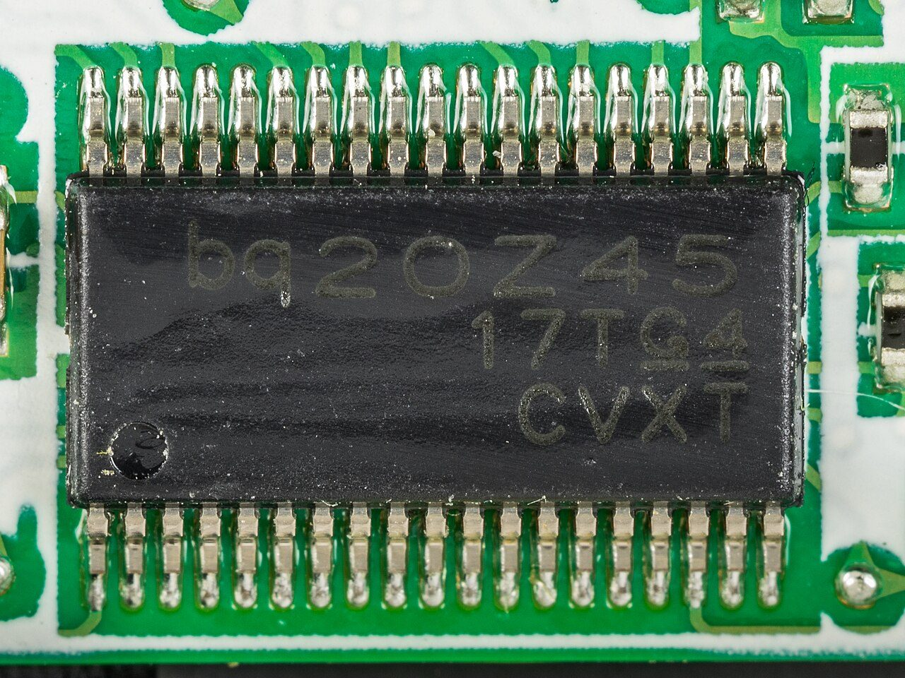

这块笔记本电池控制板上焊着 TI BQ20Z45 气量计。照片只能回答算法运行在哪类硬件上，不能据此判断 SOC 精度或内部模型。照片：Raimond Spekking，CC BY-SA 4.0；来源见[照片清单](../circuits/assets/photos/PHOTOS.md)。

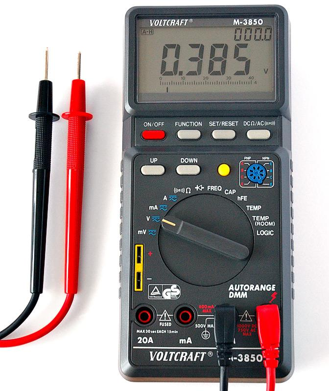

> **实物对照**　板上读数需要独立参考来核对，万用表是常见的对照仪器之一。先看旋钮与插孔：照片没有接入被测电池，也没有量程、精度和校准记录；仪表上显示的数字不能当作本节 SOC 的测量证据。照片：André Karwath aka Aka，CC BY-SA 2.5；[来源与授权](../circuits/assets/photos/PHOTOS.md)。这里只认仪器，不据照片操作带电回路。

**视频**　B 站 · [跟着戴海峰老师学 BMS（SOC / SOH / SOP）](https://www.bilibili.com/video/BV1BB4y1o7xC/)

放在问题定义，是因为这组中文课专门讲状态估计，和后面的库仑计、OCV、卡尔曼是同一条线。播放器打不开时用原页。

**视频**　YouTube · 英文，可选 · [Plett 等效电路模型课的公开欢迎片段](https://www.youtube.com/watch?v=fRgre6Tn3mw)

正课要在 Coursera 注册旁听。这条只用来看讲解风格，公式以仓库里的讲义为准。

> **原理**　$\text{SOC}(t) = \frac{\text{剩余可用容量}}{\text{当前满充容量}}$
> **证据**　SOC 的分母是当前满充容量，不是出厂标称。讲义 [Plett ECE5720](http://mocha-java.uccs.edu/ECE5720/index.html)（英文，可选）与 [Notes03 中文导读](../ece5720-notes03-中文导读.md)。
> **延伸阅读**　[Plett BMS2 课程站](http://mocha-java.uccs.edu/BMS2)（英文，可选）

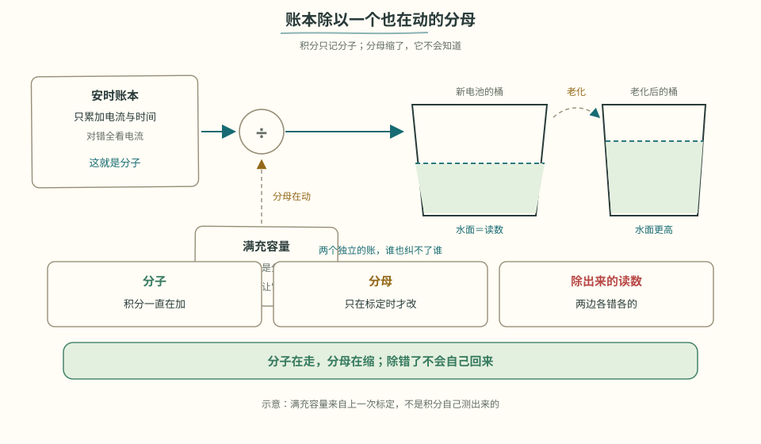

> **看图**　同一笔安时账，为什么换一块更老的电池就读出更高的荷电？

## 4.2 安时积分：电流误差也会被累计 [分析]

约定**充电为正**（I>0 充、I<0 放——写进代码注释，全项目统一）：

$$\text{SOC}(t) = \text{SOC}(0) + \frac{1}{Q}\int_0^t I(\tau)\, d\tau$$

代码就一行：`SOC += I * dt_s / (3600 * Q_Ah)`（dt 用秒、Q 用 Ah 时要除以 3600；dt 若已换成小时就不用。和 [参数速查卡](../参数速查卡.md) 的 ΔSOC = I·Δt/(3600·Q) 是同一式）。

问题出在“积”字上。看同一块电池：真实电量没变，估算账本却越记越多——

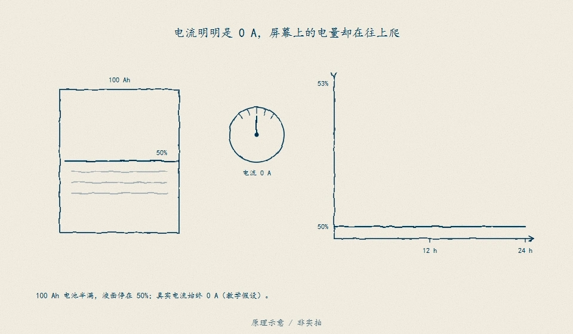

> **看图**　电流明明是 0 A，屏幕上的电量为什么一格一格往上爬？

> **图说**　100 Ah 电池初始为 50%。真实电流 0 A，却读成 +0.1 A；24 h 多记 2.4 Ah，估算升到 52.4%。蓝线不动，红线升高。忽略自放电与静态耗电的教学示意。

> **口诀**　先算多记的电量，再除以容量；多的是账，不是电。

黄点沿红线走过一天：每小时高估 0.10 个百分点，12 h 高估 1.2 个百分点，24 h 高估 2.4 个百分点。这里容量已写明是 100 Ah；下面换成另一组参数算账，不能把两组数字直接拼在一起。

**算一笔账**：1mA 的电流零漂（对 ±1A 量程的传感器来说小得几乎无法避免），一天累积 24mAh，10Ah 电池一天漂 0.24%，**一个月 7%**。纯安时积分的误差不收敛——它不会自己回来，只会越走越远。

零偏是一根慢慢爬的斜线。分流器一发热，还会在大电流那一小时里额外弯一截：

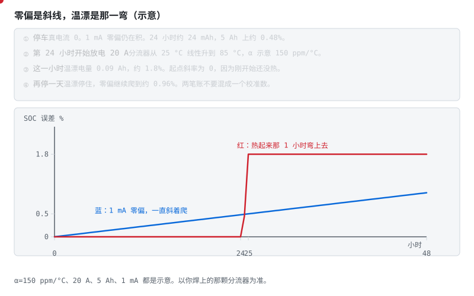

> **图说**　示意 5 Ah 的包。

> **口诀**　零偏一天天斜着爬。温漂在发热的那一小时里弯上去。

**看动画时盯住哪里**

1 mA 零偏一直在积，24 小时约 0.48%，48 小时约 0.96%。第 24 小时用 20 A 放电，分流器从 25 °C 线性升到 85 °C，温漂系数示意 150 ppm/°C。这一小时的温漂电量是 0.09 Ah，约 1.8%。刚开始还没热，所以这一弯的起点斜率是 0。停下来以后温漂不再长，零偏继续爬。

- 蓝线：只有 1 mA，几乎是直线。
- 红线和红点：第 24 到 25 小时拱起来，然后停住。
- 不要把这两笔收成一个「传感器误差」。

**短自测**

1. 停车时温漂为什么几乎不长？
2. 这一小时的 1.8% 是怎么来的？
3. 150 ppm/°C 能当成锰铜分流器的规格吗？

<b>参考答案（先自己想完再展开）</b>

1. 真电流接近 0，电阻变一点点也乘不出多少安。零偏却跟电流大小无关，停车也在积。
2. 平均温升 30 °C，20 A × 150 ppm × 30 °C = 0.09 A，乘 1 小时是 0.09 Ah。0.09/5 = 1.8%。示意口算。
3. 不能。它是为了把弯画出来。你焊上的那颗以它的手册为准，铜走线往往更差。

**练完你会怎样**：你校零点和看温漂会分成两笔账。大电流发热那一小时，不再只用停车时的零点去解释。

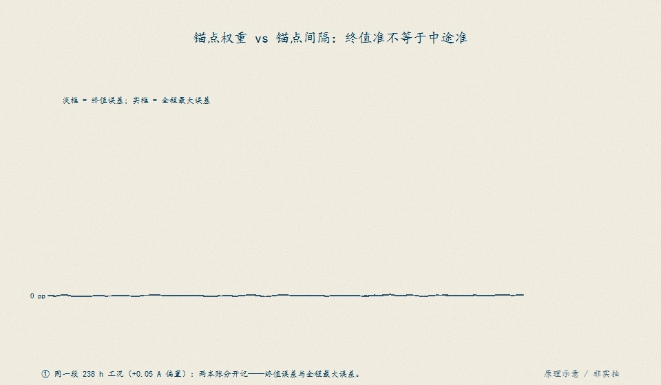

> **图说**　终值误差（淡框）与中途最大误差（实框）是两本账：权重 1.0 只把终值清零，最大误差仍 8.50 pp；把 7 天静置拆成每日一锚，才把最大误差从 9.06 pp 压到 5.07 pp。书稿 §12.4 的对照实验。

所以工程上必须给它有条件的“锚点”：

- **满充校准**：电压、电流和持续时间满足电芯的充电终止判据，并核对温度及充电协议，才可标记该条件下的满充参考；
- **静置 OCV 校准**：先验证静置条件，再结合温度、充放方向和平台斜率，按可信度校正，不是等够时间就准确复位；
- **下电保存**：SOC 带 CRC 存 Flash；上电检查保存状态是否仍有效，OCV 条件合格时再交叉验证。

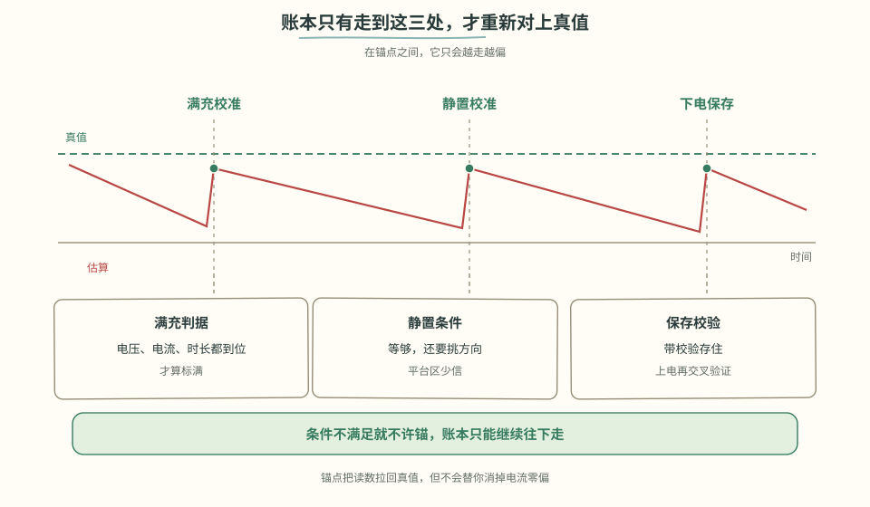

> **看图**　账本一直在漂，哪几个时刻能让它重新对准真值，各自要先满足什么条件？

> **原理**　安时积分把电流对时间累加再除以当前容量。它没有绝对锚，零漂和容量误差会一直累加，所以必须有满充或静置校正。
> **证据**　安时积分没有绝对锚。可复现实验是仓库 `code/soc` 的 `compare.py`（CI 会跑）。模型背景见 [总纲关键论文](../bms-resources.md#关键论文主线背后的学术骨架) 的 Plett 2004。
> **延伸阅读**　[ECE5720 Notes03 中文导读](../ece5720-notes03-中文导读.md)（可选，原文英文）

## 4.3 OCV 校正：先判断电压能不能信 [分析]

开路电压（OCV）和 SOC 有单调对应关系——是天然的尺子，但用起来三个坎：

- **要等静置**：断电后极化电压要几分钟到几小时才消散，行车中根本等不起；

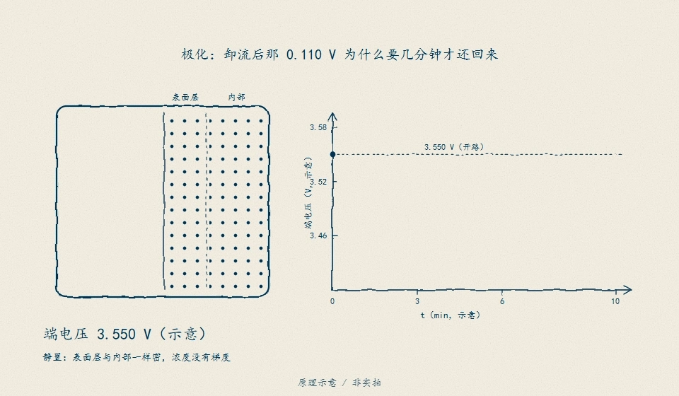

> **看图**　卸流那一刻电压先跳回 40 mV，剩下的 0.110 V 为什么要几分钟才还回来——盯住表面那层点阵，看它是怎么被抽空、又怎么被扩散抹平的。

> **图说**　放电时电极表面的锂离子被快速抽走，形成浓度梯度——表面"空"了，端电压立刻被拉低（这就是极化压降）；静置时扩散把浓度重新抹匀，电压慢慢回弹。

> **口诀**　刚卸流的电压不是开路电压。等表面的离子走匀。

**看动画时盯住哪里**

OCV 法要等的就是这个回弹完成。

- 左边颗粒：表面的点变淡，就是电压被拉低的原因。
- 右边那一颗在走动的离子：静置是扩散，不是表自己变准。
- 底下一行示意电压：3.400 V 带载，卸流瞬间 3.440 V，几分钟后才到 3.550 V 附近。

**短自测**

1. 卸流瞬间从 3.400 V 跳到 3.440 V，可以拿去查 OCV 表吗？
2. 后面从 3.440 V 慢慢走到 3.550 V，走的是哪一项？
3. 这些伏特数是某一次实验记录吗？

<b>参考答案（先自己想完再展开）</b>

1. 先别查。示意里这 40 mV 只是欧姆压降回来了，极化还在。
2. 极化。表面的锂离子要靠扩散走匀，所以要几分钟，急不得。
3. 不是。3.400 / 3.440 / 3.550 V 是教学示意，帮你记住先后，不是某一颗电芯的静置曲线。

**练完你会怎样**：你能把「刚断电的电压」和「等够的开路电压」分成两拍。第一拍只还了欧姆那一截。

- **滞回**：充电的 OCV 曲线和放电的不重合，中间差几十 mV——单张表自带系统误差；


> **图说**　同一个 SOC，充电方向的 OCV 曲线在上、放电方向在下，中间差几十 mV。

> **口诀**　同一个荷电，充电电压更高，放电电压更低。静置抹不平这条缝。

**看动画时盯住哪里**

游标停在哪一格，查表点都落在两线之间——充电时表值系统性偏低、放电时偏高。这不是噪声，滤波救不了；LFP 平台区把几十 mV 放大成几十个百分点的 SOC 误判。

- 两条曲线之间的竖缝：同一根 SOC 竖线，上面一颗电压和下面一颗不是同一个数。
- 底栏的示意：充电支 3.320 V，放电支 3.280 V，缝 40 mV。
- 平台若按本节约 0.75 mV / 1%，40 / 0.75 ≈ 53，大约 53 个百分点。

**短自测**

1. 静置半小时，充电支和放电支会合成一条吗？
2. 40 mV 的缝，在约 0.75 mV / 1% 的平台上，大约是多少 SOC？
3. 滤波能把这条缝消掉吗？

<b>参考答案（先自己想完再展开）</b>

1. 不会。静置抹平的是极化。滞回是充放电两条开路电压本来就不重合。
2. 大约 53 个百分点。40 / 0.75 ≈ 53。这是用本节平台口算做的示意，不是新的测量。
3. 消不掉。它是方向性的系统误差，不是来回跳的噪声。

**练完你会怎样**：你看见同一个荷电有两套开路电压时，不会再只留一张表。

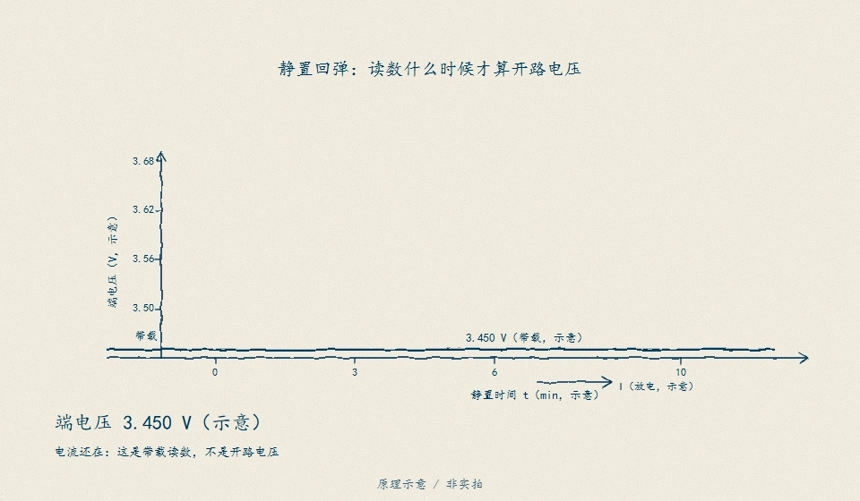

> **看图**　撤掉电流的那一刻电压就跳了一格，为什么还得再等十分钟才敢把这个读数当开路电压？

> **图说**　带载 3.450 V。

> **口诀**　立刻回来的是内阻。慢慢回来的是极化。两条开路电压的缝，等不没。

**看动画时盯住哪里**

电流一停，欧姆那 40 mV 立刻回来，到 3.490 V。图中取时间常数 τ=3 min：3 min 时约 3.572 V，10 min 时约 3.615 V，逐渐趋近放电支的 3.620 V。τ 不是通用静置时长。同一 SOC 的充电支在 3.660 V；静置不会让这两条支线自动重合。

- 卸流时竖着抬起的那一截：欧姆。
- 随后慢慢靠向 3.620 V 的那一截：极化。
- 上面那条 3.660 V 的虚线：充电方向的开路电压，它不跟着这次静置下来。

**短自测**

1. 卸流后 3.490 V 为什么还不能当开路电压？
2. 等了十分钟，为什么充电支和放电支还差 40 mV？
3. 3.450 V 这些数能写进保护比较器吗？

<b>参考答案（先自己想完再展开）</b>

1. 极化还在往回走。示意里它要再靠向 3.620 V。
2. 那是滞回，不是没等够。静置只抹平这一次的极化。
3. 不能。全是示意，用来分清三截电压，不是阈值。

**练完你会怎样**：你能把一次卸流拆成三截：立刻的、慢慢的、怎么等都还在的。

要等多久，也看温度。冷的时候同一套计时会太短：

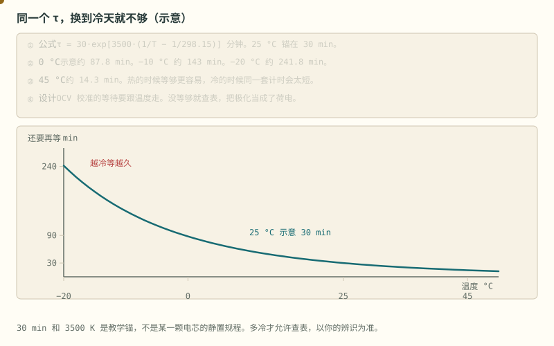

> **图说**　示意 τ = 30·exp[3500·(1/T−1/298.15)] 分钟。

> **口诀**　同一个等待时间，换到冷天就不够。

**看动画时盯住哪里**

25 °C 锚在 30 min。0 °C 约 88 min，−10 °C 约 143 min，−20 °C 约 242 min，45 °C 约 14 min。冷侧陡，热侧变缓。

- 黄点从冷往热走，等待时间很快变短。
- 25 °C 的 30 min 是锚。左边高得多。
- 这是「还要再等」，不是内阻那张图，虽然形状像。

**短自测**

1. 室温等 30 分钟就查表。拿到 0 °C 还够吗？
2. 为什么曲线在冷侧更陡？
3. 242 min 能写成你的静置规程吗？

<b>参考答案（先自己想完再展开）</b>

1. 按这张示意不够。0 °C 大约要 88 分钟。没等够，极化还在，查表会把荷电看偏。
2. 时间和内阻一样，示意里放进了活化能。越冷，扩散越慢，斜率越大。
3. 不能。30 min 和 3500 K 是教学锚。多冷才允许查表，以你的辨识为准。

**练完你会怎样**：你给开路电压校准设等待时，会让它跟着温度变，而不是全温度共用一个秒数。

铁锂平台先看结论：荷电从大约 30% 到 70%，电压只动约 30 mV，摊到每 1% 只有约 0.75 mV，已经和 2–5 mV 的采样噪声缠在一起。这段不信电压。


> **图说**　盯住几乎贴平的那一段：示意 30% 到 70% 只爬 30 mV，几毫伏噪声能盖住好几个百分点。

> **口诀**　平台上电压几乎不动，荷电可以差一大截。

盯住底栏那条几乎贴平的直线。40 个百分点只爬 30 mV，斜率 0.75 mV / 每个百分点。50% 时是 3.295 V。黄点沿这条几乎平的线走。2–5 mV 的噪声能盖住好几个百分点。

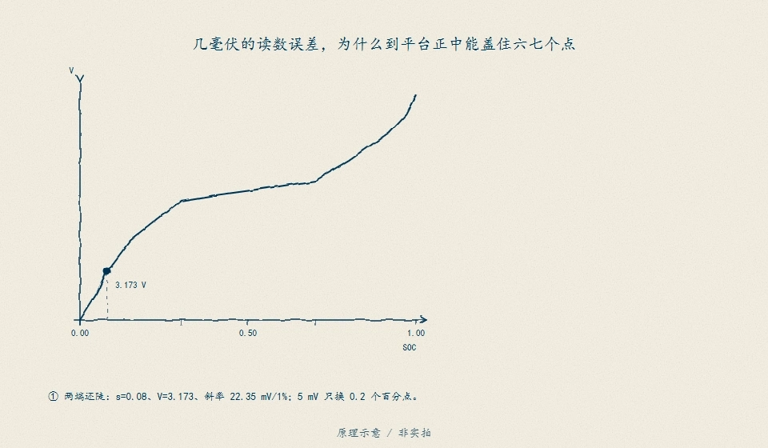

> **看图**　同是几毫伏的读数误差，为什么在曲线两端只值零点几个百分点，到了平台正中却能盖住六七个点？看那支 5 mV 的铅笔在曲线上落下多宽一道影子。

> **图说**　一条几乎水平的线上有两个点，电压差不多，荷电可以差几十个百分点。

> **口诀**　同一小段毫伏，可以是两个很不同的荷电。这段信积分。

**看动画时盯住哪里**

错的读法是「电压一样，SOC 就一样」。对的读法是这段改信安时积分。三元斜率更陡，电压还能用。示意图，不是某一颗电芯的规格。

把铁锂、三元和钠离子的示意开路电压放在同一张轴上，就看得见图为什么：

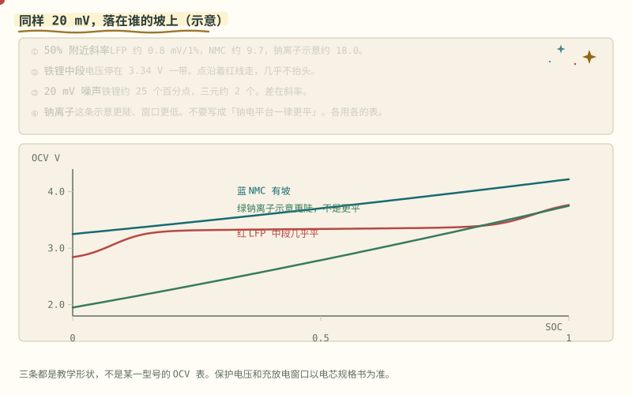

> **图说**　50% 附近的斜率，铁锂示意约 0.8 mV/1%，三元约 9.7 mV/1%，钠离子这条示意约 18 mV/1%。

> **口诀**　铁锂中段几乎是平的。同样的毫伏，在它身上换算成的荷电最大。

**看动画时盯住哪里**

同样 20 mV 的噪声，铁锂上大约是 25 个百分点，三元上大约是 2 个。钠离子这条更陡、窗口更低，不要写成「钠电平台一律更平」。

- 红点和红线：铁锂走到中间几乎不抬头。
- 蓝线有坡，绿线更陡。
- 三条都是教学形状。保护电压仍以规格书为准。

**短自测**

1. 20 mV 噪声，在这张铁锂示意上大约是多少 SOC？
2. 为什么钠离子不能画成比铁锂更平？
3. 3.34 V 能当成铁锂 50% 的规格吗？

<b>参考答案（先自己想完再展开）</b>

1. 大约 25 个百分点。20 / 0.8 ≈ 25。三元大约 2 个。所以铁锂中段改信积分。
2. 不同材料的开路电压不一样。这张示意里钠离子更陡。上一轮已经写过：不要说平台一律更平。
3. 不能。它是这条示意曲线在 50% 的读数，用来比斜率。

**练完你会怎样**：别人把三种电池的电压画在一起时，你先看中段陡不陡，再决定能不能用电压估荷电。

> **原理**　开路电压和 SOC 单调对应，但要静置够久，而且磷酸铁锂平台区几乎是平的，单靠电压分不出中间电量。
> **证据**　开路电压这把尺子要静置，铁锂平台区几乎是平的。曲线对照本节动画；讲义见 [Notes03 中文导读](../ece5720-notes03-中文导读.md)。
> **延伸阅读**　[ECE5720 Notes03 中文导读](../ece5720-notes03-中文导读.md)（可选，原文英文）。金属锂负极和结构电池要各自的 OCV 曲线，见 [阶段 0 §0.1.8](stage-0-前置知识.md#018-固态电池固体电解质换掉了什么-理解)、[§0.1.9](stage-0-前置知识.md#019-碳纤维结构电池电极在承力外壳是另一件事-理解)。钠离子不要写成平台一律更平，见 [§0.1.10](stage-0-前置知识.md#0110-钠离子硬碳和另一套电压窗口-理解)。

表上的点可以是对的。两点之间若用直线连，弯的地方会离开真曲线。

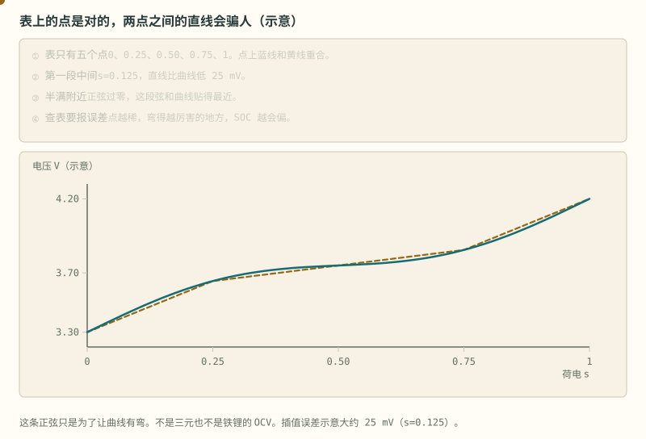

> **图说**　盯住表点中间蓝线和虚线分开的地方：示意中间比曲线低大约 25 mV，表点上才碰上。

> **口诀**　点上重合，点间会分家。弯得越厉害，分得越开。

**看动画时盯住哪里**

黄点贴着蓝线（真曲线）。黄虚线是弦。看它们在表点上碰上，在两表点中间分开。

示意真曲线 $V=3.30+0.90s+0.12\sin(2\pi s)$。这不是三元，也不是铁锂，只是一条有弯的教学曲线。表点在 0、0.25、0.50、0.75、1。$s=0.125$ 时真值大约 3.497 V，弦是 3.473 V，直线比曲线低大约 25 mV。这一带斜率大约每个百分点 14 mV，25 mV 大概是 2 个百分点的 SOC。半满附近正弦过零，弦和曲线贴得最近。

表越稀，膝部越吃亏。把插值误差当成 0，SOC 会在弯的地方静静地偏。

**短自测**

1. $s=0.125$ 时，示意误差大约多少毫伏？
2. 为什么五个点不能保证整段都准？

<b>参考答案（先自己想完再展开）</b>

1. 大约 25 mV。直线偏低。
2. 直线只保证端点。中间的弯曲没有被采样。这条正弦不是实测 OCV。

**练完你会怎样**：你查表插值时，会问表在弯的地方够不够密，而不是只数一共有几个点。

---

[下一篇：模型与校正](./stage-4-主线-模型与校正.md) · [完整讲义与原有锚点](./stage-4-SOC-SOH算法.md)

[选读：参数、老化与充电地图](./stage-4-选读-参数老化与充电地图.md) · [选读：完整自测](./stage-4-选读-完整自测.md)

<!-- Generated by prepare-stage4.mjs; edit stage-4-SOC-SOH算法.md. -->
