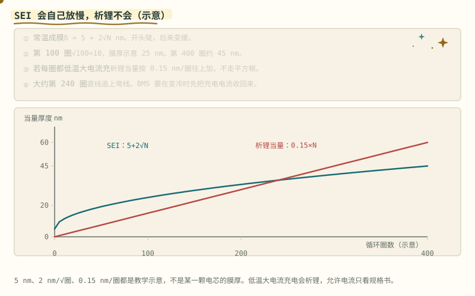
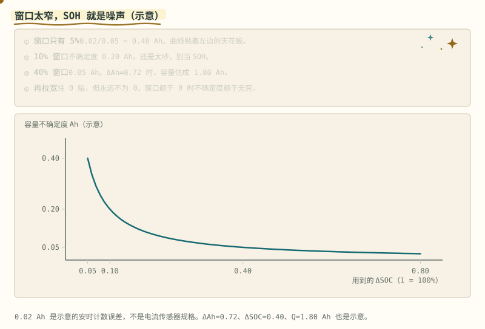
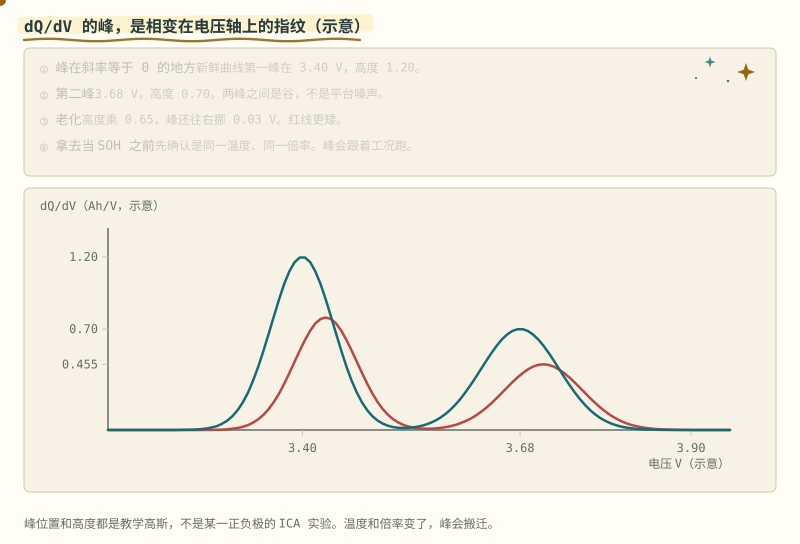
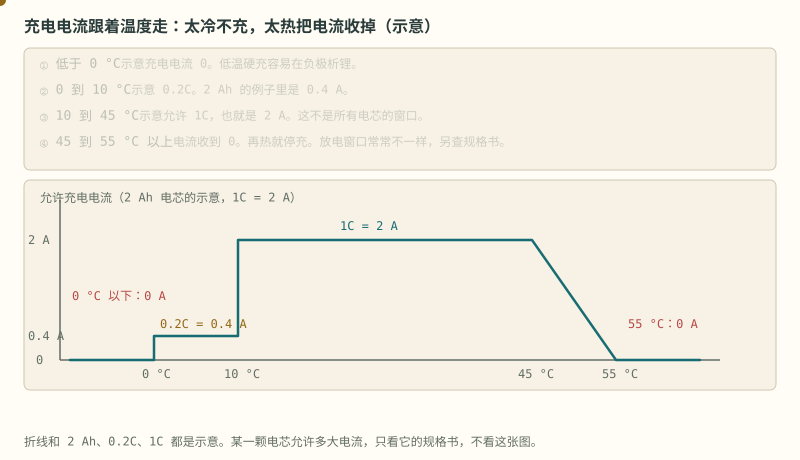
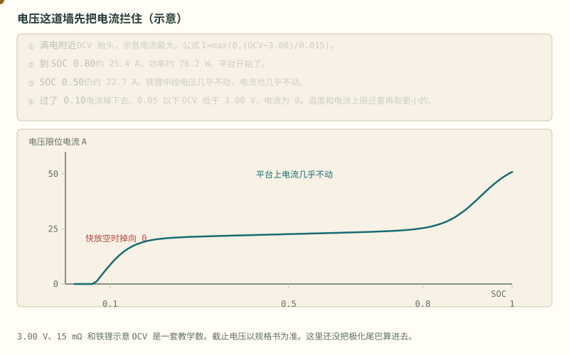
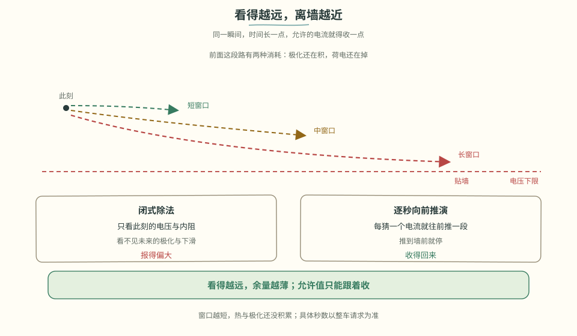
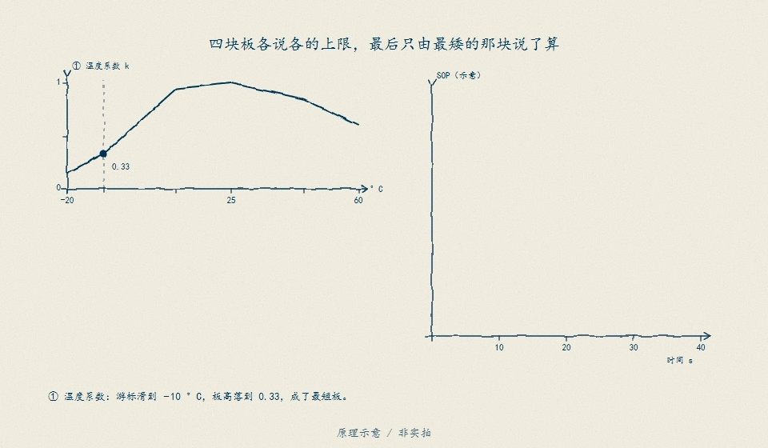
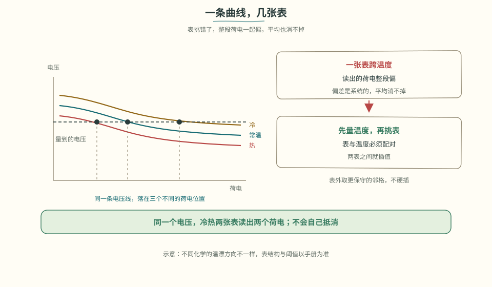

# 阶段 4 主线：SOH 与 SOP

SOC 回答还剩多少，SOH 回答老了多少，SOP 回答此刻还能安全地出多少功率。最后用代码、数据和验收清单把三件事接起来。

> **阅读边界**　正文保留公式、数值和适用条件；旁支内容放在文末选读。

## 4.6 SOH 与联合估计：同时跟踪容量和内阻 [分析]

老化的两个可观测后果：满充容量 $Q$ 下降、内阻 $R_0$ 上升。巧的是，它们都能写进状态向量一起估：

> **图说**　容量曲线从新电池的 100% 缓慢滑向 80%（EOL 惯用线），内阻曲线同期上翘——而且内阻往往先咬到 SOP（功率能力）：车还能跑、但"没劲儿"了。

> **口诀**　容量还在掉。内阻往往先把功率收走。

**看动画时盯住哪里**

这两个可观测后果正好是慢 EKF 的估计目标。

- 蓝线往 80% 那条虚线滑：容量。
- 红线往上翘，光点先碰到「先咬 SOP」：内阻。
- 底栏对照：示意新电池 5.0 Ah、20 mΩ；容量到 80% 时 4.0 Ah、45 mΩ。20 A 的欧姆压降从 0.40 V 变成 0.90 V。

**短自测**

1. 容量还剩 80% 时，为什么车可以先「没劲」？
2. 20 A 时，20 mΩ 和 45 mΩ 的欧姆压降各是多少？
3. 5.0 Ah 和 45 mΩ 能当作寿命数据引用吗？

<b>参考答案（先自己想完再展开）</b>

1. 内阻先涨。同样电流，压降更大，电压墙更早到来，功率先被收走。
2. 0.40 V 和 0.90 V。20×0.020 与 20×0.045。示意口算。
3. 不能。用来记住「容量和内阻一起变，功率往往先感觉到」，不是循环实验表。

**练完你会怎样**：你能用一笔压降说明：容量还没到报废线，脚已经软了。

容量为什么会慢慢掉，有一条常见的膜生长：SEI 按平方根变厚，开头快、后来慢。反复在低温用大电流充电，析锂不走这根弯线：

> **图说**　示意膜厚 δ = 5 + 2√N nm。

> **口诀**　SEI 开头长得快，后来自己变慢。析锂是按圈往上堆。

**看动画时盯住哪里**

第 100 圈是 25 nm，第 400 圈约 45 nm。若每一圈都做一次低温大电流充电，析锂当量按 0.15 nm/圈直线累加，大约第 240 圈追上 SEI。这不是测到的膜厚。它只说明：扩散限制的膜会自己放慢，析锂不会。

- 黄点贴着蓝线。左边陡，右边变平。
- 红线是直线，大约在第 240 圈和蓝线交叉。
- 红线的前提是「每圈都低温大电流充」。规格书不允许，就不要充。

**短自测**

1. 为什么 SEI 后来长得慢？
2. 第 100 圈的示意膜厚是多少？
3. 0.15 nm/圈 能当成析锂实验数据吗？

<b>参考答案（先自己想完再展开）</b>

1. 膜越厚，新的反应物要扩散穿过它，所以厚度按 √圈增长，斜率越来越小。
2. 25 nm。5 + 2×√100。示意，不是某一颗电芯的测量。
3. 不能。它用来和弯线做对照。低温大电流充电会析锂，允许电流只看规格书。

**练完你会怎样**：你能向别人讲清，为什么 BMS 要在变冷时先把充电电流收回来，而不是等 SEI 那种慢变化。

- **双卡尔曼（联合估计）**：一个快 EKF 估 SOC（秒级节奏），一个慢 EKF 估 $Q$ 或 $R_0$（天级节奏）——慢参数当状态、快状态当已知，交替更新；
- **可观测性条件**：参数只有在电流激励下才"看得见"——长期静置或电流纹丝不动时，参数估计的协方差会长大。工程对策：激励不足时**冻结参数更新**，别让慢滤波器在黑暗中乱走；
- 朴素法也有价值：记录每次完整循环的吞吐容量比，长期拟合——简单、稳、可解释。

> **原理**　老化表现为满充容量下降、内阻上升。这两个量要在电流有变化时才估得准，长期静置时估计会发散。
> **证据**　容量下降、内阻上升要在电流有变化时才估得准。公开数据可从 [Battery Archive](https://www.batteryarchive.org/) 取。
> **延伸阅读**　容量和电阻的讲义整理见 [ECE5720 Notes04 中文导读](../ece5720-notes04-中文导读.md)。滤波器仍看 [ECE5720 Notes03 中文导读](../ece5720-notes03-中文导读.md)（可选，原文英文）

用一段局部充电来估整包容量，窗口太窄时，答案主要是噪声。

> **图说**　盯住从左上陡壁往右下走、越走越平的黄点：窗口越窄，容量越吵，右边才够用来报 SOH。

> **口诀**　窗口越窄，SOH 越吵。不确定度跟 ΔSOC 成反比。

**看动画时盯住哪里**

黄点从左上的陡壁往右下走，越走越平。左边是窗太窄，右边是窗够用。

容量估计 $Q=\Delta\mathrm{Ah}/\Delta\mathrm{SOC}$。示意安时误差 0.02 Ah 时，容量不确定度 $\sigma_Q=0.02/\Delta\mathrm{SOC}$。窗口只有 5%，$\sigma_Q=0.40$ Ah。10% 窗口是 0.20 Ah。40% 窗口是 0.05 Ah。$\Delta\mathrm{SOC}$ 趋于 0 时，这条双曲线趋于无穷；窗口拉大，它往 0 贴，但不到 0。

算一笔：充了 0.72 Ah，SOC 从 30% 到 70%，$\Delta\mathrm{SOC}=0.40$，$Q=1.80$ Ah。若名牌 2.00 Ah，SOH 示意 90%。不确定度 0.05 Ah，相对 2.00 Ah 大约 2.5 个百分点。5% 的窗口则能晃 0.40 Ah，那就不能当 SOH 发布。

**短自测**

1. 0.72 Ah 配 $\Delta\mathrm{SOC}=0.40$，容量是多少？
2. 为什么 5% 的窗口几乎不能用？

<b>参考答案（先自己想完再展开）</b>

1. 1.80 Ah。
2. 示意不确定度有 0.40 Ah，和容量本身同一量级。0.02 Ah 不是电流传感器规格。

**练完你会怎样**：你用局部充电报 SOH 之前，会先看这次 SOC 走过了多宽。

增量容量把「这一小段电压里塞进了多少安时」画成峰。峰是相变的指纹，不是噪声尖刺。

> **图说**　盯住蓝线爬上、落下、再爬上的两座峰，以及更矮更靠右的红线：峰顶斜率是 0。

> **口诀**　峰在斜率为 0 的地方。老化让峰变矮，有时还搬家。

**看动画时盯住哪里**

黄点沿蓝线爬上第一峰、落下、再爬第二峰。红线更矮，并且稍微靠右。

示意，不是某种化学的实测。新鲜：
$1.20\exp\left(-\frac{(V-3.40)^2}{2\times 0.04^2}\right)+0.70\exp\left(-\frac{(V-3.68)^2}{2\times 0.05^2}\right)$，单位 Ah/V。
第一峰在 3.40 V，高度 1.20。第二峰在 3.68 V，高度 0.70。老化把高度乘 0.65，并把两座峰各往右挪 0.03 V，所以红峰大约在 3.43 V（高度 0.78）和 3.71 V（高度 0.455）。峰顶斜率是 0，过了峰就下降。

温度或倍率一变，峰会搬迁。拿不同工况的峰比高矮，会把工况当成老化。

**短自测**

1. 新鲜曲线两座峰的电压和高度？
2. 为什么不能直接拿两次 dQ/dV 的峰高相减当 SOH？

<b>参考答案（先自己想完再展开）</b>

1. 3.40 V / 1.20，以及 3.68 V / 0.70。都是示意高斯。
2. 峰高还跟着温度和倍率走。没对齐工况，差出来的不是老化。

**练完你会怎样**：你看见 dQ/dV 的峰，会先问这次的温度和倍率，再谈它变矮了没有。

## 4.7 SOP：计算此刻允许的功率 [分析]

SOP = 未来 T 秒（2s/10s/30s 分级）内允许的最大充/放电功率，取多约束的**最小值**：

- **电压约束**：放电时端电压不许跌破下限。由 $U = U_{oc} + IR_0 + U_{RC} \ge U_{min}$ 解出放电电流幅值上限：$|I_{\text{放}}| \le \dfrac{U_{oc} + U_{RC} - U_{min}}{R_0}$（放电时 $U_{RC}<0$，极化在吃电压——这正是大电流不能持久的数学表达）；
- **电流约束**：电芯与系统的最大允许电流；
- **SOC 约束**：低 SOC 限放电、高 SOC 限充电（回冲）；
- **温度约束**：低温降额（析锂风险）——冬天电动自行车可能表现为掉格与限流，电动摩托车和电动汽车更常表现为功率或扭矩额度下降；物理原因相通，控制与显示不能混讲。

> **图说**　示意一条 2 Ah 电芯的允许充电电流。

> **口诀**　太冷不充。舒服了再给电流。太热把电流收回来。

**看动画时盯住哪里**

0 °C 以下是 0 A，因为低温硬充容易析锂。0 到 10 °C 示意 0.2C，也就是 0.4 A。10 到 45 °C 示意 1C = 2 A。45 °C 之后收到 0，55 °C 停充。放电窗口常常不是这一条，要另查规格书。

- 0 °C 左边贴着横轴：电流是 0。
- 中间平台：示意 2 A。
- 55 °C 再贴回横轴。黄点沿折线走，看它在哪一段。

**短自测**

1. 示意曲线里，−5 °C 允许多大充电电流？为什么？
2. 2 Ah、1C，常温示意允许多少安？
3. 可以把这张折线写进任何电芯的充电规格吗？

<b>参考答案（先自己想完再展开）</b>

1. 0 A。低温充电有析锂风险。具体能不能小电流充，只看那颗电芯的规格书。
2. 2 A。0.2C 则是 0.4 A。都是这张图自己的示意。
3. 不能。它只帮你记住冷、温和热三段。阈值以规格书为准。

**练完你会怎样**：别人说「冬天没劲」，你能指到温度这根轴，而不是先怪电量计。

电压这道墙单独就能把放电电流拦住。端电压不许低于下限时，允许电流是 (OCV − Vmin) / R：

> **图说**　示意 Vmin = 3.00 V，R = 15 mΩ，OCV 用前面那条铁锂形状。

> **口诀**　电压墙先算一截。平台上电流几乎不动，快放空就掉到零。

**看动画时盯住哪里**

SOC 0.80 大约 25.4 A，功率约 76 W。SOC 0.50 仍约 22.7 A，因为平台上电压几乎不动。满电附近 OCV 抬头，电流更大。SOC 0.05 以下 OCV 低于 3.00 V，这条公式给出的电流是 0。温度上限和电流上限还要再取更小的那个。极化尾巴也还没算进去。

- 黄点从右上往左走：满电、平台、然后掉下去。
- 中段几乎是平的，和铁锂开路电压一样。
- 左边贴着横轴：再放就是 0，不是还能挤出一点。

**短自测**

1. SOC 0.80、15 mΩ、下限 3.00 V，示意电流大约多少？
2. 为什么 0.50 和 0.80 差不多，0.05 却是 0？
3. 76 W 能写成这颗电芯的峰值功率吗？

<b>参考答案（先自己想完再展开）</b>

1. 大约 25.4 A。功率按贴着 3.00 V 算，约 76 W。都是这张图的示意。
2. 平台上 OCV 几乎不变，分子就几乎不变。快放空时 OCV 掉到下限以下，电流被公式夹成 0。
3. 不能。3.00 V 和 15 mΩ 是教学数。产品的截止电压和内阻以规格书和实测为准。

**练完你会怎样**：你报峰值电流时，会先用电压墙算一截，再去和温度、电流上限取更小的那个。

闭式除法只看此刻的 OCV 和内阻，看不见未来 ΔT 秒里继续积累的极化，也看不见 SOC 会掉到墙下。把同一颗电芯交给两种方法——闭式 HPPC 与「每猜一个电流就把一阶 RC 模型向前仿真 ΔT 秒」的二分搜索——本仓库合成演示 [code/soc/sop_demo.py](../../code/soc/sop_demo.py) 全流程跑给你看：高 SOC 由电流帽先咬（多约束取最小）；电压约束区里闭式法偏乐观约 3%–36%，且时间窗越长二分越紧（2 s > 10 s > 30 s）；贴墙工作点闭式法照报十几安，二分只给 7.2 A——按闭式值放电就过放。附 7 个回归测试。

> **看图**　同一个瞬间，为什么把目光放到更远几秒，允许的电流就得往下收？

整车/逆变器按 SOP 限功率运行——仪表盘上的"动力受限"提示，源头在这里。

> **图说**　盯住永远卡在最矮那根柱子上的红线：能出多大力，看最短的那条约束。

> **口诀**　能出多大力，看最短的那块板，再按秒数降。

动画里那条红线永远卡在最矮的约束柱上——这就是取 min 的几何含义。注意两个工程细节：时间窗越短允许的功率越高（热还没积累起来）；输出必须平滑，约束切换时 SOP 跳变会让整车扭矩跟着抖。

> **原理**　SOP 是未来几秒到几十秒内允许的最大充放电功率，取电压、电流和温度各条约束里最紧的那一个。
> **证据**　允许多大功率取多条约束里最紧的一条。课程入口：[Coursera《电池包均衡与功率估计》](https://www.coursera.org/learn/battery-pack-balancing-power-estimation)（英文，可选）。
> **延伸阅读**　电压约束的简化起点在 [ECE5720 Notes01 中文导读](../ece5720-notes01-中文导读.md)；HPPC 与二分搜索见 [ECE5720 Notes06 中文导读](../ece5720-notes06-中文导读.md)。滤波器仍看 [ECE5720 Notes03 中文导读](../ece5720-notes03-中文导读.md)（可选，原文英文）

## 4.8 工程落地要点 [评价]

- **OCV 表分温度**：至少 -10/0/25/45°C 四张表，查表插值；
- **满充校准判据**：电压、电流和持续时间均满足电芯充电终止判据，并核对温度与充电协议；不能只看电压或单一电流阈值；
- **精度目标**：恒流工况 <5% 是入门线；车用全工况 <3% 需要温度补偿 + 联合估计；
- **先仿真后上板**：[MiniBMS（Simulink）](https://github.com/ks-santosh/MiniBMS) 提供完整被控对象，在仿真里把算法调对，再上真板——在真电池上调发散的滤波器，调试成本是仿真的十倍。

> **看图**　同一颗电芯，为什么开路电压表要按温度分成几张？

> **原理**　OCV 表至少按几档温度分开查。电流零点要标定，滤波器先在仿真里收敛，再上真电池。
> **证据**　本节可点击来源：[MiniBMS（Simulink）](https://github.com/ks-santosh/MiniBMS)。阈值与宣传口径仍以 datasheet / 标准原文为准。
> **延伸阅读**　[术语表](../glossary.md) · [总纲](../bms-resources.md)

**练完你会怎样**：你能说出安时会漂、平台上少信电压、滤波器是两个不完美的消息一起听。这阶段一台电脑就够。RC 和 EKF 的就地题还在 §4.4、§4.5。算法代码这次不动。

## 4.10 动手任务 [应用]

1. 用 [Battery Archive](https://www.batteryarchive.org/) 一组公开循环数据，在 MATLAB/Python 依次实现：安时积分 → OCV 校正 → Thevenin + EKF。若没有独立 SOC 真值，须写清计算参考的来源与假设，再比较三条曲线；
   - 仓库已提供**同构对比**的合成工况版（初始 SOC 误差 + 零漂 + 容量误差 + 三种估算器）：[code/soc/](../../code/soc/)（`python3 compare.py --plot`）。先跑通再换真实数据集。**逐行走读**：[code/README.md §代码走读](../../code/README.md#代码走读带行号-应用)。
   - 可直接从随库 [NASA RW3 真实数据实验](../SOC真实数据专题.md)开始：低电流与脉冲段标定，后续随机负载验证，包含来源、许可、原始步骤和误差报告。
2. 做一组 HPPC 脉冲实验（或用数据集里的脉冲段），辨识 $R_0, R_1, C_1$。合成演示见 [code/soc/hppc_demo.py](../../code/soc/hppc_demo.py)；真实长脉冲辨识见上面的 NASA 实验，其约 600 秒脉冲不是标准 10 秒 HPPC，下一步再换自己的电芯与工况；
   - 想知道"二阶为什么还不够"，跑 [code/soc/spm_demo.py](../../code/soc/spm_demo.py)：闭式级数与 400 格隐式有限体积互相钉，18 项自验收，把 1 阶 13.6%、2 阶 25.9%、要 28 条支路才到 90% 这些数当场算出来（跟着读：[扩散与常相位专题](../扩散与常相位专题.md)）；
3. 把"安时积分 + 满充校准 + 静置 OCV 校准"移植到阶段 3 的板子上，恒流放电验证误差（无仓库代码，须上板）。

> **原理**　动手是把机制变成一次可核对的记录：条件、读数、和规格差在哪。没有记录的操作不算做完。
> **证据**　本节可点击来源：[Battery Archive](https://www.batteryarchive.org/)。阈值与宣传口径仍以 datasheet / 标准原文为准。
> **延伸阅读**　[术语表](../glossary.md) · [总纲](../bms-resources.md)

## 4.11 验收清单 [评价]

- [ ] 能手推 EKF 五步方程并说明每个矩阵的含义
- [ ] 恒流放电工况自实现 SOC 误差 <5%（与放电容量反推真值对比）
- [ ] 能解释 LFP 平台区的处理策略
- [ ] 能画出 SOP 的多约束决策过程

> **本阶段一句话**：积分为主干、电压做校正——所有 SOC 算法都是这句话的不同实现。

全部通过 → 进入 [阶段 5：串口与 Modbus](stage-5-主线-串口与Modbus.md)（总纲入口：[阶段 5](../bms-resources.md#阶段-5系统通信与集成24-周)）。

---

[返回：SOC 估算](./stage-4-主线-SOC估算.md) · [完整讲义与原有锚点](./stage-4-SOC-SOH算法.md)

[选读：参数、老化与充电地图](./stage-4-选读-参数老化与充电地图.md) · [选读：完整自测](./stage-4-选读-完整自测.md)

<!-- Generated by prepare-stage4.mjs; edit stage-4-SOC-SOH算法.md. -->
