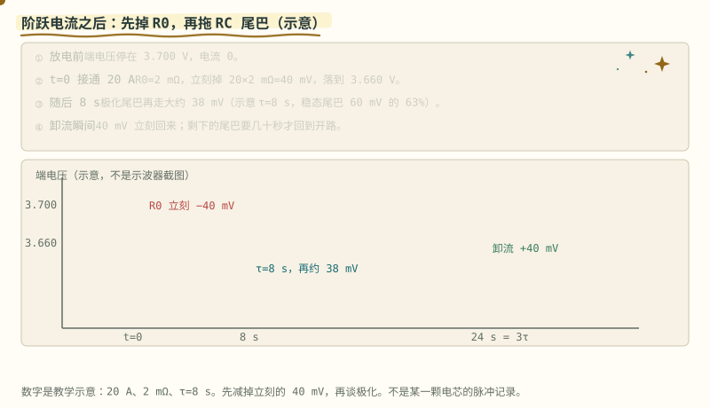
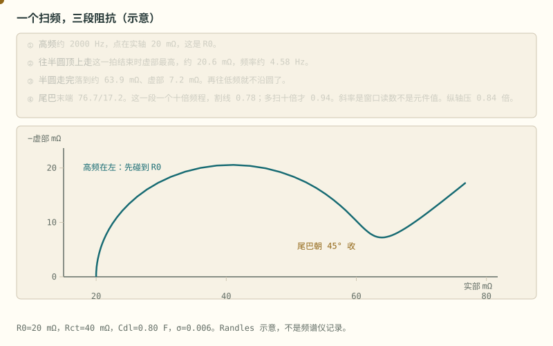
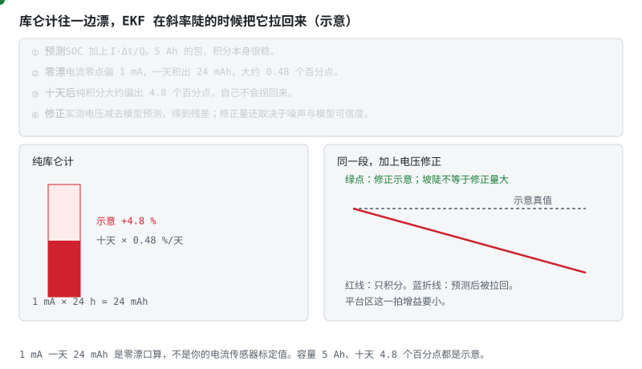
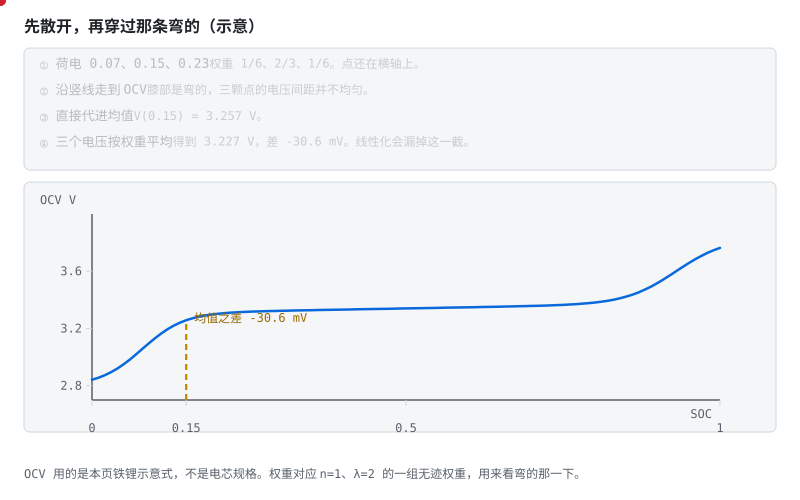

# 阶段 4 主线：模型与校正

电流还在流时，端电压不能直接查 OCV 表。这一篇先分离动态压降，再看 EKF 怎样按可信度修正积分。

> **阅读边界**　正文保留公式、数值和适用条件；旁支内容放在文末选读。

## 4.4 等效电路：从端电压中分离动态压降 [分析]

电流还在流的时候，端电压里混着三样：开路电压、立刻出现的欧姆压降、慢慢回弹的极化。静置是为了等后两样退去。等不起，就用模型把它们分开，动态里的电压才还能拿来对 SOC。

- **Rint 模型**：$U = U_{oc} + IR_0$（沿用全局约定：充电 I>0，端电压被顶高；放电 I<0，端电压被拉低）——太粗，忽略了"电压会慢慢回弹"这件事；
- **Thevenin（一阶 RC）**：$U = U_{oc} + IR_0 + U_{RC}$，其中 $\dot{U}_{RC} = -\dfrac{U_{RC}}{R_1C_1} + \dfrac{I}{C_1}$——工程主力。$R_0$ 是"立刻的压降"（欧姆内阻），$R_1C_1$ 是"慢慢来的压降"（极化）。注意 $U_{RC}$ 跟随电流符号：放电时为负，把端电压进一步往下拉；
- **二阶 RC**：极化分快慢两路，更准但参数更多。

> **图说**　真实电芯的脉冲响应前段有一个快速下陷（电荷转移极化，τ 秒级）再接缓慢长尾（扩散/浓差极化，τ 十秒到分钟级）。

> **口诀**　前段掉得快，后段拖得慢。一阶只有一根时间。

**看动画时盯住哪里**（[一阶与二阶](../circuits/assets/second-order-rc.svg) 底栏）

一阶 RC 只有一条支路，前段怎么调参都拟合不上（失配区）；二阶 RC 用快、慢两条支路各管一段才能贴合——代价是多两个参数要辨识。

- 红色失配区：一阶贴不上的快陷。
- 底栏写明：20 A、2 mΩ、立刻 40 mV，这一截不归时间常数。
- 快路示意 τ₁≈1 s，慢路示意 τ₂≈30 s。两根时间，各管一段。

**算一笔**　示例：放电 20 A，欧姆内阻 2 mΩ，立刻掉 $20 \times 0.002 = 0.040$ V，也就是 40 mV。查 OCV 表之前，先把这 40 mV 从端电压里拿掉。后面继续下沉、又慢慢回来的那一截，才是 RC。一阶只有一根时间，脉冲最前面那一截快掉拟合不上。

> **图说**　电流在 t=0 变成放电 20 A。

> **口诀**　接通先掉一根竖直的。随后才是拖尾巴。卸流时，竖直的那根先回来。

**看动画时盯住哪里**

端电压先竖直掉 40 mV，这是 R0。随后沿示意 τ=8 s 的指数再往下走，8 秒时尾巴大约走完 63%。电流再变为 0 时，40 mV 立刻回来，尾巴还要继续退。

- 竖线：接通瞬间的 40 mV。
- 弯下去的蓝线：RC 尾巴，示意 τ=8 s。
- 时间轴上的黄点：先看竖直，再看弯曲。

**短自测**

1. 20 A、2 mΩ，立刻掉多少？它属于 R0 还是 RC？
2. 为什么卸流时有一截电压马上回来，还有一截不回来？
3. τ=8 s 能当作你的电芯参数吗？

<b>参考答案（先自己想完再展开）</b>

1. 40 mV，属于 R0。20×0.002=0.040 V。它不需要时间常数。
2. R0 跟着电流，电流没了它就没了。RC 上的电压要按自己的 τ 退掉。
3. 不能。它是和上面那笔 40 mV 配套的示意，参数仍要从 HPPC 拟合。

**练完你会怎样**：你能在一条阶跃波形上指出：哪一截是内阻，哪一截才要等。

把频率从高扫到低，这三截会在一张复平面上分开：

> **图说**　示意 Randles 电路，R0 = 20 mΩ，Rct = 40 mΩ，Cdl = 0.80 F，Warburg 系数 σ = 0.006。

> **口诀**　高频先碰到内阻。半圆是电荷转移。45° 的尾巴是扩散。

**看动画时盯住哪里**

高频约 2000 Hz 时，点停在实轴 20 mΩ，那是 R0。半圆顶大约在 4.6 Hz，虚部约 21 mΩ。半圆走完，实部大约 64 mΩ。再往低频，尾巴往右上走，朝 45° 收但**在有限窗口里读不到 1**：同一条曲线、同一套 R0/Rct/Cdl/σ，尾巴只画一个十倍频程时割线斜率量到 0.782，把低频端往下多扫 10 倍变 0.937，扫 1000 倍变 0.994，理想扩散的渐近才是 1。图注原来写死的那个 0.94 已经被改掉——它是窗口的读数，不是元件的值。还有一层，这张图纵轴按 0.8358 倍压过，所以你拿尺子在纸上量出来的角比 38.02° 还小，是 33.16°，别拿它去反推常相位指数。所以「差 6%」既不用来说明元件坏了，也不能拿来当常相位元件的证据。那一截是扩散，不要再当成一个电阻。算给你看的地方在 [扩散与常相位专题](../扩散与常相位专题.md#8-那条-45-尾巴094-是谁的数)。

- 第一拍：点在最左边，贴着实轴。
- 第二拍结束：点在半圆顶上。
- 第四拍：点沿尾巴往右上走，不再绕圆。

**短自测**

1. 为什么高频读数最接近 R0？
2. 尾巴的斜率大约是多少？这个数是谁定的？它代表什么？
3. 这张图的 20 mΩ 能写进电芯规格吗？

<b>参考答案（先自己想完再展开）</b>

1. 电容在高频上接近短路，半圆缩掉，先剩下串联的那颗欧姆电阻。
2. 那张图原来标 0.94，现在标 0.78——**两个都不是元件值，是窗口读数**。尾巴只画一个十倍频程，那段自己的割线是 0.782；往下多扫 10 倍读到 0.937，扫 1000 倍读到 0.994。它是扩散（Warburg）朝 45° 收，不是再串一颗电阻；而「不到 1」主要是窗口不够宽，不能直接当常相位元件的证据——判据是把低频端往下扩，看斜率走向 1 还是走向平台。顺带一句：这张图纵轴被压到 0.8358 倍，拿尺子在纸上量出来是 33.16°，别用那个角反解 $\alpha$。
3. 不能。R0、Rct、Cdl 和 σ 是一套教学数，用来把三段分开。

**练完你会怎样**：你看见一条往右上 45° 的尾巴时，不会把它拟合成又一个 RC；看见斜率不到 1 时，先问扫到了多低的频率，而不是先去加一个常相位元件。

参数从哪来？**HPPC 脉冲测试**：在不同 SOC 点给电池打电流脉冲，从电压响应曲线拟合出 $R_0, R_1, C_1$（脚本见 [AlterWL 工程](https://github.com/AlterWL/Battery_SOC_Estimation)与 Plett 课程；本仓库合成演示：[code/soc/hppc_demo.py](../../code/soc/hppc_demo.py)——把"打脉冲→三步反推→与真值对账"全流程跑给你看）。

> **原理**　端电压等于开路电压减去欧姆压降和极化压降。模型把这两部分分开，动态过程里也能从电压反推 SOC。
> **证据**　「一阶拟合不上前段」这件事可以算，不用信断言：把活性颗粒当球、表面加恒定通量，浓度响应是 $\tan x=x$ 那一列根上的无穷级数，短时渐近 $S\sim2\sqrt{t^*/\pi}$ —— 起点是平方根，原点斜率发散，而任何有限个 RC 并联的原点斜率都是有限值。数出来：只留 1 条支路在 $t^*=5\times10^{-3}$ 处达到精确值的 13.6%，2 条 25.9%，要到 90% 得 28 条。所以二阶 RC 是"多一级台阶"，不是"更接近物理"。整套推导与 400 格隐式有限体积互相钉死，见 [code/soc/spm_demo.py](../../code/soc/spm_demo.py) 和 [扩散与常相位专题](../扩散与常相位专题.md)。可跑的对照实现另见 [AlterWL 工程](https://github.com/AlterWL/Battery_SOC_Estimation)（英文，可选）。参数是辨识出来的，不是动画里的示意数。
> **延伸阅读**　[ECE5720 Notes03 中文导读](../ece5720-notes03-中文导读.md)（可选，原文英文）

**短自测**　动画是 [一阶与二阶 RC](../circuits/assets/second-order-rc.svg)。

1. 电流还在流，端电压能直接查 OCV 表吗？
2. 上面那笔 20 A、2 mΩ，立刻掉的 40 mV 是哪一项？
3. 一阶 RC 贴不上脉冲的哪一段？

<b>参考答案（先自己想完再展开）</b>

1. 不能直接查。端电压里还有欧姆压降和极化，这两项要等静置退去，或先用模型减掉。
2. 欧姆内阻 $R_0$。它跟着电流立刻出现，也立刻消失。极化是后面那根更慢的时间。
3. 最前面那一截快掉（电荷转移，时间常数到秒级）。一阶只有 $R_1C_1$ 一根时间，前段怎么调都留一块失配。慢尾巴要另给一根。

## 4.5 卡尔曼滤波：用电压校正积分 [分析]

积分会漂，电压又有噪声。卡尔曼滤波每一步只做两件事：**先按模型预测，再按测量修正；哪一边更可信，权重就更高。**

> **图说**　盯住金线充回去仍偏低，蓝线贴着灰虚线。这组曲线来自 `compare.py`、种子 42：纯安时整段 RMSE 10.6183%，EKF 0.2004%。仿真，不是电芯考试。**0.20% 是最好情形**：EKF 拿到的 R0/R1/C1 和 OCV 曲线与「真值电芯」完全相同，只有容量、初值和零漂是错的；真电池的参数未知还会变，这个数不能当作真电池上的精度。参数失配的后果见 [§4.4b](stage-4-SOC-SOH算法.md#44b-在线辨识让参数跟着电池走-应用) 和 [SOC 真实数据专题](../SOC真实数据专题.md)。

> **口诀**　积分往前走，电压负责把它拉回来。

**看动画时盯住哪里**

- 金线是纯安时，没有人拉它，充回去仍偏低。
- 灰虚线是真值。蓝线是 EKF，贴着真值。
- 下面红线是全程误差。底栏读这一时刻的真值和误差。脚注「1 mA 一天 24 mAh」是另一笔示意账，不是这条曲线。图上写明：种子 42，17000 步，每步 1 秒。

> **图说**　预测步只做 SOC += I·Δt/(3600·Q)（Δt 用秒、Q 用 Ah）。

> **口诀**　积分负责走。电压负责在坡陡的时候拽一把。平地上别用力拽。

**看动画时盯住哪里**

零点若偏 1 mA，一天积 24 mAh。示意容量 5 Ah 时，十天大约偏 4.8 个百分点，纯积分不会自己拐回来。电压残差在斜率陡的时候把估计拉回；平台上这一拍要少听电压。

- 左边红柱往上长：十天的零漂，没有修正。
- 右边蓝折线被绿点拽回：修正发生在残差出现的那一拍。
- 底行 24 mAh：1 mA 乘 24 小时，先把单位算完再谈滤波器。

**短自测**

1. 1 mA 零漂，5 Ah 的示意包，一天大约偏多少 SOC？
2. 为什么平台上不能把电压修正的增益拧大？
3. 24 mAh 是电流计的出厂误差吗？

<b>参考答案（先自己想完再展开）</b>

1. 大约 0.48 个百分点。24 mAh / 5000 mAh。十天大约 4.8 个百分点，仍是示意。
2. 平台上几十毫伏对应几十个百分点。噪声会灌进 SOC。坡陡才多听电压。
3. 不是。它是「1 mA 积一天」的口算，用来看漂移的方向。你的零点要自己标定。

**练完你会怎样**：你能讲清：库仑计为什么越走越偏，以及 EKF 在哪一拍才有资格拉它。

开路电压是弯的。无迹卡尔曼不在工作点上拉一条切线，而是先放几个点穿过去：

> **图说**　示意三个点在荷电 0.07、0.15、0.23，权重 1/6、2/3、1/6。

> **口诀**　先把点散开，再穿过那条弯的。平均值的电压，不是电压的平均。

**看动画时盯住哪里**

直接把均值代进去，V(0.15) = 3.257 V。三个电压按权重平均是 3.227 V，低了 30.6 mV。差在膝部：左边那个点已经掉下平台，线性化会把这一截漏掉。

- 第一拍三个点还在横轴上。
- 第二拍它们沿竖线走到曲线上，间距并不均匀。
- 图上那 30.6 mV，就是「先平均再代」和「先代再平均」的差。

**短自测**

1. 为什么三个点的电压不能简单用中间那个代替？
2. 30.6 mV 出在曲线的哪一段？
3. 这组权重是某一篇论文的推荐调参吗？

<b>参考答案（先自己想完再展开）</b>

1. 曲线是弯的。左边的点掉下了膝部，拉低了加权平均。V(0.15) 看不到这件事。
2. 荷电 0.15 附近的膝。平台中段如果几乎是直的，这个差会小很多。
3. 不是。1/6、2/3、1/6 对应 n=1、λ=2 的一组无迹权重，只为了把弯的那一下演出来。

**练完你会怎样**：你能说明，为什么在铁锂膝部，只做一次线性化会把电压均值估偏。

下面把“预测—测量—修正”写成状态空间。状态 $x = [\text{SOC}, U_{RC}]^T$，输入 $I$，观测 $U$。

**预测步**：

$$\hat{x}^- = f(\hat{x}, I), \quad P^- = A P A^T + Q$$

**更新步**：

$$K = P^- C^T (C P^- C^T + R)^{-1}, \quad \hat{x} = \hat{x}^- + K\,(U_{\text{实测}} - g(\hat{x}^-)), \quad P = (I - KC)P^-$$

EKF 与线性 KF 的区别只在 $f$/$g$ 非线性（OCV 表是曲线），用雅可比矩阵 A、C 在当前工作点线性化。

**调参直觉**（比公式更难背的是这个）：

- Q 大 = 不信任模型 → 跟着测量跑，响应快但抖；
- R 大 = 不信任测量 → 平滑但滞后；
- **发散诊断**：残差 $U_{\text{实测}} - g(\hat{x}^-)$ 持续偏大 → 模型错了（参数漂移/温度没补偿），不是滤波器错了——别拧滤波器，去修模型。

> **图说**　盯住两条往下收的曲线：蓝线 R=0.001，红线 R=0.020。式子是 K=P/(P+R)。红线停得更低。

> **口诀**　平台上少信电压。斜率陡的时候才多信电压。

增益按 $K=P/(P+R)$ 把信任分出去。图上 P 从 0.04 起步，每步先加 Q=0.0004，再按 $(1-K)P$ 收缩。R=0.001 的蓝线第一步 K=0.9758，后来收到 0.4633。R=0.020 的红线收到 0.1318。绿线把 Q 提到 0.0016，平台比蓝线高：过程更吵，就多听这一次测量。右上角小图是平台：荷电 0.50 处大约 0.75 mV/1%，所以更该靠近红线。这是一维示意，不是 `code/soc` 里 EKF 的调参。测量更吵，K 自己变小；平台上电压几乎不动，同样要少信电压，否则噪声灌进 SOC。

上手路径：先在 MATLAB 跑通 [AlterWL 的 EKF 工程](https://github.com/AlterWL/Battery_SOC_Estimation)，再用 [Battery Archive](https://www.batteryarchive.org/) 的公开数据换数据集验证。

> **原理**　预测步只用模型，修正步才引入端电压；卡尔曼增益决定这一拍修正多少。
> **证据**　增益大就多信电压，增益小就多信积分。铁锂平台区电压几乎不动，这时不该把增益开大。实现对照 [AlterWL 的 EKF 工程](https://github.com/AlterWL/Battery_SOC_Estimation)（英文，可选）和仓库里的 `code/soc/`。
> **延伸阅读**　[ECE5720 Notes03 中文导读](../ece5720-notes03-中文导读.md)（可选，原文英文）

**短自测**　先看 [EKF 融合](../circuits/assets/ekf-estimation.svg)，再看 [增益怎么分](../circuits/assets/kalman-gain.svg)。

1. 铁锂平台上电压几乎不动。这一步多听积分，还是多听电压？
2. 残差 $U_{\text{实测}} - g(\hat{x}^-)$ 一直很大。先把增益拧大，还是先查模型？
3. 纯积分那条线为什么一路漂走？

<b>参考答案（先自己想完再展开）</b>

1. 多听积分。平台上大约 30% 到 70% 只动约 30 mV，每 1% 约 0.75 mV，和 2–5 mV 的采样噪声缠在一起。增益要小，否则噪声灌进 SOC。斜率陡的时候才多听电压。
2. 先查模型。残差持续偏大，是参数漂了，或温度没补上。把增益拧大，只是把错的电压灌进状态。
3. 电流零漂和容量误差没有第二头锚。积分只按电流往前加，电压这一头不来拉，它就慢慢走偏。

---

[下一篇：SOH 与 SOP](./stage-4-主线-SOH与SOP.md) · [完整讲义与原有锚点](./stage-4-SOC-SOH算法.md)

[选读：参数、老化与充电地图](./stage-4-选读-参数老化与充电地图.md) · [选读：完整自测](./stage-4-选读-完整自测.md)

<!-- Generated by prepare-stage4.mjs; edit stage-4-SOC-SOH算法.md. -->
