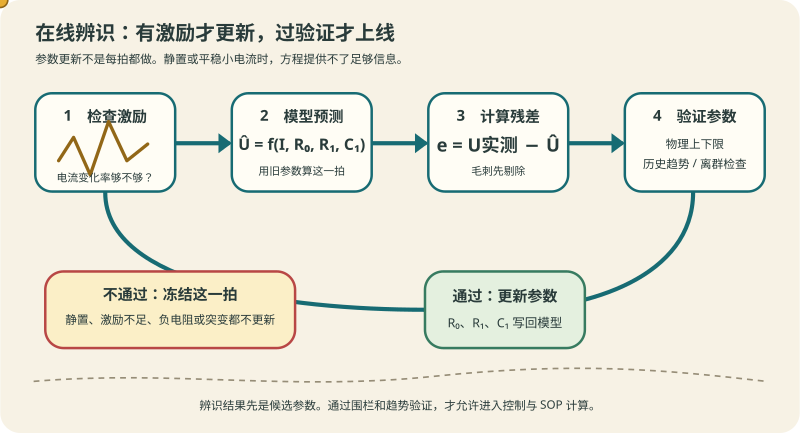
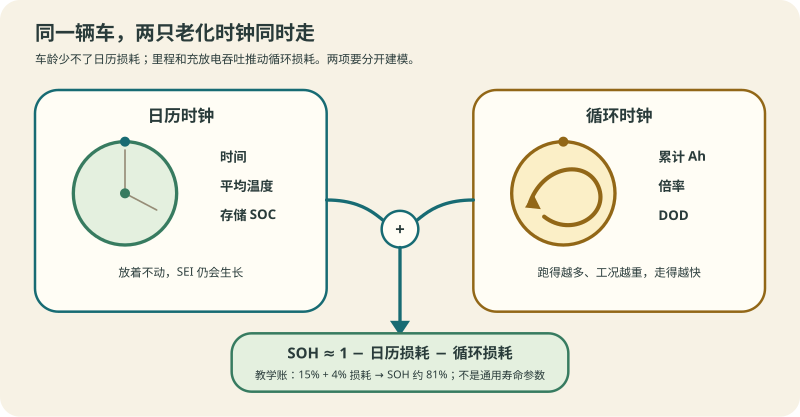
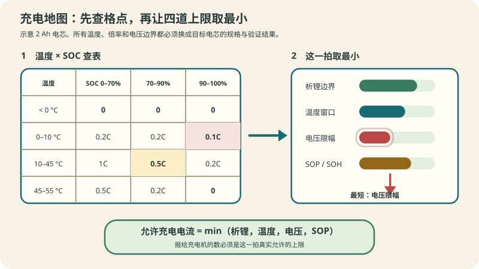

# 阶段 4 选读：参数、老化与充电地图

需要在线更新参数、解释车龄与里程的差异，或给充电机生成允许电流时再读。三个主题都依赖前面主线，不承担第一次入门。

> **阅读边界**　正文保留公式、数值和适用条件；旁支内容放在文末选读。

## 4.4b 在线辨识：让参数跟着电池走 [应用]

§4.4 的 R0、R1、C1 从哪来？`code/soc/hppc_demo.py` 演示的 HPPC 离线标定给的是**出厂那一刻**的参数。可是内阻会涨、极化会变——装车三年后还拿出厂参数算 [SOP](stage-4-SOC-SOH算法.md#47-sop电池此刻能出多大力-分析)，就是拿旧地图走路。在线辨识让模型参数**在运行中自己更新**。

> **口诀**　离线标定给起点，在线辨识跟变化；激励不够别硬估。

**递推最小二乘（RLS）的一句话版本**：每来一拍新数据，先用旧参数预测，再把「预测误差 × 可信度」加回参数。这就是 §4.5 卡尔曼滤波的思想用在参数上——事实上把参数增广进状态向量，EKF 就顺便把参数也估了，[§4.6 联合估计](stage-4-SOC-SOH算法.md#46-soh-与联合估计让算法把电池看透-分析)走的正是这条路。

**什么时候估得动：激励要够**。这是在线辨识最容易被忽略的前提：

| 工况 | 能辨识什么 | 为什么 |
|---|---|---|
| 静置 | 什么都估不动 | 输入恒为 0，方程退化 |
| 平稳小电流巡航 | 只能碰 R0 | 电流变化太小，R1、C1 不可观测 |
| 加减速、脉冲 | R0、R1、C1 都可以 | 电流有变化，指数项被「摇醒」 |
| 恒流 CC 充电全程 | 缓慢地碰 R0 | 只有阶跃开始那一瞬有信息 |

> **图说**　沿箭头走一圈：电流变化不足时直接冻结；有激励才计算残差，候选参数还要经过物理上下限和历史趋势检查。

工程结论：**辨识要挑时机**——把「电流变化率超过阈值」的时段攒起来更新，静置段不更新也不丢信息。这正是它和 [§4.7b 充电地图](stage-4-SOC-SOH算法.md#47b-充电地图把析锂温度sop-合成一条允许电流-应用)的接点：地图随 SOH 改格子里的数，改的依据就是在线辨识出来的 R。

两条纪律：

- **参数要有围栏**。RLS 遇上坏数据（电压毛刺、电流钳位）会把 R0 推到负值——给每个参数设物理上下限，撞墙就冻结，等激励恢复再解冻。
- **新参数要过验证才上线**。R 突变 20% 更可能是传感器问题（[详解② 的卡值与漂移](../circuits/02-采样链与AFE芯片.md#4b-卡值与漂移开线之外的传感器故障-分析)）而不是电池真的老了。辨识结果先和历史趋势比，离群就丢弃。

**延伸阅读**　离线辨识「一维搜索 + 线性回归」的手写复现路线见 [ECE5710 Notes02 中文导读 §七](../ece5710-notes02-中文导读.md#七动态关系测试与参数辨识28)（原文英文可选）；概念框架对照熊瑞书 3.2 的译注也在同一篇里。

**练完你会怎样**：给你一段电流曲线，你能指出哪些时段够格做参数更新、哪些时段该闭嘴，并给每个参数划出物理围栏。

> **原理**　参数辨识与状态估计共享同一套数学（最小二乘/贝叶斯更新），差别只在时间尺度：SOC 每拍都在变，R 按月变。把慢状态和快状态分开处理，就不需要为两件事造两套算法。

## 4.6b 老化的两个来源：日历老化与循环老化 [分析]

[§4.6](stage-4-SOC-SOH算法.md#46-soh-与联合估计让算法把电池看透-分析) 的 SOH 是一条合成曲线。工程上要拆成两支分别建模，因为它们的**驱动量不同**：

- **日历老化（calendar aging）**：电池**放着不动**也在老化。驱动量是时间、温度、存储 SOC——机理主体是 [§0.1.1](stage-0-前置知识.md#011-一块电池里在发生什么-理解) 讲过的负极 SEI 生长：副反应慢慢镀膜，厚度近似按 √t 走（[§4.6 的 SEI 平方根线](stage-4-SOC-SOH算法.md#46-soh-与联合估计让算法把电池看透-分析)）。高温、满电存储都加速它——这就是「长期停放别充到 100%」的出处。
- **循环老化（cycle aging）**：驱动量是**吞吐量**（累计充放 Ah）、DOD、倍率。§4.6 的 [soh-aging 图](stage-4-SOC-SOH算法.md#46-soh-与联合估计让算法把电池看透-分析)里 `Q% = 100 − 20·(n/3000)^1.5` 就是纯循环支的教学形状。

合成的近似：SOH ≈ 1 −（日历损耗 + 循环损耗）。关键在三个场景里谁主导：

| 场景 | 谁在主导 | 对策 |
|---|---|---|
| 网约车两年 20 万公里 | 循环 | SOH 跟吞吐量走，容量重标定按里程安排 |
| 私家车五年 5 万公里 | 日历 | 存放 SOC 与热环境比里程更伤电池 |
| 储能站满电浮充 | 日历（高温 + 满 SOC 是最差组合） | 闲置时把 SOC 拉进存储区间，[热管理配合](stage-6-精通与毕业项目.md#616-bms-与热管理tms的边界-评价) |

> **图说**　左边按时间、温度和存储 SOC 走，右边按累计 Ah、倍率和 DOD 走。下方 81% 只复现本节教学账，不是寿命预测参数。

**对估计的实际影响**：只按循环数建 SOH 模型，私家车的 SOH 会被**高估**——里程少，日历损耗照样在跑。日历支需要温度和 SOC 的历史统计，这正是 BMS 要记「平均温度、SOC 分布直方图」这类运行统计的原因：不是给云端凑数，是日历老化模型的输入。

**示例账**（教学数）：私家车 5 年、6 万公里。循环支按 3000 循环到 80% 折算约 4%；日历支按年均 3%（25 °C 均值、平均 SOC 60% 的示意值）约 15%。**合下来 SOH ≈ 81%**——只看循环支会以为还有 96%。「才开 6 万公里怎么就掉到 80%」在日历老化面前不是异常。

**练完你会怎样**：给你一台车的里程、车龄、地域和用车画像，你能指出它的 SOH 损耗主要来自哪一支，并给出存储 SOC 与热管理的对策。

> **原理**　两支老化的机理都指向负极副反应，但驱动量分别是**时间 × 温度 × SOC** 与**吞吐量 × 倍率 × DOD**。分解建模的意义在观测窗口不同：日历按月、循环按次——合在一起估，两个时间尺度会互相污染。

## 4.7b 充电地图：把析锂、温度、SOP 合成一条允许电流 [应用]

§4.2 到 §4.7 各给了一个零件：温度降额、析锂边界、电压限幅、SOP。产品里它们合成**一张表**——充电地图（charging map）。BMS 每个控制周期查它，把「此刻最多能充多少」报给充电机或车载充电机；[GB/T 27930 的 BCL 报文](stage-5-主线-CAN与外部接口.md#541-gbt-27930充电机与-bms-怎么握手-分析)（需求电流、需求电压），源头就是这张表。

> **口诀**　太冷怕析锂，太热怕老化，太满怕过充，大电流问 SOP。四个数取最小，才是这一拍能给多少。

**允许充电电流 = 四个约束取最小**：

| 约束 | 回答的问题 | 大概形状 |
|---|---|---|
| 析锂边界 | 负极还收得下锂吗？ | 低温 + 高 SOC 时收紧到 0。析锂当量按圈累积，见 [§4.6](stage-4-SOC-SOH算法.md#46-soh-与联合估计让算法把电池看透-分析) 的 SEI 与析锂图 |
| 温度窗口 | 这个温度允许多大？ | 折线：冰点以下 0，常温放开，高温收回（§4.7 的降额图） |
| 电压限幅 | 单体要顶到上限了吗？ | 接近满充时按 I=(OCV−V_max)/R 掉向零（§4.7 的电压限位图） |
| SOP 与老化 | 此刻出得去这么多力吗？ | 内阻抬高后，同一个电压限幅算出的电流自动变小 |

示意一张 2 Ah 电芯的充电地图（数字全是教学值，实际以规格书为准）：

| | SOC 0–70% | SOC 70–90% | SOC 90–100% |
|---|---|---|---|
| T < 0 °C | 0 | 0 | 0 |
| 0–10 °C | 0.2C | 0.2C | 0.1C |
| 10–45 °C | 1C | 0.5C | 0.2C |
| 45–55 °C | 0.5C | 0.2C | 0 |

> **图说**　左边复现本节示意表，右边把析锂、温度、电压和 SOP 四道上限画成长度。最短的一道决定这一拍报给充电机的允许电流。

读法：每一拍取「行 × 列」交点，再和 SOP、电压限幅取最小。**SOH 进来改的是格子里的数，不是表的结构**——老化让内阻变大、析锂边界左移，同一格的允许电流随 SOH 下调；这正是 [§4.6 联合估计](stage-4-SOC-SOH算法.md#46-soh-与联合估计让算法把电池看透-分析)存在的理由。

三件工程上容易漏的事：

- **地图是查询表，不是控制律**。表外的点（温度骤降、SOC 跳变）要写清取哪一格：取更保守的邻格，不做插值。
- **地图和充电机要能对上**。GB/T 27930 每 250 ms 报一次需求；地图更新比它慢没关系，报出去的数必须是这一拍真的允许的。
- **快充档是承诺，不是自由参数**。GB 38031-2025 把「快充循环后安全测试」写进了法规（见阶段 6 [§6.5b](stage-6-精通与毕业项目.md#65b-法规门槛gb-38031-2025-的热扩散-分析)），地图的 1C 档和耐久验证绑在一起。

**练完你会怎样**：给你一颗电芯的规格书，你能把温度、SOC、老化三个维度收成一张允许电流表，并说出每个格子是被四个约束里哪一个卡住的。

> **原理**　析锂边界和电压限幅是电化学与电学的「物理墙」，温度窗口和 SOP 是把它们翻译成可查表的工程包装。充电地图没有统一的行业格式，各家整车厂的标定规范自定义；表随 SOH 在线修正，是量产 BMS 与教学 demo 最常见的差距。

---

[返回：SOH 与 SOP](./stage-4-主线-SOH与SOP.md) · [完整讲义与原有锚点](./stage-4-SOC-SOH算法.md)

[选读：参数、老化与充电地图](./stage-4-选读-参数老化与充电地图.md) · [选读：完整自测](./stage-4-选读-完整自测.md)

<!-- Generated by prepare-stage4.mjs; edit stage-4-SOC-SOH算法.md. -->
