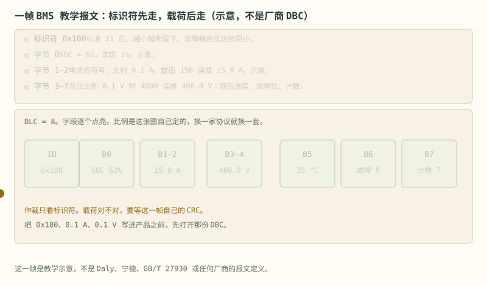
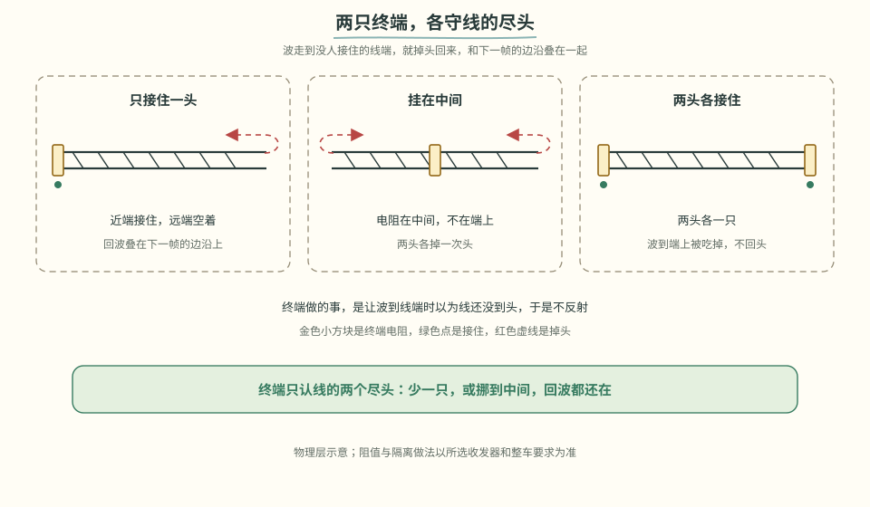
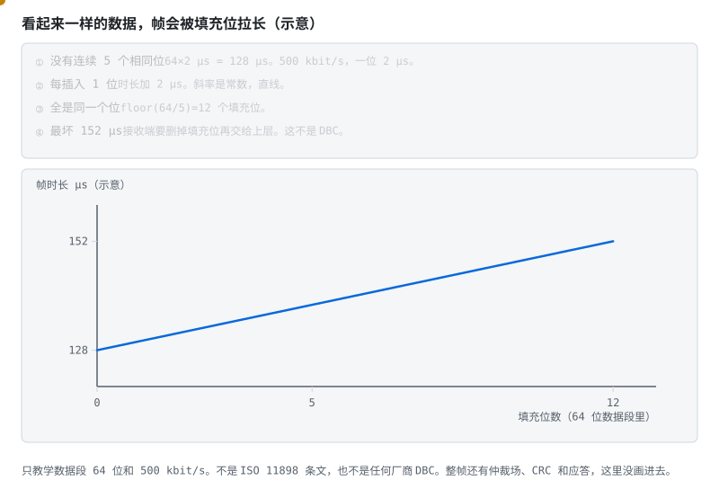
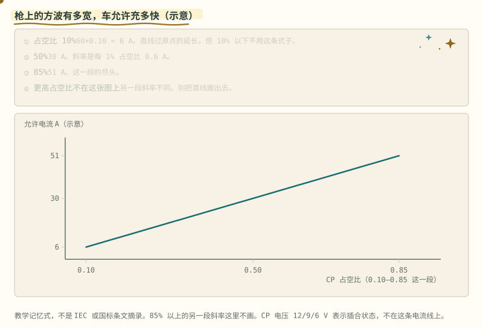

# 阶段 5 主线：CAN 与外部接口

这一篇从 CAN 物理总线走到报文信号，再用充电握手说明超时和状态为什么必须成对设计。最后对照 SMBus 与 BLE 的适用场景。

## 5.4 CAN：仲裁、信号与 DBC [理解]

> **先读/后读**：CAN 仲裁本身是 [理解]。§5.4.1 的握手时序是 [分析]。

谁先占住总线，看标识符从高位开始逐位比。先出现显性 0 的那一帧留下。CRC 在仲裁之后，它回答这一帧的载荷有没有被撕坏。仲裁赢了，只说明这帧先发了出去。

- **帧结构**：ID（标准 11 位 / 扩展 29 位）+ DLC + 最多 8 字节（CAN FD 到 64）；
- **仲裁**是它最优雅的设计——看动画两个节点怎么"和平决斗"：



> **图说**　盯住底栏那条位时间直线：示意 500 kbit/s 时一位 2 µs。谁留下仍看显性 0，不看这条线的高低。

> **口诀**　显性 0 盖过隐性 1。标识符小的那帧留下。

盯住底栏那条位时间直线：示意 500 kbit/s，一位 2 µs。数到第 2 位结束是 4 µs，11 位是 22 µs。黄点沿直线走。这是位时间，不是仲裁谁赢。谁赢仍然看显性 0。



> **图说**　仲裁赢了之后才轮到载荷。

> **口诀**　先抢到发言权，再读格子里的数。格子的比例，以那份 DBC 为准。

这帧是教学示意，不是任何厂商的 DBC。标识符 0x180。字节 0 是 SOC 62%。字节 1–2 按 0.1 A 读，数值 150 就是 15.0 A。字节 3–4 按 0.1 V 读，数值 4000 就是 400.0 V。后面是 35 °C、故障位 0、计数 7。比例是这张图自己定的。故障帧的标识符应该比 0x180 更小。CRC 仍在仲裁之后。

- 最左边 ID 格先亮：0x180。
- 随后 SOC、电流、总压、温度、故障、计数，一格一格亮。
- 底行提醒：仲裁不检查载荷，CRC 才检查。

**短自测**

1. 0x180 和一帧标识符更小的故障帧同时发，谁留下？
2. 字节 1–2 的数值 150，按这张图的比例是多少安？
3. 能把 0x180 当成某家 BMS 的固定 ID 吗？

<details>
<summary><b>参考答案（先自己想完再展开）</b></summary>

1. 故障帧。标识符更小的留下。0x180 只是教学例子。
2. 15.0 A。比例 0.1 A 是这张图定的。
3. 不能。换一家协议，字节位置和比例都会变。打开 DBC 再写解析。

</details>

> **自检**　把一帧拆成“谁先发送”和“数据表示什么”，并说明比例因子为什么不属于仲裁规则。


  显性 0 盖过隐性 1，ID 小者通吃，输家自动退出发送——**赢家甚至不知道发生过竞争**。所以 BMS 的关键报文（故障、限功率）要分配小 ID；
- **物理层**：CAN_H/CAN_L 差分，两端 120Ω 终端；电池包上**必须隔离**（隔离收发器 + 隔离电源）；
- **DBC 文件**：CAN 世界的"寄存器映射表"——定义每条报文里每个信号的起始位、长度、因子、偏移、单位。会读 DBC，车规通信就会了一半；
- **典型交互**：BMS 周期广播单体极值/SOC/故障；充电时与充电机握手（见下节）；
- 参考：[dexterbg/Twizy-Virtual-BMS](https://github.com/dexterbg/Twizy-Virtual-BMS)（车规 CAN 仿真）。



> **看图**　少一只、或者只把电阻挂在中间，为什么线端还会掉头？

**视频**　YouTube · 英文，可选 · [CSS Electronics《CAN Bus Explained》](https://www.youtube.com/watch?v=FqLDpHsxvf8)

放在仲裁动画后面，是因为这条片把帧、优先级和 DBC 解码按入门顺序讲完。它不是 BMS 协议文档。文字版在 [CSS 的 CAN 导读](https://www.csselectronics.com/pages/can-bus-simple-intro-tutorial)。中文对照可以看野火手册里的仲裁说明：[CAN 通讯实验](https://doc.embedfire.com/mcu/stm32/h750prov/hal/zh/latest/book/CAN.html)。

[](https://www.youtube.com/watch?v=FqLDpHsxvf8)

> **原理**　CAN 用标识符仲裁，显性位盖过隐性位，标识符小的帧先发。赢家的报文不会被撕掉，所以叫非破坏性仲裁。BMS 的故障和限功率报文要拿小 ID，单体明细拿大 ID。
> **证据**　车规报文怎么摆，可对 [Twizy-Virtual-BMS](https://github.com/dexterbg/Twizy-Virtual-BMS)（英文，可选）。显性盖过隐性的过程，中文见 [野火 CAN 章节](https://doc.embedfire.com/mcu/stm32/h750prov/hal/zh/latest/book/CAN.html)。
> **延伸阅读**　[CSS CAN 导读](https://www.csselectronics.com/pages/can-bus-simple-intro-tutorial)（英文，可选）

**短自测**　过程在 [CAN 仲裁](../circuits/assets/can-arbitration.svg)。

1. 标准帧 0x100 和 0x200 同时发，谁留下？
2. 仲裁赢了，载荷就一定是对的吗？
3. 故障和限功率报文为什么要拿小 ID？

<details>
<summary><b>参考答案（先自己想完再展开）</b></summary>

1. 0x100。11 位标识符从高位比，0x100 先出现显性 0，盖过 0x200 的隐性 1。输的那一帧退出，赢家可以不知道刚才有过竞争。
2. 不一定。仲裁只比标识符。载荷对不对看后面的 CRC，CRC 错了这帧作废。
3. 标识符小的帧留下。故障和限功率要先于单体明细发出去。CRC 不参加这场比较。

</details>


同一串比特，帧会被填充位拉长。接收端要先把填充位拿掉。



> **图说**　盯住从 128 µs 走到 158 µs 的黄点：每多一个填充位加 2 µs，斜率是常数。

> **口诀**　连续五个相同，插入一个相反。最坏情况要先算进时间。

黄点沿直线从 128 µs 走到 158 µs。斜率是常数。

教学示意，不是标准摘录，也不是厂商 DBC。只看数据段 64 位，速率示意 500 kbit/s，一位 2 µs。没有填充时 $64\times 2=128$ µs。全是同一个位时，**插入的填充位本身要计入下一段的连续位计数**：头 5 位触发第一个，之后每 4 位再触发一个，所以填充位数是 $1+\lfloor (64-5)/4\rfloor=15$，时长 $(64+15)\times 2=158$ µs。每多一个填充位，直线加 2 µs。整帧还有仲裁、CRC 和应答，这里没画。

若按 128 µs 去排总线，最坏的 158 µs 会挤进下一帧。

**短自测**

1. 15 个填充位时，数据段示意多少微秒？
2. 这张图为什么不能当成某家 BMS 的 DBC？

<details>
<summary><b>参考答案（先自己想完再展开）</b></summary>

1. 158 µs。注意不是 $\lfloor 64/5\rfloor=12$ 个填充位：填充位自己也算进下一段的连续计数，所以是 $1+\lfloor (64-5)/4\rfloor=15$ 个。
2. 它只教学填充和 500 kbit/s，没有标识符，也不是任何标准的条文摘录。

</details>

> **自检**　估算 CAN 帧时间时，把位填充带来的最坏情况长度计入预算。


### 5.4.1 GB/T 27930：充电机与 BMS 怎么握手 [分析]

国标直流充电机（桩）↔ 车载 BMS 走 **CAN**，不是随便发几帧电压就开充。把流程想成"先对暗号、再谈条件、最后才给电"：

```
物理连接 / 低压辅助上电
        ↓
   辨识与握手（双方互报身份、协议版本、可否充电）
        ↓
   参数配置（BMS 报电池类型、总压、允许电流/电压上限；桩确认能力）
        ↓
   充电循环（BMS 周期下发需求电流/电压；桩按需求输出并回传实测）
        ↓
   正常结束 / 故障中止（任一方超时、CRC 错、需求越界 → 停充断高压）
```



> **图说**　蓝线是示意需求。绿线晚 0.25 s 跟上，先降到 10 A，再在示意超时点落到 0。红线超时后还停在 10 A。秒和安培不是国标摘录。

> **口诀**　车先说要多少，充电机跟着给。超时就停，不要猜。

握手分四段，谁说话、敲定什么，各是一件事：

| 阶段 | 谁在说 | 这一步敲定什么 |
|---|---|---|
| 辨识 | 车（BMS）→ 桩 | 双方身份与协议版本对得上 |
| 参数配置 | 车 → 桩 | 电池允许的最大电压与最大电流 |
| 充电 | 车逐帧发需求，桩跟随 | 这一拍要多少电流 / 多少电压 |
| 结束统计 | 车 → 桩 | 充了多少、为什么停 |

充电过程中，BMS 根据电芯状态发送需求电流与需求电压，充电机按协议响应；SOP 和温度降额因此要及时反映到需求报文中。

工程要点（细则以现行国标文本为准，版本会演进）：

1. **BMS 是需求方**：桩按 BMS 当前允许的电流/电压去输出，不是桩想冲多快就多快——所以 SOP/温度降额必须实时反映到"充电需求"报文里；
2. **周期与超时**：握手与充电循环都有报文周期；对方超时未应答 → 视为通信失败，必须停充（不能"假装还连着"继续灌电）；
3. **与整车高压时序咬合**：通信 OK ≠ 可以合接触器。仍要走预充 → 主正/主负合闸 → 再允许大电流（阶段 6）；
4. **学习用法**：先画上面这张状态图，再对照国标报文列表把每一步对应到具体帧 ID——别一上来背上百个信号名。

储能侧与 PCS 的对接协议各家不同，但**"辨识 → 参数 → 周期设定点 → 超时停机"**四段骨架高度同构，27930 是练手这块肌肉的最佳标本。

> **原理**　国标直流充电先握手、再交换能力，然后由 BMS 发需求电流，充电机跟随。温度和 SOP 变了，必须写进下一帧需求。
> **证据**　需求电流由 BMS 发、充电机跟随。握手分幕见本节动画。握手报文与超时以 GB/T 27930 为准（版次与条款待核，本仓库不摘录）；GB/T 38661 是 BMS 技术条件，只作 BMS 总体要求参考：[GB/T 38661 公开文本](https://openstd.samr.gov.cn/bzgk/std/newGbInfo?hcno=DB3ACC49AC4A146FAA311BB468ACA290)。
> **延伸阅读**　握手四段和超时停充以 GB/T 27930 为准（版次与条款待核）；BMS 总体要求可参考 [GB/T 38661 公开文本](https://openstd.samr.gov.cn/bzgk/std/newGbInfo?hcno=DB3ACC49AC4A146FAA311BB468ACA290)。CAN 帧本身见上面的 CSS 导读。


直流握手是上一节的 GB/T 27930。交流枪上还有一路方波：CP 的占空比，用来告诉车「最多充多少安」。



> **图说**　盯住只在 0.10 到 0.85 之间走的黄点：示意占空比乘 60，不要把点拖出这段。

> **口诀**　这一段是直线：占空比乘 60。10% 是 6 安，85% 是 51 安。

黄点只在 0.10 到 0.85 之间沿直线走。不要把点拖出这段。

教学记忆式，不是标准摘录，也不是某根枪的铭牌。只画占空比 0.10 到 0.85：$I=60\times d$。10% → 6 A，50% → 30 A，85% → 51 A。斜率是每 1% 占空比 0.6 A。10% 以下和 85% 以上不用这条式子，更高那一段斜率不同，这张图故意不画，免得把直线延长错。

CP 上还有电压台阶，常见教学说法是大约 12 V、9 V、6 V，表示没插、插上、请求充电。那是状态，不是这条电流线。

**短自测**

1. 占空比 50% 和 85%，示意电流各是多少？
2. 为什么不能把直线延伸到 96%？

<details>
<summary><b>参考答案（先自己想完再展开）</b></summary>

1. 30 A 和 51 A。
2. 这段公式的适用范围停在 85%。再往上是另一段斜率。这里不是标准条文摘录。

</details>

> **自检**　看到充电接口上的 PWM 方波时，先判定占空比分段，再按对应规则换算允许电流。


<a id="55-smbus-与-ble笔记本的与手机的-理解"></a>

## 5.5 SMBus 与 BLE：笔记本和移动端接口 [理解]

- **SMBus**：笔记本电池的国际标准（SBS 命令集）——I2C 物理层 + 标准化命令（Voltage()、Current()、RelativeStateOfCharge()…）。逆向实战看 [BQ20Z70 逆向工程](https://github.com/omarKmekkawy/Reverse_Engineering_BQ20z70_Laptop_BMS)；



> **图说**　主机先写命令字，再读回数据。

> **口诀**　先写命令字，再读数据。电压原始值不是 SOC。

Voltage() 是 0x09，两个字节，单位 mV，低字节在前。7 位地址常见是 0x0B，先扫再假定。电量百分比是另一条命令，不要把电压原始值当成 SOC。

- **BLE**：常用于手机 App 监控。GATT 模型按“服务 → 特征值（read/notify）”组织；厂商私有服务可能承载串口透传协议。长数据需要协商 MTU 并做分包重组；已连接但帧不完整时，先检查 MTU 和重组状态机。参考 [fl4p/batmon-ha](https://github.com/fl4p/batmon-ha)（含 JK/JBD/Daly/ANT 等 BLE 协议实现，可用于比较不同帧结构）。



> **图说**　默认 ATT MTU 是 23 字节，有效载荷大约 20 字节。

> **口诀**　长帧会被切碎。按长度拼回去，半帧超时丢掉。

一帧 BMS 数据往往更长，会被切成多条通知。接收端按帧头和长度把片拼回去，超时的半帧丢掉。MTU 谈大了，片数变少，重组还是要做。

> **原理**　SMBus 把电压、电流、SOC 收成标准命令，底下仍是双线时钟。BLE 没有这套标准命令，各家把同样的量塞进私有特征值，所以要先谈 MTU，再重组。
> **证据**　命令字和字节序对照 [BQ20Z70 逆向笔记](https://github.com/omarKmekkawy/Reverse_Engineering_BQ20z70_Laptop_BMS)（英文，可选）。芯片长什么样见 [BQ20Z45 照片](../circuits/assets/photos/bq20z45-pack-controller.jpg)。默认 ATT MTU 为 23 字节，入口是 [蓝牙核心规范](https://www.bluetooth.com/specifications/specs/core-specification-5-4/)（英文，可选）。多家 BLE 帧的对照实现是 [batmon-ha](https://github.com/fl4p/batmon-ha)（英文，可选）。
> **延伸阅读**　[esphome-jk-bms](https://github.com/syssi/esphome-jk-bms)（英文，JK 的 UART/BLE 帧，可选）

<a id="56-协议逆向方法论当一回协议侦探-分析"></a>

---

[下一篇：协议逆向与安全](./stage-5-主线-协议逆向与安全.md) · [完整讲义与原有锚点](./stage-5-通信与集成.md)

[选读：完整自测](./stage-5-选读-完整自测.md)

<!-- Generated by prepare-stage5.mjs; edit stage-5-通信与集成.md. -->
