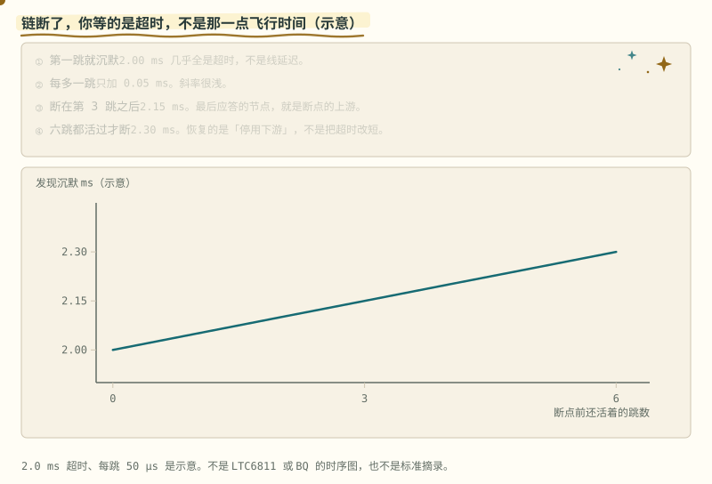
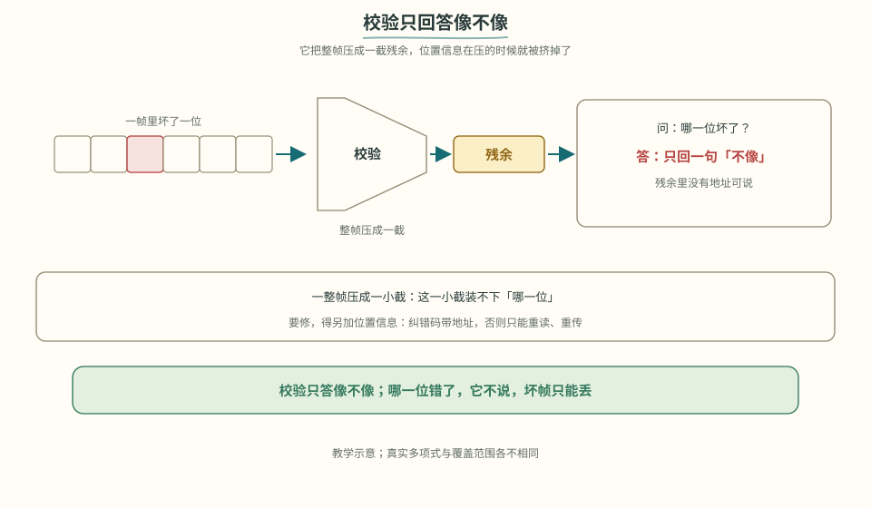
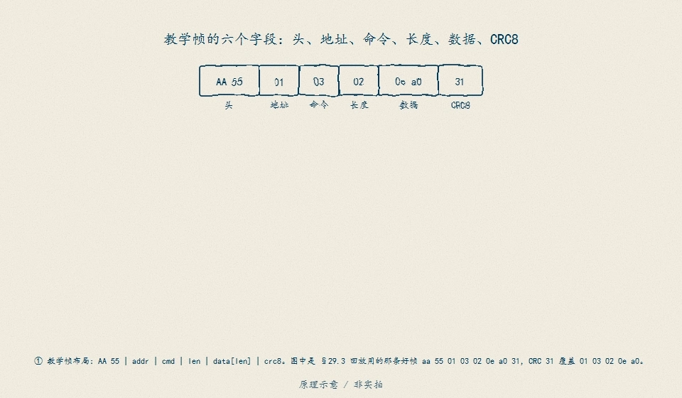

# 阶段 5 主线：串口与 Modbus

先把通信拆成三层，再分别处理字节怎样传、帧怎样分界、数据怎样映射。读完应能写出带 CRC 和坏帧恢复的串口解析器。

## 5.1 通信在 BMS 里的三个层级 [理解]

| 层级 | 连接 | 典型接口 | 在哪学的 |
|---|---|---|---|
| 板内 | AFE ↔ MCU | I2C / SPI / isoSPI | 阶段 3 已解决 |
| 板间 | CMU 从板 ↔ BMU 主控 | isoSPI / CAN 菊花链 | 阶段 6 高压架构 |
| **对外** | BMS ↔ 上位机/逆变器/整车/手机 | UART / RS485-Modbus / CAN / SMBus / BLE | **本阶段** |

> **原理**　BMS 的通信分三层：板内 AFE 到 MCU，板间从板到主控，对外到逆变器、充电机或上位机。本阶段只展开对外这一层。
> **证据**　物理层、帧和寄存器映射是三件不同的事。真实帧对照 [esphome-jk-bms](https://github.com/syssi/esphome-jk-bms)（英文，可选）与 [esphome-seplos-bms](https://github.com/syssi/esphome-seplos-bms)（英文，可选）。
> **延伸阅读**　[foxBMS 2](https://github.com/foxBMS/foxbms-2)（英文，可选）


板和板之间的菊花链，断了以后你等的主要是超时，不是那一点飞行时间。



> **图说**　盯住纵轴从 1.9 ms 起的那条浅坡：跳数只拉开零点几毫秒，不要把它读成陡坡。

> **口诀**　发现断链，大头是超时。跳数只加一点点。

黄点沿一条很浅的直线往上走。纵轴从 1.9 ms 起，所以 0.3 ms 的差别看得清。不要把它读成陡坡。

示意：$t=2.0+0.05k$ ms。$k$ 是断点前面还答得上的跳数。第一跳就沉默，2.00 ms。断在第 3 跳之后，2.15 ms。六跳之后才断，2.30 ms。斜率每跳 0.05 ms，很浅。最后一次答得上的节点，就是断点的上游。恢复动作是停用下游，不是把超时改短来「快点报故障」。超时若短于健康节点的真实应答，活的节点会被判死。

这不是某颗 AFE 的手册时序，也不是标准摘录。

**短自测**

1. 断在第 3 跳之后，示意要等多久？
2. 为什么不能靠缩短超时来加快定位？

<details>
<summary><b>参考答案（先自己想完再展开）</b></summary>

1. 2.15 ms。
2. 超时已经占了几乎全部时间。再缩短，会把还没答完的健康节点判成断链。2.0 ms 和 50 µs 是示意。

</details>

> **自检**　菊花链报告“下游丢失”时，说明时间主要花在哪里，并用最后一次成功应答定位断点。


<a id="52-uart商用-bms-的方言普通话-应用"></a>

## 5.2 UART：帧结构与状态机 [应用]

> **先读/后读**：帧里有哪些字段是 [理解]；电平和共地、以及把字节喂进解析器，是 [应用]。

调试口和监控口常用 UART。厂商帧格式不同，但通常都包含以下部分：

```
[帧头 2B][地址/命令 1-2B][长度 1B][数据 NB][CRC 1-2B]
```

（注意：这是常见抽象，不是法律——有的协议没长度字段、有的 CRC 位置不同。**拿到新协议先抓包或读厂商文档确认帧结构，别套模板**。）

一条虚构但结构典型的查询帧（仅作结构示意，非某家真实协议）：

```
AA 55 | 01 | 03 | 02 | 12 34 | 7F
帧头    地址  命令  长度  数据    CRC
```

示例的 CRC 按本仓库 [code/protocol/](../../code/protocol/) 的 CRC-8/ATM 算，覆盖"地址..数据"（真实协议以厂商定义为准）。



> **图说**　解析器按找帧头、收长度、收数据、对 CRC、计数往前走。

> **口诀**　CRC 错了就重新找帧头。坏帧不能静默丢掉还不计数。

CRC 错了要计数并重新找帧头，不能把坏帧静默丢掉。图上的字节只是结构示意。



> **看图**　校验算出来对不上之后，为什么不能顺着残余找出哪一位错了？

反过来问：三道检查全过了，这串字节就可信吗？



> **图说**　头、长度、CRC 三道检查只证明这串字节**结构合法**。缩放系数、端序、固件版本、滚动计数器、信号新鲜度一个都没验——同一串字节，刚采的和 3 秒前采的，结构上无法区分。所以「CRC 过了」只能进解析，不能直接进控制决策。

盯住底栏，按 10 位一个字节：$t=10000/\mathrm{波特率}$，单位 ms。9600 是 1.042 ms，115200 是 0.087 ms。黄点沿下降的曲线走，波特率越高越贴向 0，但不到 0。曲线是弯的：同样再加 9600 波特，低速端省下的时间更多。


真实协议就去 syssi 仓库对着源码逐字节读——比任何教程都快。

两个动手前的提醒：

- **先量电平再插线**：3.3V TTL 还是 RS232 电平（±12V）？插反电平可能烧口；
- **共地要过脑子**：UART 共地意味着你的电脑和电池包连成一体——笔记本用电池供电、或加隔离 USB 串口，别把市电地引进电池包。

学习样板：[esphome-jk-bms](https://github.com/syssi/esphome-jk-bms) 的源码与 README 就是 JK 协议的事实文档——帧格式、命令字、数据偏移、单位换算全在代码里。

> **原理**　UART 只规定字节怎样传，帧头、长度、载荷和校验由上层协议定义。解析器必须识别帧界：CRC 失败要计数，并从下一字节重新同步，不能静默丢弃坏帧。连接电脑和电池包时还要核对隔离与接地关系。
> **证据**　JK 的真实帧字段在 [esphome-jk-bms](https://github.com/syssi/esphome-jk-bms)（英文，可选）。教学状态机在 [code/protocol/](../../code/protocol/)，字节例子不是 JK 的帧。
> **延伸阅读**　拆开一块商用板来看，可选 [Off-Grid Garage 的 JK 评测](https://www.youtube.com/watch?v=BUxt_BQe9wk)（英文）。它不是协议文档。

<a id="53-rs485-与-modbus储能世界的老干部-理解"></a>

## 5.3 RS485 与 Modbus：物理层和寄存器 [理解]



> **图说**　盯住帧里前后四段和一对反相：地址、功能、数据、CRC 各管一段，差分线上两根同时往相反方向走。

> **口诀**　地址、功能、数据、CRC 各管一段。差分线上一对反相。

- **物理层 RS485**：A/B 差分、半双工。三个必考点：总线两端各一颗 **120Ω 终端电阻**（少了就回波丢包）；偏置电阻让总线空闲时电平确定；方向脚（DE/RE）切换收发——**切换时序是新手第一坑**：方向切早了丢尾字节，切晚了丢首字节；
- **协议层 Modbus RTU**：功能码记四个就够干活——0x03 读保持、0x04 读输入、0x06 写单寄存器、0x10 写多寄存器；帧 = 地址 + 功能码 + 数据 + CRC16（反射多项式 0xA001）；BMS 厂商给"寄存器映射表"（SOC 在 0x0100、单体 1 电压在 0x0101…），照表实现；
- 帧边界靠 **3.5 字符静默间隔**判断，不只是 CRC——定时器超时重组是解析器的核心；
- 参考实现：[esphome-seplos-bms](https://github.com/syssi/esphome-seplos-bms)、[esphome-pace-bms](https://github.com/syssi/esphome-pace-bms)。



> **图说**　一帧里的字节要连着发。

> **口诀**　帧和帧之间停够。帧中间停久了，这帧作废。

帧和帧之间至少停 3.5 个字符时间，接收端才敢说上一帧结束。帧中间停超过 1.5 个字符时间，这帧作废，不要拿残缺字节去碰 CRC。波特率不超过 19200 时按字符时间算；再高就用规范里的固定间隔。方向脚切早切晚，丢的是首尾字节，和这个静默定时器不是同一件事。

> **原理**　RS485 是差分半双工。两端终端电阻、空闲偏置，以及收发方向脚的切换时机，决定帧头和帧尾会不会被切掉。RTU 没有帧头魔术字，帧界是静默时间划出来的。
> **证据**　静默间隔写在 Modbus over serial line 的 RTU 成帧规则里：帧间至少 t3.5，帧内间隙超过 t1.5 则丢帧。波特率不超过 19200 时按字符时间算，更高用规范给出的固定间隔。实现对照 [esphome-seplos-bms](https://github.com/syssi/esphome-seplos-bms)（英文，可选）。官网 PDF 路径会变动，定时器以规范正文为准，不要凭记忆改。
> **延伸阅读**　[esphome-pace-bms](https://github.com/syssi/esphome-pace-bms)（英文，可选）

<a id="54-can车上的官话-理解"></a>

---

[下一篇：CAN 与外部接口](./stage-5-主线-CAN与外部接口.md) · [完整讲义与原有锚点](./stage-5-通信与集成.md)

[选读：完整自测](./stage-5-选读-完整自测.md)

<!-- Generated by prepare-stage5.mjs; edit stage-5-通信与集成.md. -->
