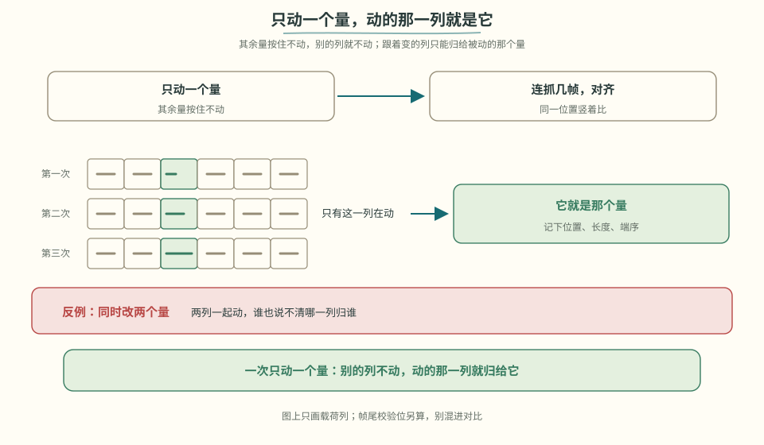
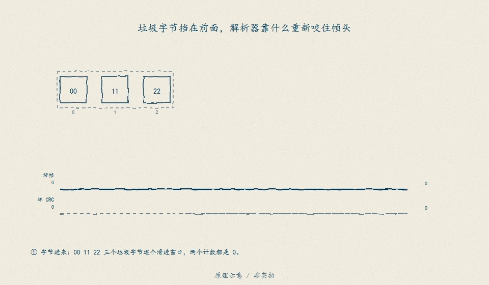

# 阶段 5 主线：协议逆向与安全

没有协议文档时，先固定实验变量，再比较帧、验证长度与校验。读操作跑通后，还要把写命令、诊断和升级入口纳入权限与审计。

## 5.6 协议逆向：从抓帧到字段验证 [分析]

面对一块无文档 BMS，按刑侦流程来：

1. **抓包**：逻辑分析仪（UART/RS485/I2C）或 USBCAN，抓 App ↔ BMS 完整会话；
2. **控制变量找字段**：只改一个已知量（让某节电压变、记录当前 SOC），对比多帧找出变化的字节 → 定位字段与字节序；
3. **解单位**：字节值与真实值通常线性（电压 = raw × 0.001V），两个已知点解出系数与偏移；
4. **CRC 反推**：拿多组完整帧，逐一试常见组合（CRC8/CRC16、多项式、初值、反射、异或输出）。**先用 syssi 仓库里已知协议的帧验证你的 CRC 程序本身是对的**——连已知帧都算不对，就别去碰未知协议；
5. **写解析器**：状态机逐字节接收（找帧头 → 收长度 → 收数据 → 验 CRC），超时重组，坏帧丢弃并计数——**绝不因一帧坏数据死机**。

> 💻 **参考实现（PC 可跑）**：[code/protocol/](../../code/protocol/) — CRC 基准向量 + 教学帧状态机（坏帧计数、垃圾前缀重同步）。帧格式是抽象示意，不是某家真实协议；硬件联调见下方动手任务。**逐行走读**：[code/README.md §代码走读](../../code/README.md#代码走读带行号-应用)。

每确认一个字段，都记录触发条件、字节位置、端序、比例、单位和验证帧。经过复核的记录才能成为后续实现的协议说明。

> **看图**　同时改两个量，为什么就说不清哪一列归谁？

仓库里的教学帧可以先当「已知的好帧」练手。格式是 `code/protocol` 的 AA 55，不是某一家的抓包：

> **看图**　三个垃圾字节挡在前面时，解析器靠什么重新咬住帧头？翻错一位之后，它又为什么要多记一个数而不是把帧吞掉？

> **图说**　三个垃圾字节之后，AA 55 仍能被认出来。末字节翻一位，坏 CRC 计数加一。

> **口诀**　坏帧计数，好帧接着找。一帧坏了，程序不能跟着死。

绿线在最后一个好字节跳到 1。红线是同一位置翻位后的坏 CRC。金点沿好流走。帧里的大端 3700 mV 是仓库约定，不是 SMBus 的低字节在前，也不是抓包。先用这份已知帧证明解析器是对的，再去碰未知协议。

**短自测**

1. 前面有 00 11 22，解析器应该停在第一个字节，还是继续找 AA 55？
2. 末数据字节翻一位之后，应该把整段流丢掉，还是这一帧计数、后面继续？

<b>参考答案（先自己想完再展开）</b>

1. 继续找。教学解析器把对不上帧头的字节当垃圾跳过，好帧还在后面。
2. 这一帧记一次坏 CRC，然后接着扫。合法载荷里碰巧出现的帧头仍当数据。不要因为一帧坏了就退出。

> **自检**　区分帧前噪声与 CRC 错误：前者继续搜索帧头，后者记录坏帧并重新同步。

> **原理**　没有文档时，先抓空闲波形找出帧头和长度，再改一个物理量看哪个字段跟着变。CRC 的多项式、初值和覆盖范围要分开猜：先用一份已知帧证明你的 CRC 程序是对的，再去碰未知帧。确认过的字段写下来，笔记就是下一份协议说明。
> **证据**　已知帧用 [esphome-jk-bms](https://github.com/syssi/esphome-jk-bms)（英文，可选）和 [esphome-seplos-bms](https://github.com/syssi/esphome-seplos-bms)（英文，可选）。本地 CRC 向量在 `code/protocol/tests/`。
> **延伸阅读**　笔记本 SMBus 的一条逆向笔记：[BQ20Z70](https://github.com/omarKmekkawy/Reverse_Engineering_BQ20z70_Laptop_BMS)（英文，可选）。

> **完成标志**　能解释 CAN 显性位仲裁、UART 接地与隔离风险，并说明 ESP32 只负责上报而不承担第一道安全保护。

把 §5.6 的动作压成一张执行单：

| 步 | 做什么 | 判断标准 | 常见坑 |
|---|---|---|---|
| 1 | 抓空闲波形，找帧头与长度 | 同长度重复出现 | 把数据里的帧头当帧起始 |
| 2 | 只改一个物理量，看哪个字节跟着变 | 多帧对比只有一个字段动 | 同时改两处，定位不到 |
| 3 | 先用已知帧验 CRC 程序 | 已知向量全过 | 多项式、初值、覆盖范围一起猜 |
| 4 | 确认过的字段写进笔记 | 下次可复现 | 只记结论不记验证条件 |

## 5.6b 通信安全：把能写的口都上锁 [分析]

BMS 可能同时暴露 [UART/RS485](stage-5-主线-串口与Modbus.md#52-uart帧结构与状态机-应用)、[CAN](stage-5-主线-CAN与外部接口.md#54-can仲裁信号与-dbc-理解)和 [BLE](stage-5-主线-CAN与外部接口.md#55-smbus-与-ble笔记本和移动端接口-理解)。§5.6 讨论怎样读协议；本节处理谁可以读写、哪些命令必须鉴权。强制性国标 GB 44495-2024《汽车整车信息安全技术要求》于 2024-08-23 发布、2026-01-01 实施；管理体系可对照 ISO/SAE 21434，出口型式批准还要考虑 UN R155。

> **口诀**　能写进去的口，都要先验明身份。只读的口，也要防着被人灌满。

**BMS 的攻击面盘点**（从最近的口往外数）：

| 口 | 谁能碰到 | 保守做法 |
|---|---|---|
| UART/RS485 维护口 | 拆壳的维修者 | 调试口出厂锁定；现场服务走签名的令牌，不留「万能密码」 |
| CAN（OBD、充电口、车内网） | 插枪、插 OBD 的人 | 报文白名单＋网关隔离；控制类报文做计数器校验；充电报文按 [GB/T 27930](stage-5-通信与集成.md#541-gbt-27930充电机与-bms-怎么握手-分析) 的角色收，不收陌生 ID 的写请求 |
| BLE 配对 | 用 App 的用户 | 配对绑定＋密钥不明文落日志；弃用固定 PIN |
| 云端 MQTT/TLS | 拿到凭据的人 | 每台设备独立凭据；主题最小权限；固件更新必须验签（[§6.2.4](stage-6-精通与毕业项目.md#624-bootloader-与-ota-应用)） |
| 刷写口（UDS 诊断） | 售后诊断仪 | 0x27 安全访问按会话分级；0x2E 写参数先验身份；刷写镜像签名＋回滚保护 |

**UDS 安全访问（0x27）怎么工作**：诊断仪请求种子 → ECU 回随机数 → 诊断仪用共享密钥算响应 → 对上了才解锁对应等级。两个常见的假安全：种子-响应算法用固定密钥，等于没锁；解锁等级和被保护的写服务没对上，等于留后门。

> **图说**　蓝箭头是要种子、发密钥，绿箭头是 BMS 确认解锁；末段红箭头是连错三次之后的 `7F 27 36` 和罚等未到再请求的 `7F 27 37`。金点一枚报文走一趟。字节、次数与 10 秒都是示意。

> **口诀**　种子要新的，密钥是算的，错三次罚等。

**为什么 CAN 自己防不了**：CAN 帧没有源地址认证——§5.4 的仲裁只解决「谁先说」，不解决「说的是不是真话」。任何插上总线的人都能用任意 ID 发报文。所以车规的做法是分层：网关白名单转发、控制报文加端到端保护（计数器＋CRC/MAC）、敏感动作（解锁充电口、远程切断）放到有身份认证的高层协议里。

**最后别忘物理层**：JTAG/SWD 调试口出厂要熔断或口令保护。壳被拆开之后，软件上的一切锁只剩壳的强度。

> **完成标志**　列出 BMS 的全部通信口，逐项标注可接触者、暴露数据、可执行写操作、鉴权方式和审计记录，并映射到适用法规要求。

> **原理**　通信安全三要素：身份（谁在说话）、完整性（说的没被改）、新鲜度（不是重放的旧话）。CAN 协议本身三项都不提供，21434、R155、GB 44495 要求的是**在系统层补齐**，而不是指望协议层天生安全。

## 5.8 动手任务 [应用]

**视频**　YouTube · 英文，可选 · [Off-Grid Garage《JiKong 300A BMS 评测》](https://www.youtube.com/watch?v=BUxt_BQe9wk)

放在动手读商用 BMS 之前，是因为这条片把一块 JK 板拆开看，和 syssi 的协议笔记是同一类对象。它不是协议文档。

1. 用 ESP32 + 隔离串口读一块商用 BMS（JK/JBD/小象任一），对照 syssi 源码实现帧解析，打印电压/电流/SOC（选型、框架、功耗与参考工程的地图见 [ESP32 实战专题](../esp32-bms专题.md)）；
2. 接入 Home Assistant（直接用 batmon-ha 或自写 MQTT 上报）；
3. 进阶挑战：抓一段未知 BMS 的通信，按 5.6 流程定位 SOC 字段并验证 CRC。

> **原理**　动手是把机制变成一次可核对的记录：条件、读数、和规格差在哪。没有记录的操作不算做完。
> **证据**　动手读一块商用 BMS 的帧。对照 [esphome-jk-bms](https://github.com/syssi/esphome-jk-bms)（英文，可选）。解析器测试在 `code/protocol/tests/`。
> **延伸阅读**　[esphome-seplos-bms](https://github.com/syssi/esphome-seplos-bms)（英文，可选）

## 5.9 验收清单 [评价]

- [ ] 能独立实现 UART 协议解析器（状态机 + CRC + 坏帧处理）
- [ ] 能照寄存器映射表写出 Modbus RTU 读写
- [ ] 能读懂 DBC 并手工解码一条 CAN 报文
- [ ] 能默写 GB/T 27930 握手四段骨架，并说明超时必须停充
- [ ] 完成至少一次真实协议逆向（哪怕只逆向出一个字段）

> **本阶段结论**　先分清物理层、帧和数据映射；逆向时先用已知帧验证解析与 CRC，再改变单一变量确认未知字段，同时为写命令、诊断和升级入口设置权限与审计。

全部通过 → 进入 [阶段 6 主线：高压与安全](stage-6-主线-高压与安全.md)（总纲入口：[阶段 6](../bms-resources.md#阶段-6精通工程化与前沿持续)）。

---

[返回：串口与 Modbus](./stage-5-主线-串口与Modbus.md) · [完整讲义与原有锚点](./stage-5-通信与集成.md)

[选读：完整自测](./stage-5-选读-完整自测.md)

<!-- Generated by prepare-stage5.mjs; edit stage-5-通信与集成.md. -->
