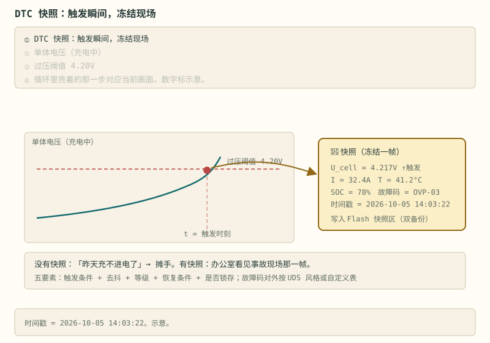
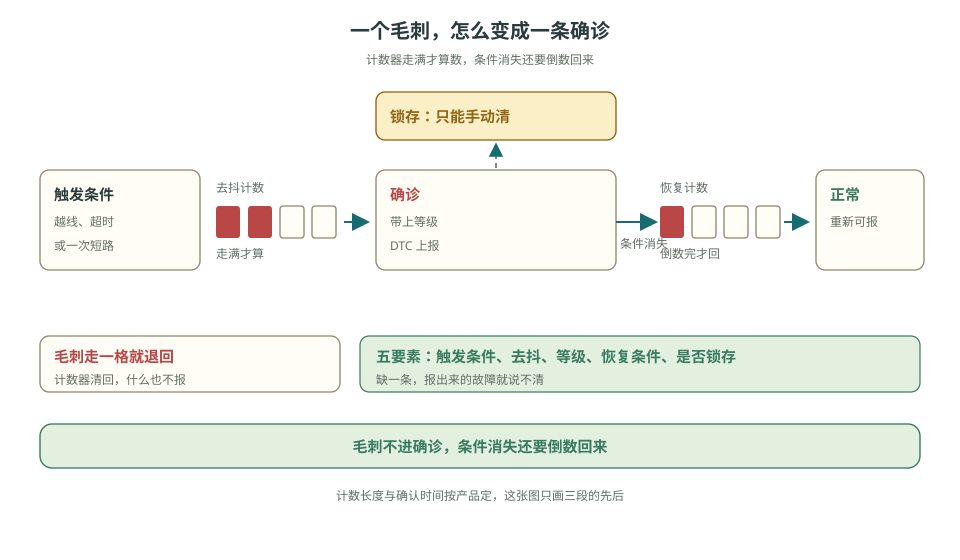
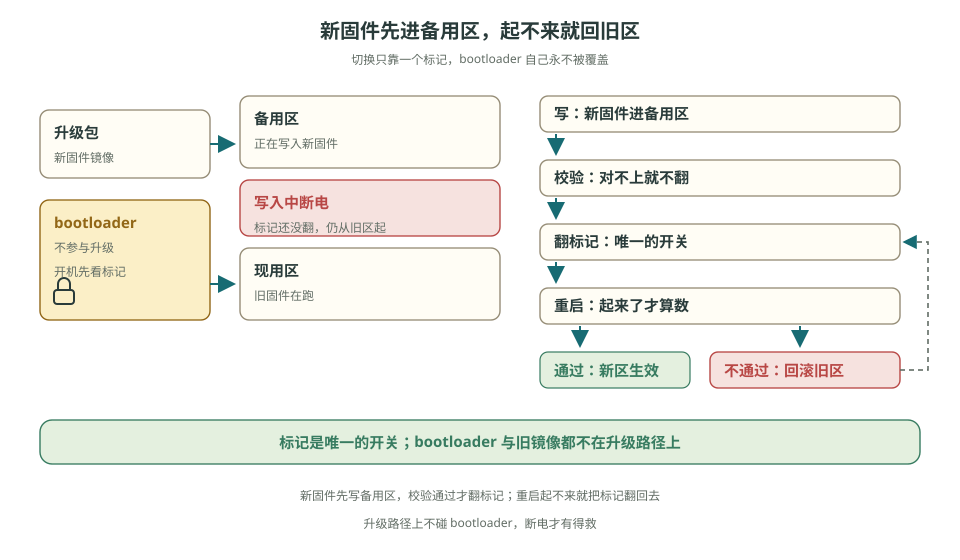
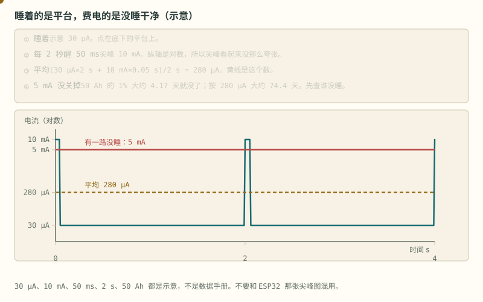
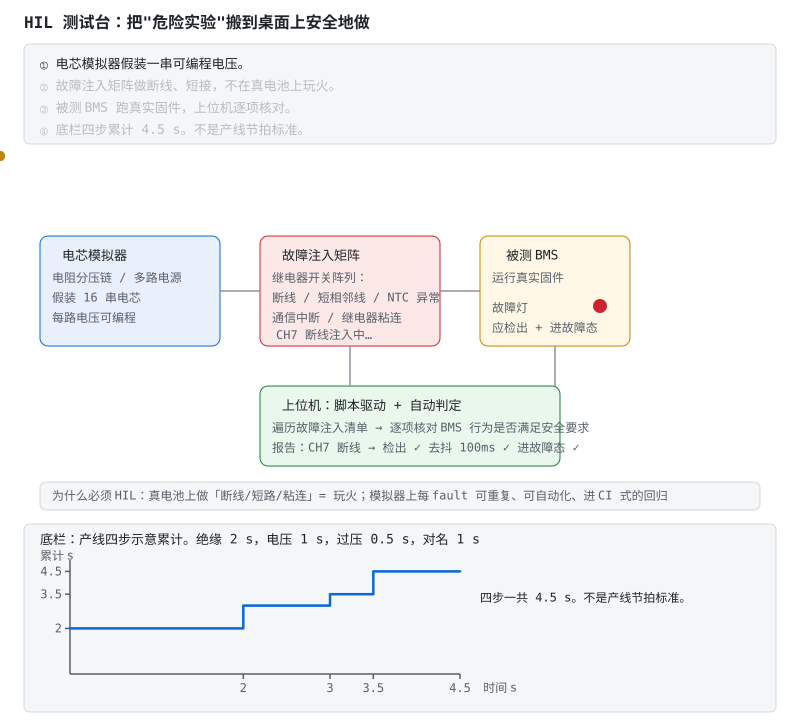
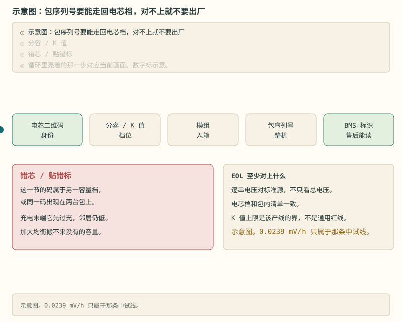
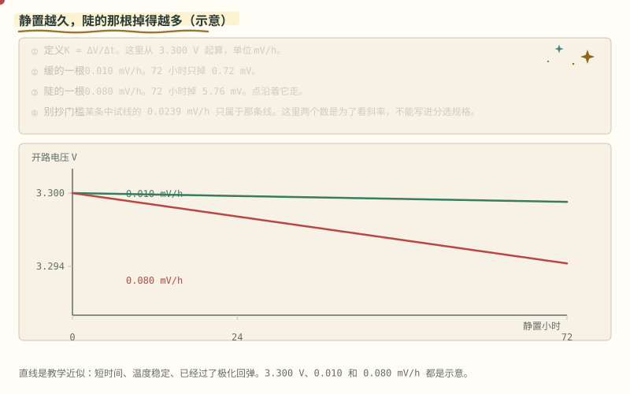
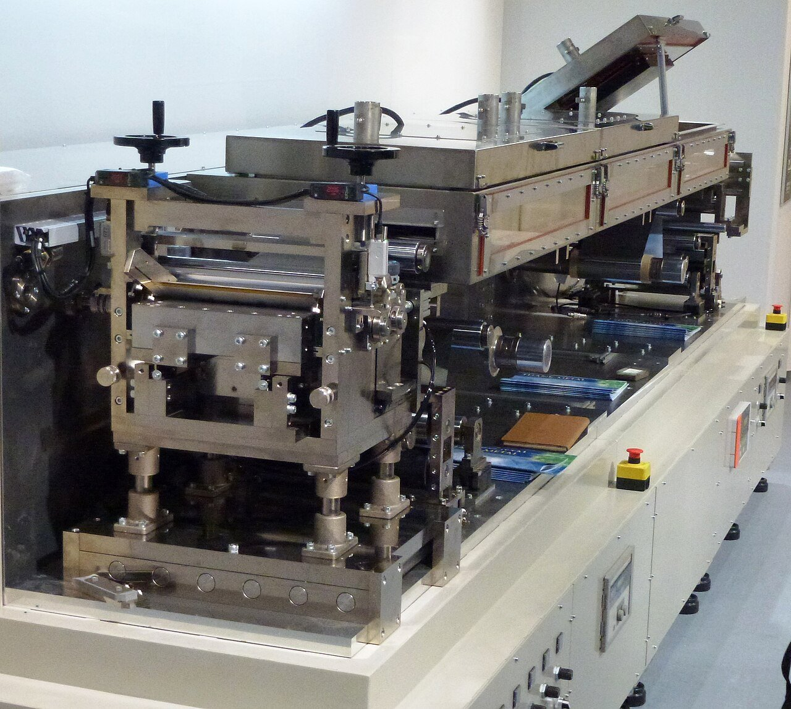

# 阶段 6 主线：量产与毕业

这一篇沿着“固件可控 → 产线可测 → 问题可追 → 项目可验收”往下走。自测题、法规全文和云端诊断放在选读页，不堵住第一次阅读。

> **阅读边界**　这是一条短路径，不删公式、阈值和适用条件；需要旁支时再打开文末选读。

## 6.2.1 量产状态机 [应用]

在阶段 3 的最小集合上扩展成完整版图（巡游动画见 [状态机](../circuits/assets/state-machine.svg)）：

```
初始化 → 自检 → 待机 → 预充 → 就绪 ⇄ 充电 ⇄ 充电末端均衡
                         ⇅      ⇄ 放电
                        故障（分级：提示/限功率/断开）
                         ⇅
                        休眠 ⇄ 运输模式（深度低功耗）
```

三条铁律再背一遍：迁移集中一处；每个状态"进入/周期/退出"三动作明确；**任意状态可直接进故障态**。

> **原理**　每个状态写清进入、周期和退出。迁移集中在一处，任意状态都可以直接进入故障，不能靠调用顺序碰运气。
> **证据**　每个状态写清进入、周期、退出，任意状态都能进故障。巡游动画在本节；代码落点是 `code/firmware` 的 `test_bms`。
> **延伸阅读**　[《车用 BMS 功能安全设计方法论》](https://www.mdpi.com/1996-1073/14/21/6942)（英文，可选）

## 6.2.2 故障管理（DTC 体系） [应用]

每个故障五要素：触发条件 + 去抖 + 等级 + 恢复条件 + 是否锁存。

**故障快照**：触发瞬间冻结电压、电流、温度、SOC 和时间戳。没有快照，只能知道故障名称，无法复核当时的工况；有快照才能区分单体过压、温度越线或电流尖峰。故障码对外按 UDS 风格（车规）或自定义表（储能/消费）。



> **图说**　充电曲线爬过 4.20V 阈值的那一瞬，BMS 把这一帧冻结下来——触发的单体电压、当时的电流温度 SOC、故障码、时间戳，写进 Flash 快照区（双备份）。

> **口诀**　冻的是越线那一拍，不是用户事后的描述。

**看动画时盯住哪里**

售后拿到的不是"用户描述"，而是事故现场的物证。

> **原理**　每个故障五要素：触发条件 + 去抖 + 等级 + 恢复条件 + 是否锁存。
> **证据**　可核验演示：本节 SVG（浏览器打开即播），正文有不看动画也能读的说明。故障要留下当时的电压、电流、温度和时间。结构可对照 [foxBMS 2](https://github.com/foxBMS/foxbms-2)（英文，可选），安全过程见 [《车用 BMS 功能安全设计方法论》](https://www.mdpi.com/1996-1073/14/21/6942)（英文，可选）。
> **延伸阅读**　[ENNOID-BMS](https://github.com/EnnoidMe/ENNOID-BMS)（英文，可选）

**短自测**

1. 快照要冻住的是哪一拍？
2. 后面又来一个更严重的故障，能改掉已经冻住的第一现场吗？

<details>
<summary><b>参考答案（先自己想完再展开）</b></summary>

1. 越线那一拍：电压、电流、温度、SOC、时间戳。不是用户第二天的描述。
2. 不能。显示可以升级。冻结帧不改。否则办公室里只剩短路，看不出它发生在过充之后。

</details>

**练完你会怎样**：客户说「昨天充不进电」，你先要快照，不先要故事。



> **看图**　电压越线一拍就报故障吗？什么让它从疑似变成确诊，又怎么自己回到正常？


## 6.2.3 参数与标定系统 [应用]

- 参数区：Flash 独立扇区，结构体 + 版本号 + CRC + **双备份**；
- 标定项：电流零漂（出厂必做，不做的话 SOC 出厂就偏几个点）、电压增益、NTC 偏移；
- 防写穿：写次数计数 + 磨损均衡；参数更新**先写备份区再切换**——更新中途掉电，旧参数还在。

> **原理**　参数放在独立扇区，带版本号、CRC 和双备份。先写备份再切换，写到一半掉电时旧参数还在。
> **证据**　标定参数和代码分开，否则现场改一个阈值就要重刷程序。结构参考 [foxBMS 2](https://github.com/foxBMS/foxbms-2)（英文，可选）。
> **延伸阅读**　[《车用 BMS 功能安全设计方法论》](https://www.mdpi.com/1996-1073/14/21/6942)（英文，可选）

## 6.2.4 Bootloader 与 OTA [应用]

- 双区（A/B）方案最稳：新固件写备用区 → 校验 → 标记切换 → 重启验证 → 失败自动回滚；
- 两条铁律：**bootloader 自身永不被 OTA 覆盖**；升级中断电必须能恢复原固件——做不到这两条，OTA 就是批量变砖机。

> **原理**　新固件写到备用区，校验通过才切换。Bootloader 自己不被升级覆盖，切换后起不来要能自动回到旧固件。
> **证据**　升级失败必须还能回到能启动的旧镜像。工程结构参考 [foxBMS 2](https://github.com/foxBMS/foxbms-2)（英文，可选）。不要在没有校验时把 OTA 写进量产。
> **延伸阅读**　[LibreSolar 固件](https://github.com/LibreSolar/bms-firmware)（英文，可选）。云端建议的标定不能绕过这里，见 [§6.2.6](stage-6-精通与毕业项目.md#626-云端诊断停在包外-评价)。



> **看图**　升级写到一半断电，机器为什么还开得起来？

## 6.5 量产与测试 [评价]

> **先读/后读**：标定步骤和 HIL 清单是 [应用]；用标准决定能不能放行是 [评价]。

**出厂标定与 EOL 清单**：电流零点（零电流读数写入参数区）、电压增益（标准源比对）；全串采样精度、通信收发、保护阈值抽测、绝缘电阻、静态功耗、固件版本与序列号烧录。

静态功耗不是一个数。睡着的平台可以只有几十微安，周期唤醒会打出毫安尖峰，平均由占空比决定：



> **图说**　示意睡着 30 µA。

> **口诀**　睡着看平台。费电的是没睡干净的那一路。

**看动画时盯住哪里**

每 2 秒醒 50 ms，尖峰 10 mA。平均 (30 µA×2 s + 10 mA×0.05 s) / 2 s = 280 µA。纵轴是对数，所以尖峰看起来没那么高。若有一路停在 5 mA 没睡，50 Ah 的 1% 大约 4.2 天就没了；按 280 µA 大约 74 天。先查谁没睡。这不是 ESP32 无线尖峰那张图。

- 黄点大部分时间贴着 30 µA，每隔 2 秒跳上 10 mA。
- 黄横线是平均 280 µA。
- 红横线是 5 mA。它没有尖峰，但把日子吃短了。

**短自测**

1. 280 µA 是怎么口算出来的？
2. 为什么 5 mA 比 10 mA 的尖峰更费电？
3. 74 天能写成产品的静置寿命吗？

<details>
<summary><b>参考答案（先自己想完再展开）</b></summary>

1. 两秒里，30 µA 贡献 60 µA·s，10 mA 的 50 ms 贡献 500 µA·s，加起来除以 2 s 是 280 µA。
2. 尖峰只有 50 ms。5 mA 如果一直在，平均就是 5 mA，比 280 µA 大十几倍。
3. 不能。30 µA、10 mA、50 Ah 都是示意，用来比「睡干净」和「有一路没关」。

</details>

**练完你会怎样**：静态功耗测高了，你会先找没关掉的那一路，而不是把休眠电流的规格改大。


**HIL 测试**：电芯模拟器（入门可用电阻分压链，见 [EEVblog 实操帖](https://www.eevblog.com/forum/projects/lithium-battery-cell-simulatoremulator-for-bms-testing/)）+ **故障注入清单**：断任意采样线、短相邻采样线、NTC 开路/短路、通信中断、继电器粘连、电流超限——逐项验证 BMS 行为符合安全要求；边界工况：-20°C 启动、满充保持、深度过放恢复、长期静置唤醒。



> **图说**　电芯模拟器（可编程电压的"假电池"）经故障注入矩阵（继电器阵列制造断线/短接/NTC 异常）接到跑真实固件的被测 BMS；上位机脚本遍历故障清单，自动核对每项的安全行为（检出、去抖、进故障态）。

> **口诀**　可编程电源代替电芯。脚本电压不是这张机架。

**看动画时盯住哪里**

危险实验在桌面上变得可重复、可自动化。PC 上能跑的那一层快照回放在 [§6.2.5](stage-6-精通与毕业项目.md#625-故障注入与快照回放-应用)，它不代替这张台子。四件设备画在同一框里的接线见这一节的 [电池 HIL 实验台场景](../circuits/assets/hil-bench-scene.svg)，示意图·待实拍，实验台照片仍然没有。

盯住底栏那四步台阶。这是示意累计，不是节拍标准：绝缘 2 s，电压点 1 s，过压注入 0.5 s，通信对名 1 s，一共 4.5 s。黄点沿台阶走到 4.5。过压那 0.5 s 短，是因为比较器不该等软件慢慢想。真实节拍以工装为准。


**标准速查**（按产品选）：ISO 26262/GB/T 34590（功能安全母标准）、[GB/T 38661-2020](https://openstd.samr.gov.cn/bzgk/std/newGbInfo?hcno=DB3ACC49AC4A146FAA311BB468ACA290)（车用 BMS 技术条件）、GB/T 39086-2020（车用 BMS 功能安全要求）、UL 1973/IEC 62619（储能）、UN 38.3（运输）、GB/T 32960（远程监控）。

> **原理**　出厂要记下电流零点和电压增益，并抽测采样、通信、保护阈值、绝缘和静态功耗。没有这些记录，就不知道这台机器出厂时是否在规格里。
> **证据**　本节可点击来源：[EEVblog 实操帖](https://www.eevblog.com/forum/projects/lithium-battery-cell-simulatoremulator-for-bms-testing/)。阈值与宣传口径仍以 datasheet / 标准原文为准。
> **延伸阅读**　[《车用 BMS 功能安全设计方法论》](https://www.mdpi.com/1996-1073/14/21/6942)（英文，可选）。电芯档和包序列号对不上时见 [§6.5.1](stage-6-精通与毕业项目.md#651-产线追溯错芯和贴错标-评价)。

**练完你会怎样**：你能用上面那句口诀，把这张图讲给别人听。

## 6.5.1 产线追溯：错芯和贴错标 [评价]

EOL 要回答的是：这台包里的电芯，是不是当时分进这一档的那些。链是电芯二维码，到化成后的容量、内阻和 K 值，到模组，到包序列号，再到 BMS 里售后能读出的标识。K 值的定义，以及一条中试线 Figure 4 上的 0.0239 mV/h，已经写在 [详解④ §4.3](../circuits/04-系统安全与量产.md#43-电芯筛选与追溯-应用)。那是那条线的界，不是电芯手册上的通用红线。

分选的意思是同一包里的电芯落在这份工艺约定的同一档。档的边界写在工艺里。总电压及格，替不了逐串对标准源，也替不了对电芯身份。



> **图说**　二维码、分容与 K 值、模组、包序列号、BMS 标识连成一条。

> **口诀**　错的那一节先过充。加大均衡抹不平贴错的标。

**看动画时盯住哪里**

蓝点沿这条链走。红格是错芯或贴错标：这一节先过充，邻居仍低，加大均衡没有用。示意图。0.0239 mV/h 只属于那条中试线。

K 值本身是静置时开路电压掉多快。陡的那根要单独挑出来，但门槛不能从这张图里抄：

**练完你会怎样**：你能用上面那句口诀，把这张图讲给别人听。



> **图说**　从 3.300 V 起算。

> **口诀**　静置越久，陡的那根掉得越多。门槛仍是那条产线的，不是这张图的。

**看动画时盯住哪里**

缓的一根示意 0.010 mV/h，72 小时只掉 0.72 mV。陡的一根 0.080 mV/h，72 小时掉 5.76 mV。两条都是直线，因为这里假设极化已经退完、温度不变。某条中试线的 0.0239 mV/h 只属于那条线，不是这两根斜线中间的红线。

- 红点和红线往下走得更快。
- 绿线几乎贴着 3.300 V。纵轴只拉开了十几毫伏，所以陡一点就很显眼。
- 不要把 0.080 或 0.010 写进分选规格。

**短自测**

1. 0.080 mV/h 静置 72 小时，电压掉多少？
2. 为什么这张图画成直线？
3. 0.0239 mV/h 能当作通用报废线吗？

<details>
<summary><b>参考答案（先自己想完再展开）</b></summary>

1. 5.76 mV。0.080×72。示意。缓的那根同样时间只掉 0.72 mV。
2. 教学近似：短时间、温度稳定、极化已经退完。刚卸流的那一截回弹不在这张图里。
3. 不能。它是张赫坤等那条中试线 Figure 4 上的传统上限，正文别处已经写明只属于那条线。

</details>

**练完你会怎样**：你看见静置电压往下掉，会先算出 K，再问这个 K 是不是这条产线自己的界，而不是随手画一条。




这是锂离子电极的卷对卷涂布设备。上传者说明写的是 Coating Equipment for Electrodes for Lithium-Ion Batteries。看的是涂布这一步的设备外形。它不是化成柜，不是 K 值分选工位，也不是结构电池的产线，更不是上面那条追溯链的数据库。来源见 [照片来源](../circuits/assets/photos/PHOTOS.md)。车间里工人与模组混在一起、看不清是电芯还是别的模块的照片没有收。工厂外立面也没有收。

**故障分析**

- 一节先过充、其余还低，先怪均衡电流太小。均衡搬的是已经存在的电量差，搬不来另一档的容量，也搬不齐电压窗口不同的电芯。定量上「哪条路径更省」见 [详解③ §3.1](../circuits/03-充电均衡与计量.md#31-同一模型下的拓扑对比-评价)，那仍然解决不了错芯。
- 标签重打之后只改包装，不改 BMS 里的电芯身份。售后按身份查到的是另一批的容量和 K 值。
- 出厂只看总电压和通信。错的那一节可以被邻居的电压掩盖。

**案例解析**（教学案例，不是某条产线的事故报告）

发生了什么：模组里一节的二维码属于另一容量档，或者贴标时张冠李戴。出厂看了总电压，通信也能通。

信号：充电末端这一节先碰到软件过充点，邻居仍明显更低。按二维码回查，这条身份的分容不在本包的档内，或者同一身份出现在另一台包上。压差的具体毫伏以该包的电芯曲线和均衡阈值为准，这里不写通用规格。

根因：追溯在贴标或入箱时断了，EOL 没有把逐串和电芯档对上。

BMS 上的教训：保护把这一节切断是对的，切断解释不了为什么只有它高。售后要能从包序列号读到电芯身份，再对上当时的分容和 K 值。对不上就停用这一台，不要靠加大均衡电流把档差抹平。没有电芯厂公开的分档表时，正文不写「差多少毫伏必须报废」。

> **原理**　追溯是把包序列号走回电芯的分容、内阻和 K 值。错芯或贴错标会让一节先越限。均衡和总电压 EOL 都看不出身份错了。
> **证据**　K 值定义和 0.0239 mV/h 的适用范围在 [详解④ §4.3](../circuits/04-系统安全与量产.md#43-电芯筛选与追溯-应用)，论文是 [Batteries 2023, 9, 346](https://doi.org/10.3390/batteries9070346)。EOL 项目表在同一篇的 [§4.2](../circuits/04-系统安全与量产.md#42-产线-eol-测试出厂前的最后一道筛-评价)。
> **延伸阅读**　主动均衡搬不齐容量档，见 [详解③ §3.1](../circuits/03-充电均衡与计量.md#31-同一模型下的拓扑对比-评价)。

**短自测**

1. 一节先过充、邻居仍低，加大均衡能抹平吗？
2. 0.0239 mV/h 是通用报废线吗？

<details>
<summary><b>参考答案（先自己想完再展开）</b></summary>

1. 抹不平贴错的标，也抹不平另一档的容量。保护切断是对的，解释不了为什么只有它高。
2. 不是。那是张赫坤等 Batteries 2023 一条中试线 Figure 4 上的传统上限。别的线不要抄。

</details>

**练完你会怎样**：你能从包序列号走回电芯身份。对不上就停用，不靠均衡把档差抹平。

## 6.6 毕业项目指南 [创造]

先用 [PC 综合实验](../PC综合实验专题.md)完成软件信号链的联调，保存采样、状态迁移与接收日志；再进入本节的实物工程。算法验证可先做 [SOC 真实数据实验](../SOC真实数据专题.md)。这两项是毕业项目的准备练习，不替代保护实测、硬件设计或功能安全论证。

> **先读/后读**：需求、里程碑和发布是 [创造]。做完怎么打分在下一节评审量规（评价），不要把打分表当成需求本身。

**需求模板**（先写死再动手）：

```
串数/化学体系：16S LFP
持续/峰值电流：100A / 200A(10s)
保护清单：OVP/UVP/OCP×2/SCD/OTP/UTP/低温禁充/绝缘
均衡：被动 150mA，充电末端
算法：安时积分 + OCV 校准（+ EKF 加分项）
通信：UART（调试）+ CAN（系统）
结构：BMU 一体板 或 BMU + CMU×2
```

**里程碑**（每个都要可验证）：

1. 原理图评审（发 EEVblog / EEWORLD 求评）→ 2. PCB 投板焊接 → 3. 采样与驱动调通 → 4. 保护项全部实测通过 → 5. SOC 恒流误差 <5% → 6. 通信接入上位机 → 7. 完整文档（原理图说明、寄存器/协议文档、测试报告）

**发布清单**：开源仓库含 KiCad 工程、固件源码、BOM、测试报告、README（带实拍与接线图）→ 发社区接受评审。

> **原理**　毕业项目先把串数、化学体系和安全边界写成需求，再做电路和固件。做完要能按量规说明每个安全要求怎么被验证。
> **证据**　毕业作品要能指出危险是怎么被拦住的。过程对照 [《车用 BMS 功能安全设计方法论》](https://www.mdpi.com/1996-1073/14/21/6942)（英文，可选）与 [GB/T 38661 公开文本](https://openstd.samr.gov.cn/bzgk/std/newGbInfo?hcno=DB3ACC49AC4A146FAA311BB468ACA290)。
> **延伸阅读**　[foxBMS 2](https://github.com/foxBMS/foxbms-2)（英文，可选）

## 6.6b 毕业项目评审量规 [评价]

自评或请社区按此打分；「优秀」列就是产品级门槛。

> **先读/后读**：上一节是 [创造]（把项目做出来）。这张表是 [评价]：用来判断做到了哪一档，不是另一份需求。

| 维度 | 达标（能用） | 良好（可交付） | 优秀（产品级） |
|---|---|---|---|
| 安全保护 | 保护清单全部实测通过 | + 故障注入覆盖关键诊断（开线/短接/停喂狗） | + 双通道独立性验证 + 快照复盘报告 |
| 采样与算法 | SOC 恒流误差 <5% | 变流工况也 <5%，OCV 校准实测生效 | EKF 或 SOH 上线 + 全温区补偿 |
| 固件 | 状态机 + 保护去抖 | + 参数双备份、OTA 可回滚 | 诊断周期按 FTTI 推导 + 快照可读出 |
| 通信 | UART 调通 | CAN 接入上位机 + 协议文档 | 超时/CRC/重同步压力测试报告 |
| 硬件 | 功能正常 | + 开线检测、预充时序实测 | + 绝缘检测实测 + EMC 预一致性摸底 |
| 文档 | README + BOM | + 原理图说明 + 寄存器/协议文档 | + 测试报告与复盘，他人可复现 |

> **原理**　自评或请社区按此打分；「优秀」列就是产品级门槛。
> **证据**　量规问的是证据、安全论证和可复现，不是页数。过程对照 [《车用 BMS 功能安全设计方法论》](https://www.mdpi.com/1996-1073/14/21/6942)（英文，可选）。
> **延伸阅读**　[GB/T 38661 公开文本](https://openstd.samr.gov.cn/bzgk/std/newGbInfo?hcno=DB3ACC49AC4A146FAA311BB468ACA290)

**练完你会怎样**：你能把这阶段收成五句——先灌满母线再合主闸；绝缘要投切两次；快照冻的是第一现场；云端可以晚半分钟，切断不看它；读数冲高先问线。HIL 机架、认证现场和包级手册该缺的还缺，PC 上的 `hil_replay` 代替不了那张台子。

## 6.8 毕业验收 [评价]

回到 [主文档的精通自检清单](../bms-resources.md#精通自检清单)：硬件 9 项、固件 4 项、算法 5 项、系统与安全 6 项——**全部打勾 + 毕业项目发布** = 路线终点：你已具备独立完成产品级 BMS 的能力。

往后没有"阶段 7"。深耕方向任选：车规（功能安全/AUTOSAR）、储能（系统架构/电网交互）、算法（电化学模型 PyBaMM/AI）、芯片（AFE 原厂 FAE）。前沿资料在 [主文档 6.5](../bms-resources.md#65-前沿方向) 持续更新。

> **本阶段一句话**：产品级 = 双通道保护 + 故障快照 + 可回滚的升级 + 一套故障注入测试——全部做到，才算毕业。

---

[返回：高压与安全](./stage-6-主线-高压与安全.md) · [完整讲义与原有锚点](./stage-6-精通与毕业项目.md)

[选读：EMC、并簇与热管理](./stage-6-选读-系统边界.md) · [选读：故障回放与云端](./stage-6-选读-固件与云端.md) · [选读：算法、法规与自测](./stage-6-选读-算法法规与自测.md)

<!-- Generated by prepare-stage6.mjs; edit stage-6-精通与毕业项目.md. -->
