# 阶段 6 主线：高压与安全

第一次读只解决两件事：高压怎样安全接通，以及单点故障怎样被发现并收敛。先看架构、预充、绝缘和过充案例，再进入量产主线。

> **阅读边界**　这是一条短路径，不删公式、阈值和适用条件；需要旁支时再打开文末选读。

## 6.1.1 高压电池系统架构 [分析]

几十到几百串的系统不再是一块板，而是三级结构：

```
        ┌─────────────┐
        │  BMU 主控    │ ← 对外 CAN / 绝缘检测 / 继电器驱动 / SOC 汇总
        └──────┬──────┘
               │ isoSPI / CAN（隔离）
   ┌───────────┼───────────┐
┌──┴──┐     ┌──┴──┐     ┌──┴──┐
│CMU 1│     │CMU 2│ ... │CMU n│  ← 每块从板管 12–18 串
└─────┘     └─────┘     └─────┘
BDU 配电盒：主正/主负继电器、预充回路、熔断器、电流传感器
```

板间通信的难点是共模：相邻从板的"地"隔着十几节电池的电位。isoSPI 的解法是变压器耦合——**信号穿墙，电位差留下**：


> **图说**　盯住变压器：数据包过去，高压电位差留在墙那边，不要把它当成一根普通排线。

> **口诀**　数据穿过变压器，高压电位差留在墙那边。

参考实现：[EnnoidMe/ENNOID-BMS](https://github.com/EnnoidMe/ENNOID-BMS)（330★，LTC68xx 菊花链 + 400V 电池包 + 接触器控制）。

高压系统还有一根"看不见的保险丝"——HVIL：

**练完你会怎样**：你能用上面那句口诀，把这张图讲给别人听。


> **图说**　盯住先断开的那根低压环：接触器随后打开，母线泄放排在人碰到端子之前。对数轴原点是 ≤1 ms，环断发生在 0 ms。

> **口诀**　环先断，闸再开。人碰到端子之前，高压先离开。
> **动态**　初始态：低压环闭合，接触器吸合，母线带电。扰动：插头或维修开关把环拉开。中间态：BMS 先看到环断开，再打开接触器。保护态：触点分开之后，母线才开始泄放。

一根低压细线串遍所有高压接插件和维修开关，任何人拔枪或开 MSD，信号都比高压触点先断（针脚长短差保证这个时序），BMS 赶在人碰到端子前完成断接触器和母线泄放。

**练完你会怎样**：你能用上面那句口诀，把这张图讲给别人听。


> **图说**　三步按顺序亮：环断开，接触器打开，母线电压掉下来。

> **口诀**　信号没有了，就不要再合闸。泄放排在触点分开之后。
> **动态**　初始态：环通，闸合，母线有电压。扰动：短的信号针先离开，环断开。中间态：接触器打开，长的高压针还连着。保护态：母线电压掉下来。图右侧的错序是高压还在、人已经摸到端子。
> **错了会怎样**　去抖拉到按键那种几百毫秒，人已经碰到端子，母线还在包压。

**看动画时盯住哪里**

错序是高压还在、人已经碰到端子。信号针短、先断；高压针长、后断。这是接插件的机械顺序，不是软件延时。示意图。

**练完你会怎样**：你能用上面那句口诀，把这张图讲给别人听。


> **图说**　0、15 ms、30 ms、500 ms 都是示例，不是示波器截图，也不是某只插头的图纸。

**看动画时盯住哪里**

环在 0 断开，大约 15 ms 下令开闸，大约 30 ms 母线开始掉。去抖若拉到 500 ms，人可以先碰到端子。

> **算一笔**　去抖必须远短于拔插头的时间。几十毫秒是第二道，针脚长短差才是第一道。

索引见 [电路动态分析](../circuits/README.md#电路动态分析)。

> **原理**　几十到几百串拆成从板采集、主控汇总、接触器执行。高压接插件用互锁回路，插头松脱要比人碰到端子更早切断。
> **证据**　400 V 包上从板、主控和接触器怎么分工，参考实现是 [ENNOID-BMS](https://github.com/EnnoidMe/ENNOID-BMS)（英文，可选）。接触器外形见 [详解④ 的实拍](../circuits/04-系统安全与量产.md#13-主动放电碰撞后的-5-秒钟-理解)，不要带电拍母线。
> **延伸阅读**　[术语表](../glossary.md) · [总纲](../bms-resources.md)

## 6.1.2 预充回路：合闸的艺术 [应用]

母线电容（逆变器侧，几百 μF 到几 mF）完全放电时相当于短路——400V 直接合闸，瞬间电流数千安，继电器触点当场烧蚀粘连。解法是"先小水流灌满管道，再开主闸"：


> **图说**　盯住爬升的母线电压：先走预充电阻，接近包压才合主闸；超时上不来就停住。

> **口诀**　先小电流灌满母线电容，再合主闸。
> **动态**　初始态：母线电容放空，主闸打开。扰动：合上预充继电器。中间态：电压爬升，冲击电流被电阻挡住。保护态：接近包压再合主闸；爬不上来就停在故障，不合主闸。同一过程在 [详解① §3.2](../circuits/01-功率回路-MOS保护与预充.md#32-解法与计算-应用)。
> **错了会怎样**　空着的母线电容上直接合主闸，触点打火粘连。400 V、1 mF、170 Ω 的一笔账在 [详解① §3.2](../circuits/01-功率回路-MOS保护与预充.md#32-解法与计算-应用)。

时序三步：合预充继电器 K2（串电阻）→ 母线电压爬到电池电压 90–95%（约 $t \approx 3RC$）→ 合主继电器 K1、断 K2。

- 电阻选型：阻值按 $R \approx t/(3C)$；功率按单次冲击能量 $E = \frac{1}{2}CU^2$ 的**脉冲额定**（线绕/水泥电阻），不是连续功率；
- **预充失败判据**：超时母线电压上不来 → 外部短路或后端故障，**禁止合 K1**——量产 BMS 必备诊断，省的是整柜的保险。

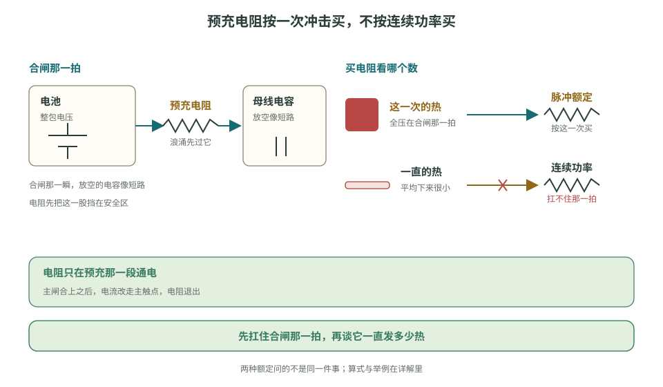

> **看图**　预充电阻的功率，为什么按这一次冲击的能量买，不按平摊下来的功率买？

> **动手**　跑 `python bms-book/code/precharge_timeline.py`：复算 τ = 0.17 s、I0 ≈ 2.35 A、80 J 与 3τ 处的 380 V，并核对超时、不上升、粘连三条禁止合 K1 的证据（400 V / 1 mF / 170 Ω 是教学示例）。

> **原理**　母线电容放空时相当于短路。先用预充电阻把电容充到和电池压差足够小，再合主接触器，否则触点会烧蚀粘连。电阻按单次脉冲能量选型，不按连续功率。
> **证据**　时序动画在本节。整包参考 [ENNOID-BMS](https://github.com/EnnoidMe/ENNOID-BMS)（英文，可选）。线绕电阻、密封接触器，以及和主接触器同框的预充电阻，在 [详解④ §1.3](../circuits/04-系统安全与量产.md#13-主动放电碰撞后的-5-秒钟-理解)。400 V 与数千安是数量级示例。
> **延伸阅读**　有的接触器把旁路做进器件里。那是另一条路，见详解④里的 E-T-A 片子，并记住：片子讲的不是电阻预充的替代教材。

**视频**　YouTube · 英文，可选 · [E-T-A《高压接触器与旁路预充》](https://www.youtube.com/watch?v=Xy6EdcROX_M)

放在电阻预充算完之后看。片子里的半导体旁路是这家产品的做法，教材主线仍是 K2 串电阻。不要带电拆高压包。

[](https://www.youtube.com/watch?v=Xy6EdcROX_M)

**短自测**

1. 母线电容还是空的，能直接合主闸吗？
2. 预充电阻按连续功率买，还是按一次冲击的脉冲能量买？

<details>
<summary><b>参考答案（先自己想完再展开）</b></summary>

1. 不能。放空的电容像短路，触点会打火粘连。先用预充电阻灌到接近包压，爬不上来就停在故障。
2. 按脉冲能量。½CU² 在很短时间里变成热。400 V、1 mF 那笔账在详解① §3.2，是示例不是你的包。

</details>

**练完你会怎样**：合闸前你会先看母线电压爬没爬上来。


## 6.1.3 绝缘检测（IMD） [分析]

高压包与机壳之间的绝缘电阻必须实时监测。主流**电桥法**：在 B+/B- 与机壳间交替投切已知电阻桥，测两组电压联立解出 $R_{iso+}$、$R_{iso-}$。

- 判据示例（以 GB/T 38661、ISO 6469 或产品标准为准）：常见 <500Ω/V 报警、<100Ω/V 故障；
- 误差源：母线电压波动、Y 电容充放电——Y 电容典型 nF–µF 级，与 MΩ 级桥臂形成毫秒–秒级时间常数，采样必须安排在投切后 3–5 个 τ 的稳态窗口内做，急不得。


> **图说**　盯住两次投切：每次得到一个方程，联立才解得出正负对地的绝缘电阻。

> **口诀**　投切两次，得到两个方程，解出正负对地的绝缘电阻。

电桥是一条路。另一条是低频方波注入：经已知电阻送进一个小方波，用稳态电流反推绝缘。边缘上的尖峰是 Y 电容在充电，不能拿来除。

**练完你会怎样**：你能用上面那句口诀，把这张图讲给别人听。

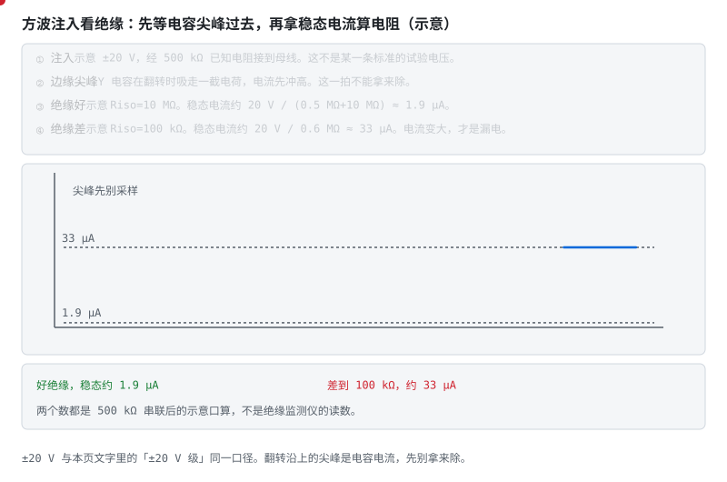

> **图说**　示意注入 ±20 V，串联 500 kΩ。

> **口诀**　方波一翻，先别采样。等尖峰过去，电流变大才是绝缘变差。

**看动画时盯住哪里**

翻转瞬间电流先冲高。绝缘示意 10 MΩ 时，稳态大约 20 V / 10.5 MΩ ≈ 1.9 µA。绝缘掉到 100 kΩ 时，大约 20 V / 0.6 MΩ ≈ 33 µA。电流变大才是漏电变大。±20 V 与本节「±20 V 级」同一口径，不是某一条标准的试验电压。

- 波形边上的红点：电容尖峰，这一拍跳过。
- 平台段：才用来除。
- 1.9 µA 和 33 µA：同一个注入，两种绝缘。

**短自测**

1. 为什么方波刚翻转时不能算绝缘电阻？
2. 示意里 10 MΩ 和 100 kΩ，稳态电流大约各是多少？
3. 1.9 µA 能写成绝缘监测仪的实测吗？

<details>
<summary><b>参考答案（先自己想完再展开）</b></summary>

1. Y 电容在那一拍吸走电荷，电流里混着充电，不是漏电。
2. 大约 1.9 µA 和 33 µA。分母分别是 0.5 MΩ+10 MΩ 和 0.5 MΩ+0.1 MΩ。
3. 不能。它是 500 kΩ 串联之后的口算，用来看「绝缘变差则电流变大」。

</details>

**练完你会怎样**：你能指出采样点应该落在平台上，而不是落在方波的棱上。


电阻变小只说明「漏了」。漏在哪一截，要看机壳相对负极的电压：

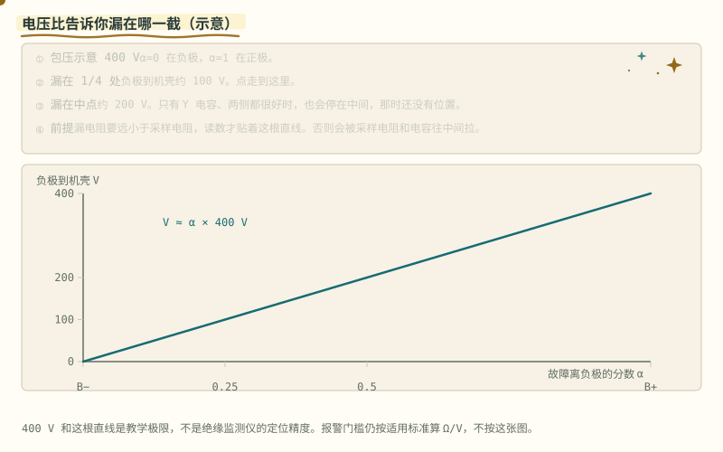

> **图说**　包压示意 400 V。

> **口诀**　电压比告诉你漏在哪一截。中间那个数，也可能只是还没漏。

**看动画时盯住哪里**

漏电阻远小于采样电阻时，负极到机壳的电压约等于 α×400 V，α 是故障离负极的分数。漏在四分之一处，大约是 100 V。漏在中点，大约是 200 V。只有 Y 电容、两侧都很好时，读数也会停在中间，那时还没有「位置」。前提不成立，采样电阻和电容会把读数往中间拉。

- 黄点沿着直线走。α = 0 在负极，α = 1 在正极。
- 0.25 对 100 V，0.5 对 200 V。
- 这根线是极限。不是监测仪的定位精度。

**短自测**

1. 负极到机壳约 100 V，包压 400 V，故障大约在哪？
2. 为什么读到 200 V 不能马上说漏在中间？
3. 这根直线的前提是什么？

<details>
<summary><b>参考答案（先自己想完再展开）</b></summary>

1. 大约在从负极数起的四分之一处。100/400 = 0.25。示意。
2. 两侧绝缘都很好、只有 Y 电容时，机壳也会停在中间。先看绝缘电阻是不是已经变小。
3. 漏电阻要远小于采样电阻。否则读数被采样网络往中间拉，位置会偏。

</details>

**练完你会怎样**：绝缘报警之后，你会用电压比估一估漏靠近哪一端，而不是只报一个「绝缘低」。


动画把"两次投切"演了一遍：B+ 侧投一次、B− 侧投一次，两组电压读数联立才能分别解出 R_iso+ 和 R_iso−——单侧绝缘下降时整包对地电位会偏移，只测一侧是要漏判的。

- **联立求解的数学**（电桥法怎么从两个电压算出两个电阻）：思路像称体重——一边一次称不出两个人的分量，就让你俩轮流单独上秤。设已知桥臂电阻 $R_p$、$R_n$（MΩ 级、1% 精度、耐压按母线）：B+ 侧投入时 B− 对地测得 $U_1$，B− 侧投入时测得 $U_2$，两次各得一个含 $R_{iso+}$、$R_{iso-}$ 的分压方程，联立即得闭式解。代码层面只是两个除法，**工程难度全在细节上**：采样必须落在投切后 Y 电容充放电结束的稳态窗（上一条的误差源）、桥臂电阻的耐压与漏电流自身要合格、母线电压在两次测量间不能明显波动；
- **低频方波注入法**（第二条主流路线）：经大电阻向母线注入 ±20V 级的低频方波，测回路耦合电流反推绝缘电阻。对 Y 电容鲁棒（方波基频远低于 Y 电容阻抗拐点），代价是注入电路本身成为新的安规器件。车规方案多走这条；
- **外接 IMD 仪器**（第三条路）：储能柜常见——Bender 等独立绝缘监测仪专职测量，BMS 经 CAN 或干接点读它的报警位。职责边界干净，BOM 多一个器件；
- 现场误报的主要来源：多点绝缘同时下降（方程假设单点失效）、潮湿凝露（阻值边缘抖动）——量产做法是多帧滤波 + 温湿度联合判断，不在本节展开。

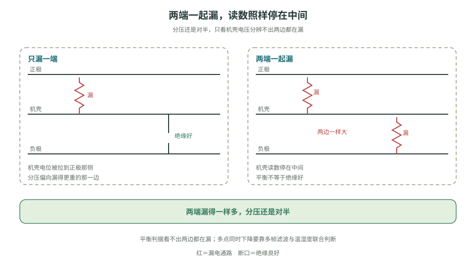

> **看图**　机壳读数停在中间，能排除两端同时漏吗？

> **原理**　高压包与机壳之间的绝缘电阻必须实时监测。主流**电桥法**：在 B+/B- 与机壳间交替投切已知电阻桥，测两组电压联立解出 $R_{iso+}$、$R_{iso-}$。
> **证据**　电桥两次测量解绝缘电阻。车规落地见 [功能安全方法论](https://www.mdpi.com/1996-1073/14/21/6942)（英文，可选）与 [GB/T 38661 公开文本](https://openstd.samr.gov.cn/bzgk/std/newGbInfo?hcno=DB3ACC49AC4A146FAA311BB468ACA290)。
> **延伸阅读**　[batterydesign.net《BMS 功能安全》](https://www.batterydesign.net/battery-management-system/functional-safety/)（英文，可选）

**短自测**

1. 电桥法为什么要投切两次？
2. Y 电容还在充的时候能采样吗？

<details>
<summary><b>参考答案（先自己想完再展开）</b></summary>

1. 一次只有一个方程，解不出正负对地两个绝缘电阻。像两个人一起称，要轮流上秤。
2. 不能。要等几个时间常数，读稳态。阶段 6 里 <500 Ω/V 报警、<100 Ω/V 故障是教学示例，产品用哪一条标准以适用文本为准。

</details>

**练完你会怎样**：你能说出：投切两次，得到两个方程。

## 6.4 功能安全落地：以过充为例走一遍 [评价]

ISO 26262 / GB/T 34590 的流程听起来抽象，走一遍就具体了：

1. **危害识别**：单体过充 → 热失控起火（回看 [热失控链](../circuits/assets/thermal-runaway.svg)）；
2. **场景分析**：充电中电压采样失效 / MOS 粘连 / 充电机失控；
3. **ASIL 定级**：由 HARA 结果决定——很多车用项目把防过充定为 ASIL C 或 D（仅为示例，须按场景、暴露率与车型风险评估定级）；
4. **安全目标**：任何单点失效不得导致单体电压超过安全限值；
5. **功能安全要求**：双通道独立保护——MCU 软件保护 + AFE/独立保护 IC 硬件保护；
6. **技术安全要求**：ADC 自检与开线检测周期按 FTTI（故障容忍时间间隔）推导，本例取 <100ms；MOS 驱动回路诊断；通信 CRC + 超时；独立看门狗；
7. **验证**：失效注入测试——拔采样线、短 MOS、停喂狗，逐项确认**硬件通道独立生效**。

单点失效发生后，独立防线仍要把电池带到安全状态；分析时还要证明两道防线不会被同一原因同时击穿。深入研读：[《车用 BMS 功能安全设计方法论》（MDPI Energies 2021）](https://www.mdpi.com/1996-1073/14/21/6942)、[batterydesign.net《BMS 功能安全》](https://www.batterydesign.net/battery-management-system/functional-safety/)、[英飞凌知识库《ASIL 分解》](https://community.infineon.com/t5/Knowledge-Base-Articles/ASIL-decomposition-ISO-26262/ta-p/852405)。

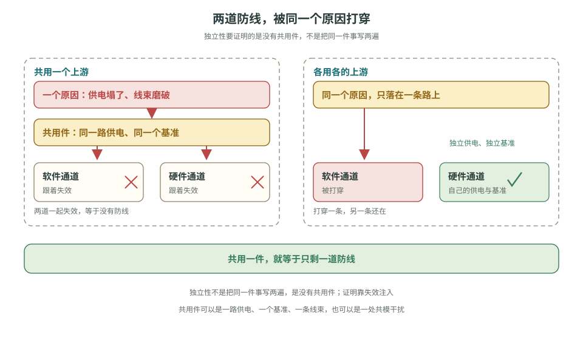

> **看图**　两条通道都做了，为什么还要问它们共用什么？

> **原理**　功能安全要把「非预期输出高压」从危害一路落到独立的硬件关断，并用失效注入证明软件死了这条通路仍然有效。
> **证据**　本节可点击来源：[《车用 BMS 功能安全设计方法论》（MDPI Energies 2021）](https://www.mdpi.com/1996-1073/14/21/6942)。阈值与宣传口径仍以 datasheet / 标准原文为准。
> **延伸阅读**　[瑞萨《BMS 教程》中文导读](../renesas-bms-tutorial-中文导读.md)（可选扫盲）。把七步走成一条会误诊的过充，见 [§6.4.1](stage-6-精通与毕业项目.md#641-过充案例开线被当成过充-评价)。

## 6.4.1 过充案例：开线被当成过充 [评价]

上面七步是一条能走完的路径。下面用教学案例把它走完。这不是某次事故的调查报告，也没有编 ISO 26262 的条款号。

发生了什么：充电中，第 3 串的 ADC 连续三拍高于软件过充阈值，其余串仍在充电平台里。软件切断充电 MOS，DTC 记成过充。

信号：只有这一串冲高；切断前电流仍是充电方向；开线检测位没有被读。采样线断开时，检测电流可以把悬空脚推向异常电平，读数可以像过充，也可以像过放。这和电芯的真实电压不是同一件事，见 [详解④ §3.4](../circuits/04-系统安全与量产.md#34-采样链的可信度断线检测-分析)。

两条根因要能在记录里分开：

1. 真过充。这一串的电压确实越过安全限。不经过这颗 MCU 的硬件比较器也应切断。软件停了，这条通路还在。
2. 开线。电芯并没有过充。根因是线束。把它记成过充，维修会去换电芯，或者把阈值放宽。

误诊就出在三条路上：只信 ADC，不开线检测就定过充；为了还能充电，用标定或云端把软件阈值放宽；硬件比较器被短接或没装。§6.4 里的 ASIL C 或 D 是示例，由 HARA 按场景来定，不是所有车的固定等级。文中「ADC 自检与开线检测 <100 ms」也是这条教学路径里的取值，不是从标准条款抄来的唯一数字。

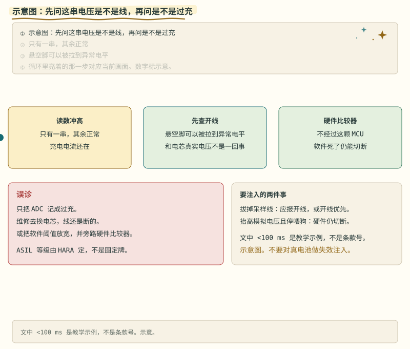

> **图说**　读数冲高之后先查开线，硬件比较器不经过 MCU。

> **口诀**　读数冲高，先问是不是线，再问是不是过充。

**看动画时盯住哪里**

红格是误诊：只记过充，或放宽软件并旁路硬件。绿格是要注入的两件事。蓝点沿这条路径走。示意图。不要对真电池做失效注入。

共享资源里的 [File:ISO 26262 ASIL berechnen.svg](https://commons.wikimedia.org/wiki/File:ISO_26262_ASIL_berechnen.svg)（CC BY-SA 4.0）是严重度、暴露率和可控性怎么算出 ASIL 的图，不是认证现场的照片，没有收。

2026-10-05 再看的 [HIMA 演讲照片](https://commons.wikimedia.org/wiki/File:Functional_safety_in_a_connected_world_-_HIMA_(40604023743).jpg) 是会议演讲者，不是失效注入、硬件比较器和见证记录同框，也不收。

功能安全见证现场的实拍仍然没有。本节继续用这条过充路径，不编条款号。

近邻是电池试验室。爱达荷国家实验室的一张写的是电动车与储能电池的过热测试能力。橡树岭的一张是锂离子电芯制备实验环境。能源部另有一张同一类 INL 测试照片，公有领域。三张都是试验或制备环境。

**练完你会怎样**：你能用上面那句口诀，把这张图讲给别人听。

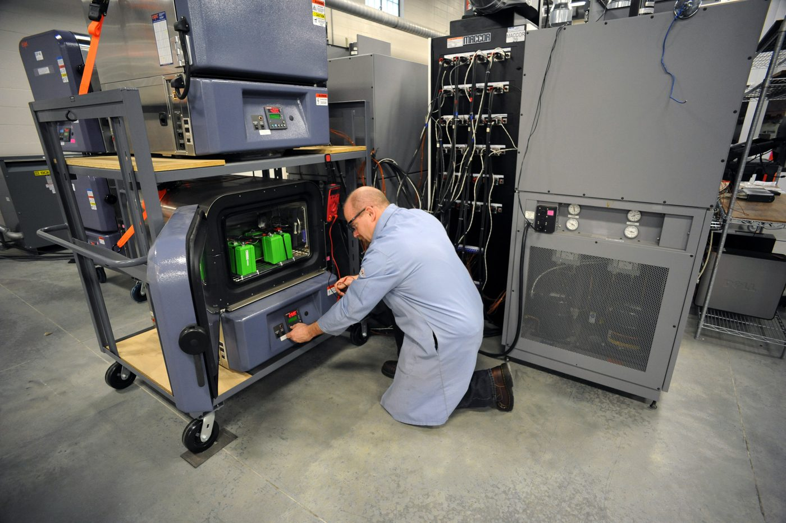


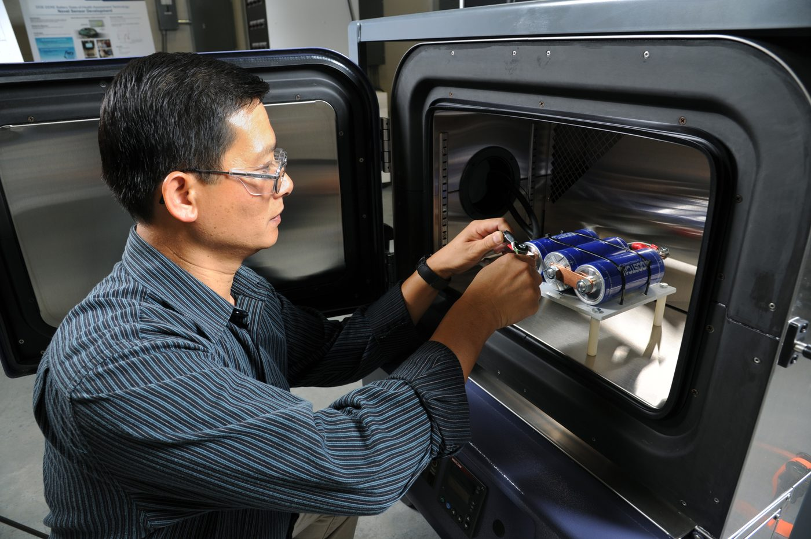

来源见 [照片来源](../circuits/assets/photos/PHOTOS.md)。


> **图说**　绿线在教学反应时间 10 ms 跳到已切断。红线是停掉的软件，一直是 0。100 ms 是同一笔示意 FTTI，不是认证结论。

> **口诀**　注入一次，独立切断一次，把时间写下来。

**看动画时盯住哪里**

金点沿绿线走。软件停了，红线仍是 0：比较器不经过这颗 MCU，也不能被标定旁路。记录里要能看出切断时间。这不是认证结论，功能安全见证的实拍仍然没有。上面三张试验室照片不是这张时序。不要对真电池做失效注入。

验证就两下，对应上面第 7 步：拔掉这一根采样线，确认报的是开线，或开线优先于「这是过充」；用模拟电压抬高这一串，并停掉喂狗，确认硬件通道仍切断。PC 上的 `hil_replay` 只能演示「0 mV 会被现有骨架记成欠压」，替代不了这两下。

> **原理**　过充的安全目标是单点失效不得让单体电压越过安全限。读数冲高时，先判断采样线是否还在，再判断电芯是否真的过充。硬件切断不依赖 MCU 和云端。
> **证据**　方法论文仍是 [《车用 BMS 功能安全设计方法论》（MDPI Energies 2021）](https://www.mdpi.com/1996-1073/14/21/6942)。开线机理在 [详解④ §3.4](../circuits/04-系统安全与量产.md#34-采样链的可信度断线检测-分析)。本页不引用未核对的条款号。
> **延伸阅读**　云端把阈值放宽的边界在 [§6.2.6](stage-6-精通与毕业项目.md#626-云端诊断停在包外-评价)。PC 回放在 [§6.2.5](stage-6-精通与毕业项目.md#625-故障注入与快照回放-应用)。

**短自测**

1. 只有一串读数冲高，第一反应是换电芯吗？
2. 软件停了，硬件比较器还要在吗？

<details>
<summary><b>参考答案（先自己想完再展开）</b></summary>

1. 先问是不是采样线。开线可以把悬空脚推向像过充的电平。记成过充，维修会去换电芯，或者把阈值放宽。
2. 要。它不经过这颗 MCU，也不能被标定旁路。功能安全见证现场的实拍仍然没有，不要把试验室照片当成认证现场。

</details>

**练完你会怎样**：读数冲高，你先问线，再问过充。


从故障发生到必须做完安全动作，只有一个口袋。检测、去抖、反应都要装进去。

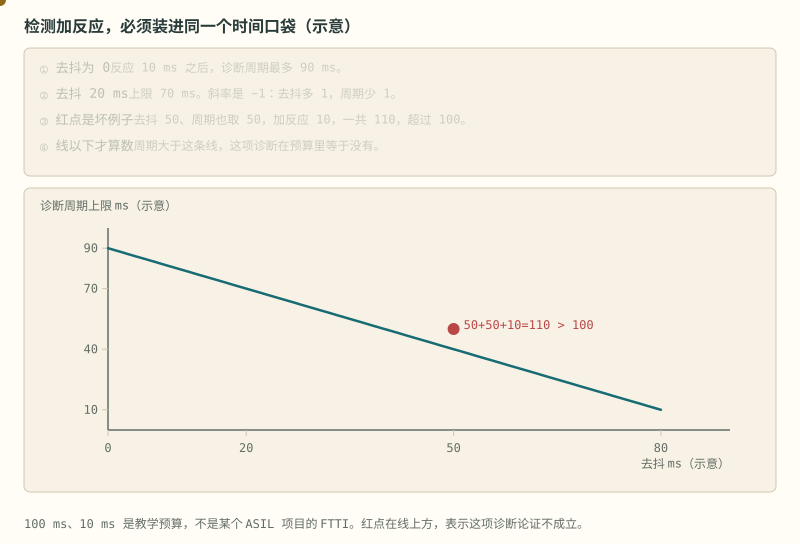

> **图说**　盯住下降直线上的黄点和线外的红点：去抖多 1 ms，允许的诊断周期就少 1 ms。

> **口诀**　诊断周期的上限 = 口袋 − 反应 − 去抖。线以上等于没做这项诊断。

**看动画时盯住哪里**

黄点沿下降的直线走，那是还允许的周期。红点停在线外，不要跟着它走。

示意口袋 100 ms，反应 10 ms。诊断周期上限 $T=90-t_\mathrm{debounce}$。去抖为 0，周期最多 90 ms。去抖 20 ms，最多 70 ms。斜率是 −1：去抖多 1 ms，周期就必须少 1 ms。红点是坏例子：去抖 50 ms、周期也取 50 ms，再加反应 10 ms，一共 110 ms，超过 100 ms。那个点在线的上面。

这不是某个 ASIL 项目的 FTTI，只说明不等式怎么约束周期。

**短自测**

1. 去抖 20 ms、反应 10 ms、口袋 100 ms，诊断周期最多多少？
2. 红点为什么不行？

<details>
<summary><b>参考答案（先自己想完再展开）</b></summary>

1. 70 ms。
2. 50+50+10=110，大于 100。最坏检测时间大约是一个周期再加去抖。数字是示意预算。

</details>

**练完你会怎样**：你定诊断周期时，会先写下口袋、反应和去抖，再看周期还剩多少。


覆盖率不是「故障消失了」。残余大致按 $1-\mathrm{DC}$ 留下。

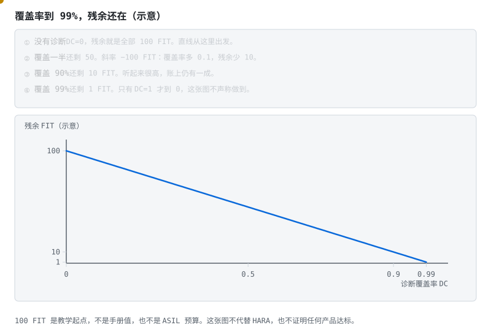

> **图说**　盯住沿直线下降、在右端仍高于 0 的黄点：覆盖到 99%，残余还在。

> **口诀**　覆盖到 99%，残余还在。只有 100% 才到零，而这张图不声称做到。

**看动画时盯住哪里**

黄点沿直线下降，越靠近右端越低，但在 0.99 处仍高于 0。

教学用：起点 100 FIT，$\lambda_\mathrm{res}=100\times(1-\mathrm{DC})$。覆盖 50% 还剩 50。覆盖 90% 还剩 10。覆盖 99% 还剩 1。直线，斜率 −100 FIT。这不是零件手册里的 FIT，也不是认证计算，更不能用来声明产品达到某个 ASIL。

常见的坑：把「我们做了诊断」说成残余可以忽略。90% 的覆盖仍留下一成。

**短自测**

1. 覆盖率 0.9 和 0.99，残余各是多少 FIT？
2. 为什么这张图不能当认证结论？

<details>
<summary><b>参考答案（先自己想完再展开）</b></summary>

1. 10 和 1。
2. 100 FIT 是教学起点。图上没有危害分析，也没有某个产品的诊断覆盖试验。

</details>

**练完你会怎样**：你听到「覆盖率很高」，会顺手算一下还剩的那一截，而不是把故障划掉。

---

[下一篇：量产与毕业](./stage-6-主线-量产与毕业.md) · [完整讲义与原有锚点](./stage-6-精通与毕业项目.md)

[选读：EMC、并簇与热管理](./stage-6-选读-系统边界.md) · [选读：故障回放与云端](./stage-6-选读-固件与云端.md) · [选读：算法、法规与自测](./stage-6-选读-算法法规与自测.md)

<!-- Generated by prepare-stage6.mjs; edit stage-6-精通与毕业项目.md. -->
