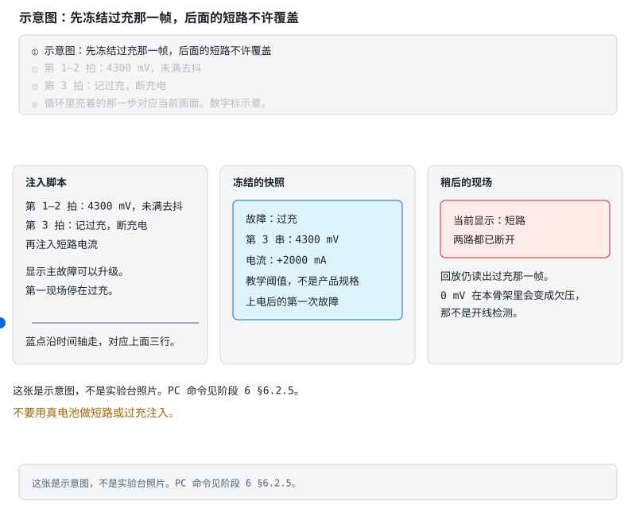
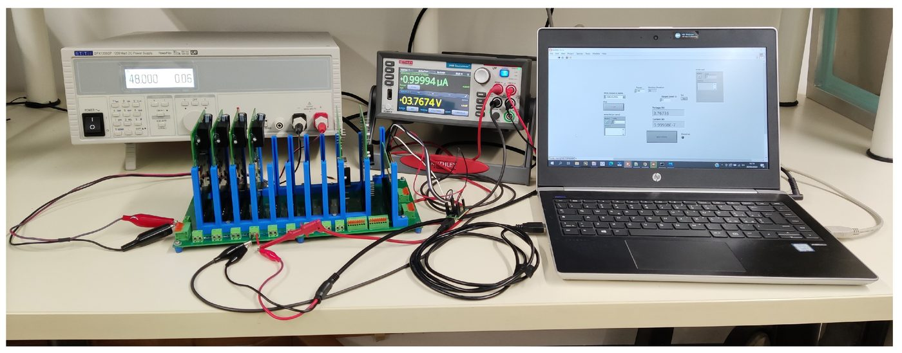
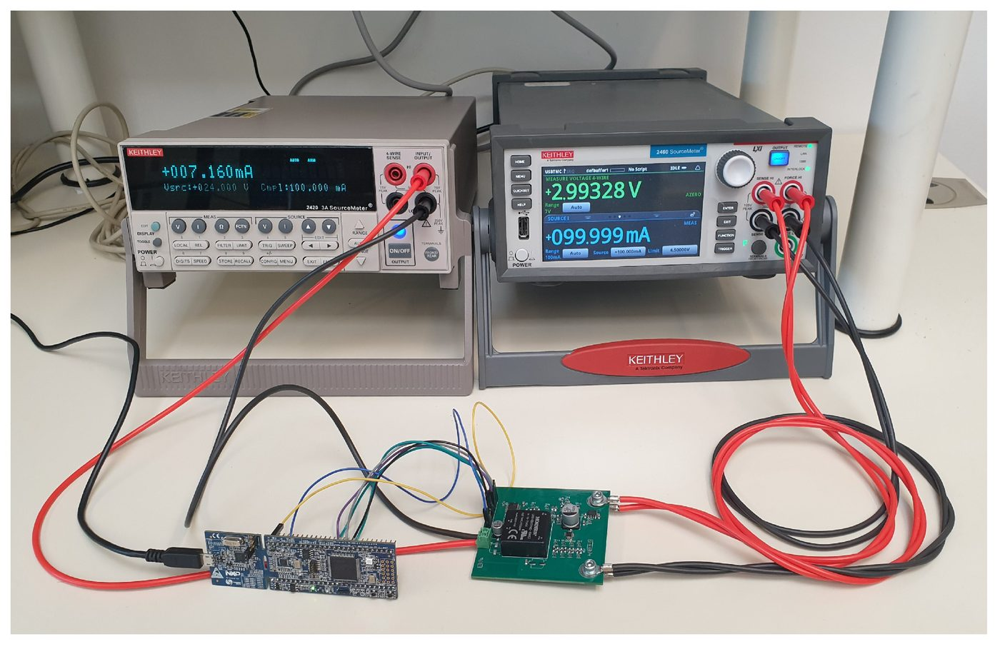
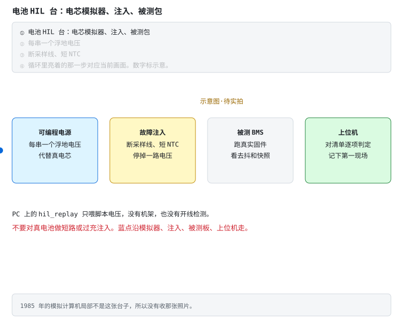
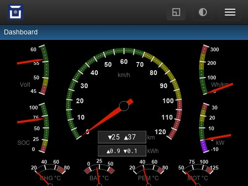
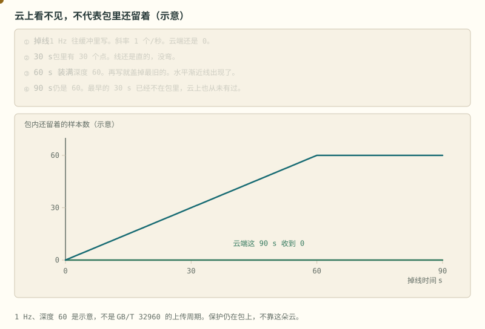

# 阶段 6 选读：故障回放与云端诊断

准备搭 HIL、做远程诊断或追查偶发故障时再读。危险动作留在仿真与台架，包内保护不能等待云端。

> **阅读边界**　这是一条短路径，不删公式、阈值和适用条件；需要旁支时再打开文末选读。

## 6.2.5 故障注入与快照回放 [应用]

§6.2.2 的快照是「触发那一拍冻住」。回放是事后把这一拍再读出来，并确认后面的故障没有把它盖掉。真实验台用可调电压代替电芯，本仓库这一步在 PC 上调用现有的 `bms_tick`，不改 `bms.c` 里的保护。

怎么跑：

```bash
cd code/firmware
gcc -std=c99 -Wall -Wextra -Werror -o hil_replay bms.c hil_replay.c && ./hil_replay
```

脚本用的阈值和 `test_bms` 相同：过充 4250 mV、去抖 3 拍，短路 30 A。这些是锂电教学示例，不是产品规格，也不是钠离子窗口。

程序打两段。案例 A：充电中把第 3 串写成 4300 mV。前两拍可以已经进入均衡（压差够了），但还不到去抖，不应进故障。第三拍冻结过充、4300 mV、+2000 mA，并断开充电。下一拍改注入 −40 A，显示主故障升级成短路，两路都断；快照里的故障码、电压和电流仍是过充那一帧。案例 B：把一串写成 0 mV。去抖之后快照是欠压。这个骨架没有开线标志，0 mV 只能落到欠压。真实验台要另注入断线，并核对开线 DTC，不能把案例 B 的欠压当成开线已经测过。



> **图说**　左格是脚本的三步，中格是冻住的过充帧，右格是后来的短路。

> **口诀**　后来的故障可以改显示。已经冻住的第一现场不改。

**看动画时盯住哪里**

蓝点只沿时间轴走。第一现场停在过充。这张是示意图。不要用真电池做短路或过充注入。

2026-10-05 在共享资源检索过硬件在环、电芯模拟器和 HIL 台。对得上名字的一张是 [File:Analogrechner HW-in-Loop Ausschnitt.jpg](https://commons.wikimedia.org/wiki/File:Analogrechner_HW-in-Loop_Ausschnitt.jpg)（CC BY-SA 4.0），画面是大约 1985 年的 EAI 模拟计算机局部。

那不是电池电芯模拟器机架，所以不放进仓库。同一天再看：硬件在环的检索里还有学位论文 PDF，以及注册号带 HIL 的客机，都不是电池台。厂商电芯模拟器商品页没有写明可以转载，不收。记录在 [照片来源](../circuits/assets/photos/PHOTOS.md)。

可编程电源、故障注入、被测 BMS 和上位机在同一张里的实拍仍然没有。可以放进仓库的是仿真器表征台，两篇都是 CC BY 4.0。Verani 等 Electronics 2023 的 Figure 4 是模块化电池仿真器的表征布置：TTi QPX1200SP、仿真器机架、Keithley 2460 和笔记本。Di Rienzo 等 Electronics 2022 的 Figure 3，图注写的是电芯仿真器表征用的实验布置。两张画面里都没有被测 BMS。

**练完你会怎样**：你能用上面那句口诀，把这张图讲给别人听。



Verani、Di Rienzo、Baronti、Roncella、Saletti，[Electronics 2023, 12, 1232](https://doi.org/10.3390/electronics12051232)，Figure 4。开源电池仿真器表征台。没有被测 BMS。



Di Rienzo、Verani、Baronti、Roncella、Saletti，[Electronics 2022, 11, 1215](https://doi.org/10.3390/electronics11081215)，Figure 3。仿真器表征台。来源见 [照片来源](../circuits/assets/photos/PHOTOS.md)。



> **图说**　同一框里是可编程电源、故障注入、被测 BMS、上位机。

> **口诀**　可编程电源代替电芯。脚本电压不是这张机架。

**看动画时盯住哪里**

电源用浮地电压代替真电芯；注入可以断采样线、短 NTC 或停掉一路电压；被测板跑真实固件；上位机对清单判定并记下第一现场。蓝点沿这四件走。示意图·待实拍。1985 年的模拟计算机局部不是这张台子。上面的 `hil_replay` 只喂脚本电压，没有机架，也没有开线检测。

**故障分析**

- 快照每次故障都重写。售后看到的是最后一条短路，过充那一拍的电压和电流没了。本骨架刻意只留上电后的第一次；量产要的是「每条故障事件的第一拍」，读走或恢复后再允许下一条，见 `bms.h` 里 `FaultSnapshot` 的注释。回放程序没有把骨架改成后者。
- 去抖未满时状态已经是均衡，就被当成保护没在计时。保护和状态迁移是两条线，案例 A 的前两拍就是这样。
- 把 0 mV 直接记成电芯过放。开线和真欠压在这个骨架里长得一样。先有开线检测，再信这串电压，见 [详解④ §3.4](../circuits/04-系统安全与量产.md#34-采样链的可信度断线检测-分析)。

**案例解析**（教学案例；数字来自上面的 PC 脚本，不是某次事故）

发生了什么：充电中第 3 串被脚本抬到 4300 mV。第三拍 BMS 进故障，快照记下过充和当时的 +2000 mA。随后电流被改成短路量级。

信号：屏幕上的主故障变成短路，充放电都断了。把快照再读一遍，故障码仍是过充，第 3 串仍是 4300 mV，电流仍是 +2000 mA。

根因：显示用的主故障会升级，第一现场不跟着改。若实现成「后来的故障覆盖快照」，办公室里就只剩短路，看不出它是在过充之后发生的。

BMS 上的教训：回放读的是冻结帧，不是当前 ADC。注入清单至少包括「去抖边界」「第一现场不被覆盖」和「开线与真欠压分开」。PC 脚本覆盖前两件；开线仍要在带检测电流的台子上做。分压链和可编程电源可以代替电芯，不要对真电池做这些注入。

> **原理**　故障注入是按脚本改采样，看去抖、断口和快照是否和安全要求一致。回放是把触发那一拍再读出来。后来的故障可以改当前显示，不应改已经冻结的第一现场。
> **证据**　可核验命令见本节。`hil_replay` 只链接现有 `bms.c`。开线与真过放的差别见 [详解④ §3.4](../circuits/04-系统安全与量产.md#34-采样链的可信度断线检测-分析)。台架思路见 [EEVblog 电芯模拟器讨论](https://www.eevblog.com/forum/projects/lithium-battery-cell-simulatoremulator-for-bms-testing/)。
> **延伸阅读**　快照五要素在 [§6.2.2](stage-6-精通与毕业项目.md#622-故障管理dtc-体系-应用)。功能安全的失效注入在 [§6.4.1](stage-6-精通与毕业项目.md#641-过充案例开线被当成过充-评价)。只有电脑时，把这一节走完的五天在 [共学 · 固件](../共学/03-固件五天.md)。

**练完你会怎样**：你能用上面那句口诀，把这张图讲给别人听。

## 6.2.6 云端诊断停在包外 [评价]

车队平台看的是报上来的帧：电压、温度、报警、SOC。它适合看一批车的漂移、哪一批电芯先老化、标定要不要改。它不在切断回路里。

时间尺度分开。GB/T 32960.2—2016 对车载终端的写法是：实时数据采集频次不应低于 1 次/s；正常时内部存储间隔最大不超过 30 s；出现该标准所指的 3 级报警时，存储间隔最大不超过 1 s。上传还要符合 GB/T 32960.3。通信中断时先存本地，恢复后再补发。这是监控记录。包上的比较器、接触器和熔断器按自己的去抖和硬件速度切断，不等这 30 s。

必须留在包上的：过充、过放、过流、短路、过温的切断；开线检测；绝缘和接触器粘连的安全状态。这些不依赖蜂窝信号。

可以放在云上的：车队统计、SOH 模型的离线更新、一份「建议标定」。建议值写进包之前，要走 [§6.2.3](stage-6-精通与毕业项目.md#623-参数与标定系统-应用) 的版本、CRC 和双备份，并且不得放宽硬件比较器。OTA 只换应用区，bootloader 不被覆盖，见 [§6.2.4](stage-6-精通与毕业项目.md#624-bootloader-与-ota-应用)。



> **图说**　三条阶梯在对数时间上先后落下。短路示例 10 μs，过充窗口 80–200 ms，都早于正常存储最多 30 s。

> **口诀**　包上这一拍就断。云上的报文可以晚半分钟。

**看动画时盯住哪里**

金点沿 80 ms 那条走。包上的比较器不等云上那 30 s。这张不是平台截图。

2026-10-05 检索过车队监控和 telematics。公共汽车 GPS 控制室、车队定位平台的界面图、车展上的车载通信展台，画面里没有电池单体电压和包内 DTC，没有收。可转载的仪表盘是 OVMS 的网页：单车 SOC、续航、电池电压、电流、温度和 SOH。项目许可 MIT。它是开源车载监控，不是商业车队云的后台，也不在切断回路里。

**练完你会怎样**：你能用上面那句口诀，把这张图讲给别人听。



Open Vehicles / OVMS，[Dashboard](https://docs.openvehicles.com/en/stable/components/ovms_webserver/docs/dashboard.html)。来源见 [照片来源](../circuits/assets/photos/PHOTOS.md)。



> **图说**　蓝线是存储年龄对 30 s 取余。绿线钉在 1 s，那是 3 级报警的存储上限。

> **口诀**　云上看见的是已经发生的帧。切断不看它在不在线。

**看动画时盯住哪里**

金点沿锯齿走，锯齿顶端是 30 s。绿线是 1 s，3 级报警的存储不超过这一档。切断仍留在包上，不看这条记录到没到。上面的 OVMS 是单车网页，不是这张锯齿。正常存储可以到 30 s。

**故障分析**

- 平台半分钟没有报警，就认为没有过充。正常存储可以到 30 s，断网时报文还在终端里。平台安静不等于包安静。
- 用云端标定把软件过充点改高，用来消掉「误报」，并把硬件比较器一并放宽或旁路。软件这条通道就不再有独立的第二道。
- 把热失控切断做成「等云端下令」。链路、平台和人的延迟都不在包上的故障响应时间里。

**案例解析**（教学案例，不是某次事故调查）

发生了什么：充电中一串越过包内阈值。软件去抖后断开充电 MOS，硬件比较器仍按本地分压处于能切断的状态。车载终端按正常周期把数据放进存储。平台侧要等这条记录上传；若当时没有被标成 3 级报警，存储间隔仍按不超过 30 s 那一档。

信号：包内 DTC 和快照的时间早于平台上的同一条电压。平台曲线在切断之后才出现尖峰，或因补发而晚到。只看平台的人会说「云端没有及时保护」。

根因：把监控上报当成保护动作。

BMS 上的教训：硬切断留在包上。云端可以建议新阈值，包上的参数更新仍要校验，并且不能改硬件比较器的分压。晚到的报文用来复盘，不用来决定这一秒断不断。

> **原理**　云端看的是已经发生、再被记下来的帧。过充过放和短路的切断必须在包上完成，因为上报间隔和断网补发都以秒计，保护动作不是这条链路。
> **证据**　记录间隔见 GB/T 32960.2—2016：采集不低于 1 次/s，正常存储最大不超过 30 s，该标准所指的 3 级报警存储最大不超过 1 s。上传周期另见 GB/T 32960.3。这是监控，不是 FTTI。
> **延伸阅读**　参数区在 [§6.2.3](stage-6-精通与毕业项目.md#623-参数与标定系统-应用)，升级边界在 [§6.2.4](stage-6-精通与毕业项目.md#624-bootloader-与-ota-应用)。开线与过充的差别在 [§6.4.1](stage-6-精通与毕业项目.md#641-过充案例开线被当成过充-评价)。

**短自测**

1. 平台上 30 秒没有报警，能说明包没有过充吗？
2. 热失控切断可以等云端下令吗？

<details>
<summary><b>参考答案（先自己想完再展开）</b></summary>

1. 不能。GB/T 32960 那一档正常存储可以到 30 s。那是监控记录，不是切断时限。断网时报文还在终端里。
2. 不可以。比较器和接触器在包上这一拍就断。云端可以建议标定，不能放宽硬件比较器。

</details>

**练完你会怎样**：你能把「云上看见」和「包上切断」分成两件事。OVMS 那张图是单车网页，不是切断回路。


云上的曲线断了，不等于包里还留着完整的一段。缓冲满了就盖旧数据。



> **图说**　盯住爬到深度就改走水平的黄点，以及贴着 0 的绿线：云端在掉线期间仍然一个点都收不到。

> **口诀**　先按每秒一个点往上堆。堆到深度就改走平线。云在恢复前是 0。

**看动画时盯住哪里**

黄点先沿斜线爬，到 60 之后改走水平线。绿线贴着 0。

示意：采样 1 Hz，缓冲深度 60。掉线后 $n=\min(60,t)$，$t$ 用秒。30 s 时包里 30 个点。60 s 装满。90 s 仍然是 60，最早的 30 s 已经被新点盖掉。绿线是云端收到的个数，整段掉线里都是 0。水平那段就是渐近线：深度有限，样本数不会跟着掉线时间一直涨。

这不是 GB/T 32960 的上传周期。保护在包上，不靠这朵云。把云仪表盘的空白理解成「那一阵没有故障」，是把记录和安全弄反了。

**短自测**

1. 掉线 90 s、深度 60、1 Hz，包里还剩多少点？丢掉的是哪一段？
2. 为什么云上的 0 不能证明包是健康的？

<details>
<summary><b>参考答案（先自己想完再展开）</b></summary>

1. 还剩 60 个点。最早约 30 s 被覆盖，云上一个也没收到。
2. 掉线时上传就是 0。故障可以留在包内的 DTC 里。1 Hz 和深度 60 是示意。

</details>

**练完你会怎样**：你看云曲线断档时，会问缓冲有多深、盖掉的是旧是新，而不是只刷新页面。

---

[返回：量产与毕业](./stage-6-主线-量产与毕业.md) · [完整讲义与原有锚点](./stage-6-精通与毕业项目.md)

[选读：EMC、并簇与热管理](./stage-6-选读-系统边界.md) · [选读：故障回放与云端](./stage-6-选读-固件与云端.md) · [选读：算法、法规与自测](./stage-6-选读-算法法规与自测.md)

<!-- Generated by prepare-stage6.mjs; edit stage-6-精通与毕业项目.md. -->
