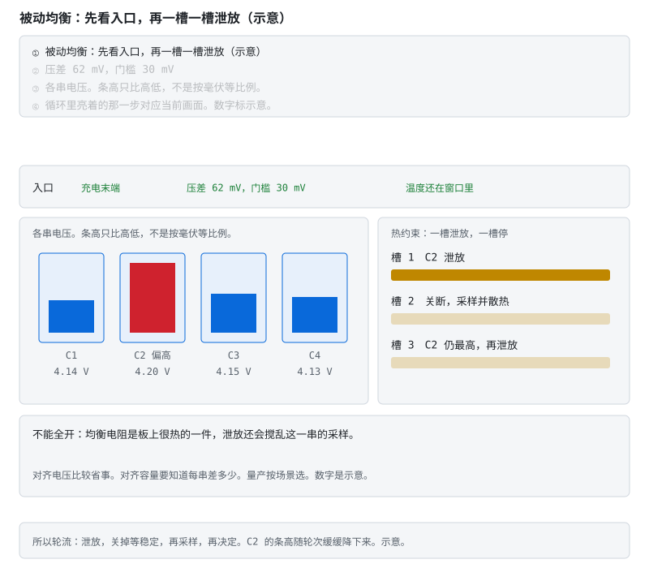

# 阶段 6 选读：算法、法规与完整自测

主线走通后，用这篇查缺补漏。算法条目是深化路线，法规日期和测试条件要回到适用版本核对；自测答案用于复盘，不用于代替实验。

> **阅读边界**　这是一条短路径，不删公式、阈值和适用条件；需要旁支时再打开文末选读。

## 6.3 算法精通（阶段 4 的深化清单） [分析]

- **OCV 滞回建模**：状态里加滞回电压项（Plett Vol. II 的方法），解决"充放电曲线不重合"的系统误差；
- **双卡尔曼工程化**：快/慢滤波器的交替节奏、激励不足时冻结慢滤波器参数更新（可观测性保护）；
- **SOP 完整版**：多约束取最小 + 时长分级（2s/10s/30s）+ 温度查表降额（公式与符号约定见阶段 4）；
- **均衡策略工程化**：入口条件（充电末端、压差 > 阈值、温度允许）、目标选择（电压对齐 vs 容量对齐）、热约束下分时调度；大容量场景评估主动均衡（[电路详解 ③](../circuits/03-充电均衡与计量.md) 的拓扑对比）。

> **图说**　入口条件（充电末端、压差 62mV 超阈值、温度在窗口）满足后，最高的 C2 开始泄放——但不是一直开：泄放一个槽位就关断，等 RC 稳定再采样复测，然后下一轮决策。

> **口诀**　轮流放一节，放完等电压稳住再量。不要一起烤。

**看动画时盯住哪里**

条高随轮次缓降。热与采样精度两个约束决定了"轮询"而不是"全开"。

> **原理**　深化的第一步是把充放电 OCV 不重合写成滞回，否则平台区会留下系统性的 SOC 误差。
> **证据**　可核验演示：本节 SVG（浏览器打开即播），正文有不看动画也能读的说明。阶段 4 的模型在这里碰到热、均衡和功率限制。讲义 [Plett BMS2 课程站](http://mocha-java.uccs.edu/BMS2)（英文，可选）与 [Plett ECE5720](http://mocha-java.uccs.edu/ECE5720/index.html)（英文，可选）。
> **延伸阅读**　[ECE5720 Notes03 中文导读](../ece5720-notes03-中文导读.md)。热、均衡、功率和老化控制的讲义导读在 [UCCS 路径](../uccs-中文导读路径.md)。

**练完你会怎样**：你能用上面那句口诀，把这张图讲给别人听。

## 6.5b 法规门槛：GB 38031-2025 的热扩散 [分析]

[§6.1.4](stage-6-精通与毕业项目.md#614-emc-与热失控防护-分析) 讲了热失控的物理与预警；这一节讲**法规把物理变成了硬门槛**。GB 38031-2025《电动汽车用动力蓄电池安全要求》2025-03-28 发布：新申请型式批准的车型 2026-07-01 起执行，已获型式批准的车型 2027-07-01 起执行。全文在国家标准全文公开系统（openstd.samr.gov.cn）按标准号检索。

**这一版改了什么**：GB 38031-2020 对热扩散的要求是「起火、爆炸前 5 分钟提供热事件报警信号」——给乘员留逃生时间。2025 版升级为**热失控后不起火、不爆炸**（报警信号仍然必须，对烟气也有要求），并新增电池包**底部撞击**测试与**快充循环后安全**测试。达标思路从「预警＋逃生」变成「阻断＋约束」。

**BMS 在这条链上的位置**：

| 法规要求 | BMS 要交出的东西 | 对应的仓库内容 |
|---|---|---|
| 热事件报警信号 | dT/dt 速率报警、压差/气压突变判据，及时且不漏报 | §6.1.4 的温升速率图 |
| 不起火、不爆炸 | 隔热、泄压、排烟在结构侧；BMS 负责把触发概率压低（过充保护、绝缘监测、SOP 收敛）和触发后的断电时序 | §6.1.4 的传播图、[§6.4 功能安全](stage-6-精通与毕业项目.md#64-功能安全落地以过充为例走一遍-评价) |
| 底部撞击 | 撞击信号处理、撞后禁充的锁存逻辑 | [§6.2.2 DTC 体系](stage-6-精通与毕业项目.md#622-故障管理dtc-体系-应用) |
| 快充循环后安全 | 充电地图的快充档与耐久验证绑定 | [§4.7b 充电地图](stage-4-SOC-SOH算法.md#47b-充电地图把析锂温度sop-合成一条允许电流-应用) |

三个不要犯的错：

- **把 2020 版的「5 分钟报警」当成 2025 版的达标手段**。2025 版报警仍然必须，但只有报警不够——系统要保证不起火、不爆炸。
- **把达标当成 BMS 一个盒子的事**。热扩散是系统级验证：电芯、包、整车一起过。BMS 提供判断与断电时序，不提供防火墙。
- **在产车型只盯着 2026-07-01**。已获批车型 2027-07-01 起执行，改型验证的周期从现在往回算并不宽裕。

**练完你会怎样**：你能对着 GB 38031-2025 的热扩散条款，说出自己的毕业项目 BMS 在「报警、阻断、验证」三段里各承担什么，哪一段不在 BMS 的能力范围内、要找谁要。

> **原理**　强标把安全目标从「乘员有时间逃生」改写成「乘员不需要逃生」，并配了可试验的判据。工程师读强标的姿势和读 datasheet 一样：先看试验条件与判据，再看自己负责的部件在链路里挡哪一环。

## 6.7 自测题 [评价]

1. BMU / CMU / BDU 三者各管什么？为什么板间通信必须隔离？
2. 预充电阻为什么不能只按连续功率或单次脉冲能量选型？预充超时上不来电压，为什么**禁止**合主继电器？
3. 电桥法绝缘检测为什么要"交替投切"两组电阻？采样为什么必须安排在投切后的稳态窗口？
4. 故障五要素是哪五个？为什么故障管理还需要快照？
5. 参数区为什么要双备份 + 先写备份再切换？
6. OTA 的两条铁律是什么？违反各自的后果？
7. 走一遍防过充的功能安全链：从危害识别到验证，双通道冗余体现在哪两个器件上？
8. FTTI 怎么约束 ADC 自检与开线检测的周期？
9. 故障注入测试清单里，"短相邻采样线"想验证什么？
10. 熔断器和 MOS 保护的分工是什么？为什么说熔断器是"最后手段"？
11. 两簇并联时为什么会有环流？合闸前 BMS/系统至少要检查什么？
12. BMS 与 TMS 各管什么？冬天动力受限时两者怎么配合？
13. 电桥法测绝缘的"两组方程"隐含了什么失效假设？多点绝缘同时下降时会发生什么？
14. Y 电容为什么会影响绝缘测量？采样窗口按什么量化依据确定？
15. PC 上的快照回放里，后面的短路为什么不能盖住第一次过充？0 mV 为什么不能当成开线已经测过？
16. 平台上几十秒没有报警，为什么不能说明包没有过充？
17. 一节先过充、邻居仍低，为什么不能先加大均衡电流？

<b>参考答案（先自己想完再展开）</b>

1. **BMU**（主控）：对外 CAN、绝缘检测、继电器驱动、整包 SOC/SOP 汇总、故障决策。**CMU**（从板）：每块管 12–18 串的电压与温度采样、执行被动均衡，把数据上报 BMU。**BDU**（配电盒）：主正/主负继电器、预充回路、熔断器、电流传感器——功率通断的执行机构。必须隔离的原因：相邻 CMU 的"地"参考在电池串的不同高度，隔着十几节电池、相差几十到几百伏；BMU 侧又常与整车低压地关联。不隔离就等于把这些电位差直接加到通信芯片的 I/O 上。
2. 空电容由理想恒压源经电阻、无负载充至稳态时，源供 $CU^2$，电阻耗热与电容储能各为 $\frac12CU^2$，是两份能量。400 V、1 mF 的稳态账为 160 J＝80 J＋80 J；到 95% 时则为 152 J＝79.8 J＋72.2 J。电阻要核对瞬时功率、脉冲曲线、持续时间、重复间隔、热降额与工作电压，不能由连续瓦数或单个焦耳数决定型号。超时说明设计的预充条件尚未成立，应报故障并保持 K1 断开；支路拒动/开路、负载过大、参数或测量故障都可能造成升压不足，须补电流、命令反馈与独立测量来区分。即使读到 95%，也还要确认数据有效性、升压过程、保护与时序、器件接通限制等，不能由单电压授予合闸许可。
3. 因为要解的是**两个**未知量 $R_{iso+}$ 和 $R_{iso-}$（正母线对壳、负母线对壳的绝缘电阻），而一次测量只给一个方程。交替在 B+ 对壳、B− 对壳投入已知电阻，得到两组不同的电压测量值，联立两个方程才能把两个未知量分别解出来——只测一组无法区分到底是正侧还是负侧绝缘下降。必须等稳态是因为回路里有 **Y 电容**（母线对壳的滤波电容）：投切瞬间电容在充放电，电压处于指数过渡过程，此时采样得到的是暂态值，解出的绝缘电阻会严重偏离真值。必须等若干个时间常数后在稳态窗口采样。
4. 五要素：**触发条件、去抖、等级（提示/限功率/断开）、恢复条件、是否锁存**。故障是瞬时事件，用户反馈时现场工况往往已经消失。没有快照，只能看到故障名称，无法复核当时是哪串过压、温度越线还是电流尖峰。触发时应冻结电压、电流、温度、SOC 和时间戳，供售后复盘。
5. 因为 Flash 写入是"擦除整扇区 → 重新写入"的**非原子**过程，中途掉电会留下一个既不是旧参数也不是新参数的半成品。若参数区只有一份，这块板子下次上电就读不出有效参数（阈值、标定系数全丢）——轻则不工作，重则按垃圾参数运行。双备份 + 先写备份区再切换有效标记，保证任何时刻**至少有一份完整且 CRC 正确的参数**：掉电发生在写备份区时主区完好，发生在切换标记时靠版本号/CRC 判定采信哪一份。配套还要写次数计数与磨损均衡，防止参数区被写穿。
6. ①**bootloader 自身永不被 OTA 覆盖**——违反的后果是升级包一旦出问题（或传输中断落在 bootloader 区），板子失去唯一的恢复入口，彻底变砖，只能拆机用调试器重烧；已发货的产品等于全部召回。②**升级中断电必须能恢复原固件**——违反的后果是用户升级途中拔电或电池耗尽，应用区留下半截固件又没有回滚机制，同样变砖。双区（A/B）方案同时满足两条：新固件写备用区 → 校验 → 标记切换 → 重启后验证通过才确认，失败自动回滚。
7. 链条：**危害识别**（单体过充 → 热失控起火）→ **场景分析**（充电中电压采样失效 / MOS 粘连 / 充电机失控）→ **ASIL 定级**（由 HARA 决定，很多车用项目取 ASIL C/D）→ **安全目标**（任何单点失效不得导致单体电压超过安全限值）→ **功能安全要求**（双通道独立保护）→ **技术安全要求**（ADC 自检与开线检测周期按 FTTI 推导、MOS 驱动回路诊断、通信 CRC + 超时、独立看门狗）→ **验证**（失效注入：拔采样线、短 MOS、停喂狗，逐项确认硬件通道独立生效）。

双通道落在两个器件上：**MCU**（软件保护，第一级，快速可配置）+ **AFE 或独立的二级保护 IC**（硬件保护，第二级，不依赖 MCU 存活）。关键是两者的失效必须**不相关**——不共用采样链、不共用电源、不共用时钟，否则"冗余"是假的。
8. FTTI（故障容忍时间间隔）是"从故障发生到必须完成安全动作"的总预算。约束关系是：**故障检测时间 + 故障反应时间 ≤ FTTI**。而检测时间的最坏情况约等于"诊断周期 + 去抖确认时间"（故障刚好发生在一次诊断刚结束之后）。所以诊断周期要用 FTTI 减去反应时间与去抖时间后再留余量——文中示例取 <100ms。反过来说，如果诊断周期大于 FTTI，这项诊断在安全论证上等于**不存在**。
9. 验证两件事。①**读数合理性检查**：两根相邻采样线短接后，被短路的那节读数会掉到 0V 左右，而它的邻居变成两节之和（约 7–8V）。BMS 必须识别出"某串 0V"和"某串明显高于单体上限"这类**物理上不可能**的组合，而不是把 0V 当成严重过放、把 8V 当成真实值去执行错误动作。②**诊断的覆盖面**：开线检测能查断线，但查不出短接——需要独立的范围校验与一致性校验（单串上下限、各串之和与总压比对）。这项注入专门检验那条校验是否真的实现了。
10. **MOS/继电器**是**可复位**的主动保护：由 BMS 判断后断开、能恢复，承担日常的过流/短路/过充过放保护，阈值与延时可配置。**熔断器**是**不可复位**的被动保护：靠自身 $I^2t$ 特性在极端电流下熔断，不需要任何电子电路参与。它是最后手段的原因：①一旦熔断必须更换硬件，对产品是一次维修事件，所以额定值必须选在"MOS 保护和继电器都已失效（粘连/击穿）"的工况才动作；②选型必须与 MOS、线束的 $I^2t$ 耐受曲线**配合**——熔断特性要快于线束着火、慢于 MOS 的正常保护动作，否则要么烧线束，要么日常工况就误熔。
11. 两簇开路电压不完全相等时，合闸等于把两个电压源经很小的回路电阻并联，压差 ÷ 回路电阻 = **环流**（不经负载）。合闸前至少检查：簇间压差低于阈值、各簇无严重故障、必要时经限流/预充支路均压；并保证每簇可独立断开、有协调层汇总 SOP，且能监测"各簇电流之和与母线电流不一致"这类环流迹象。
12. **BMS** 负责测温、按温度降额 SOP、低温禁充/高温禁充放、热失控预警，并向 TMS **请求**加热或制冷；**TMS** 负责加热/液冷/风道等执行与控温，但不得擅自突破 BMS 的允许功率。冬天配合：BMS 收紧 SOP 并请求加热 → TMS 把电芯温度打进窗口 → BMS 再放开充电/放电功率。
13. 联立求解把被测系统建模成"正母线对壳一个电阻、负母线对壳一个电阻"——即假设绝缘失效可以用这两个集中参数描述（单点失效假设）。多点同时下降（多串采样口进液、线束多处磨损）时，真实网络不再是这个结构，两个方程解出的 R_iso± 只是失真的等效值——可能两侧读数都还在限值边缘、实际绝缘已经越限。所以量产不只看单次数值：多帧滤波、阻值变化率监视、结合温湿度与历史记录综合判断（§6.1.3）。
14. Y 电容（母线对壳滤波电容，nF–µF 级）与 MΩ 级桥臂电阻构成 RC 回路：投切瞬间电容充放电，母线对壳电压处于指数过渡过程，此时采样等于把暂态当稳态，解出的绝缘电阻严重偏离真值。时间常数 τ = R_桥 × C_Y 落在毫秒–秒级，故采样窗口定在投切后 3–5 个 τ——过渡过程衰减到 <1–5% 再读数；这就是一次绝缘测量需要几十毫秒到秒级"等得起"的时间的原因（§6.1.3）。
15. 显示用的主故障可以升级成短路，冻结帧仍是过充那一拍的电压和电流。命令是 `cd code/firmware && gcc -std=c99 -Wall -Wextra -Werror -o hil_replay bms.c hil_replay.c && ./hil_replay`。0 mV 在这个骨架里会记成欠压，因为没有开线标志；开线要在带检测电流的台子上另测（§6.2.5、§6.4.1）。
16. GB/T 32960.2—2016 允许正常存储间隔最大到 30 s，断网时先存本地再补发。这是监控记录。过充切断在包上的比较器和 MOS，不等平台（§6.2.6）。
17. 均衡只能搬已经存在的电量差。身份属于另一容量档，或标签贴错时，加大电流抹不平。要按包序列号走回电芯的分容和 K 值；对不上就停用，不靠均衡收场（§6.5.1）。

> **原理**　这些题考的是上面几节的机制。先盖住折叠答案，用自己的话讲完再展开。
> **证据**　这些题考高压、故障记录和功能安全的过程。对照 [《车用 BMS 功能安全设计方法论》](https://www.mdpi.com/1996-1073/14/21/6942)（英文，可选）与 [ENNOID-BMS](https://github.com/EnnoidMe/ENNOID-BMS)（英文，可选）。
> **延伸阅读**　[GB/T 38661 公开文本](https://openstd.samr.gov.cn/bzgk/std/newGbInfo?hcno=DB3ACC49AC4A146FAA311BB468ACA290)

---

[返回：量产与毕业](./stage-6-主线-量产与毕业.md) · [完整讲义与原有锚点](./stage-6-精通与毕业项目.md)

[选读：EMC、并簇与热管理](./stage-6-选读-系统边界.md) · [选读：故障回放与云端](./stage-6-选读-固件与云端.md) · [选读：算法、法规与自测](./stage-6-选读-算法法规与自测.md)

<!-- Generated by prepare-stage6.mjs; edit stage-6-精通与毕业项目.md. -->
