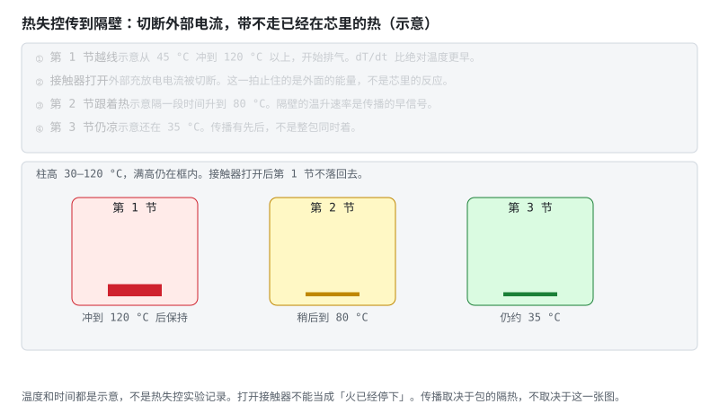
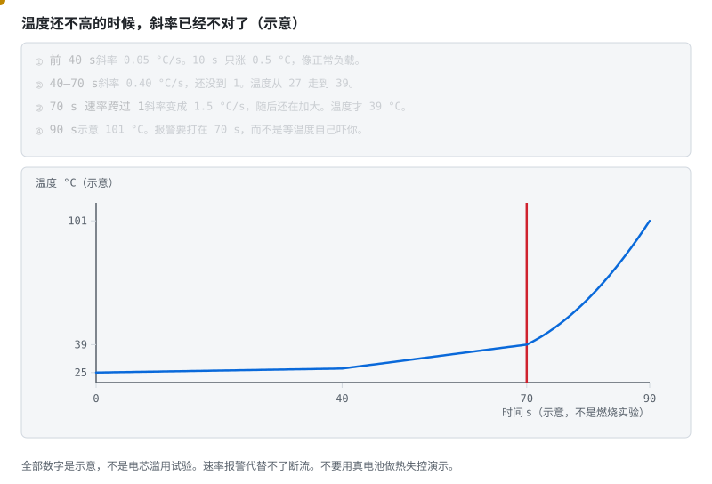
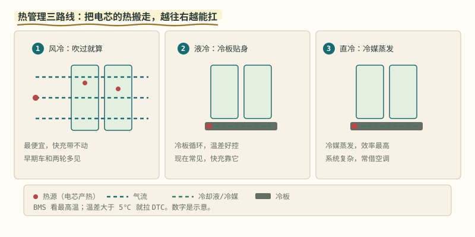
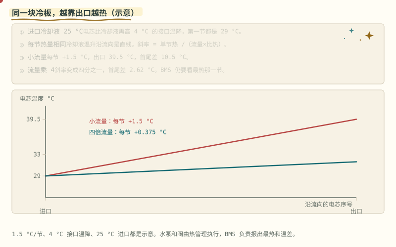

# 阶段 6 选读：EMC、并簇与热管理

做多包并联、热设计或 EMC 整改时再读。这里回答的是系统边界，不是高压合闸的第一条主线。

> **阅读边界**　这是一条短路径，不删公式、阈值和适用条件；需要旁支时再打开文末选读。

## 6.1.4 EMC 与热失控防护 [分析]

- 采样链是模拟小信号，功率回路是 du/dt、di/dt 的噪声源：**分区布局、采样线双绞、通信隔离**；
- 继电器线圈：吸合后降 PWM 占空比保持（经济又降温），续流二极管不能省；
- 热失控链的 BMS 对策（回看 [热失控动画](../circuits/handraw/exports/thermal-runaway.webp)）：**dT/dt 温升速率**比绝对温度更早报警；熔断器是最后手段——它是不可复位的一次性保护，选型按 $I^2t$ 与 MOS/线束的耐受曲线配合。

> **图说**　示意第 1 节从大约 45 °C 冲过 120 °C 并排气。

> **口诀**　先看谁在猛涨。切断外面的电流。别以为芯里的热会跟着接触器一起消失。

**看动画时盯住哪里**

接触器打开，外部电流被切断，芯里已经开始的反应不会因此停。第 2 节随后被烤到示意 80 °C，第 3 节还可以停在 35 °C 附近。传播有先后。打开接触器不等于火已经停下。温度不是实验记录。

- 左边那节先涨满：它已经在失控。
- 中间那节后涨：邻居。
- 右边那节还矮：传播还没走到。

**短自测**

1. 接触器已经打开，第 1 节里的反应会停下吗？
2. 为什么要看第 2 节的温升速率，而不是只看第 1 节的绝对温度？
3. 120 °C 和 80 °C 能引用成实验数据吗？

<b>参考答案（先自己想完再展开）</b>

1. 不会。切断的是外部电流。已经在芯里的热和反应还在。包的隔热决定会不会传到隔壁。
2. 第 1 节很热时往往已经晚了。隔壁开始变热，是传播的早信号。
3. 不能。它们是为了分清「已经失控、正在被烤、还凉着」三节的示意。

**练完你会怎样**：你能说明：接触器打开之后，还要继续看隔壁的温度往哪里走。

> **原理**　采样是小信号，功率回路是噪声源，所以要分区、双绞和隔离。热失控要看温升速率，不能只等绝对温度越线。
> **证据**　过充触发的热失控（析锂、刺膜、正极释氧）见 [Batteries 2025 综述](https://www.mdpi.com/2313-0105/11/7/242)（英文，可选）。
> **延伸阅读**　[瑞萨《BMS 教程》中文导读](../renesas-bms-tutorial-中文导读.md)

绝对温度还不高的时候，斜率可以已经不对了。早警打在斜率上。

> **图说**　盯住先缓、再陡、70 s 后上翘的黄点：红竖线是速率跨过 1 °C/s，不是起火的照片。

> **口诀**　先看每秒涨多少，再看此刻多少度。

**看动画时盯住哪里**

黄点先缓、再陡、70 s 之后明显上翘。红竖线是速率跨过 1 °C/s 的地方，不是起火的照片。

示意曲线，不是燃烧实验，也不要拿真电池去复现：

- $t\lt 40$ s：$T=25+0.05t$，到 40 s 是 27 °C，斜率 0.05 °C/s
- $40\le t\lt 70$：$T=27+0.40(t-40)$，到 70 s 是 39 °C，斜率 0.40 °C/s，还没到 1
- $t\ge 70$：$T=39+1.5(t-70)+0.08(t-70)^2$，斜率从 1.5 °C/s 起还在加大。90 s 时温度示意 101 °C

三段在 40 s 和 70 s 上是连上的。报警若设在「超过 1 °C/s」，它发生在 70 s，当时只有 39 °C。等到 100 °C 再喊，已经晚了一截。

速率报警代替不了断开电流。芯里已经起来的热，不会因为报文发出去就消失。

**短自测**

1. 70 s 时温度和刚跨过的斜率各是多少？
2. 为什么不能等温度本身很高再报警？

<b>参考答案（先自己想完再展开）</b>

1. 39 °C，斜率变成 1.5 °C/s。
2. 这张示意里，速率在 39 °C 就已经越过 1 °C/s。等 101 °C 是 90 s 的事。全是示意，不是滥用试验。

**练完你会怎样**：你写热失控早警时，会同时看绝对温度和温升速率，并且知道断流仍然必须在包上完成。

## 6.1.5 并簇与环流：两包并联时 BMS 多管什么 [分析]

储能常把多簇（或多包）并联扩容。电压不完全相等时，合闸瞬间会出现**环流**——电流在包与包之间窜，不经过负载，却能把接触器、线束和弱包打坏。

BMS / 系统侧最低要求：

1. **合闸前电压对齐**：簇间压差大于阈值（常见几十伏量级，按系统定）时禁止并簇；必要时先经预充/限流支路缓慢均压；
2. **每簇独立断路**：各簇有自己的接触器/熔断器，一簇故障可隔离，不拖死整柜；
3. **主从或协调层**：有一个能量管理/主控汇总各簇 SOC、SOP、故障，统一对 PCS 报"整柜允许功率"——单簇 SOP 简单相加在压差大时是错的；
4. **环流监测**：并簇母线上的异常电流（负载电流对不上各簇电流之和）要进故障策略。

并簇把"单包 BMS"升级成"多代理协调"——算法与通信都从板级问题变成系统问题。

> **图说**　盯住两簇之间那条不经过负载的电流：压差落在很小的电阻上，对冲电流可以很大。

> **口诀**　两簇压差落在很小的电阻上，对冲电流可以很大。

环流的账用示例值算一遍：1.5V 压差落在毫欧级的回路阻抗上，合闸瞬间就是几百安——不经过负载，全烧在接触器和线束上。所以第 1 条"先比压、再合闸"不是流程洁癖，是保命。

> **原理**　储能常把多簇（或多包）并联扩容。电压不完全相等时，合闸瞬间会出现**环流**——电流在包与包之间窜，不经过负载，却能把接触器、线束和弱包打坏。
> **证据**　可核验演示：本节 SVG（浏览器打开即播），正文有不看动画也能读的说明。两包压差落在毫欧级连接上，环流可以到很大。架构参考 [ENNOID-BMS](https://github.com/EnnoidMe/ENNOID-BMS)（英文，可选）。本节数字是示例。
> **延伸阅读**　[《车用 BMS 功能安全设计方法论》](https://www.mdpi.com/1996-1073/14/21/6942)（英文，可选）

**短自测**

1. 两簇差 1.5 V，合闸瞬间电流为什么可以很大？
2. 各簇 SOP 能直接相加交给 PCS 吗？

<b>参考答案（先自己想完再展开）</b>

1. 压差落在毫欧级的连接上。电流不经过负载，烧在接触器和线束上。示例是数量级，阈值按系统定。
2. 压差大的时候不能。要有一层汇总，先对齐电压再并。

**练完你会怎样**：并簇之前你会先比电压，不先合闸。

## 6.1.6 BMS 与热管理（TMS）的边界 [评价]

BMS **不是**热管理系统，但热管理离开 BMS 的温度/功率信息几乎没法干活。边界划清，两边都不会越权：

| 谁 | 管什么 | 不管什么 |
|---|---|---|
| **BMS** | 测温（多点 NTC）、按温度降额 SOP、低温禁充/高温禁充放、dT/dt 热失控预警、请求"需要加热/需要制冷" | 不直接驱动水泵/压缩机占空比（除非产品把 TMS 并进同一控制器） |
| **TMS** | 加热膜/液冷回路/风机的执行与闭环控温 | 不擅自改充电电流上限——必须以 BMS 的允许功率为准 |

冬天"没劲儿 / 充得慢"：往往是 BMS 因低温收紧 SOP，并置位加热请求；TMS 把电芯打到允许窗口后，BMS 再放开功率。两边抢权（TMS 猛加热而 BMS 仍按冷电池限流，或反过来）是系统集成常见坑。

散热三条路线的工程对比：

> **图说**　风冷（气流掠过电芯，最简最省但能力有限）→ 液冷（冷板贴身、冷却液循环，当前主流，2C 快充靠它）→ 直冷（空调冷媒在板内直接蒸发吸热，效率最高但系统最复杂）。

> **口诀**　风冷、液冷、直冷可以换。测温和按温度收功率不换。

**看动画时盯住哪里**

BMS 的职责在三路线下不变：T_max 告警、温差 >5℃ 拉 DTC、按温度收紧 SOP。

液冷不是整包一个温度。冷却液沿流向被捂热，下游的电芯更高：

**练完你会怎样**：你能用上面那句口诀，把这张图讲给别人听。

> **图说**　进口冷却液示意 25 °C，电芯再高 4 °C 的接口温降，所以靠进口的那一节是 29 °C。

> **口诀**　越靠出口越热。流量加大，这根斜线变平。

**看动画时盯住哪里**

每节热量相同，冷却液温升是直线，斜率等于单节热除以流量和比热。小流量每节 +1.5 °C，出口 39.5 °C，首尾差 10.5 °C。流量乘 4，斜率变成四分之一，首尾差约 2.6 °C。BMS 仍要看最热的那一节，不看平均。

- 红点和红线从进口走到出口，一路升高。
- 蓝线更平：流量是四倍，斜率是四分之一。
- 两条线在第一节重合。接口温降还在，变的是沿程那一截。

**短自测**

1. 为什么第一节的温度不随流量变？
2. 小流量时首尾差是多少？流量乘 4 呢？
3. 10.5 °C 能写成冷板的验收指标吗？

<b>参考答案（先自己想完再展开）</b>

1. 这张示意里，第一节只比进口冷却液高固定的 4 °C 接口温降。沿程温升从它后面才累加上去。
2. 10.5 °C 和约 2.6 °C。温差和流量成反比，因为每节热量没变。
3. 不能。1.5 °C/节和 4 °C 都是示意。水泵归热管理，BMS 负责报出最热和温差。

**练完你会怎样**：你布 NTC 时会在出口那一节留一个点，而不是只测冷板进口。

> **原理**　BMS 提供温度和允许功率，热管理系统负责把热量搬走或补上。两边同时改电流限值，电池会在加热和限流之间打架。
> **证据**　可核验演示：本节 SVG（浏览器打开即播），正文有不看动画也能读的说明。BMS 负责测温和降额，不负责把冷却回路设计完。寿命侧先对照 [BU-808](https://batteryuniversity.com/article/bu-808-how-to-prolong-lithium-based-batteries/)（英文，可选）。
> **延伸阅读**　[《车用 BMS 功能安全设计方法论》](https://www.mdpi.com/1996-1073/14/21/6942)（英文，可选）。固态电芯并没有取消测温和限功率，结构电池的热和力学边界在 [阶段 0 §0.1.8](stage-0-前置知识.md#018-固态电池固体电解质换掉了什么-理解)、[§0.1.9](stage-0-前置知识.md#019-碳纤维结构电池电极在承力外壳是另一件事-理解)。

---

[返回阶段 6 主线](./stage-6-主线-高压与安全.md) · [完整讲义与原有锚点](./stage-6-精通与毕业项目.md)

[选读：EMC、并簇与热管理](./stage-6-选读-系统边界.md) · [选读：故障回放与云端](./stage-6-选读-固件与云端.md) · [选读：算法、法规与自测](./stage-6-选读-算法法规与自测.md)

<!-- Generated by prepare-stage6.mjs; edit stage-6-精通与毕业项目.md. -->
